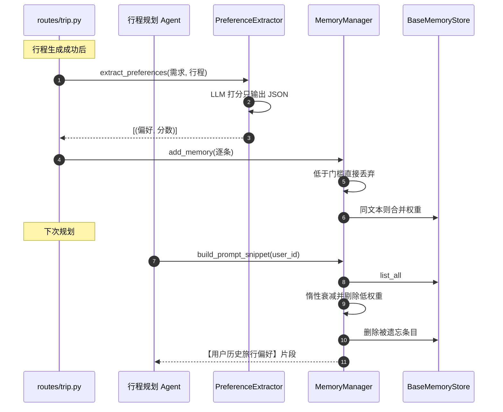

# 用户偏好记忆系统

> 所属项目：[TripStar 旅途星辰](README.md) · 本解读按 ai-agent 类规格产出 · 基线 `main`（`1dce6df`）

## 关注面定位

TripStar 的记忆不是"对话历史缓存"，而是一个**带权重的用户长期偏好库**：行程生成成功后由 LLM 从"原始需求 + 生成结果"里提炼稳定偏好并打分入库，下次规划时把高权重偏好注入 Agent 的 Prompt。它要解决的核心矛盾是——**想让推荐越用越贴合用户，又不能让注入的记忆无限膨胀把 Prompt 撑爆**。整个模块 464 行，用四道闸门回答了这个矛盾。

## 数据模型：一条记忆是什么

记忆条目是一个轻量 dataclass，字段设计直接对应"权重治理"的需求——`weight` 是排序与淘汰的唯一依据，`last_access_time` 是衰减的基准，`source` 区分来源（`explicit` 手动 / `implicit` 自动提取）（[backend/app/memory/data_model.py:8-16]()）：

<!-- anchor: class MemoryItem: … last_access_time: float -->

条目通过 `create()` 工厂生成 UUID 与初始时间戳，并提供 `update_access()` 刷新访问时间——**这个方法是双存储语义分叉的根源**（见下文「双存储的语义差异」）（[backend/app/memory/data_model.py:18-31]()）：

<!-- anchor: def create(cls, content: str, source: str, init_weight: float) -> "MemoryItem": … self.last_access_time = time.time() -->

## 四道闸门

所有阈值都通过环境变量暴露，默认值即治理策略（[backend/app/memory/memory_manager.py:13-19]()）：

<!-- anchor: DECAY_FACTOR = float(os.getenv("MEMORY_DECAY_FACTOR", "0.97")) … USE_SQLITE_PERSIST = os.getenv("MEMORY_USE_SQLITE", "false").lower() == "true" -->

| 闸门 | 机制 | 默认参数 | 作用 |
|------|------|----------|------|
| 准入 | 初始权重低于门槛直接拒收 | `MIN_INIT_WEIGHT=4.0` | 挡掉一次性的、临时的偏好 |
| 合并 | 相同文本不新增条目，而是叠加权重 | `min(10.0, w + new×0.4)` | 重复出现的偏好自然升权 |
| 遗忘 | 惰性时间衰减，低于阈值删除 | `DECAY_FACTOR=0.97/天`，`MEMORY_THRESHOLD=2.0` | 让过时偏好自动退场 |
| 召回 | 权重降序 + TOP-K + 单条长度截断 | `MAX_RECALL=10`，`MAX_SINGLE_CONTENT=120` | 硬性锁死注入 Prompt 的体积 |

### 准入与合并：用"打分"代替"全部记住"

自动提取路径由 `PreferenceExtractor` 完成，它**刻意不走 Agent**，而是用 `httpx` 直连 OpenAI 兼容接口——注释写明理由是"避免额外开销"。[backend/app/memory/preference_extractor.py:3-4]()
<!-- anchor: 复用项目 chat_service 的 LLM 直连方式（httpx 调用 OpenAI 兼容接口）， … 不依赖 hello_agents 的 Agent 机制，避免额外开销。 -->

Prompt 的关键约束是"只提取长期稳定偏好，临时目的地、单次短期安排不要提取"，并要求输出 `[{content, score}]` 的纯 JSON 数组（[backend/app/memory/preference_extractor.py:16-18]()）：

<!-- anchor: EXTRACT_PROMPT = """你需要从用户出行需求和最终生成的旅行行程中，提炼用户稳定旅行偏好。 … 1. 只提取长期稳定偏好，临时目的地、单次短期安排不要提取 -->

两个细节体现了成本意识。其一，行程正文只截取前 6000 字符送进提取 Prompt：[backend/app/memory/preference_extractor.py:76-77]()
<!-- anchor: prompt = EXTRACT_PROMPT.format( … user_query=user_query, trip_content=trip_content[:6000] -->

其二，打分低于 `MIN_INIT_WEIGHT` 的结果**在提取器里就被丢掉**，根本走不到存储层：[backend/app/memory/preference_extractor.py:124-133]()
<!-- anchor: filtered: List[Tuple[str, float]] = [] … return filtered -->

提取本身是**纯尽力而为**的：没有 API Key 直接返回空列表、调用异常返回空列表、JSON 解析失败也返回空列表——记忆提取失败绝不影响主流程：[backend/app/memory/preference_extractor.py:72-74]()
<!-- anchor: if not cfg["api_key"]: … return [] -->

这是长任务系统里正确的失败姿态。

手动路径走另一个权重口径：设置页手动添加的偏好初始权重固定 **8.5**，显著高于自动提取（后者通常 4~8）（[backend/app/api/routes/memory_routes.py:32-38]()）：

<!-- anchor: """用户手动添加偏好（explicit，初始权重 8.5，高于自动提取）""" … user_id=user_id, content=content, source="explicit", init_weight=8.5 -->

**这个"人工权重高于机器权重"的默认选择值得注意**：它意味着用户显式表达的偏好更难被遗忘，而模型推断的偏好更容易自然淘汰——把"人的确定性"排在"模型的猜测"之前，是一个朴素但正确的优先级判断。

合并逻辑用**精确文本相等**判定重复，并按 `init_weight × 0.4` 的折扣叠加，上限硬编码 10.0（[backend/app/memory/memory_manager.py:91-102]()）：

<!-- anchor: all_items = await self.store.list_all(user_id) … return -->

折扣系数 0.4 是一次"递减收益"设计：同一偏好反复出现会升权但升得越来越慢，避免一条口头禅式的偏好迅速顶到上限而霸占全部召回名额。

### 惰性遗忘：不引入定时任务

遗忘不在后台跑调度器，而是**在每次读取时按时间差一次性结算**——读取时计算 `delta_days`，把权重乘以 `DECAY_FACTOR ** delta_days`，低于阈值的收集起来批量删除（[backend/app/memory/memory_manager.py:41-62]()）：

<!-- anchor: async def _apply_forget_and_filter( … return valid_items, to_remove_ids -->

选择 `0.97` 的日衰减意味着权重约 **23 天衰减到一半**（`0.97^23 ≈ 0.5`）、从 8.5 掉到 2.0 门槛需要约 **47 天**；从自动提取的 4.0 起步则约 **23 天**即被遗忘。这套参数的实际效果是"一个多月不出现的偏好自动退场"，无需任何清理任务。

**惰性结算的取舍**：省掉了调度器与后台资源，代价是衰减只在有读取请求时才发生——对 TripStar 这种"用户来规划才读记忆"的场景完全够用；但如果换成需要"按时间主动过期"的语义（如验证码、租约），惰性方案就不适用。

### 召回与注入：双层体积防护

召回先做衰减过滤与删除，再按权重降序取 TOP-K（[backend/app/memory/memory_manager.py:64-78]()）：

<!-- anchor: async def recall_user_memory(self, user_id: str) -> List[MemoryItem]: … return top_k_items -->

Prompt 组装则是**第二层防护**：即使 TOP-K 已经是 10 条，每条内容仍会被截断到 120 字符，最终拼成带标题的列表（[backend/app/memory/memory_manager.py:111-123]()）：

<!-- anchor: async def build_prompt_snippet(self, user_id: str) -> str: … snippet = "【用户历史旅行偏好】\n" + "\n".join(lines) -->

因此注入体积有一个**可计算的上界**：约 `10 × 120` 字符加上固定标题——不会随用户使用时长增长。相比"把所有历史偏好塞进 system prompt"的常见做法，这是把不确定性关进笼子的正面案例。

注入点是编排层的 `memory_snippet`，仅在 `ENABLE_USER_MEMORY=true` 时读取，并按前端生成的 `user_id` 隔离（[backend/app/agents/trip_planner_agent.py:522-531]()）：

<!-- anchor: memory_snippet = "" … memory_snippet = "" -->

## 双存储的语义差异

存储层抽了一个只含四个方法的抽象基类（save / list_all / delete / clear），内存与 SQLite 两个实现都必须遵守（[backend/app/memory/base.py:8-12]()）：

<!-- anchor: class BaseMemoryStore(ABC): … async def save(self, user_id: str, item: MemoryItem) -> None: -->

选择由环境变量 `MEMORY_USE_SQLITE` 在构造时决定（[backend/app/memory/memory_manager.py:27-33]()）：

<!-- anchor: if USE_SQLITE_PERSIST: … logger.info("Memory module enabled: using in-memory storage") -->

**这里存在一个值得警惕的跨实现语义差异**。`recall_user_memory` 只把"被遗忘的条目"写回存储，**从不保存衰减后的权重与刷新后的访问时间**（[backend/app/memory/memory_manager.py:66-70]()）：

<!-- anchor: all_items = await self.store.list_all(user_id) … await self.store.delete(user_id, mid) -->

由此两个实现的行为分叉：

- **内存存储**：`list_all` 返回的是**存储中的对象本身**（[backend/app/memory/in_memory_store.py:16-17]()），因此 `_apply_forget_and_filter` 里的 `weight *=` 与 `update_access()` 实际改写了库中对象的字段 → 衰减被写回、访问时间被刷新，等效于"被召回即续期"。

  <!-- anchor: async def list_all(self, user_id: str) -> List[MemoryItem]: … return list(self._storage.get(user_id, {}).values()) -->

- **SQLite 存储**：`list_all` 从行数据**新建** dataclass 对象（[backend/app/memory/sqlite_store.py:49-61]()），衰减与访问刷新只作用在临时副本上，随即被丢弃 → 每次召回都从"上次写入时的 `last_access_time`"重新衰减，**读取永远不会为记忆续期**。

  <!-- anchor: async def list_all(self, user_id: str) -> List[MemoryItem]: … return res -->

后果是：同一份偏好数据在默认内存模式下"越常被用越长寿"，切到 SQLite 后变成"只按最后写入时间衰减、用得再多也会到期消失"。**这是隐性的行为变更，且不会有任何报错**——对以"记忆持久化"为目的而打开 `MEMORY_USE_SQLITE` 的用户来说，这个差异是反直觉的。修复方向也很明确：召回后把衰减/续期结果 `save` 回存储，或在 SQLite 实现里显式 UPDATE 这两列。

## 管理接口与开关

记忆模块有一组独立的管理 API，全部受 `ENABLE_USER_MEMORY` 门控（默认 `false`），未开启时统一返回 `code 400` 而不是 500——把"功能未启用"与"服务异常"区分开了（[backend/app/api/routes/memory_routes.py:10-19]()）：

<!-- anchor: ENABLE_MEMORY = os.getenv("ENABLE_USER_MEMORY", "false").lower() == "true" … memory_list = await mm.recall_user_memory(user_id) -->

| 接口 | 语义 |
|------|------|
| `GET /api/memory/list` | 列出有效记忆（已执行遗忘衰减 + TOP-K） |
| `POST /api/memory/add-explicit` | 手动添加偏好，初始权重 8.5 |
| `DELETE /api/memory/item` | 删除单条 |
| `DELETE /api/memory/clear` | 清空该用户全部记忆 |

列表接口直接复用 `recall_user_memory`，因此**用户看到的正是模型会看到的**（同一套衰减与 TOP-K 规则），不存在"设置页显示的偏好"与"实际注入的偏好"不一致的问题——这种"管理视图与生效视图同源"的设计能省掉一整类难以排查的困惑。

## 全局关联

记忆系统在整条链路里是一个**闭环的尾部与头部**：`routes/trip.py` 在行程成功生成后触发提取（写入），编排层在下次规划开始时注入（读取）。它对外依赖极轻——只依赖一个 `user_id`（前端生成并本地持久化）与 LLM 的 JSON 输出，不依赖地图或小红书任何环节，因此可以独立开关而不影响主链路。它与[数据模型](data-model.md)共享唯一一张业务表 `user_memory`，与[异步任务系统](async-task-system.md)共享"尽力而为、不阻塞主流程"的容错哲学。

## 设计取舍与不足

**可借鉴之处**

- **用"权重 + 阈值 + 衰减 + TOP-K + 截断"五件套把记忆体积锁死在上界内**，而不是靠"定期清理"或"人工删除"维持 Prompt 卫生。
- **惰性衰减避免引入调度器**：在"读时才需要"的场景里，这是零运维成本的最优解。
- **人工权重（8.5）高于模型打分**，把用户显式意图排在模型推断之前。
- **提取是纯尽力而为**：任何失败都返回空列表，绝不把记忆模块的故障传染给行程生成。
- **管理视图与注入视图同源**，避免"设置里看得到但没生效"的错觉。

**不足与风险**

- **双存储语义不一致**（见上文）：内存模式召回即续期，SQLite 模式读取不续期，且静默无告警。这是本模块最需要修的问题。
- **合并依赖精确文本相等**，没有语义相似度：`"偏爱小众自然景点"` 与 `"喜欢小众自然风光"` 会存成两条独立记忆，各自占一个召回名额。在没有任何向量检索的前提下这是必然的简化，但也意味着同一个偏好反复以不同措辞出现时，召回名额会被同义条目稀释。
- **TOP-K 是纯权重排序，没有相关性维度**：召回不参考本次旅行的目的地、季节或交通方式，注入的 10 条偏好可能与当前行程毫不相关（例如去日本却注入"国内民宿偏好"）。加入"目的地/场景相关性"过滤是明显的下一步。
- **无记忆数量上限**：准入与遗忘控制的是"注入量"，但存储层对单个用户的条目总数没有上限；在长期只增不减（且 SQLite 模式衰减不生效）的情况下，`list_all` 会逐渐变慢。
- **SQLite 路径缺少索引与迁移**：`user_memory` 只有 `memory_id` 主键，没有 `user_id` 索引，而每次读取都按 `user_id` 过滤；同时反序列化用 `MemoryItem(**dict(row))` 严格匹配列数，未来给表加列会直接抛 `TypeError`（详见[数据模型](data-model.md)）。
