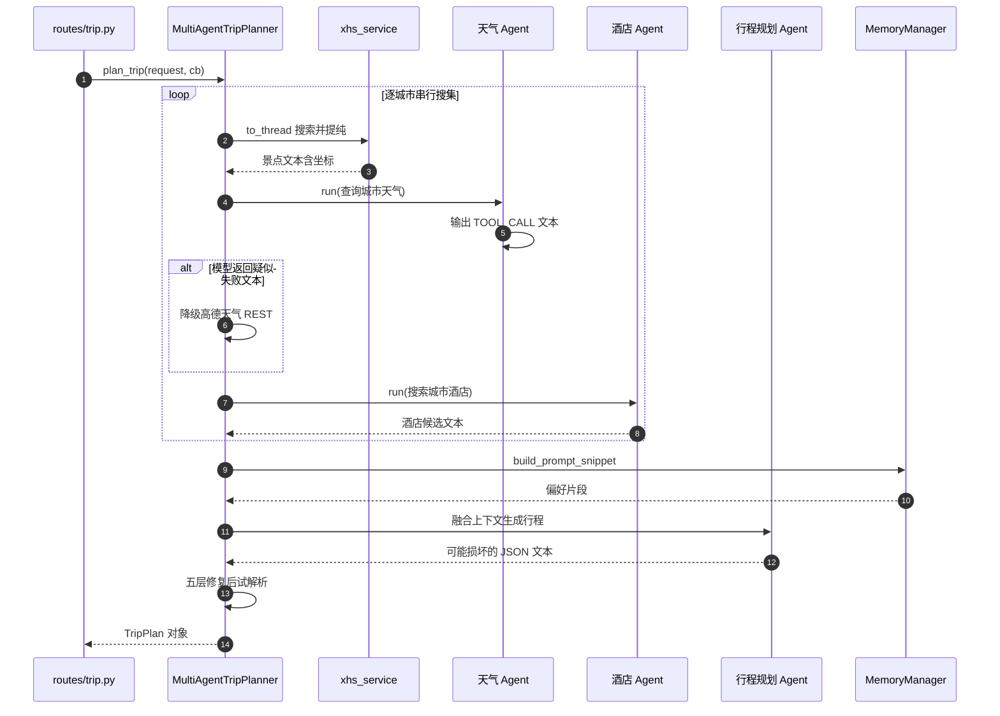

# 多智能体编排与工具调用

> 所属项目：[TripStar 旅途星辰](README.md) · 本解读按 ai-agent 类规格产出 · 基线 `main`（`1dce6df`）

## 关注面定位

TripStar 的编排层只有 1134 行、一个类，却承载了整条业务主链：**Agent 组装 → 逐城市信息搜集 → Prompt 融合 → 模型输出解析**。这一篇要回答的是：三个 Agent 各自凭什么能力干活、工具是怎么被"看见"和调用的、为什么串联顺序是这样、以及当模型不听话时系统靠什么活下来。

## Agent 的组成：三个分工明确的角色

编排队列由一个类集中持有，`MultiAgentTripPlanner` 在构造时按"地图供应商"分支初始化工具，再创建三个 `SimpleAgent`（[backend/app/agents/trip_planner_agent.py:180-181]()）：

<!-- anchor: class MultiAgentTripPlanner: -->

三个角色里，**天气与酒店 Agent 持有工具**（`add_tool`），**行程规划 Agent 刻意不持有任何工具**——它的职责是把已经搜集好的上下文做融合推理，而不是再去调外部接口：

[backend/app/agents/trip_planner_agent.py:212-217]()
<!-- anchor: self.weather_agent = SimpleAgent( … self.weather_agent.add_tool(self._active_tool) -->

[backend/app/agents/trip_planner_agent.py:228-233]()
<!-- anchor: # 创建行程规划Agent(不需要工具) … system_prompt=PLANNER_AGENT_PROMPT -->

更值得注意的是**景点搜索根本没有被做成 Agent**：源码里保留了 `ATTRACTION_AGENT_PROMPT = ""  # 已弃用，景点改走小红书`，注释明确写着"取消高德景点 Agent，改用原生小红书服务"。也就是说，项目在演进中把"景点"从 Agent 能力里摘了出去，改为在编排层直接调用一个确定性函数。这个取舍很务实——**景点抽取需要的是"抓取 + 提纯"的确定性流程，而不是让 Agent 自主决定要不要调工具**，去掉这一层反而减少了一次模型往返和一类失败模式。

## 工具调用：文本协议而非原生 function calling

这是本项目最有辨识度、也最值得讨论的设计。工具调用**不走 OpenAI 原生 `tools` 字段**，而是约定一种单行文本协议，由模型"原样输出"、再由工具适配器正则解析：

[backend/app/agents/trip_planner_agent.py:22-31]()
<!-- anchor: tool_name = f"{tool_prefix}_maps_weather" … `[TOOL_CALL:{tool_name}:city=城市名]` -->

System Prompt 里用近乎强制的措辞要求模型"只能而且必须原样输出这个名字"，并给出 few-shot 示例。**为什么这样设计、代价是什么？**

- **Why（框架约束）**：项目构建在 HelloAgents 的 `SimpleAgent` 之上，该框架的 Agent 循环以文本协议驱动工具执行；`MCPTool` 与自建工具适配器都实现了 `run(input_data)` 这一入口。要接入框架，就必须产出框架能识别的调用格式。
- **Why（可移植性）**：文本协议不依赖特定厂商的 `tools`/`tool_choice` 支持，只要模型能遵循格式，任何"兼容 OpenAI 格式"的服务商都能跑——这与项目"推荐使用兼容 OpenAI 格式的服务商"的定位一致。
- **代价**：可靠性由**模型遵循格式的意愿**决定，而非由 API 的结构化约束保证。因此才有 System Prompt 里反复强调格式、以及 `_dispatch` 把所有异常都转成字符串返回而不是抛出（[backend/app/agents/trip_planner_agent.py:361-363]()）——**工具错误被当作"观察结果"回注给模型**，让 Agent 有机会自我纠正，而不是让整条链路崩掉。

<!-- anchor: return f'未知的 Google Maps 工具: {tool_name}' … return f'Google Maps 工具调用失败: {e}' -->

## 两种工具接入方式：MCP stdio 与鸭子类型适配器

`_active_tool` 按供应商指向两个完全不同的实现，这是编排层最体现"务实"的地方。

**高德走 MCP**：直接使用框架的 `MCPTool`，以 `uvx amap-mcp-server` 子进程作为 MCP 服务端，Key 通过 `env` 注入，`auto_expand=True` 让子工具自动展开为独立工具（[backend/app/agents/trip_planner_agent.py:249-257]()）：

<!-- anchor: self.amap_tool = MCPTool( … self._active_tool = self.amap_tool -->

**Google 走手写鸭子类型适配器**：Google Maps 没有现成 MCP Server，项目没有去包装一个 stdio 服务，而是就地写了一个 `GoogleMapsNativeTool` 内部类。它**不继承任何基类**，靠鸭子类型模拟 `MCPTool` 的接口契约（`name` / `description` / `expandable` / `_available_tools` / `get_expanded_tools` / `run`），从而被框架的 ToolRegistry 当作 MCP 工具展开：

[backend/app/agents/trip_planner_agent.py:267-288]()
<!-- anchor: class GoogleMapsNativeTool: … {"name": "google_maps_geo", "description": "Google 地理编码"}, -->

`get_expanded_tools()` 为三个子工具各生成一个 `_SubTool` 外壳，外壳的 `run` 直接委托给父对象——这让框架看到的"三个工具"实际共享同一分发入口（[backend/app/agents/trip_planner_agent.py:291-307]()）：

<!-- anchor: def get_expanded_tools(self): … return [_SubTool(t["name"], t["description"]) for t in self._available_tools] -->

`run()` 同时接受**字典**（框架内部调用路径）和**文本**（模型输出的 `[TOOL_CALL:...]`）两种输入，后者用一条正则拆出工具名与 `key=value` 参数：

[backend/app/agents/trip_planner_agent.py:316-333]()
<!-- anchor: # 解析 [TOOL_CALL:google_maps_xxx:key=val,...] 格式 … return self._dispatch(tool_name, arguments) -->

这个适配器的设计价值在于：**它把一个"框架不认识的服务"伪装成框架已有的扩展点，而不是去改框架或引入新的扩展机制**。代价是接口契约靠约定而非类型系统保证——一旦 hello_agents 变更 `MCPTool` 的内部契约（如 `_available_tools` 结构），这个适配器会静默失效。作者的注释把这一权衡写清楚了。

## 主链路：逐城市串行搜集

`plan_trip()` 的结构是"**按城市循环 → 城内三件事 → 全部完成后统一规划**"。循环体内依次完成景点、天气、酒店搜集，每一步都通过 `asyncio.to_thread` 把同步的 Agent 调用丢到线程池（Agent 与 requests 都是同步的），并在之前回调一次进度：

[backend/app/agents/trip_planner_agent.py:460-476]()
<!-- anchor: for idx, city_stay in enumerate(cities): … attraction_response = await asyncio.to_thread( -->

**进度条是按城市切片的**：每进入一个城市先算出该城市的进度基准 `progress_base = int(10 + (idx / total_cities) * 65)`，再按三段（景点/天气/酒店）均分步长，从而让多城市行程的进度线性推进而不是跳变。

进度回传本身也做了兼容设计——`_emit_progress` 通过 `asyncio.iscoroutine` 判断回调是同步还是异步实现，两种都支持（[backend/app/agents/trip_planner_agent.py:376-380]()）：

<!-- anchor: if progress_callback is None: … await result -->

**这里必须纠正一处 README 与源码的偏差**：README 的时序图把景点/天气/酒店标注为 `asyncio.gather` 并发阶段，但全仓库不存在任何 `asyncio.gather` 调用，实际是严格的串行 `await`。多城市行程的耗时因此随城市数线性增长——每次规划要串行等待"抓取小红书 + 两次 Agent 往返"，这是当前架构最主要的性能瓶颈，也是最容易改进的地方（三个城市的搜集彼此完全独立，天然可并发）。

## 降级设计：天气与地理编码的两条独立路径

链路里埋了两条互不相关的降级，都遵循"**失败就换一条确定性通路**"的思路。

天气降级发生在 Agent 返回**疑似失败文本**时：编排层用一组关键词（`无法`/`失败`/`错误`/`error`/`unknown`/`抱歉`/`sorry`）判断模型是否"没查到"，命中则绕过 MCP Agent，直接用 `httpx` 打高德天气 REST：

[backend/app/agents/trip_planner_agent.py:492-496]()
<!-- anchor: _weather_fail_keywords = ("无法", "失败", "错误", "error", "unknown", "抱歉", "sorry") … weather_response = await self._fallback_amap_weather(city) -->

降级函数还处理了一个具体的脏数据问题：请求里的城市名常带国家/省份前缀（如 `中国-北京`），而高德天气 API 严格要求城市名或 adcode，于是代码取最后一段再做查询（[backend/app/agents/trip_planner_agent.py:393-399]()）：

<!-- anchor: # 很多时候 request.city 会带有国家/省份前缀，例如 "中国-北京" … params = {"key": amap_key, "city": clean_city, "extensions": "all", "output": "JSON"} -->

**用关键词嗅探"模型是否失败"是这套方案里最脆弱的一环**：它把语义判断退化成了字符串匹配，模型换一种说法（如"该城市暂无数据"）就会漏判。但在没有结构化错误码可用的文本协议下，这是一个成本极低的务实选择。

另一条降级在 `map_dispatcher`（地理编码），见 [`map-provider.md`](map-provider.md)。

## 规划阶段：上下文融合、超时重试与语言注入

搜集完成后进入统一规划。`_build_planner_query` 把每个城市的景点/天气/酒店文本按城市分段拼进 Prompt，多城市时额外追加一套要求（`city` 字段、`is_transfer_day` 标记、城际交通预算字段）：

[backend/app/agents/trip_planner_agent.py:709-717]()
<!-- anchor: if is_multi_city: … 6. "cities" 数组列出所有途经城市名称 -->

Prompt 里还有一处值得学的约束：**明确禁止模型编造不可验证的信息**——"禁止编造具体车次、班次号、出发时间、到达时间等不可验证的信息"，只允许给交通方式与大致时长。这是在 LLM 应用里少见的、主动为幻觉划边界的 Prompt 设计。

**语言注入放在最后一段**，指示模型翻译所有文字类 value 而保持 JSON key 不变（[backend/app/agents/trip_planner_agent.py:724-730]()）：

<!-- anchor: _lang = (getattr(request, 'language', 'zh') or 'zh').strip().lower().split('-')[0] … JSON 的 key 名称保持英文不变，只翻译 value 中的文字。""" -->

规划调用有**超时保护与一次重试**：超时阈值由 `TRIP_PLANNER_TIMEOUT` 环境变量控制（默认 180 秒），且只对超时类错误重试，其他异常直接向上抛：

[backend/app/agents/trip_planner_agent.py:596-604]()
<!-- anchor: timeout = int(os.getenv("TRIP_PLANNER_TIMEOUT", "180")) … temperature=0.2, -->

[backend/app/agents/trip_planner_agent.py:606-611]()
<!-- anchor: except Exception as exc: … print("⚠️  首次行程规划超时，正在重试一次...") -->

重试时会在原 Query 上追加一句"信息不足就用保守可执行的建议补齐，但必须输出完整合法 JSON"——**重试不是原样重放，而是带着更强的格式约束再试**。`temperature=0.2` 也是同一取向：牺牲多样性换取结构稳定性。

## 模型输出治理：五层本地修复 + LLM 兜底

这是整个编排层工程量最大、也最通用的部分。行程是一个深嵌套对象（城市 → 日 → 景点/餐饮/酒店 → 预算），而模型输出会以多种方式损坏。项目把"坏 JSON"拆成若干可独立处理的病理，逐个用确定性代码修复，最后才动用模型：

| 病理 | 修复手段 |
|------|----------|
| 代码块包裹、JS 注释、控制字符、尾逗号、全角标点 | 正则清洗 `_sanitize_json_str` |
| 数值字段被写成算术式（`30+54+120=324`） | 正则捕获表达式，取等号右侧或安全 `eval` |
| 字符串值内未转义双引号 | 手写状态机扫描引号，判断后随字符是否为结构符 |
| 被 `max_tokens` 截断 | 关闭未终止字符串 + 剔除尾部碎片 + 用栈补齐括号 |
| 以上全失败 | 只发首尾片段请 LLM 补全，温度 0 |

四层本地修复各有独立入口，可分别理解与测试：

- 清洗（去代码块/注释/控制字符/尾逗号/全角标点）：[backend/app/agents/trip_planner_agent.py:734-771]()
<!-- anchor: def _sanitize_json_str(self, json_str: str) -> str: … json_str = _re.sub( -->
- 算术式数值字段修复：[backend/app/agents/trip_planner_agent.py:757-767]()
<!-- anchor: def _fix_arithmetic_expr(m): … return m.group(0).replace(m.group(1), str(result)) -->
- 未转义引号状态机：[backend/app/agents/trip_planner_agent.py:810-822]()
<!-- anchor: # 看下一个非空白字符是否是 JSON 结构字符 … result.append("'") -->
- 截断修复的括号栈：[backend/app/agents/trip_planner_agent.py:888-908]()
<!-- anchor: for ch in s: … closing = [']' if c == '[' else '}' for c in reversed(stack)] -->
- LLM 兜底补全：[backend/app/agents/trip_planner_agent.py:917-918]()
<!-- anchor: tail = broken_json[-2000:] if len(broken_json) > 2000 else broken_json -->

其中"全角引号必须换成单引号而非双引号"是一个容易被忽略的正确性细节：中文双引号通常出现在 JSON 字符串**值内部**，若替换成标准双引号会直接破坏结构，所以作者替换为单引号并写了注释说明原因。

最终解析把上述修复编排成**候选列表 + 依次试解析**，任一试通即返回，全部失败才走 LLM 兜底：

[backend/app/agents/trip_planner_agent.py:1032-1038]()
<!-- anchor: for attempt_name, candidate in parse_attempts: … return TripPlan(**data) -->

这套设计的原则可以一句话概括：**把"模型可能不听话"当作常态而非异常，用确定性的本地代码吸收绝大多数抖动，把昂贵的模型兜底留到最后**。它比"失败就重试整条链路"省得多，也比"只 try/except 一次"稳得多。

## 编排的宿主与生命周期

编排器是**进程内单例**，并通过一个显式的重置函数支持运行时热生效（[backend/app/agents/trip_planner_agent.py:1120-1133]()）：

<!-- anchor: def get_trip_planner_agent() -> MultiAgentTripPlanner: … _multi_agent_planner = None -->

设置页保存新 Key 后会依次重置 LLM、地图服务、地理编码失败标志与编排器，使新配置立刻生效而无需重启进程（[backend/app/api/routes/settings.py:49-53]()）：

<!-- anchor: reset_llm() … reset_trip_planner_agent() -->

LLM 层另有一个专门的适配器 `DirectOpenAILLM`，它**绕开框架的 LLM 封装**，理由是"避免 HelloAgentsLLM 构造阶段自动继承系统代理"——因为项目的 Google Maps 代理只应作用于 Google 请求，不能被 LLM 误继承。[backend/app/services/llm_service.py:26-27]()
<!-- anchor: class DirectOpenAILLM: … """轻量 LLM 适配器，避免 HelloAgentsLLM 构造阶段自动继承系统代理。""" -->

实现上它强制 `trust_env=False` 并清理系统代理环境变量，同时把默认的流式响应拼回纯文本以兼容框架的同步 `invoke` 语义。[backend/app/services/llm_service.py:68-79]()
<!-- anchor: if stream: … return "".join(content_parts) -->

## 全局关联

编排层是整个系统的**唯一业务中枢**，它同时耦合了四个关注面：通过 `search_xhs_attractions` 依赖[小红书采集链路](xhs-integration.md)拿到带坐标的景点文本；通过 `_active_tool` 依赖[地图供应商调度](map-provider.md)决定用哪套 POI/天气能力；通过 `MemoryManager.build_prompt_snippet` 依赖[偏好记忆系统](memory-system.md)注入历史偏好（[backend/app/agents/trip_planner_agent.py:522-531]()）；最终产出交给[异步任务系统](async-task-system.md)推送、交给[知识图谱](knowledge-graph.md)构图。

<!-- anchor: memory_snippet = "" … memory_snippet = "" -->

这种"中枢耦合一切"的结构优点是链路短、调试直观；代价是编排层成了所有外部依赖的汇聚点，任一下游的接口变更都会波及这里。

## 设计取舍与不足

**可借鉴之处**

- **用鸭子类型适配器把"框架不认识的服务"接进既有扩展点**，而不是改框架或引入新机制——迁移到任何插件化框架都适用。
- **工具错误返回字符串而非抛出**，让错误成为模型的观察输入，保留自我纠正机会。
- **脏输出修复链按病理分层**，每层可单独测试、可单独失效，比单一大函数可维护得多。
- **重试携带更强的约束**（追加"必须输出完整合法 JSON"），而非原样重放。
- **在 Prompt 里显式禁止编造不可验证信息**（车次/班次/时刻），是主动治理幻觉的正面案例。

**不足与风险**

- **README 声称并发、实现是串行**（见上文），多城市耗时线性增长；三城搜集彼此独立，具备直接并发的条件。
- **文本协议工具调用的可靠性依赖模型遵循格式**，且失败嗅探靠关键词匹配；换成结构化 function calling 或让工具返回结构化错误码会更稳。
- **遗留了高德景点 Agent 时代的死代码**：`_build_attraction_query` 仍在拼 `[TOOL_CALL:amap_maps_text_search:...]` 查询串，但景点已改走小红书，全仓库无调用点。[backend/app/agents/trip_planner_agent.py:566-577]()
<!-- anchor: def _build_attraction_query(self, request: TripRequest) -> str: … return query -->
- **兜底计划生成器被写好却未接线**：`_create_fallback_plan` 能在 Agent 彻底失败时产出一份日期骨架完整的降级行程，但没有任何调用点，导致模型反复失败时只能整个任务失败。[backend/app/agents/trip_planner_agent.py:1069-1070]()
<!-- anchor: def _create_fallback_plan(self, request: TripRequest) -> TripPlan: … """创建备用计划(当Agent失败时)""" -->
- **无最大步数 / token 预算控制**：编排层没有对工具调用轮次或上下文长度设上限，约束完全交给框架与 Prompt；长行程（30 天上限）下的上下文膨胀缺少显式防线。
- **该项目的 Skill 体系与 ACP 宿主接入均不适用**：无 Skill 概念，也非对外的 client–agent 服务，属纯库内编排——按 ai-agent 规格此处标注不适用，不硬凑。
