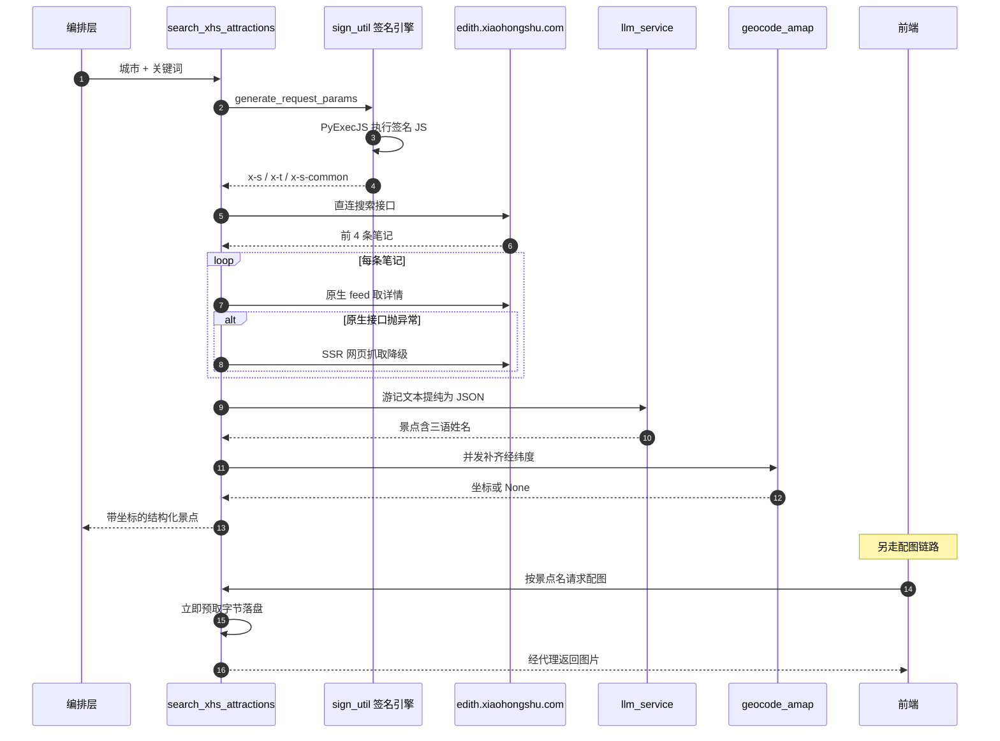

# 小红书数据采集链路

> 所属项目：[TripStar 旅途星辰](README.md) · 本解读按 ai-agent 类规格产出 · 基线 `main`（`1dce6df`）

## 关注面定位

TripStar 最大的差异化不在编排，而在**数据源头**：它的景点推荐不是来自通用 POI 库，而是从小红书真实用户游记里提纯出来的。这条链路要同时解决三类硬问题——**反爬签名**（怎么合法地把请求发出去）、**内容提纯**（怎么把散文式游记变成结构化景点）、**资源代理**（怎么让带防盗链和时效签名的图片在浏览器里显示）。三者环环相扣，也是全项目工程量最集中的地方（`xhs_service.py` 759 行 + 签名引擎 148 行）。

## 签名层：把风控问题变成工程依赖问题

项目最初的方案是依赖第三方 `xhs` Python 库，结果遭遇 `300011 账号异常` 风控误杀。最终解法是**自带 JS 签名引擎**：把小红书的签名逻辑作为静态资源随仓库携带，用 PyExecJS 调 Node.js 执行，生成 `x-s` / `x-t` / `x-s-common` 三个核心签名头，再直连 API。

签名能力在模块**导入时**就编译进内存（而非每次请求重新编译），这是热点路径上的必要优化（[backend/app/services/xhs_sign/sign_util.py:28-35]()）：

<!-- anchor: _xs_js_path = os.path.join(_SIGN_DIR, "xhs_xs_xsc_56.js") … _xray_js_code = f.read() -->

三个跨平台兼容处理很能说明"在别人的运行时里执行代码"有多少暗坑：

- **非 ASCII 转义**：把 JS 源码里的中文统一转成 `\uXXXX` 再交给 execjs。注释写明原因是 Windows 的 stdin 管道会按系统代码页（如 cp932）编码，直接喂中文会触发 `UnicodeEncodeError`（[backend/app/services/xhs_sign/sign_util.py:20-25]()）：

<!-- anchor: def _compile_js(js_code: str): … return execjs.compile(encode_unicode_codepoints(js_code)) -->

- **`require` 路径重写**：execjs 从 stdin 执行时工作目录不定，相对 `require` 会找不到包，因此用正则把 xray 脚本里的相对引用改写成绝对路径（[backend/app/services/xhs_sign/sign_util.py:37-45]()）：

<!-- anchor: # 动态替换JS中的相对路径require为绝对路径，防止execjs从stdin执行时找不到包 … _xray_js = _compile_js(_xray_js_code) -->

- **Cookie 归一化**：小红书 Cookie 可能是请求头字符串、浏览器导出的 JSON 数组，或单个 JSON 对象；`normalize_xhs_cookie` 统一转成 `k=v; k=v` 形式，并处理整体被引号包裹的粘贴习惯（[backend/app/services/xhs_service.py:70-104]()）：

<!-- anchor: def normalize_xhs_cookie(cookie: str) -> str: … return normalized -->

**这套方案的收益与代价都很明确**：收益是不再受第三方库更新节奏制约、能精确控制请求指纹，从根上绕开风控误杀；代价是把"反爬对抗"永久变成了自己的维护负担——签名算法一旦变更，必须手动更新随仓库携带的 JS（文件名里的 `xhs_xs_xsc_56.js` 版本号即是这一负担的痕迹）。这是**把外部不确定性内化**的典型案例，适合流量与合规都自己承担的自托管项目。

## 客户端层：错误分类决定上层能不能正确响应

`XhsNativeClient` 用一个自带 `trust_env=False` 的 `requests.Session`（避免继承系统代理而影响签名一致性），并按小红书的风控语义把错误**分成两类**：`300011` 或带"异常"文案的失败抛 `XHSCookieExpiredError`（需要用户换 Cookie），其余抛普通异常（[backend/app/services/xhs_service.py:177-184]()）：

<!-- anchor: if not res_json.get("success"): … raise Exception(f"小红书搜索失败 (code={code}): {msg}") -->

两个异常类在模块顶部显式声明，并写明区分意图——"区别于 Cookie 过期/风控"（[backend/app/services/xhs_service.py:58-65]()）：

<!-- anchor: class XHSCookieExpiredError(Exception): … """小红书普通抓取异常；区别于 Cookie 过期/风控。""" -->

这个分层在业务函数里被兑现：`XHSCookieExpiredError` **原样上抛**（让前端能提示"换 Cookie"），网络与未知异常则包装成 `XHSFetchError` 并给出可操作的建议文案（[backend/app/services/xhs_service.py:367-374]()）：

<!-- anchor: except XHSCookieExpiredError: … raise XHSFetchError(f"小红书数据抓取失败: {e}") from e -->

**"错误可区分"比"错误不丢"更重要**：如果两类失败被压成同一个异常，前端就只能显示一句无用的"请求失败"，用户不会知道该去换 Cookie 还是该检查网络。

## 详情获取：原生优先，SSR 兜底

搜索结果只给标题与摘要，正文需要二次请求 `/api/sns/web/v1/feed`。这条路径也有降级：当原生接口抛异常时，改为抓取网页并解析 SSR 状态里的 `window.__INITIAL_STATE__`（[backend/app/services/xhs_service.py:300-314]()）：

<!-- anchor: def get_note_detail_ssr(note_id: str) -> dict: … return {} -->

SSR 解析里有个细节：页面里注入的 `undefined` 不是合法 JSON，需先替换为 `null` 才能解析（[backend/app/services/xhs_service.py:308-311]()）：

<!-- anchor: match = re.search(r'window\.__INITIAL_STATE__=({.*?})</script>', resp.text) … return state_json.get("note", {}).get("noteDetailMap", {}).get(note_id, {}).get("note", {}) -->

**这里存在一个降级缺口**：SSR 兜底被写在 `except` 分支里，因此只有"原生请求抛异常"才会触发；若原生接口返回 **成功但内容为空**（`detail_items` 为空列表），`desc` 会保持空字符串，**不会**转而尝试 SSR（[backend/app/services/xhs_service.py:347-363]()）。把判断条件从"异常"扩展为"异常或结果为空"是低成本的改进。

<!-- anchor: note_id = note.get("id", "") … desc = "" -->

搜索侧还有一个口径收紧：只取前 **4** 条笔记参与提纯，在信息量与 Prompt 长度之间取了保守值（[backend/app/services/xhs_service.py:335-336]()）：

<!-- anchor: res_json = client.search_notes(keyword=query) … items = res_json.get("data", {}).get("items", [])[:4] -->

## 提纯层：LLM 把游记变成结构化景点

提纯是这条链路的核心转换。Prompt 要求模型从"素人游记"中提取真实存在的游玩景点，并严格返回 JSON 数组（[backend/app/services/xhs_service.py:399-401]()）：

<!-- anchor: extract_prompt = f""" … 要求返回严格的 JSON 数组格式(哪怕只提取到了1个)，切勿返回除了JSON以外的任何冗余 markdown 文字！ -->

字段设计里最有价值的一处是**三语姓名三元组**（[backend/app/services/xhs_service.py:405-406]()）：

<!-- anchor: "name_zh": 景点的中文简体名称(必须是简体中文，例如 "故宫博物院"。此字段始终为中文，不受目标语言影响) … "name_en": 景点的英文名称(必须是英文，使用景点在国际上通用的官方英文名，例如 "The Palace Museum"。此字段始终为英文，不受目标语言影响) -->

- `name` 跟随目标语言，供前端展示；
- `name_zh` **恒为中文简体**；
- `name_en` **恒为英文官方名**。

**这不是为了国际化显示，而是为了地理编码**——Prompt 里有一整段"地理编码辅助字段说明"点明了用途：`name_zh` 与 `name_en` 将分别用于高德与 Google 两套地图服务商定位，并要求 `name_en` 优先使用国际通用官方英文名（[backend/app/services/xhs_service.py:413-415]()）：

<!-- anchor: name_zh 和 name_en 将分别用于不同地图服务商(高德/Google)的地理定位，请务必准确填写！ … - name_en 必须是英文名称，优先使用国际通用的官方英文名 -->

**把"给下游服务用的字段"写进提取 Prompt，而不是在调用下游时再翻译**，是本项目一个很聪明的设计：翻译一次（在已经要付 LLM 调用费的时候）比在每个地理编码调用前各翻译一次便宜得多，也避免了译名不一致导致的定位漂移。翻译指令本身也被做成了条件附加，并特别强调 `name_zh`/`name_en` **不受目标语言影响**（[backend/app/services/xhs_service.py:386-394]()）：

<!-- anchor: if _lang != "zh" and _lang in _lang_names: … - 严格保持 JSON schema 格式不变！ -->

另一个来自真实游记的字段是**预约提醒**：Prompt 明确列出判断线索（"需要预约""提前预约""抢票""约满""官方预约"），要求输出布尔值并在需要时提取预约渠道与提前天数（[backend/app/services/xhs_service.py:409-410]()）：

<!-- anchor: "reservation_required": 是否需要提前预约(布尔值 true/false)。请根据游记中提到的 … "reservation_tips": 预约相关提示(字符串)。如果需要预约，请提取预约渠道、提前天数等具体信息；如果不需要预约则填空字符串 -->

这是把**社区经验（"故宫要提前 7 天抢票"）结构化成产品能力**的正面案例——通用 POI 数据库通常没有这类时效性极强的信息，而它恰恰是最容易让人"白跑一趟"的坑。

提纯调用固定 `temperature=0.1`（抽取任务要的是稳定而非创造），解析用一条 `\[.*\]` 的非贪婪正则兜住模型可能加的 markdown 包裹（[backend/app/services/xhs_service.py:433-437]()）：

<!-- anchor: json_match = re.search(r'\[.*\]', content, re.DOTALL) … extracted = json.loads(content) -->

整个提纯被包在 try/except 里，任何失败都返回一句"降级回常规处理"的提示文本而非抛异常（[backend/app/services/xhs_service.py:468-470]()）：

<!-- anchor: except Exception as e: … return "尝试提取小红书结构化数据失败，降级回常规处理。" -->

**注意这是"软失败"**：编排层拿到的是普通字符串，无法区分"真的没找到景点"与"提取崩了"。这与[编排层](multi-agent-orchestration.md)用关键词嗅探天气失败是同一类妥协——在纯文本接口上传递结构化状态，只能靠约定。

## 坐标补齐：并发提速度，限流保配额

提纯出的景点还只有名字没有坐标。补齐环节用 `ThreadPoolExecutor` 并发（上限取 `min(3, 景点数)`，避免小任务也开满线程），每个景点调用 `geocode_amap` 并传入中英双名（[backend/app/services/xhs_service.py:454-457]()）：

<!-- anchor: locations: List[Optional[dict]] = [] … locations = list(pool.map(_resolve_location, valid_items)) -->

失败时**返回 `None` 而不是伪造默认坐标**（[backend/app/services/xhs_service.py:450-452]()）：

<!-- anchor: except Exception as geo_err: … return None -->

这个看似保守的选择非常关键：伪造坐标会让"地图路线"整体失真且无迹可循；返回空则前端可以退化为"不画该点"，问题可见、可修。高德兜底路径里也有一句同样的自我约束——"失败返回 None，不能伪造默认坐标"（[backend/app/services/map_dispatcher.py:90-93]()）：

<!-- anchor: # 注意：失败返回 None，不能伪造默认坐标。 … return _geocode_amap_raw(amap_address, city) -->

并发之上还有一层**按官方配额限流**：高德地理编码限制 3 次/秒，实现用一个 `deque` 记录最近 1 秒内的请求时间戳，槽位已满就睡到最早那次请求滑出窗口（[backend/app/services/xhs_service.py:34-55]()）：

<!-- anchor: def _wait_for_amap_geocode_slot() -> None: … time.sleep(wait_seconds) -->

配套的两个全局量在模块顶部声明为阈值常量（[backend/app/services/xhs_service.py:30-31]()）：

<!-- anchor: _AMAP_GEOCODE_RATE_LIMIT = 3 … _AMAP_GEOCODE_RATE_WINDOW = 1.0 -->

值得注意的是限流用的是**阻塞式 `time.sleep`**，配合 `ThreadPoolExecutor` 的 3 个线程刚好可用；如果哪天把并发度调高，等价的 `asyncio` 信号量会比阻塞睡眠更合适。

## 图片链路：两级缓存与 SSRF 白名单

图片是这条链路里最"物理"的部分。代码注释把小红书图片 CDN 的两层限制写得很清楚：**防盗链**（稳定直链校验 `Referer`，非 localhost 站点直接引用会 403，对应 issue #28）与**时效签名**（部分直链路径内嵌时间戳，约 1 分钟后失效，即使服务端带正确 Referer 再取也会 403）（[backend/app/services/xhs_service.py:616-621]()）：

<!-- anchor: # 1. 防盗链：稳定格式直链（sns-img-*.xhscdn.com）会校验请求 Referer， … # 关键词为主键（而非 URL），缓存过期/丢失后可透明地重搜重取。 -->

由此推出的架构决策是：**图片必须由后端在拿到直链的瞬间立即代取并落盘**，且磁盘缓存以**搜索关键词**为主键而非 URL。这个主键选择是整段设计的枢纽——URL 带时效签名必然过期，用 URL 做主键等于缓存永远 miss；用关键词做主键，缓存失效后可以透明地重新搜索。

围绕它建了两级缓存：

- **内存直链缓存**：`OrderedDict` 实现的 LRU + TTL，命中 6 小时、未命中 10 分钟，容量 512；未命中短 TTL 的意义是**避免对不存在的景点反复回源**（[backend/app/services/xhs_service.py:475-501]()）：

<!-- anchor: _PHOTO_CACHE_MAXSIZE = 512 … _photo_cache.popitem(last=False) -->

- **磁盘字节缓存**：以 `sha256(命名空间:关键词)` 为文件名（`.img` 存内容 + `.meta` 存 Content-Type），TTL 24 小时，单文件上限 10MB，写入走"临时文件 + `replace`"保证原子性（[backend/app/services/xhs_service.py:648-652]()）：

<!-- anchor: def _image_cache_paths(cache_key: str) -> tuple: … return _IMAGE_CACHE_DIR / f"{digest}.img", _IMAGE_CACHE_DIR / f"{digest}.meta" -->

缓存键带命名空间（`kw:` / `url:`）是防碰撞的必要设计；原子写则避免了并发读到半个文件（[backend/app/services/xhs_service.py:670-682]()）：

<!-- anchor: def _write_image_cache(cache_key: str, content: bytes, content_type: str) -> None: … print(f"⚠️  写入图片缓存失败: {e}") -->

**代理天然是一个 SSRF 面**：接口接受外部传入的 URL 并代取。项目用一条主机后缀白名单挡住了它，只允许 `xiaohongshu.com` 与 `xhscdn.com` 两个域，并同时校验协议（[backend/app/services/xhs_service.py:638-645]()）：

<!-- anchor: def _validate_image_url(url: str) -> None: … raise ValueError(f"仅允许代理小红书图片域名，收到: {host}") -->

**这是图片代理功能里最容易被漏掉的一环**：一个只做"代取 URL"的接口，如果没有域名白名单，就等价于给攻击者提供了一个带 Referer 伪装的内网探测工具。项目把它写在了显眼位置并配了注释说明用途。

最后是失效重试：直链失效后**重新搜索一条全新直链再试一次**，共两次机会（[backend/app/services/xhs_service.py:741-753]()）：

<!-- anchor: for attempt in range(2): … return None -->

调用侧统一用 `asyncio.to_thread` 把同步的抓取/下载丢进线程池，避免阻塞事件循环（[backend/app/services/xhs_service.py:756-759]()）：

<!-- anchor: async def get_photo_bytes_from_xhs(keyword: str) -> Optional[tuple]: … return await asyncio.to_thread(get_xhs_photo_bytes_sync, keyword) -->

## 全局关联

这条链路是编排层的**数据上游**：`search_xhs_attractions` 的返回文本被直接拼进规划 Prompt（见[多智能体编排](multi-agent-orchestration.md)），其坐标字段决定[知识图谱](knowledge-graph.md)与地图能否画出路线；而三语姓名的设计正是为了服务[双地图引擎](map-provider.md)的路由需求——`name_zh` 走高德、`name_en` 走 Google。图片链路则独立于规划，由[前端结果页](frontend-rendering.md)按需按名触发。它也参与[数据模型](data-model.md)中的磁盘缓存形态。

## 设计取舍与不足

**可借鉴之处**

- **把反爬对抗内化为随仓库携带的签名资产**，从此不受第三方库节奏制约；代价显式（需跟随算法更新），适合自托管项目。
- **让 LLM 在提纯时"顺手"产出下游服务需要的字段**（中英双名），把翻译成本摊到已有调用里，避免下游重复翻译与译名漂移。
- **缓存主键选"搜索关键词"而非"URL"**，直接绕开了时效签名导致的必然 miss。
- **代理接口必须配白名单**：`_validate_image_url` 是这类功能的标配，缺它就是内网探测入口。
- **地理编码失败返回 `None` 而非默认坐标**，宁可缺失也不制造错误数据。
- **未命中短 TTL**（10 分钟）防止对不存在资源的反复回源，是个容易忽略的成本细节。

**不足与风险**

- **Cookie 是硬依赖且会过期**：整条链路依赖用户手动提供 `XHS_COOKIE`，风控随时可能让它失效；虽然有专门的异常类型与提示，但没有任何自动恢复手段。
- **SSR 降级触发条件偏窄**：只在原生请求抛异常时生效，原生"成功但空"不会降级（见上文），会让部分笔记静默贡献空正文。
- **提纯前不做长度截断**：`combined_text` 由最多 4 篇笔记正文拼成，未设上限就交给 LLM；相比之下偏好提取明确截到 6000 字符。极端长游记会推高 token 成本甚至超上下文。
- **软失败无法区分原因**：提纯失败与"确实没找到景点"返回的都是普通字符串，编排层无从判断，前端也无法给出针对性提示。
- **磁盘缓存没有回收机制**：单文件 24 小时过期，但没有任何清理任务删除过期文件，长期运行会持续占用磁盘（`photo_cache` 目录只增不减）。
- **`search_notes` 的排序参数部分失效**：方法接受 `sort_type` 并据此生成 filters 标签，但请求体的顶层 `sort` 字段被硬编码为 `"general"`（[backend/app/services/xhs_service.py:151]()），非默认排序无法完整生效——当前调用方只用默认值，属于潜在缺陷而非现行 bug。

<!-- anchor: "sort": "general", -->
