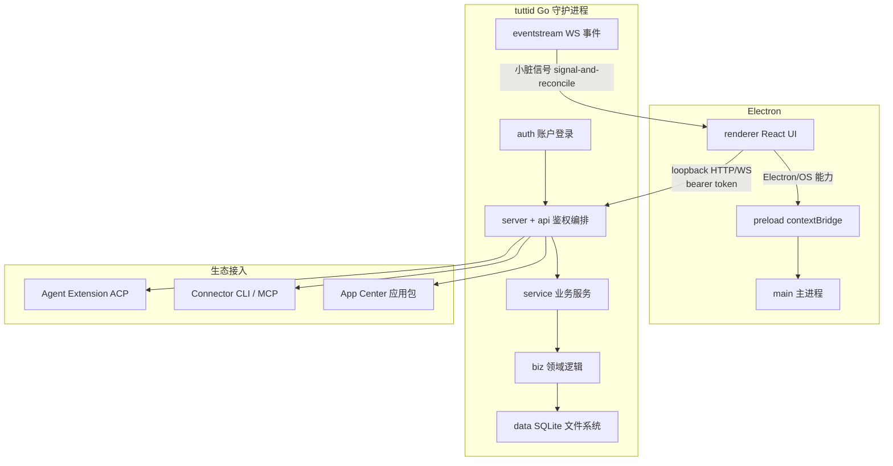
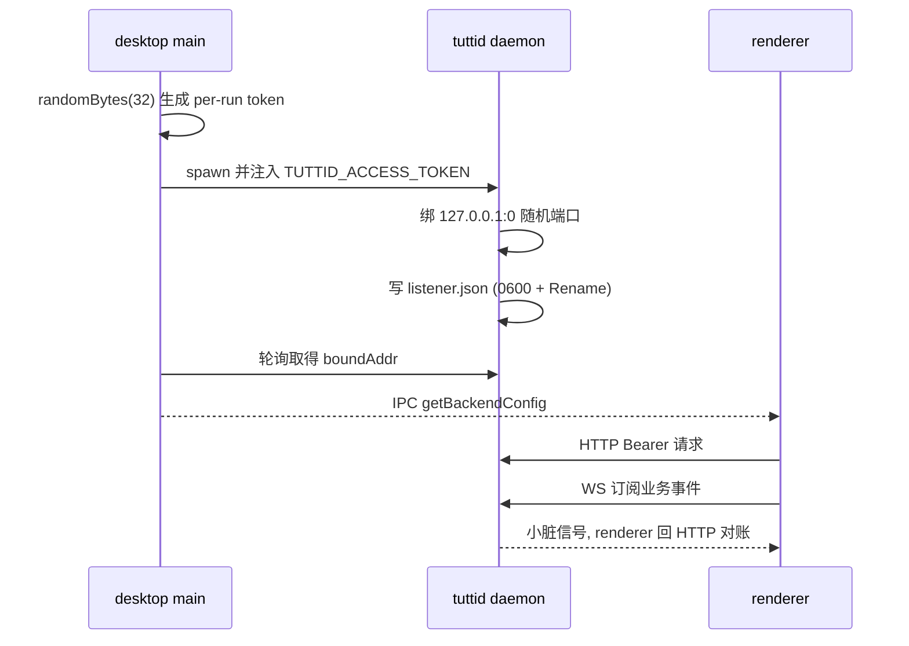

# Tutti：多智能体实时共享协作空间

> 本解读按 **agent 类型规格** 产出。
> 项目：tutti — **Where people and agents build in tune.**
> 仓库：https://github.com/tutti-os/tutti （Apache-2.0）

## 根因

Claude Code 很强、Codex 很强、Canvas 很强——但一旦真实工作流需要依赖关系和交接，**最忙的人反而是你自己**：Claude 写完 API，你要把上下文复制粘贴给 Codex 让它接前端；接了代理文档、出图、传文件给下一个 agent 再解释一遍需求。

tutti 要解决的根本问题是：**把用户从"多 AI agent 之间的信使"角色中解放出来**。它提供的是多个 agent 共享、实时、可见、连接的 workspace——上下文、文件、正在跑的任务、应用都能流动，让不同厂商的 agent 像共享一个大脑一样接力，而不是靠总结与复制粘贴交接。

> Tutti 不是你的编码 agent 的替代品，它是给你的 agent 们用的**实时共享工作空间**。

## 概览

| 维度 | 描述 |
|------|------|
| 核心能力 | Real-time shared workspace / Big @（跨 agent 引用会话、文件、任务）/ "+" 引用 / 任务编排 / 应用生态（Agent 与人都能用）/ 多 provider agent 通协 |
| 形态 | 本地优先（local-first）桌面应用：Electron 壳层 + Go 守护进程（tuttid）；v0.2.30 起支持 Windows x64 桌面版 |
| 生态 | 自带 App Center（image/UI/design/docs/presentation），Agent Extension 接第三方 ACP agent，Connector 接外部 CLI/MCP 能力（含远程 MCP） |
| 适用人群 | 同时用多个 AI agent、被跨 agent 上下文搬运折磨的开发与创作者 |
| 版本边界 | 开源版 = 单人多 agent 本地协作；Tutti · VM（商业 EA）= 多用户/多设备实时 Room 共享，需邀请码，不在开源仓库内 |

## 技术栈一览

| 层 | 技术 |
|----|------|
| 前端壳层 | Electron / React / Vite，contextBridge 隔离 |
| 后端业务核心 | Go（tuttid 守护进程，标准库为主，零 ORM/DI 框架） |
| 存储 | SQLite（modernc.org/sqlite 纯 Go）+ 本地文件系统，WAL + busy_timeout |
| 前端状态包 | pnpm workspace monorepo，依赖关系 DAG 无环 |
| 协议 | loopback HTTP/1.1 + WebSocket 业务事件流 + ACP（agent）/ MCP（connector） |
| 移动端 | React Native（apps/mobile，Android/iOS），device-link 对接 |

## 规模指标（参考）

| 维度 | 数值（近似） |
|------|------|
| Go 守护进程源文件 | services/tuttid 下 ~1,350 个 .go 文件 |
| 最重模块 | service/agent（~7 万行、245 个 .go）、service/workspace（~3 万行）、service/agentstatus（~2 万行） |
| 共享运行时 | packages/agent/daemon/runtime（ACP/Codex/Claude SDK 适配器，377 个 .go 文件） |
| Monorepo | 27+ npm 包 + 多个 Go module（go.work） |
| 文档体系 | docs/architecture + docs/specs + docs/adr 持续演进 |

## 同领域定位对比

| 项目 | 定位 | 与 Tutti 的差异 |
|------|------|----------------|
| Claude Code / Codex / Canvas | 单 agent 编码/画布 | 单 agent 产物；Tutti 是跨 agent 协作层，不替代它们 |
| OpenWorker | 本地 AI 同事桌面平台（sidecar + 审批门控） | 偏"一个带审批的 Agent 循环 + sidecar"；Tutti 更偏多 agent 实时共享 + 应用生态 |
| OpenBee | 自托管 24/7 数字员工管理 | 偏组织态多 Agent 常驻；Tutti 偏桌面创作工作流接力 |
| Multica | 托管式 Agent 任务管理 | 托管云；Tutti 本地优先、进程内 daemon |
| OpenHands | 开发者控制中心（多后端切换） | 前端为控制台；Tutti 带应用生态 + Agent Extension/Connector 双边接入 |

---

## 子文档索引

- [`memory-system.md`](memory-system.md) — 记忆系统：Local-First SQLite 分层存储、事件流投影、消息版本游标
- [`tutti-mode-orchestration.md`](tutti-mode-orchestration.md) — 多 Agent 编排：以 SQLite 为真值的 Saga 闭环，checkpoint 节拍 + 独立审核 + 防冲突
- [`app-ecosystem.md`](app-ecosystem.md) — 应用生态：App Center / Factory / Runner，Agent 反向造应用与子进程隔离
- [`connector-market.md`](connector-market.md) — 连接器市场：外部 CLI/MCP 能力接入，v0.2.30 起共享 packages/connector + 远程 MCP
- [`agent-extensions.md`](agent-extensions.md) — Agent Extension：第三方 ACP 智能体的声明式接入
- [`acp-protocol.md`](acp-protocol.md) — ACP 协议：双向 JSON-RPC 契约、标准 ACP 适配器、会话/turn 生命周期与权限交互
- [`transport-security.md`](transport-security.md) — 传输与安全：loopback 随机端口 + listener-info 握手 + bearer token + Electron 安全边界
- [`CHANGELOG.md`](CHANGELOG.md) — 各版本变更汇总

---

## 架构总览

tutti 采用"**单一业务权威 + 多宿主通道**"架构：tuttid 守护进程是唯一的业务核心，Electron 只是宿主。renderer 直接连 daemon 拿流式能力，main 只做监督与 OS 能力。

模块职责对应：

| 模块（services/tuttid） | 职责 | 深读 |
|------|------|------|
| `service/agent` | 核心 Agent 会话 / 运行 / 活动投影（最重） | [`memory-system.md`](memory-system.md) |
| `service/agenttarget` | Agent Target（provider 统一抽象） | [`agent-extensions.md`](agent-extensions.md) |
| `service/agentextension` | 第三方 ACP agent 扩展安装/解析 | [`agent-extensions.md`](agent-extensions.md) |
| `service/tuttimodeplan` / `tuttimodeexecution` | Tutti Mode：目标→Plan→Issue→执行编排 | [`tutti-mode-orchestration.md`](tutti-mode-orchestration.md) |
| `service/collabrun` | 横向协作（fork/delegate/consult/handoff）记账 | [`tutti-mode-orchestration.md`](tutti-mode-orchestration.md) |
| `service/workspace` | workspace 应用、App Factory/Runner、包来源 | [`app-ecosystem.md`](app-ecosystem.md) |
| `service/connector`（+ `packages/connector`） | 连接器安装/运行时/命令 provider、远程 MCP | [`connector-market.md`](connector-market.md) |
| `service/eventstream` | 业务事件订阅/发布、协作广播 | [`tutti-mode-orchestration.md`](tutti-mode-orchestration.md) |
| `packages/agent/daemon/runtime` | ACP/Codex/Claude SDK provider 适配器引擎 | [`acp-protocol.md`](acp-protocol.md) |
| `server` + `types/httputil` + `api/daemon_events` | HTTP/WS 服务、鉴权、事件流 | [`transport-security.md`](transport-security.md) |
| `data/` + `packages/agent/store-sqlite` | SQLite 持久化、可嵌入 Agent 存储 | [`memory-system.md`](memory-system.md) |

## 启动流程与主请求链路

## 关键源码入口（真源引用）

- 服务组装入口：`main.go:58` 经 `buildTuttiServer()` 把 listener 与依赖图装配成 HTTP server。[services/tuttid/wiring.go:154-156]() 是手工组合根的起点，从环境解析 listener spec 再组装各服务。
  <!-- snippet: func buildTuttiServer() (*http.Server, net.Listener, *tuttiWiring, error) {
	listenerSpec, err := tuttiserver.ListenerSpecFromEnv()
	if err != nil { -->
- 业务事件主题目录：[services/tuttid/service/eventstream/catalog.go:20-23]() 集中声明 workspace 级事件 topic（`agent.collaboration.updated` / `connector.market.changed` / `agent.model.catalog.invalidated` 等），是信号-and-对账的"脏信号"清单源。
  <!-- snippet: 	TopicAgentCollaborationUpdated                       = "agent.collaboration.updated"
	TopicAgentModelCatalogInvalidated                    = "agent.model.catalog.invalidated"
	TopicAgentQuickPromptUpdated                         = "agent.quickprompt.updated"
	TopicConnectorMarketChanged                          = "connector.market.changed" -->

## 工程实践亮点

### Monorepo 治理

pnpm workspace + Go workspace（go.work）共存，npm 包依赖关系保持 DAG 无环。大型 monorepo 中最难维持的纪律之一就是"边方向一致、无循环依赖"。

### Schema-first 跨语言契约

events 包做真正的 schema-first 跨语言事件协议：`definitions/` 定义 schema → 自动生成 TS 合约 + 运行时验证器 + 事件注册表 → Go 端对应合约。保证 TS 与 Go 通信类型安全。

### OpenAPI Contract-First

API 变更流程：改 `tuttid.v1.yaml` → `pnpm generate:api` 生成 Go handler + TS client → `check:api-generated` 校验一致。用 fragments 机制（`x-tutti-openapi-fragments`）组织子规范，避免单文件巨型化。

### 分层验证链

`pnpm check:changed` 只验改动影响项（日常），`pnpm check:full`（pre-push 全量）+ pre-commit lint-staged（只暂存文件）。go 侧 golangci-lint，TS 侧 oxlint + 自定义边界检查（UI/renderer/i18n/API-generated）。

### 文档自进化

团队用 AutoSkill 四态决策（discard/improve/merge/create）维护文档；每次变更若影响模块职责/数据流/用户交互/公开 API/运行时配置/验证命令，需更新对应持久文档。`docs/{architecture,specs,adr}` 持续演进是理解设计意图的金矿。

## 代码质量现状（重写时抽查）

原 7 月解读指出 P0 级"业务代码超 800 行"违规约 30+ 文件（最重 `WorkspaceSettingsPanel.tsx` 4,701 行），且 `apierrors/` 无测试、preload 安全层测试不足。本次增量未逐文件复核最新状态，以上属历史快照；如需准确保留此节的最新准确数据，建议下次按当前 HEAD 单独深挖（`[WIP]`）。

## 设计亮点与风险

**亮点**
- Local-First：全部状态本地 SQLite（WAL + busy_timeout），离线可用、用户数据主权、低延迟。
- 无 DI 框架：手写 `wiring.go` + `wiring_*.go` 组合根做接口注入，API 层只认知接口、具体注入在 wiring。
- Checkpoint 仲裁：多 agent 协作用"SQLite 真值 + checkpoint 节拍 + 源 agent 唯一决策"，刻意去除自推进，避免多 agent 跳步冲突。
- 诚实的安全边界：App 生成器无 sandbox/VM，靠目录边界 + 二级受限 token；连接器 fail-closed 验签 + 只接无凭据能力。

**主要风险**
- service/agent 已 ~7 万行、245 个 .go 文件，是最大复杂度源，随更多 agent target 增长边界难管。
- wiring.go 中 `store.(workspacedata.XxxStore)` 未检查转型，接口未实现时静默返回 nil。
- 可移植性：Windows 桌面版 v0.2.30 已随正式发布落地；Tutti · VM 属商业 EA（需邀请码），扫码生态（mobile）仍在演进。
> **演进说明(v0.2.30)**：原"Tutti · VM 计划中，Windows 支持进行中"已过时——Windows x64 桌面下载已入正式 release，Tutti · VM 进入 Early Access（仅建 Room 需邀请码）。

## 值得借鉴的设计（可跨项目迁移）

1. **多 agent 协作的 Checkpoint + Run 模型**：图是数据、推进是"停→决断→再放"，比自动化 DAG 在真实多 agent 场景更可控（[`tutti-mode-orchestration.md`](tutti-mode-orchestration.md)）。
2. **随机端口 + listener-info 文件握手**：无固定端口扫描面、无写死密码，token/地址随运行变化再原子发布（[`transport-security.md`](transport-security.md)）。
3. **signal-and-reconcile**：事件只发"我脏了"的提示，真值永远在 SQLite 回 HTTP 对账——实时性与一致性兼得。
4. **声明式扩展包 + 独立运行时**：Agent Extension / App 都用"manifest 描述起哪个外部进程"，平台不加载第三方可执行代码，零代码扩展避开供应链风险。
5. **双签安全门禁**：连接器 Ed25519 域分离验签 + App dry-run 启动校验，把"可信"与"跑得起来"分开验证。

## 总结回扣根因

tutti 没有发明新的单 agent 能力，它解决的是**跨 agent 协作时"上下文搬运"这一根本摩擦**。其技术含量不在任何单个模型调用，而在工程层：用 Go 守护进程做唯一业务权威、用 SQLite 做一切状态的真值、用 checkpoint 仲裁多 agent 的推进、用声明式扩展把生态无限接入而零代码注入。读懂它，读到的是"如何为多个 AI 智能体设计一个可信、实时、可扩展的协作底座"——这正是它区别于单 agent 产品的最深价值。
