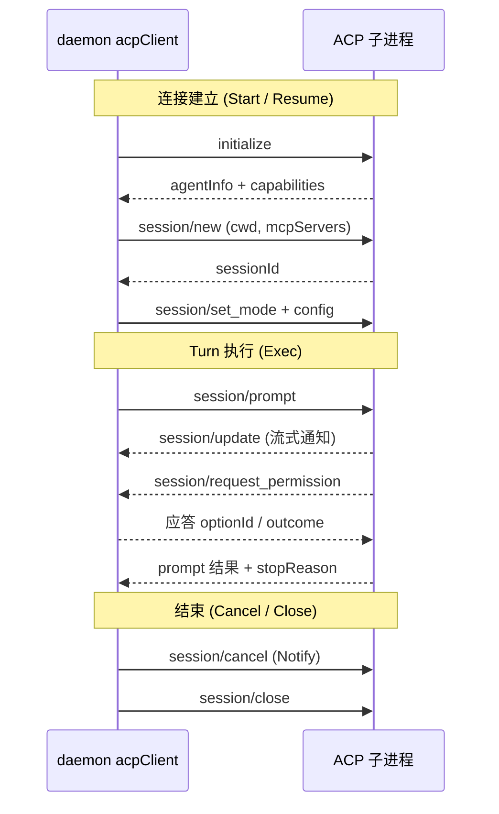

# ACP 协议：Tutti 与第三方智能体的统一接入语言

> 本解读按 **agent 类型规格** 产出。
> 关注面：Tutti 如何通过 ACP 协议把"任意实现了 Agent Client Protocol 的第三方 agent"接成一等公民。这是 `agent-extensions.md`（声明式扩展包）背后的**运行时协议底座**——扩展包描述"起哪个外部进程"，ACP 定义"进程起来之后怎么对话"。

## 根因：为什么 ACP 是接入层的公共底座

Tutti 要同时连接 Codex、Claude Code、Cursor、OpenClaw、Kimi、gemini 等来自不同厂商的 agent。每个 agent 的命令、CLI 参数、认证方式、会话模型都不一样——如果为每个 provider 各写一套进程管理 + 会话状态 + 事件投影，接入成本随厂商数量线性膨胀，且每家的行为差异会漏进业务层。

解法是**收敛到一个共享协议 + 一份声明式配置**：所有走 ACP 的 provider 共用 `standard_acp_adapter.go` 里的同一个引擎，差异只体现在 `standardACPConfig` 结构体字段上。文件头的注释直接点明这个分工：

[packages/agent/daemon/runtime/acp_providers.go:1-15]()：每个 ACP provider 只是共享引擎之上的一份薄配置，一 provider 一文件；Codex（app-server 私有协议）与 Claude Code（Agent SDK sidecar）是特例，**不**作为新 ACP provider 的模板。
<!-- anchor: package agentruntime … // sidecar. Neither is a template for new ACP providers. -->

## ACP 协议方法面：双向 JSON-RPC 契约

ACP（Agent Client Protocol）本质是 **stdio 上的 JSON-RPC 2.0**，且是**双向**的：daemon 向 agent 子进程发起请求，agent 也可以反过来向 daemon 发请求（权限、文件写入）。方法目录集中在 `acp_shared.go` 的常量块：

[packages/agent/daemon/runtime/acp_shared.go:25-39]()：请求类方法有 `initialize` / `session/new` / `session/load` / `session/resume` / `session/prompt` / `session/cancel` / `session/set_mode`；agent→daemon 的入站通知有 `session/update`（流式状态）与 `session/request_permission`（求批），并声明 `acpProtocolVersion = 1`。
<!-- anchor: acpMethodInitialize        = "initialize" … acpStartCallTimeout        = 30 * time.Second -->

消息信封就是标准 JSON-RPC：`jsonrpc: "2.0"` + 可选的 `id` / `method` / `params` / `result` / `error`。`id` 用 `json.RawMessage` 保留原始类型，因为 ACP 的请求 id 既可能是数字也可能是字符串：

[packages/agent/daemon/runtime/acp_client.go:48-55]()：`acpMessage` 结构直接镜像 JSON-RPC 报文，五个字段都是可选的——同一结构既当请求又当响应又当通知。
<!-- anchor: type acpMessage struct { … Error   *acpError       `json:"error,omitempty"` -->

daemon 侧发送时统一带 `jsonrpc: "2.0"` 头，唯一例外是 codex app-server 的私有 wire 格式（`omitWireVersion` 为 true 时不写版本头）：

[packages/agent/daemon/runtime/acp_client.go:127-131]()：`messageEnvelope` 决定请求是否带 `"jsonrpc":"2.0"` 头，代码库复用一个 client 结构消化两种 wire 格式。
<!-- anchor: func (c *acpClient) messageEnvelope() map[string]any { … return map[string]any{"jsonrpc": "2.0"} -->

## 适配器：一份声明式配置 + 共享引擎

协议的分层很清晰：`acpClient` 只负责"一行一行读 stdout、按 JSON-RPC 派发消息"，不管业务；`standardACPAdapter` 把协议流翻译成 Tutti 的 activity 事件；`standardACPConfig` 描述"这个具体 agent 长什么样"。后者是关键——它几乎全是可选回调，每个 provider 只覆写自己需要的那几个：

[packages/agent/daemon/runtime/standard_acp_adapter.go:32-37]()：`standardACPConfig` 开头是 provider 身份 + 启动命令 + 标题，后面一长串 `func` 字段（`initializeParams` / `setModeParams` / `env` / `beforeNewSession` / `automaticPermissionDecision`…）都是"协议有，但此 provider 可能不需要"的钩子。
<!-- anchor: type standardACPConfig struct {
	provider            string
	adapterName         string
	command             []string
	defaultTitle        string
	defaultTitleAliases []string -->

运行时把 provider 声明落到具体适配器的路由在 `provider_descriptors.go`：按 `descriptor.Runtime.Kind` 分流，StandardACP 再按 `AdapterStrategy` 细分通用/cursor/nexight/openclaw/opencode：

[packages/agent/daemon/runtime/provider_descriptors.go:74-86]()：`RuntimeKindStandardACP` 下再按 `AdapterStrategy` 分派到 5 个构造器，`Generic` 兜底走共享引擎；Claude SDK 与 Codex app-server 走各自独立分支。
<!-- anchor: case providerregistry.RuntimeKindStandardACP: … case providerregistry.StandardACPAdapterStrategyOpenCode: -->

这也是"Agent Extension 零代码"能成立的根本：扩展包只提供 manifest + 命令，daemon 用 `NewStandardACPAdapter` 从配置构造适配器，**不加载任何第三方代码**进进程：

[packages/agent/daemon/runtime/provider_descriptors.go:187-194]()：`NewStandardACPAdapter` 校验 provider 名与命令非空后直接构造共享适配器，注释明确"故意不暴露任何把扩展代码加载进 daemon 的钩子"。
<!-- anchor: func NewStandardACPAdapter(config StandardACPAdapterConfig, transport ProcessTransport, host HostMetadata) (Adapter, error) {
	provider := strings.TrimSpace(config.Provider)
	if provider == "" || len(config.Command) == 0 || strings.TrimSpace(config.Command[0]) == "" { -->

## 进程与传输：stdio 上的 JSON-RPC

每个 ACP agent 是一个**独立子进程**，daemon 通过 `ProcessTransport` 抽象与它通信。进程由 `startClient` 装配：解析命令（支持 `commandResolver` 动态解析）、合并环境变量、按 permission mode 改写启动参数，再经 transport 拉起：

[packages/agent/daemon/runtime/standard_acp_session.go:509-517]()：`startClient` 的起点——从 config 复制命令、追加 session 环境与 `commandResolver` 的解析结果，transport 不可用直接报错。
<!-- anchor: func (a *standardACPAdapter) startClient( … return nil, nil, false, errors.New("ACP process transport is unavailable") -->

stdout 按行切分解析：协议要求**一行一个 JSON 对象**。`dispatchLineAt` 对非 JSON 行做了区分处理——`npm warn` / `(node:` 这类 benign 日志被忽略，其余畸形行计入协议错误，连续 5 条即判定协议损坏终止连接：

[packages/agent/daemon/runtime/acp_client.go:493-503]()：`dispatchLineAt` 先 trim、再判断是否 `{` 开头、是否合法 JSON，把"provider 的日志噪音"与"真正的协议消息"在入口处就分开。
<!-- anchor: func (c *acpClient) dispatchLineAt( … if !bytes.HasPrefix(line, []byte("{")) { -->

读循环本身在 `readLoop` 里：从 `conn.Recv()` 拿帧（区分 stdout / stderr / 退出码），stderr 喂给诊断 tail 与可选的 `stderrMessageMapper`（把 codex-acp 的 retry 日志翻译成传输通知），stdout 按 `\n` 边界切成行再派发：

[packages/agent/daemon/runtime/acp_client_read_loop.go:14-24]()：读循环开头——分帧收 stdout/stderr，进程退出码会带 stderr tail 一起终结连接。
<!-- anchor: func (c *acpClient) readLoop() { … 		if len(frame.Stderr) > 0 { -->

## 会话生命周期：initialize → session/new → turn → close

一个 ACP 会话的建立分三段。**initialize** 是能力握手：daemon 声明自己是怎样的 client（要不要 terminal、要不要写文件），agent 回 `agentInfo` + capabilities：

[packages/agent/daemon/runtime/standard_acp_events.go:25-38]()：`defaultACPInitializeParams`——daemon 声明 `protocolVersion: 1`，`clientCapabilities.fs.writeTextFile: true` 但 `terminal: false`（Tutti 是 GUI 宿主，不暴露终端交互给 agent）。
<!-- anchor: func defaultACPInitializeParams(host HostMetadata) map[string]any { … "clientInfo": host.clientInfoParams(), -->

**session/new** 才是真正建会话：传 `cwd`、MCP servers、标题元数据，agent 回 `sessionId`。这一步由 `Start` 驱动，且带重试、带 `beforeNewSession` 钩子（setup 探测用它注入认证）：

[packages/agent/daemon/runtime/standard_acp_session.go:25-30]()：`Start` 入口——先按 session 粒度拿生命周期锁（`lockSessionLifecycle`），确保同一 session 的 Start/Resume/Close 串行，再用 `admitReplacementLocked` 放行替换旧连接。
<!-- anchor: func (a *standardACPAdapter) Start(ctx context.Context, session Session) ([]activityshared.Event, error) { … if err := a.admitReplacementLocked(session.AgentSessionID); err != nil { -->

[packages/agent/daemon/runtime/standard_acp_session.go:99-116]()：`session/new` 的请求体——`cwd`（Windows 特判，POSIX 根目录不是合法 workspace）、`mcpServers`（把 Tutti 绑定的本地 MCP server 注入 agent）、附加 `_meta`，然后经 `callSessionNewWithRetry` 发送。
<!-- anchor: 	newSessionParams := map[string]any{
		"cwd":        standardACPProtocolCWD(session.CWD),
		"mcpServers": mcpServers,
	} -->

会话建立后还有一步 **session/set_mode**（把 permission 模式同步给 agent）与 config options 下发。整条生命周期可用一张图概括：

## Turn 执行：session/prompt 与 update 流投影

一次 turn 是 `session/prompt` 请求 + 一个持续到 stopReason 的**长连接式消息循环**。`Exec` 里 `client.Call` 的 handler 会收到 agent 在 turn 期间推送的所有 `session/update` 通知，逐个翻译成 activity 事件：

[packages/agent/daemon/runtime/standard_acp_turn.go:141-148]()：`Exec` 的主循环——`client.Call(session/prompt, {sessionId, prompt})`，handler 里每个入站消息走 `handleACPMessage`，`inputUnits.begin/end` 把每条消息锚定到录制回放的单位上。
<!-- anchor: 		result, err := acpSession.client.Call(ctx, acpMethodPrompt, map[string]any{ … 			endInputUnit := a.inputUnits.begin(ctx, session.AgentSessionID) -->

`session/update` 是 ACP 的"状态流"通道，靠 `sessionUpdate` 字段区分消息种类。`standardACPPermissionRequested` 之前的 `standardACPUpdateEvents` 就是这个投影器的核心：

[packages/agent/daemon/runtime/standard_acp_events.go:49-60]()：`session/update` 按 `sessionUpdate` 分派——`agent_message_chunk` / `agent_thought_chunk` 变成 assistant 流式块，`user_message_chunk` 直接忽略（用户消息不来自 agent）。
<!-- anchor: 	updateType := asString(params.Update["sessionUpdate"])
	switch updateType {
	case "user_message_chunk":
		return nil
	case "agent_message_chunk": -->

消息入口 `handleACPMessage` 是 turn 内所有入站消息的总开关：`fs/write_text_file`（agent 请求写文件）、`session/update`（投影）、`session/request_permission`（审批），其余方法回 `-32601 method not supported`：

[packages/agent/daemon/runtime/standard_acp_stream.go:54-58]()：`handleACPMessage` 的消息分派 switch——写文件 / update / permission 三类入站请求，外加 provider 专属 handler 优先插队。
<!-- anchor: 	switch message.Method {
	case acpMethodWriteTextFile: … case acpMethodUpdate: -->

`Exec` 对 turn 结果按 `stopReason` 分类落账：`canceled` → 中断；`refusal` / `max_tokens` → 失败；`end_turn` 且有 observable 输出 → 完成；`end_turn` 但没有任何输出 → 显式失败 `provider_empty_response`（防"agent 假装正常结束实则空手"）：

[packages/agent/daemon/runtime/standard_acp_turn.go:317-357]()：`stopReason` 分支表——canceled/refusal/max_tokens/默认（含 empty-response 检查）四种终态路径，全部走 `normalizer.Finish*` + `RootProviderTurnCompletedEvent` 收口。
<!-- anchor: 		switch stopReason {
		case "canceled":
			terminalEvents := normalizer.FinishInterrupted(session, turnID, stopReason) -->

## 权限与交互：request_permission 的三条出路

ACP 里"agent 想干需要人批准的事"通过 `session/request_permission` 表达。Tutti 的处理有严格边界：**只有活动 turn 内的权限请求才有效**。没有活动 turn（`normalizer == nil` 或 turnID 空）直接拒绝——避免把迟到的回调绑到已终结的 turn 上：

[packages/agent/daemon/runtime/standard_acp_stream.go:95-113]()：权限请求的 turn 作用域校验——没有 active turn 时回 `-32000` 并 warn，注释说明这是为了防止晚到的回调重开已结算的 turn。
<!-- anchor: 	case acpMethodPermission:
		// A permission callback is actionable only while the session/prompt call
		// that owns its canonical turn is active. The global client handler has no
		// normalizer; binding such a late callback to recentTurnID would reopen a -->

对有效的权限请求，有三条出路：

1. **自动决策**：配置了 `automaticPermissionDecision`（如 `approved`/`denied`）时，直接按当前 permission tier 代答，不打断用户（`standard_acp_stream.go:119-148`）。
2. **人工审批**：默认路径——把请求投影成 pending 交互，异步等用户在 AgentGUI 上选择，再用 `respondWithDispatchFence` 回包（保证本地生命周期事件先于 provider 因响应触发的消息）。
3. **交互桥**：kimi 的 ask-user 等用 `_meta["terminal-auth"]` / `cursor/ask_question` 表达的问题式请求，被归一化到同一个 pending 状态机，而不是另造一套。

权限请求从协议报文到 pending 交互的投影入口是 `standardACPPermissionRequested`：

[packages/agent/daemon/runtime/standard_acp_events.go:289-296]()：`standardACPPermissionRequested` 把 `request_permission` 报文解析成 `pendingACPApproval`——它同时承载 approval（批准选项）与 interactive（问答）两种形态。
<!-- anchor: func standardACPPermissionRequested( … ) ([]activityshared.Event, *pendingACPApproval, error) { -->

## 设置与认证探测：setup probe

接入一个 ACP agent 不是建完进程就算完——Tutti 需要在安装/启用时就知道它**能不能用、要不要登录**。`RunStandardACPSetup` 做一次仅限探测的 `initialize → session/new`，把结果分类成 `ready` / `auth_required`：

[packages/agent/daemon/runtime/standard_acp_setup.go:76-87]()：`RunStandardACPSetup`——setup 探测强制 60s 超时（首个 cold start 可能要在托管 Python runtime 上初始化），并保留认证方法列表与已认证账号返回。
<!-- anchor: func RunStandardACPSetup( … config.StartupTimeout = 60 * time.Second -->

探测还专门处理了两种"看起来能用、实际不能"的情况：agent 声明 `terminal` 型认证方法（在 headless 后台进程里永远走不完交互式登录）直接拒绝；`session/new` 成功但暴露零可用模型（kimi 存了 token 却没种模型配置）判为 `auth_required`，把终端登录重新推给用户。

## 安全边界与诚实取舍

- **零代码注入**：ACP 适配器由配置构造，daemon 永不加载扩展代码；进程是独立的 CLI 子进程，靠签名验签 + 不可变安装保证"跑的是验过的字节"。
- **进程不是 shell**：启动命令以 argv 数组传递（`ProcessSpec.Command []string`），不经 shell 拼接，避免命令注入；敏感文件用 fd 继承（`SensitiveInheritedFile`）而非复制进环境。
- **stdio 是唯一通道**：没有固定端口、没有网络面；`session/update` 里混入的日志行在入口被过滤，畸形协议帧有上限熔断。
- **诚实的能力声明**：`initialize` 里 daemon 明说 `terminal: false`（Tutti 不给 agent 终端），`fs.writeTextFile: true`（允许写 workspace 文件）——协议能力面就是安全面，宁可少声明不可多吹。

## 可借鉴的设计

1. **共享引擎 + 声明式钩子**：一个适配器消化一族协议，差异收敛为配置回调。新 ACP provider 只需写 descriptor，不用复制会话状态机。
2. **协议与业务解耦**：`acpClient` 只懂 JSON-RPC 和换行，`adapter` 只懂翻译成 activity 事件——录制/回放、测试、多 provider 共享全部建立在"协议层纯净"之上。
3. **turn 作用域强制**：权限/update 都校验"必须属于活动 turn"，宁可拒绝迟到回调也不污染已结算状态——多 agent 场景下的一致性命门。
4. **stopReason 显式分类 + 空响应兜底**：把 provider 的"正常结束但没干活"识别为失败，避免把假完成当成成功。
5. **录制回放贯穿协议层**：`ProviderInputUnit` 把每条协议消息锚定到 replay 单元，让"协议级确定性回放"成为测试与诊断的一等公民。
