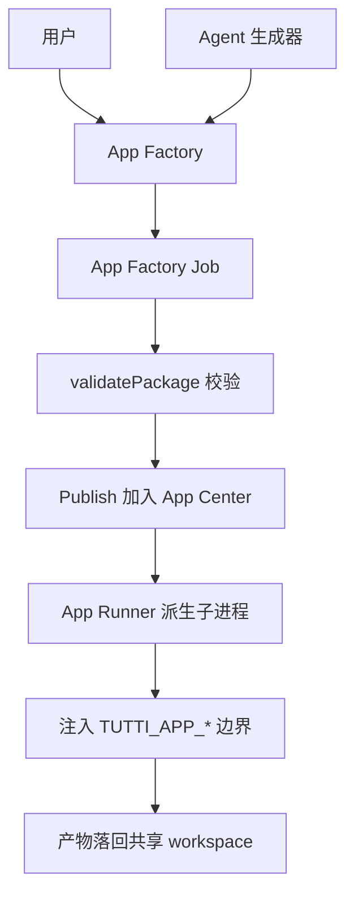

# App Center：应用生态与 Agent 反向造应用

> 本解读按 **agent 类型规格** 产出。
> 关注面：Tutti 不只是让 agent 写代码/做任务，还内置一套"应用生态"——让 agent 会话本身去生成可安装的 App 包，再用子进程隔离运行时。这是 README 自述的"app ecosystem"能力落地。

## 定位与根因

多 agent 协作的工作流里，"UI/UX 设计、出图、写文档、做 PPT"这类中间产物往往要跨多个工具搬运。Tutti 的解法是提供自己的 **App Center**：一套共享的本地应用生态，人类和 agent 都能调用。应用不是 Tutti 主仓里的代码，而是**独立的自包含包**，通过一个固定契约（manifest + bootstrap）与 daemon 衔接。

## App 是什么：包契约

一个 workspace app 是一个本地包，核心契约是 `tutti.app.json` manifest + 一个 bootstrap 可执行文件。包形态固定为 `tutti.app.json` + `bootstrap.sh` + `AGENTS.md` + `icon.png`。设计约束：`appId` 由系统 mint（`app_<uuid>`），不归用户编辑——应用身份由 daemon 掌控，包内容可换但身份稳定。

### App 生命周期总览



## 应用从哪来：四种包来源

`services/tuttid/service/workspace/app_packages.go` 与 `apps.go` 定义了多来源模型：

| 来源 | 说明 | 关键证据 |
|------|------|---------|
| **Builtin** | 内建包，启动时从内建目录物化到包缓存 | `apps.go:144-145` 用 `AppPackageSourceBuiltin` 写包行 |
| **Generated** | App Factory 生成（agent 造的应用） | `app_factory_publish.go:18` `Publish` |
| **Imported/Exported** | 本地 zip 导入导出 | `app_packages.go:31-131` |
| **LocalDev** | 本地开发目录直挂 | `app_local.go:92` |

[services/tuttid/service/workspace/apps.go:142-143]() 把内建包源写为 `AppPackageSourceBuiltin`：
<!-- snippet: 			ManifestJSON: manifestJSON,
			Source:       workspacebiz.AppPackageSourceBuiltin, -->

## App Factory：agent 反向"写应用"

这是最独特的设计点：**让一个 Agent 会话本身就充当 App 生成器**。App Factory 创建 job 后，用目标 agent target 起一个 Agent Session，把这个 agent 的 `cwd` 设为草稿目录、注入 `appFactorySkill` 等额外技能，让 agent 直接在草稿里产出完整的 App 包。

[services/tuttid/service/workspace/app_factory.go:289-290]() 的 `Create`：校验 agent target → mint appId → 创建草稿目录（`job.DraftDir`）→ 起 Agent 会话作为生成器。
<!-- snippet: func (s *AppFactoryService) Create(ctx context.Context, workspaceID string, input CreateAppFactoryJobInput) (workspacebiz.AppFactoryJob, error) {
	workspace, err := s.workspaceSummary(ctx, workspaceID) -->

生产流程分几步，且**生成代码绝不落进产品源码** `apps/desktop`、`services/tuttid`、`packages/*`，只写在 daemon 拥有的 state 下。

### 生命周期状态机

```
queued -> generating -> preparing -> validating -> ready -> published
```

其中 `validating` 是关键安全阀：`validatePackage`（app_factory.go:517）通过 `runner().Start` 做 dry-run 启动 + healthcheck，在隔离的 factory workspace 里确认应用真能起来才放行。

## App Runner：应用怎么跑起来

`services/tuttid/service/workspace/apps_runner.go` 是运行时核心：

- `AppRunner.Start`（apps_runner.go:87）走 `preparing → starting → running`，且**进程排队串行启动**（`queue chan struct{}` 有界信号量，apps_runner.go:41/148）。
- 启动即派生一个**独立子进程**，注入一组 `TUTTI_APP_*` 环境变量，把目录边界彻底分开：

[services/tuttid/service/workspace/apps_runner.go:257-265]() 的目录边界设计——只读包目录、scratch runtime、持久 data、独立 database、logs、可复用 toolchain root，全部分开：
<!-- snippet: 		"TUTTI_APP_PACKAGE_DIR=" + input.PackageDir,
		"TUTTI_APP_RUNTIME_DIR=" + input.RuntimeDir,
		"TUTTI_APP_DATA_DIR=" + input.DataDir,
		"TUTTI_APP_DATABASE_DIR=" + input.DatabaseDir,
		"TUTTI_APP_LOG_DIR=" + input.LogDir,
		"TUTTI_APP_TOOLCHAIN_ROOT=" + appToolchainRoot,
		"TUTTI_APP_PORT=" + strconv.Itoa(port),
		"TUTTI_APP_BASE_URL=http://127.0.0.1:" + strconv.Itoa(port),
		"TUTTI_API_BASE_URL=" + tuttiAPIBaseURL, -->
<!-- snippet: 		"TUTTI_APP_PACKAGE_DIR=" + input.PackageDir,
		"TUTTI_APP_RUNTIME_DIR=" + input.RuntimeDir,
		"TUTTI_APP_DATA_DIR=" + input.DataDir,
		"TUTTI_APP_DATABASE_DIR=" + input.DatabaseDir,
		"TUTTI_APP_LOG_DIR=" + input.LogDir,
		"TUTTI_APP_SERVER_TOKEN=" + appServerToken(input.WorkspaceID, input.AppID), -->

- 应用通过 `TUTTI_APP_BASE_URL`/`TUTTI_API_BASE_URL` 与 daemon 通信，用 `/healthz` 探测存活。
- **二级授权**：`TUTTI_APP_SERVER_TOKEN` 是 `AppServerToken(accessToken, workspaceID, appID)` 派生的**按 workspace×app 受限 token**，应用只能碰自己那一片，触不到 daemon 全局 API。

## 安全边界的诚实取舍

设计文档明确承认：**无 sandbox/VM/容器/防火墙**，生成的应用是本地子进程。验证靠 dry-run 本地启动 + healthcheck，不是静态安全分析或跨机可移植认证。这是"本地工具生态"刻意接受的边界——换取的是零基础设施、用户数据主权、低延迟。

## Agent 如何调用 App

App 对两类调用者开放：人类在 AgentGUI/composer 里直接点，**或 agent 经 daemon 调用**。当一个 Codex 会话需要"出个 prototype 图"，它不是在多 agent 间复制文件，而是请求启动某个 App 实例，App 的产出落回共享 workspace 供下一个 agent 直接用——这正是 README 宣称的 "Everything is visible and connected"。

## 可借鉴的设计

- **"Agent 生成应用"而非"平台内置所有应用"**：平台只提供包契约 + 运行时，把具体应用的实现完全交给 agent 工作流，规模化地让生态自增长。
- **身份与内容分离**：`appId` 由系统 mint，包内容可迭代版本，身份稳定——天然支持发布/回滚。
- **目录边界即安全契约**：用 6 个独立目录 + 受限 server token 表达"应用能碰什么"，比白名单 API 更朴素可审查。
- **dry-run 验证作为发布门禁**：发布前必须真的启动并过 healthcheck，杜绝"声明能用但跑不起来"的包。
