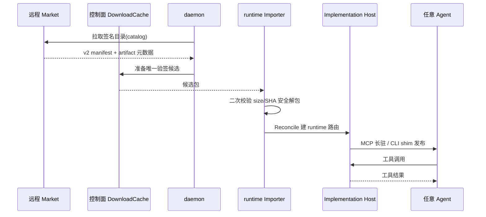

# Connector：连接器市场与外部能力接入

> 本解读按 **agent 类型规格** 产出。
> 关注面：Tutti 如何把"外部能力"（命令行 CLI / MCP server）接进 daemon，变成可以被任意 agent 调用的统一 capability。这是 README 自述 "Tutti's own app ecosystem" 之外的横向能力接入层。

## 定位：连接器 ≠ Agent 扩展

Tutti 有两条"接第三方"的机制，容易混淆：

- **Connector**：把某公司/产品的 **CLI 或 MCP server** 变成 daemon 管理的子进程，暴露为统一能力。接入的是"能力"。
- **Agent Extension**：把第三方 **ACP agent** 接入（见 `agent-extensions.md`）。接入的是"智能体"。

本文件讲 Connector。它对应 agent 类型规格里的"MCP / 外部能力接入"关注面。

> **演进说明(v0.2.30)**：v0.2.30 起，Connector 模块从 `services/tuttid/service/connectormarket/` 重构为共享 `packages/connector/`（runtime/host/daemon 分层）与 `services/tuttid/service/connector/{market,mcp}`（Tutti 宿主注入）；原 `docs/architecture/connector-market.md` 扩展为 `connector.md` 并新增远程 MCP 方案 `connector-remote-mcp.md`。本文按新架构重写。

## 双 API 架构

`connector.md` 明确分离远程与本地两个权威面：

- **远程 Connector Market API**：发布 connector release、manifest、不可变 artifact 元数据。
- **本地 daemon API**：接收目录（accepted catalog）、安装、授权、兼容性、持久操作状态。

关键设计：**renderer 永不直接调远程市场**，本地 daemon 是 renderer 状态的唯一权威。

[docs/architecture/connector.md:10-16]() 把两个 API 的职责切分写死——远程只管发布与元数据，安装/授权/兼容性/操作状态全部归属本地宿主。
<!-- anchor: Connector market uses two independent APIs: … owned by one desktop host -->

v0.2.30 之前由 daemon 独占实现，重构后变为**共享 Go module + 宿主注入**：`packages/connector/runtime` 提供可移植的 artifact 与托管运行时原语（下载缓存、无网导入、安全解包、ABI 校验），而具体 daemon 负责提供"实现宿主 / 进程 / 产品命令"等宿主适配器。这是"一次实现、多宿主复用"（Tutti 桌面 + TSH 托管 VM）的架构前提。

## 安全模型：fail-closed 验签与 artifact 完整性

连接器可信性的唯一闸门是**签名验签 + artifact 完整性校验**，对每个 daemon fail-closed。远程 market 用 **manifest v2 envelope**（market-neutral `payload.implementation`，无 `supportedMarkets`），daemon **拒绝旧 v1 envelope** 而非适配，从源头消除"跨市场歧义"：

[docs/architecture/connector.md:138-150]() 描述 artifact 准备与运行时激活的解耦——安装先走控制面 DownloadCache 准备**唯一验签候选**，再经运行时 Importer 二次校验 size/SHA、安全解包，最终由 repository 提交"设备已装"真值。
<!-- anchor: Artifact preparation and runtime activation are different responsibilities.
They may also live on different machines: -->

安装路径强调"两段式验证"：控制面下载只准备一个验签候选，运行时机器上**重新校验** size 与 SHA 才解包，缓存候选变 current 前先提交安装收据。这消除了"下载验证 → 执行之间"的路径名空窗。

## 安装与运行时

### 连接器从安装到被 Agent 使用的路径

安装状态机为**粗粒度幂等**：`accepted → installing(receipt) → runtime_pending(candidate+Desired) → Observed(精确 generation) → current promoted → completed`，每次失败从幂等 release installer 重启，不持久化下载/同步/导入的内部子阶段。

[docs/architecture/connector.md:325-340]()：install/update/uninstall/断开/重连全部 at-least-once；按 `operationId + connectorKey + version + releaseDigest` 幂等，刻意不做跨 SQLite/文件系统/进程重启的 exactly-once 假设。
<!-- anchor: Remote refresh, install, update, uninstall, disconnect, and runtime reconcile
use at-least-once execution. -->

**runtime 分两类**：

- **MCP server**：长驻子进程，受 route generation fence 与 process registry 治理，工具列表以 MCP `notifications/tools/list_changed` 动态通知订阅方。
- **CLI**：原子发布稳定的 `tutti-connector-<key>` shim，直接 exec 验签后的 release entrypoint 走 Agent 正常 shell；`managed_stdio` 连接器解析精确的 Node/Python runtime profile。

## 命令面收敛：从 4 命令到 connector.available

v0.2.30 前 `broker.go` 暴露 4 个 daemon CLI 命令（`connector.available` / `connector.skills` / `connector.skill.read` / `connector.invoke`），有界串行队列限流。重构后**执行面归原生 MCP/CLI**，daemon CLI 只留发现面：

[services/tuttid/service/connector/market/command_provider.go:10-11]() 只保留 `connectorAvailableCommandID = "connector.available"`，其余命令返回 `ErrCommandNotFound`——连接器执行由 MCP / CLI 原生面拥有，provider 自身无传输无生命周期。
<!-- anchor: const connectorAvailableCommandID = "connector.available"
 -->
<!-- anchor: func (*ConnectorCommandProvider) Capabilities(context.Context, cliservice.InvokeContext) []cliservice.Capability {
	return []cliservice.Capability{
		connectorCommandCapability(connectorAvailableCommandID, []string{"connector", "available"}, -->

命令面收敛的理由在 `connector.md` 里写得很直白：连接器的调用不该经由"命令文本 + 参数解析"的间接层，而是由 Agent 直接消费原生 MCP tool / CLI 能力——更少转换、更少注入面。

[docs/architecture/connector.md:810-817]()：command broker 明确不暴露 `connector capabilities` / `connector skills` / `connector skill read` / `connector invoke`，第一阶段也不暴露 enable/disable 命令。
<!-- anchor: native Skill roots. The command broker does not expose `connector capabilities`,
`connector skills`, `connector skill read`, or `connector invoke`, and the first -->

## 远程 MCP：跨机器执行的新通道

v0.2.30 的新能力：**远程 Connector MCP**。它解决"连接器在别的机器/VM 上执行"的场景（Tutti · VM / TSH 托管环境）：本地不下载 release 执行快照、不起连接器进程，而是经已认证的 Gateway 把 MCP 调用转发到远端。

[docs/architecture/connector-remote-mcp.md:7-9]()：Tutti 侧用 MCP `2026-07-28` 无状态 HTTP Client，不复用旧 Stdio / Legacy Streamable HTTP Client；`RemoteMCPClientFactory` 请求产品实现的远端 Client，宿主不再持有 Gateway Base URL。
<!-- anchor: Tutti 侧已经采用独立的 MCP `2026-07-28` 无状态 HTTP Client，不复用旧 Stdio / Legacy … `RemoteMCPClientFactory` 请求一个产品实现的远端 Client，不再持有 Gateway Base URL、 -->

[docs/architecture/connector-remote-mcp.md:92-98]()：endpoint 固定为 `POST {baseUrl}/v1/connectors/{connectorId}/mcp`，每请求带 `Tutti-Connector-Version` 钉住已安装 release；客户端不接收/转发 Binding Revision、业务 endpoint、Connection ID 或 Provider 凭据。
<!-- anchor: Tutti 根据当前环境和 Connector 标识生成 endpoint： … 每个请求还必须通过 `Tutti-Connector-Version` 固定当前已安装的 Connector Release。客户端不会接收或发送 Binding Revision、业务 endpoint、Connection ID 或 Provider 凭据。 -->

关键安全点：**连接器作者不能决定服务端出网地址，也不能决定用户凭据的发送目标**。发布物只声明"产品契约"，业务 MCP endpoint 与凭据注入策略归 `tsh-server` Binding 控制面。远程 Route 只携带 Tutti Account Session 访问 Gateway，不缓存 Provider Credential Grant。本地聚合 MCP Server `connector` 依旧对 Agent 呈现统一 Tool 列表（本地 + 远程 Route 合并）。

## 兼容性边界故意收窄

[docs/architecture/connector.md:813-817]() 只放行 `managed_stdio` + 受支持 runtime contract；授权连接器必须声明 connector-owned **credential broker** 与精确的 HTTPS authorization hosts。renderer 投影里**永不含凭据与敏感实现配置**。
<!-- anchor: The first production compatibility boundary is deliberately narrow:
`managed_stdio` connectors are installable when their runtime contract is
supported. -->

相比 v0.2.30 前的"无 credential broker、需凭据的连接器只可见不可装"，新边界进一步要求连接器自带凭据代理——把"凭据怎么管"这个最难的安全问题从平台端推向 connector 作者，但通过"必须声明精确授权 HTTPS 主机"来收口可信域。

## 可借鉴的设计

- **双 API 分离 + 本地 daemon 权威**：远程目录只管发布，所有状态/授权在本地 daemon fail-closed——避免 renderer 被远程内容反制。
- **共享模块 + 宿主注入**：`packages/connector` 把可移植部分（下载/解包/ABI 校验/安装收据）做成多宿主复用，daemon 只注入 transport/process/凭据——"一次实现、多宿主"的模块化模板。
- **两段式 artifact 验证**：控制面准备唯一候选 + 运行时二次校验，消除下载到执行的路径名空窗。
- **幂等粗粒度安装状态机**：at-least-once + 按 operation×release 幂等，故障从幂等点重启，不为内部子阶段持久化。
- **命令面收敛**：把"能力执行"从命令文本间接层挪到原生 MCP/CLI 面，减少转换与注入面。
- **远程执行只带会话、不带凭据**：远程 MCP Route 只携带 Account Session，Provider Credential Grant 永不离开本地——跨机执行的安全红线。
