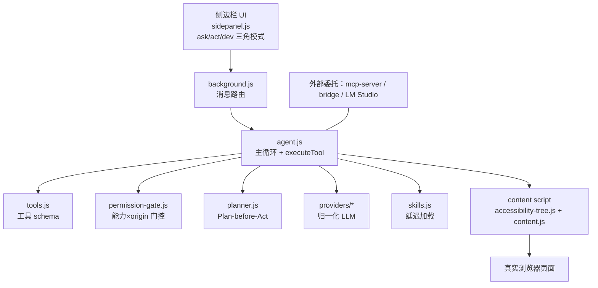

# WebBrain

开源 AI 浏览器 Agent 扩展（Chrome MV3 / Firefox MV2）——在真实浏览器里"读页、点、输、跑多步工作流"，支持你自选的任何 LLM（本地、云端、托管）。把浏览器当作 Agent 的最后一公里接口，而不是给 headless 框架造一个伪造登录态的模拟器。

## 子文档索引

- [`architecture.md`](architecture.md) — 四层扩展架构、启动流程、一次"提问→动作"请求链路、Chrome/Firefox 双构建差异
- [`agent-loop.md`](agent-loop.md) — 主 Agent 循环、mode/tier 双轴、maxSteps 停止条件、上下文压缩、循环检测、会话持久化
- [`page-interaction.md`](page-interaction.md) — accessibility-tree + ref_id 页面读取、CDP 可信事件 vs 合成事件、富文本/表单守卫
- [`security-model.md`](security-model.md) — 权限门控、prompt-injection 防御、untrusted 边界、consequential 同意、AOT 令牌
- [`skill-tools.md`](skill-tools.md) — 工具 schema 矩阵（65 工具）、tier/mode 工具面分发、Skill 延迟加载
- [`scheduler-workflows.md`](scheduler-workflows.md) — 定时调度、watch 轮询、已存工作流编译重放、teacher 教学录制
- [`providers.md`](providers.md) — Provider 抽象（17 实现、106 卡）、三级 prompt tier、上下文窗口、Ask 流式聚合
- [`mcp-integration.md`](mcp-integration.md) — MCP server（task 级委托）、cloud bridge、WebMCP、LM Studio 插件
- [`offline-rag.md`](offline-rag.md) — 离线 RAG、Apocalypse Mode（ZIM+Xapian）、本地 WebGPU、MIT→GPL 的授权权衡

## 核心能力清单表

| 能力 | 说明 |
|------|------|
| 真实浏览器自动化 | 侧边栏 Agent 直接操作系统浏览 tab，非 headless，天然带 cookie/SSO 登录态 |
| 可读的三角模式 | `ask`（只读）/ `act`（点击输入导航）/ `dev`（源码/样式/控制台调试）三权定义"用户允许什么" |
| 页面读取 via 无障碍树 | accessibility-tree 以稳定 ref_id 定位，而非脆弱 CSS 选择器或整页 DOM dump |
| 自主多步循环 | 默认 130 步（可配到 195），负温度确定性（决策 0.15 / ask 0.3 / 视觉 0），超限可 Continue |
| Plan-before-Act | Act/Dev 先产出结构化 JSON 计划让用户批准，批准后计划钉进 scratchpad |
| 纵深安全 | capability×origin 权限门控 + untrusted 内容包裹防注入 + consequential 前征询 + AOT 一次性令牌 |
| 几乎任意 LLM | 17 provider 实现、106 张 provider 卡，含本地 llama.cpp/Ollama/vLLM/WebGPU |
| 可复用工作流 | 把一次成功 run 编译为无值工作流再跑/导出/分享（含 teacher 教学录制） |
| 定时与轮询 | `/schedule` 后台定时、`/watch` 条件轮询、浏览器 alarms 断电恢复 |
| Skill 体系 | 信任指令/工具包，目录语义路由 + `load_skill` 延迟注入 |
| 离线知识 | Apocalypse Mode 装多吉字节 ZIM 离线维基 + 本地 WebGPU 推理，纯本地检索 |
| 对外委托 | MCP server 让 Claude Code/Codex/Cursor 借这个真实浏览器执行任务 |

## 技术栈一览表

| 层面 | 技术 |
|------|------|
| 语言 | 原生 JavaScript（vanilla，刻意不加框架）+ TypeScript（mcp-server） |
| 浏览器 | Chrome Manifest V3（service worker + chrome.debugger）+ Firefox Manifest V2（background page） |
| 页面交互 | Chrome DevTools Protocol（可信事件/截图/shadow DOM）+ content script（合成事件、AX 树） |
| 交互目标 | CDP `Input.*`（`isTrusted`）+ accessibility-tree `ref_id` + WeakRef registry |
| 本地存储 | `chrome.storage.local`（调度/工作流/记忆）+ IndexedDB（trace）+ OPFS（ZIM 存档正文）+ SQLite-WASM |
| 本地推理 | WebGPU（transformers）、onnxruntime、Xapian/libzim WASM（离线检索） |
| 对外接入 | MCP（stdio，任务级工具）、WebSocket cloud bridge、WebMCP（实验性）、LM Studio 插件 |
| 协议 | GPL-3.0-or-later（33.0 起，因捆绑 GPL 的 Xapian/libzim；此前 MIT） |

## 架构总览

> 架构总览只画职责与数据流主链：侧边栏提问 → 后台 agent loop → content/CDP 操作页面 → 结果回注。每一层的完整细节（含 Chrome/Firefox 双构建落地差异）见 [`architecture.md`](architecture.md)。

## 根因：浏览器是最后一公里，Agent 不该只活在文本里

WebBrain 回答的根本问题是：**Agent 无法可靠地操作真实浏览器**。headless 框架从零启动、过不了登录墙、没有用户已登录态；而一次性的 puppeteer 脚本面对现代 SPA（动态 shadow DOM、React 事件、反爬）尤其脆弱。WebBrain 选择**住在用户已登录的真实标签页里**，复用 cookie/SSO，用 CDP 可信事件完成 `isTrusted` 的真实用户操作，再用无障碍树做稳定的语义定位——把"我该点什么/输什么"交给模型，把"能不能点、点了会不会出事"交给确定性门控。

## 核心模块导读表

| 模块 | 承载关注面 | 深读文档 |
|------|-----------|---------|
| `agent.js` 主循环与工具分发 | 规划-执行-观察循环、maxSteps、上下文、detached-run 状态 | [`agent-loop.md`](agent-loop.md) |
| `accessibility-tree.js` + `cdp/` | 页面读取、可信/合成分支、表单守卫 | [`page-interaction.md`](page-interaction.md) |
| `permission-gate.js` + untrusted 边界 | 权限门控、注入防御、consent、AOT | [`security-model.md`](security-model.md) |
| `tools.js` + `skills.js` | 65 工具矩阵、tier/mode 分发、Skill 延迟加载 | [`skill-tools.md`](skill-tools.md) |
| `scheduler.js` + `workflows.js` | 定时/watch/工作流/teacher | [`scheduler-workflows.md`](scheduler-workflows.md) |
| `providers/*` | Provider 抽象、三级 tier、Ask 流式 | [`providers.md`](providers.md) |
| `mcp-server/` + bridge + WebMCP + LM Studio | 外部 AI 工具委托真实浏览器 | [`mcp-integration.md`](mcp-integration.md) |
| `offline-rag.js` + `apocalypse-mode.js` | 离线 RAG、ZIM 存档、授权转变 | [`offline-rag.md`](offline-rag.md) |

## 同类定位对比

| 项目 | 形态 | 浏览器操作方式 | 登录态 | WebBrain 差异 |
|------|------|---------------|--------|--------------|
| **WebBrain** | 浏览器扩展（侧边栏） | CDP 可信事件 + 无障碍树 | 复用用户已登录 tab | 真实浏览器 + 纵深权限/注入防御 |
| Puppeteer / Playwright | 无头脚本库 | 直接 DOM API | 需手动登录注入 | 无模型、无登录态、对反爬敏感 |
| browser-use / Gemini 浏览器 Agent | 云端/库 | 多模型截图+DOM | 各自会话 | 多偏"所见即所得"，权限/注入防御弱 |
| headless Chrome frame 方案 | headless 框架 | 截图+坐标点击 | 无、撞登录墙 | 登录墙即死穴，WebBrain 反向规避 |

## 总结：把"最小能力面"与"不可信数据隔离"投射到浏览器自动化

WebBrain 的工程哲学是一贯的：**把能力缩小到每个运行真正需要的最小面**，**把不可信输入永远隔离在数据舱里**。它向上（模型）只暴露经过 tier/mode 裁剪的工具面，向下（浏览器）只执行经 capability×origin 门控、consequential 同意的动作；页面/截图/fetch 一律作为 untrusted data 包裹，防 prompt 注入；Skill/Provider/MCP 全部以"窄而稳定"的契约接入。这套"结构隔离 + 决定性门控"（而非让模型判断意图）的两条腿，正是浏览器 Agent 从玩具走向可信工具所需的最小设计坐标系。

## 属性

- **版本** 33.1.1 · **语言** JavaScript（核心）/ TypeScript（mcp-server）· **协议** GPL-3.0-or-later（33.0 起；此前 MIT）
- **开源地址** <https://github.com/webbrain-one/webbrain>
