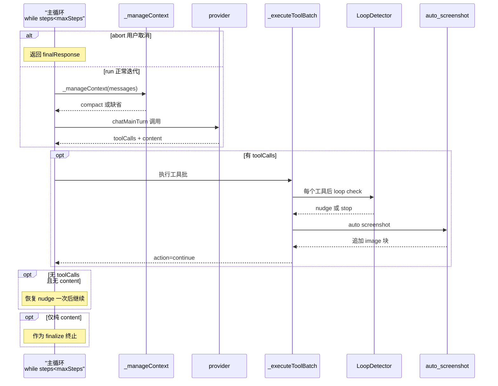

# 主 Agent 循环：感知 / 推理 / 行动的自执行架构

> 本子文档聚焦 WebBrain 的**自主工具循环**：单轮「LLM 推理 → 批量工具执行 → 回注上下文」的内部循环结构、`mode（ask/act/dev）`与`tier（compact/mid/full）`双轴如何决定工具面与权限语义、循环停止条件与 `maxSteps` token 预算、上下文自动压缩与紧急溢出恢复、会话/任务状态的可持久化，以及多层循环检测如何防止 agent 卡死在重复动作里。

## 根因：如何让「自我循环」可信地收敛

一个能自主操作浏览器的 agent，本质上是一个**不断复读自身输出的闭环**：它读页面、想下一步、调工具、把结果塞回上下文、再读、再想。这个闭环只要有一个环节失控就会致命——模型开始重复点同一个按钮、模型在单个页面上漫无目的地翻 ref_id、上下文把模型的推理预算吃光导致它「中途放弃」、或者面板关掉之后任务脱手无人认领。

WebBrain 的主循环要回答的根本问题是：**怎样让这个自我循环可信地收敛**。三组相互碰撞的诉求：

- **让它跑**——单轮 LLM 输入 + 工具输出循环，模型可连续多步自主推进任务。
- **让它停**——有硬性预算（`maxSteps`、上下文 token 上限）兜底，防止失控时烧钱烧死。
- **让它记住**——任务中途面板关闭、后台重新加载，都不能丢失已完成的进度与不确定的副作用。

主循环几乎所有复杂设计——`maxSteps` 预算、上下文压缩的 delta 估算、`action` 五态返回、多层 loop detector、detached-run journal——都是这三条诉求的具体落点。理解主循环，就是理解这三条线如何交织在同一个 `while (steps < this.maxSteps)` 里。

## 核心结构：一个由 LLM 驱动的「感知-行动批处理」管线

### 主循环骨架（autonomous loop）

主循环是一个普通的 `while (steps < this.maxSteps)` 计数循环。它不是把「每一步」当作独立请求，而是让模型在**一个持续增长的 `messages` 数组**上连续推理。循环头顶有 abort 检查，体内每轮先重建当轮工具面，再调用 `_manageContext` 做上下文预算检查（见「上下文自动压缩」），然后递增 `steps` 并发起 LLM 调用。

正文：主循环上限默认 130 步、可配置（configurable），每轮先从 abort 检查进入循环体。[src/chrome/src/agent/agent.js:27531-27533]()
<!-- anchor:     while (steps < this.maxSteps) { …     if (this._checkAbort(tabId)) { -->

正文：每次循环迭代开始都会重建工具定义（`getToolsForMode`），并调用 `_manageContext` 做上下文预算管控——这是「单轮内部压缩」而非「两轮之间压缩」的关键。[src/chrome/src/agent/agent.js:27566-27571]()
<!-- anchor:       // Auto-compact mid-run when the conversation outgrows the budget — not …       await this._manageContext(tabId, messages, onUpdate, costState); -->

正文：真正驱动循环的 LLM 调用是 `chatMainTurn`，它把整个累加的 `prunedMessages` 连同当轮 `tools` schema 一起喂给模型；模型要么返回 `toolCalls`（继续循环），要么返回纯 `content`（即终止）。`tools` 为空时（Ask 模式读不到页面操作工具、或 selectionOnly 场景）该调用退化成纯对话。[src/chrome/src/agent/agent.js:27580-27601]()
<!-- anchor:         const useTools = provider.supportsTools && tools.length > 0; …         result = await chatMainTurn(prunedMessages, chatOpts, { tabId, generationName: 'main' }); -->

### 从「推理」到「行动」的批量切换

当模型返回 `tool_calls` 时，主循环不自己逐个执行工具，而是把整批 `tool_calls` 交给 `_executeToolBatch`。批处理内部做参数校验、权限门控、CAPTCHA 门、WebMCP 准备、执行，以及最关键的结果注入——把页面上取回的数据包上 `<untrusted_page_content>` 标记回填到 `messages`。

正文：模型返回 `tool_calls` 后，主循环把整批工具调用委托给 `_executeToolBatch`；它的返回 `action` 值决定主循环是否继续——`continue` 让循环进入下一轮迭代，`return`/`deliver`/`recover`/`abort` 则终止本轮。[src/chrome/src/agent/agent.js:27836-27872]()
<!-- anchor:         const batchResult = await this._executeToolBatch( …         continue; -->

### 主循环单轮迭代链路

下面这张时序图展示主循环**最核心的一轮迭代**（上一轮已产生 `tool_calls` 时）——从 abort 检查、上下文预算、LLM 推理、批量执行、loop 检测、auto-screenshot，到回注结果、再次进入迭代的完整路径。

### mode × tier 双轴：为什么拆成两条独立的控制维度

工具面不是铁板一块，而是由 `getToolsForMode(mode, opts)` 里的**两个正交维度**共同决定：

- **`mode（ask/act/dev）`** 表达的是**权限语义**，即「这笔交互允许 agent 干什么」：`ask` 只能读（`ASK_ONLY_TOOLS`），`act`/`dev` 能操作页面，`dev` 额外叠加 `DEV_EXTENDED_TOOL_NAMES` 的开发向工具。
- **`tier（compact/mid/full）`** 表达的是**工具面数量**，即「给这个模型暴露多少个工具」：小模型工具定义多了会烧掉宝贵上下文，故 `compact` 只给核心工具，`full` 全量。

**为什么分离而非合并？** 两者回答的是不同的问题：`mode` 回答「该不该允许」，`tier` 回答「模型吞不吞得下」。把权限和工具面绑在一起会导致「想给大模型更多工具」就必须同时「给更多权限」，或反过来——权限不变时无法只调工具面规模。分离后，`ask + full` 可以是「只读但工具定义很大」，`act + compact` 是「能动但只给最小工具集」。

两维度还交互出一个边界：`dev` 与 `compact` 不兼容——`devCompactBlocked` 分支直接返回空工具面。原因是 `dev` 的扩展工具要求模型有理解能力，而 `compact` 本就是给能力不足的小模型的最低配置，二者叠加无意义，宁可报错也不给一个阉割版的 `dev`。

正文：mode/tier 双轴在 `getToolsForMode` 中交叉分发：`ask` 取只读工具、`dev`+`compact` 直接拒绝、`compact`/`mid`/`full` 三档按工具名集合过滤 `AGENT_TOOLS`。[src/chrome/src/agent/tools.js:1554-1570]()
<!-- anchor:   const devCompactBlocked = normalizedMode === 'dev' && tier === 'compact'; …     base = AGENT_TOOLS.filter(t => FULL_TOOL_NAMES.has(t.function.name)); -->

正文：工具面不是标量——`dev` 在 `tier !== compact` 时把 `DEV_EXTENDED_TOOL_NAMES` 里没见过的工具追加进 base，再按运行时能力（webMcp、carousel、watchBeep、skillLoader）增减。[src/chrome/src/agent/tools.js:1602-1605]()
<!-- anchor:   if (normalizedMode === 'dev' && tier !== 'compact') { …     base = [...base, ...devTools]; -->

**工具面的基数锚点**：`AGENT_TOOLS` 是全部工具的总表。[src/chrome/src/agent/tools.js:19-19]() 起。每种 mode/tier 组合都是对这个总表的**投影**，而非各自维护一份定义——新增工具只需在 `AGENT_TOOLS` 加一项并在 `*_TOOL_NAMES` 集合登记。系统提示词也随 tier 分档：`_getActPrompt` 按 `_resolvePromptTier()` 返回 `compact/mid/full` 三套不同的 ACT 提示词。
<!-- anchor: export const AGENT_TOOLS = [ -->

正文：active 的 system prompt 由 tier 决定——小模型换紧凑版 ACT 提示词以省上下文，`_getActPrompt` 按 `_resolvePromptTier()` 返回三档版本。[src/chrome/src/agent/agent.js:14508-14512]()
<!-- anchor:   _getActPrompt() { …     return SYSTEM_PROMPT_ACT; -->

**为什么 `get_accessibility_tree` 是首选读页工具（accessibility-tree 语义读取）**：WebBrain 读页面不直接抓整页 HTML，而是从可访问性树提取语义化文本。原因是 a11y 树只保留「模型能理解怎么操作」的节点（按钮、输入框、链接、heading…）并附带**稳定的 `ref_id`**，而原始 HTML 充满样式标记、脚本噪音与嵌套混乱。`ref_id` 是循环的关键：模型前一轮拿到 `ref_id`，本轮可直接 `click_ax(ref_id)` 而不必重新解析 DOM。它按页（`page`）切片，超长自动返回 `continuationArgs`，模型据此翻页而非一次拉回巨树——这是循环 token 预算与读页容量之间的权衡。

正文：`get_accessibility_tree` 是首选读页工具，返回带稳定 `ref_id` 的语义树并按页切片（用 `continuationArgs` 续页），而非整页 HTML——这是 token 预算与可操作性之间的核心权衡。[src/chrome/src/agent/tools.js:23-24]()
<!-- anchor:       name: 'get_accessibility_tree', …       description: 'PREFERRED page-reading tool. Returns the page as a flat, indented text -->

## 执行流程：`action` 五态返回与循环推进

`_executeToolBatch` 内部遍历一批 `tool_calls`，对每个工具做一整套前置校验（参数合法性、授权门控、CAPTCHA 门、Chrome 保护页、skill 端点重定向等），但批次最终返回给主循环的只是一个**字符串状态 `action`**。主循环只根据这个 `action` 决定是 `continue` 还是终止，而不关心批次内部到底执行了多少个工具。这个抽象是主循环保持「薄」的关键——工具执行的所有复杂分支（capcha、权限、验证）都被封装在批次内部，主循环只消费一个信号。

返回语义是稳定的契约（`return`/`deliver`/`recover`/`abort`/`continue`）：

- `continue`：无终止条件，落到循环底部自然进入下一轮。
- `return`：正常完成（如 `done` 结束），立即返回 `finalResponse`。
- `deliver` / `recover`：终端恢复路径，交给专门的 `_recoverDeliveryCheckpointTurn` / `_recoverLoopStoppedTurn` 处理再返回。
- `abort`：用户取消，返回取消消息。

**为什么需要专门的 `deliver` / `recover` 而非一律 `continue`**：某些工具（如一次投递、或完成被 `loop stop` 打断）的副作用可能已经落地，需要 agent 在完成态收尾而非让主循环顺手又发起一轮 `continue`。单列这两条，是避免「工具已成功但 agent 卡在继续重试」的重复副作用。

正文：一批工具执行后，主循环按 `action` 分派——`return` 直接返回、`deliver`/`recover` 走终端恢复、`abort` 返回取消、`continue` 自然迭代。[src/chrome/src/agent/agent.js:27839-27872]()
<!-- anchor:         if (batchResult.action === 'return') { …         continue; -->

## 循环停止条件与 maxSteps token 预算

### 停止的三道闸门

主循环的终止不是单一条件，而是三条互不重叠的闸门。

**闸门一：`maxSteps` 预算（权威上限）**。`this.maxSteps = 130`，计数循环 `while (steps < this.maxSteps)`。循环从 `while` 条件退出的那一刻，如果 `steps >= maxSteps` 且没有真实最终答案，主循环会**合成一条透明的摘要**（`_buildStepLimitSummary`）而不是返回空 `done`，向用户解释「为什么跑了 130 步没产出」。[src/chrome/src/agent/agent.js:28077-28078]()
<!-- anchor:     if (steps >= this.maxSteps) { …       onUpdate('max_steps_reached', { steps: this.maxSteps }); -->

**闸门二：abort（用户取消）**。`_checkAbort(tabId)` 检查 `abortFlags` map，一旦置位即终止。它在主循环**顶部**（每次迭代前）、**LLM 响应之后**（`agent.js:27732`）、以及工具批处理**内每个工具前**（`agent.js:6433`）都被检查——三个检查点覆盖了「发出前」「响应后」「执行中」三条时间线，保证用户 Stop 能在最短延迟内生效，尤其不会让一个耗时的工具调用在用户取消后继续跑。

正文：abort 由 per-tab 的 `abortFlags` map 承载，`_checkAbort` 读到即删除并返回真——语义是「一次性消费」：同一标志只触发一次取消。[src/chrome/src/agent/agent.js:14493-14498]()
<!-- anchor:   _checkAbort(tabId) { …     return false; -->

**闸门三：`action: abort/return`**。工具批次或前置 `_maybeExecuteRecommendedActionFirstTool` 返回这些终止动作时直接返回，这在主观上也是「停止」的一类（见上）。

### 上下文 token 预算（决定「跑到哪停」的软性层）

`maxSteps` 是外层的硬次数，内层还有一个按**上下文容量**决定的软预算。`messages` 不能无限增长，否则一次 LLM 调用就会超出 provider 的 context window 而 hard-error。WebBrain 用 `_contextTokenBudget` 把 provider 的 `contextWindow` 乘一个随窗口大小调整的压缩比得到 token 预算，再换算成字符预算与消息条数预算。

正文：上下文软预算由 provider 的 contextWindow 乘随窗口大小调整的比值得出 token 预算，再换算成字符/消息条数预算——这是循环「应在上下文耗尽前收敛」的软性控制器。[src/chrome/src/agent/agent.js:17495-17498]()
<!-- anchor:   _contextTokenBudget(tabId = null) { …     return Math.floor(window * this._contextCompactRatioForWindow(window)); -->

## 上下文自动压缩（auto-compaction）与紧急溢出恢复

### _manageContext：在循环内部而非两轮之间压缩

这是主循环最精巧的部分之一。`_manageContext` 在**循环内每一轮**都被调用（见上节主循环骨架的引用），即 mid-run 压缩，而非只在用户每发一条新消息时才压缩。因为长任务里 agent 一轮一轮烧工具，消息数增长快得惊人，等两轮间隙再压缩时早就溢出 provider 窗口了。

预算判定是一个三态检测：是否「消息条数过多」/「字符数过多」/「预估 token 过多」。预估 token 用「上次报告的 token + 本次的增长 delta」来幂等计算，避免把固定开销（系统提示 + 完整工具 schema）重复算进去——`lastReported` 携带固定开销，delta 只捕捉新增消息。

正文：`_manageContext` 用「字符数 / 消息条数 / 预估 token」三态之一触发压缩；预估 token 用「上次报告的 token + 增长 delta」幂等，避免把固定开销重复算入。[src/chrome/src/agent/agent.js:17685-17701]()
<!-- anchor:     const estTokens = Math.ceil(totalChars / 4); …     const tooManyTokens = usedTokens > tokenBudget; -->

判定之后分两条路：

1. **token 溢出（`tooManyTokens`）永不抑制**——这是防止 provider hard-error 的最后防线，即使刚压缩过也会立刻再次压缩。
2. **字符/消息软触发带 hysteresis**——刚压缩完的 2 轮内抑制软触发，避免「单张截图就重新武装压缩」的 compact-every-step 抖动。（`agent.js:17703-17712`）

压缩策略是「**保留锚点 + 摘要旧段 + 保留最近段**」：

- **锚点**：系统提示 + **原始用户任务**（第 1 条真实用户消息）+ scratchpad + agent memory + progress ledger + 最近一次 scheduled resume。原始任务被注释点名「折叠它会害小模型忘记自己在干嘛」，所以永远逐字保留在位置 1。（`agent.js:17718-17742`）
- **旧段摘要**：把「原始任务之后、最近 N 条之前」的旧消息逐条折叠成一行摘要（用户问了什么 / 助手答了什么 / 工具结果 digest），若摘要超过 2000 字符再用 LLM 压缩成 3-5 个要点。（`agent.js:17896-17911`）
- **最近段**：保留最近 30 条逐字（约 15 轮工具往返）。（`agent.js:17744-17749`）

**边界修复**：最近段的起点不能落在工具调用组的中间——若切在 assistant `tool_calls` 之后，`recentMessages` 会以孤儿 `tool` 结果开头，而 OpenAI/Anthropic 都拒绝没有前置 assistant 的 tool 消息，所以把开头的 tool 结果移回摘要段。（`agent.js:17771-17782`）

重建后 `messages` 变成「system + 原始任务 + scheduledResume? + scratchpad? + memory? + progress? + summary+ack + ...recent」，并清空上次 token 读数、武装 2 轮 cooldown。

正文：压缩重建的最终形态——保留锚点（原始任务/scratchpad/memory/progress）+ 摘要段 + 最近 30 条，清空 token 读数并设 2 轮 cooldown 防抖动。[src/chrome/src/agent/agent.js:17916-17932]()
<!-- anchor:     const summaryMsg = { role: 'user', content: `[Context window was trimmed to stay within budget. …     this._compactCooldown.set(tabId, 2); -->

### 紧急溢出恢复（_emergencyTrim）

`_manageContext` 管的是「将满未满」的主动压缩；还有一种「已经满了、provider 直接报 context overflow」的被动恢复。主循环 catch 住 `_isContextOverflow(e)` 后，先 `_emergencyTrimMessagesForRun()` 激进裁剪再重试一次；若重试仍溢出则终止并提示用户新建会话。`_emergencyTrim` 与 `_manageContext` 共享同一套「钉住原始任务」的逻辑，但裁剪更激进。

正文：provider 硬报 context overflow 时，主循环先急剪一次、最多重试一轮，仍溢出则终止并提示开新会话——这是 `_manageContext` 未兜住时的最后防线。[src/chrome/src/agent/agent.js:27643-27671]()
<!-- anchor:         if (this._isContextOverflow(e.message)) { …             finalResponse = 'The conversation got too long. Please start a new conversation (click the + button).'; -->

## 多层循环检测：防止「模型重复它自己」

### 为什么需要独立于 maxSteps 的第二道护栏

`maxSteps` 是次数上限，但它不区分「正常推进的 130 步」和「卡死在同一个动作上的 130 步」。一个卡死的 agent 会烧掉全部 130 步预算、消耗大量 token，最后只返回一句「没完成」。所以需要**尽早识别循环**并在预算耗尽前拉回。这就是 loop detection——**软性先劝、硬性后杀**的两级策略。代价不对称是关键：一次 nudge 误报只占模型一行上下文，而一次漏报可能是 $5 的零产出运行。

### 检测器组合：一个入口支撑多层信号

`_checkLoop` 是总入口，它把多路信号编排起来，再按「stop > nudge > none」合并：

1. **精确参数环**（`_detectLoop`）：在 per-tab 6 条环形 buffer 里找「同一 key 3 次以上」或「ABAB 振荡」——覆盖「重复点同一个按钮」。
2. **URL-family 语义 bucket**：URL 抓取类工具不按精确参数哈希（否则换个 GitHub 端点就逃逸），而是按「资源 bucket」，见下文 loop-bucket。
3. **坐标点击环**（`_checkCoordClickLoop`）：坐标归到最近 5px、window 12 条，第 5 次 nudge、第 8 次 stop。
4. **可访问性读环**（`_checkAccessibilityReadLoop`）：模型读 `ref_1, ref_2, ...` 而从不行动——唯一解析「读取 vs 行动」语义的检测器。
5. **无进度滚动环**（`_checkNoProgressScroll`）：滚动返回 success 但页面没动。
6. **校验对话框重开环** 与 **转盘振荡环**（carousel）：验证弹窗/相册翻页的专门环。

**失败动作环**用 `failedActionLoops` map 记录「同一目标连续失败 N 次」，3 次即 stop。**导航归零**：一旦页面 URL 变化且不是「访问最近见过的 URL」，就清空页面级 loop 状态——新页面上的控件该从第一次计数开始；但如果回到近期 URL（如 click/go_back 乒乓），则保留计数，否则乒乓每次跳转都被重置而永远抓不住。

正文：_checkLoop 依据工具结果是否表示 URL 变化来「归零还是保留」loop 状态——首次访问新 URL 清空页面级计数器，但返回近期 URL（导航乒乓）时保留计数，以防乒乓每次跳转都被重置而逃逸。[src/chrome/src/agent/loop-detector.js:585-591]()
<!-- anchor:   _checkLoop(tabId, toolName, toolArgs, toolResult) { …     if (toolResult?.pageUrlChanged === true && !this._noteNavArrival(tabId, toolResult.currentUrl)) { -->

正文：基础环用「同一 key 命中 3 次」或「最近 4 条 ABAB 振荡」来判定——前者抓重复，后者抓在两个调用之间来回摇摆。[src/chrome/src/agent/loop-detector.js:239-260]()
<!-- anchor:   _detectLoop(buf, activeKey = null) { …     return null; -->

正文：nudge 升级为 stop 的机制——每检出一次环就给 per-tab nudge 计数加一，同一轮内累计 8 次即 hard-stop；`healthyCallsSinceLoop` 记录健康调用，连续 2 次健康才重置 nudge 计数，避免「夹在两段卡死之间的一两次正常调用」把环洗掉。[src/chrome/src/agent/loop-detector.js:699-711]()
<!-- anchor:     // Any new loop detection resets the healthy-streak counter. …         message: `Stopped: I detected I was looping on ${desc} without making progress after multiple warnings. Please tell me what's blocking, give me a different instruction, or take a look at the page yourself.`, -->

### loop-bucket：把「换端点逃逸」关进同一个 bucket

问题：agent 在 GitHub 上取同一份 `en.json`，可以用 raw URL、contents API、git/blobs、blob-page 四种形态——精确参数哈希会判成四种不同调用，永不触发。实际 trace 里 agent 就真用 8 种方式抓同一文件而没识别。

解法：`bucketArgsKey` 把 URL-family 工具的参数（`fetch_url`/`research_url`/`read_page_source`/`download_file`/`read_downloaded_file`）降维成「资源 bucket + method」。`resourceBucket` 把所有 GitHub 家族 host 归一成 `github.com`，并剥离 `/repos/o/r/contents/`、`/o/r/blob/<ref>/` 等语义前缀，只保留 `<owner>/<repo>/<路径>` 三元组——同一文件的不同 URL 形态坍缩到同一 key。

**这是明确的权衡而非纯 bug**：bucket 过多会把「合法三步流程」（GET raw → GET contents 拿 SHA → PUT 写回）的前两步折叠为同 key。代码注释里直接论证了为什么接受——误报只是 nudge（一行上下文），漏报是整次死循环；且第 3 步是 `PUT`（method 不同），`bucketArgsKey` 把 method 编进 key，合法写入即可重置计数。

正文：URL 抓取类工具按「资源 bucket + method」而非精确参数哈希——同文件的多种 URL 形态坍缩为同一 key 以抓逃逸；已知误报（合法三步流程）被接受，因为误报只是一行 nudge、漏报是整次死循环。[src/chrome/src/agent/loop-bucket.js:155-163]()
<!-- anchor: export function bucketArgsKey(name, args) { …   return JSON.stringify(args || {}); -->

正文：非 GitHub 的 URL 保留小写 host 与路径末尾 3 段作为 backstop，换取跨 host 抖动也能被抓到（容忍一点兄弟文件误并）。[src/chrome/src/agent/loop-bucket.js:106-114]()
<!-- anchor:   const ghBucket = _ghResourceBucket(rawHost, rawPath); …   return `${rawHost}::${tail}`; -->

## 会话/任务状态管理与持久化：detached-run journal

### _persistNow 与 conversation-persistence

主循环不是无状态地跑完就丢——每一步都涉及把 `messages` 和运行状态写回 `chrome.storage`。`_persistNow`（及带 debounce 版的 `_persist`）在多个关键节点被调用（工具批次内、压缩后、取消后等），保证即使面板中途崩掉，`conversation-persistence.js` 也能把对话恢复出来。

但**原始 messages 持久化不足以支撑「面板关闭后任务继续跑」**，这才有下面的 run-ui-journal。原始 `messages` 记录的是「对话内容」，而 run-ui-journal 记录的是「这一场 run 的可视化进度事件流」，二者目的不同：一个是供下一轮调用喂给 LLM，一个是供断开的面板重建 UI。

### RunUiJournal：有界事件日志 + seq 分页 + 确认水位

`RunUiJournal` 是独立于原始 messages 的**进度事件日志**。它不是记录对话文本，而是记录一场 run 的**可见 UI 事件流**（`tool_call`、`tool_result`、`text_delta`、`run_complete`、`plan_review`...），每个事件带单调递增的 `seq`。

正文：journal 是有界事件流——最多保留 256 条事件并随驱逐推进 `discardedBeforeSeq`，同时用 `ackedSeq` 记录「面板已读到的 seq」，两水位共同定义哪段可重放、哪段已不可用。[src/chrome/src/run-ui-journal.js:232-269]()
<!-- anchor:   record(tabId, requestId, type, data, runId = null) { …       snapshot.truncatedBeforeSeq = snapshot.discardedBeforeSeq; -->

两个关键设计：

- **有界**：`events` 最多保留 `RUN_UI_EVENT_LIMIT`（256）条，满了挤掉最老事件并推进 `discardedBeforeSeq`；`streamedText` 也有 10 万字符上限。持久化 snapshot 还有预算水位 `RUN_UI_PERSIST_BUDGET`（512KB），超出就从前往后删字段并推 `discardedBeforeSeq`。（`run-ui-journal.js:88-93`）
- **可确认**：sidepanel「读到了哪些事件」通过 `acknowledge` 记录 `ackedSeq`，已确认的事件从 journal 里丢弃。[src/chrome/src/run-ui-journal.js:405-411]() 这样 journal 是**流式的 checkpoint**，不是一直膨胀的完整记录——面板每读一段就确认一段，后台只保留未读取部分。
<!-- anchor:   acknowledge(tabId, requestId, seq) { …     snapshot.events = snapshot.events.filter(event => Number(event?.seq || 0) > snapshot.ackedSeq); -->

`seq` 分页（`ackedSeq` / `discardedBeforeSeq` 两个水位）让新增的 sidepanel「从断点续读」成为可能：`runUiSnapshotForRequest` 按 `requestId` 过滤，`runUiUnavailableBeforeSeq` 告诉面板哪些事件因为已确认或已驱逐而不可重放。

正文：runUiUnavailableBeforeSeq 把「已确认」与「已驱逐」两水位取大，作为面板重放的不可用下界——区分这两种「读不到」的原因是：已确认是正常释放，已驱逐是真正丢失。[src/chrome/src/run-ui-journal.js:29-33]()
<!-- anchor: export function runUiUnavailableBeforeSeq(snapshot = {}) { …   return Math.max(acknowledgedBoundary, runUiDiscardedBeforeSeq(snapshot)); -->

### run-reconnect：面板关闭后如何凭 journal 重连

当用户关掉 sidepanel（或后台 context 因扩展卸载/Chrome 重启而重建）而 run 仍在后台跑时，`run-reconnect.js` 负责恢复。它轮询 probe 后台的 run 状态，关键判断基于 journal snapshot 的身份与终态：

正文：reconnect 的判据——`sameSnapshot` 校验 snapshot 的 `requestId` 与本次请求一致，`sameStartingRun`/`sameLiveRun` 分别对应「后台尚在启动/正在跑同一请求」；一旦 snapshot 进入终态集合即返回最终响应。[src/chrome/src/run-reconnect.js:178-195]()
<!-- anchor:       const snapshot = state?.runUi && typeof state.runUi === 'object' ? state.runUi : null; …           submittedTurnDurable: state?.submittedTurnDurable === true, -->

**为什么不能盲目重新 start？** 恢复的最大陷阱是**重复副作用**——如果后台已执行过某个改动页面的动作却没留下记录，重新 start 就会把该动作再执行一遍。因此恢复逻辑在多数不确定情形下选择「失败并要求用户介入」而非「重新开始」：

正文：若 journal 记录了未定的工具调用（`pendingToolCall`），恢复直接失败并要求用户检查页面后再重试——宁可中止也不冒险重复已落地的页面动作。[src/chrome/src/run-reconnect.js:239-240]()
<!-- anchor:         if (snapshot.pendingToolCall) { …           throw new Error(`Run recovery stopped because the outcome of ${snapshot.pendingToolCall.name || 'a page action'} is uncertain. Check the page before retrying to avoid repeating the action.`); -->

这个「fail-safe 而非 retry」的设计贯穿整个 recover：`runUiDurable false`（最新 checkpoint 未持久化）、`submittedTurnDurable !== true`（提交的那轮还没写盘）、`pendingToolCall`（有个工具结果不确定）都会让恢复停止并要求用户核对。只有当 `pendingToolCall`、durability 都满足时，才会用 `resumeAction` 触发后台 `resume`，而不是重发最初的 `start`。

正文：recover 从「重发 start」变为「发 resume」——一旦观察到自己的请求已送达（`startObserved`），绝不重试原始 start，而是改用 resume 从已落盘的 checkpoint 继续，从结构上规避重复副作用。[src/chrome/src/run-reconnect.js:204-218]()
<!-- anchor:       if (sameStartingRun || sameLiveRun) { …         continue; -->

## 依赖关系

主循环的可观测与可控，依赖一组围绕它的协作者，构成清晰的依赖边界：

- **`tools.js` 的 `getToolsForMode`** 为循环的每一轮提供当轮工具面（及 `done` 工具的动态替换、`SYSTEM_PROMPT_ACT/ASK` 系统提示词）。
- **`loop-detector.js` + `loop-bucket.js`** 被 `_executeToolBatch` 在每次工具后调用，是循环「是否能继续可信推进」的检查器；`Agent extends LoopDetector` 直接继承了这类无浏览器依赖的检测逻辑。
- **`conversation-persistence.js` / `_persistNow`** 负责把 `messages` 与运行状态写回 `chrome.storage`，是「让它记住」的落地。
- **`run-ui-journal.js` + `run-reconnect.js`** 支撑 detached-run 的跨面板可持续：journal 记录可重放的进度事件，reconnect 依据 journal 的 status/requestId/durability 决定重连还是安全失败。
- **`provider`（`chatMainTurn`）** 是循环的「推理引擎」；它的 `contextWindow` 经 `_contextTokenBudget` 折算成上下文预算，反过来约束循环该在何处压缩、何处收敛。

主循环把这些依赖编排在一个 `while (steps < this.maxSteps)` 里：`tools` 决定「可用动作」、`_manageContext` 决定「还能装多少」、loop-detector 决定「是不是在空转」、persist 决定「崩了捡得回来」、reconnect 决定「重新打开还接得上」。循环的可信收敛，不等于任何单个部件的正确，而是这五者协同的结果。

## 四要素对照

- **核心结构**：一条由 `chatMainTurn` 驱动的感知-行动批处理管线，`while (steps < maxSteps)` 计数循环 + `_executeToolBatch` 工具批。
- **执行流程**：每轮「abort 检查 → 重建工具面 → `_manageContext` 预算 → LLM → 工具批（loop 检测 + auto-screenshot + 结果回注）→ 按 `action` 分流」。
- **设计决策**：mode/tier 双轴分离权限语义与工具面规模、maxSteps 硬预算 + 上下文软预算双层停闸、mid-run 自动压缩 + emergency trim 双保险、nudge 到 stop 两级 loop 检测、run-ui-journal 有界 checkpoint + fail-safe reconnect。
- **依赖**：tools / loop-detector(+bucket) / conversation-persistence / run-ui-journal / run-reconnect / provider，六方协作构成闭环。

## 总结：一条可收敛的自反馈环

回到开篇的根因——WebBrain 主循环的全部复杂度，都是在回答「一个会不断自我复读的 agent，如何被允许一直跑、又能被可靠停下、还能在中断后捡回来」。读它源码得到的核心启示是：**它不信任任何一个单一的停止条件**。`maxSteps` 管次数，token 预算管容量，loop detector 管「空转」，三者正交叠加；上下文压缩在预算耗尽前主动瘦身，而不是等 provider 硬报错；persist/journal/reconnect 把「中断」从一个故障，变成一次可恢复的状态转移。对一个在真实浏览器里自主操作、且可能烧真金白银算力的系统来说，这种「分层兜底」不是过度设计，而是让「自主」二字站得住的前提。
