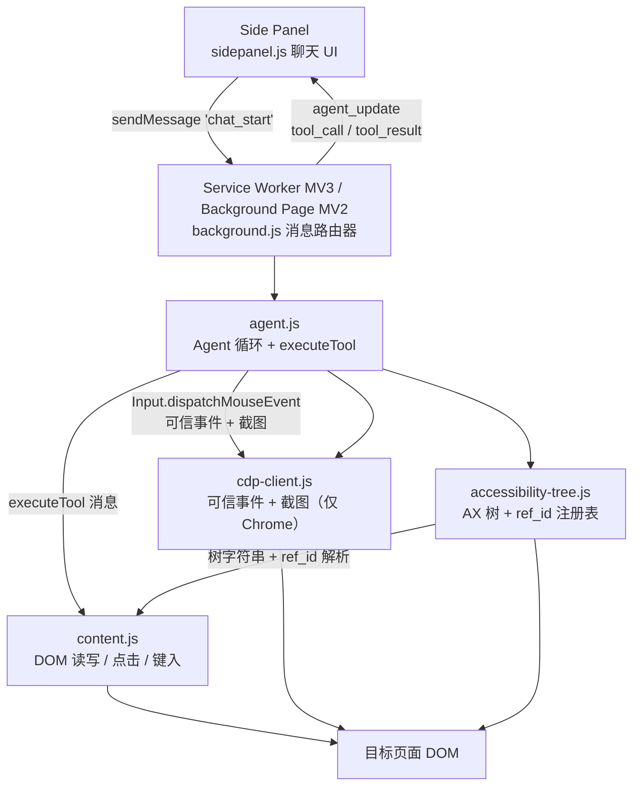
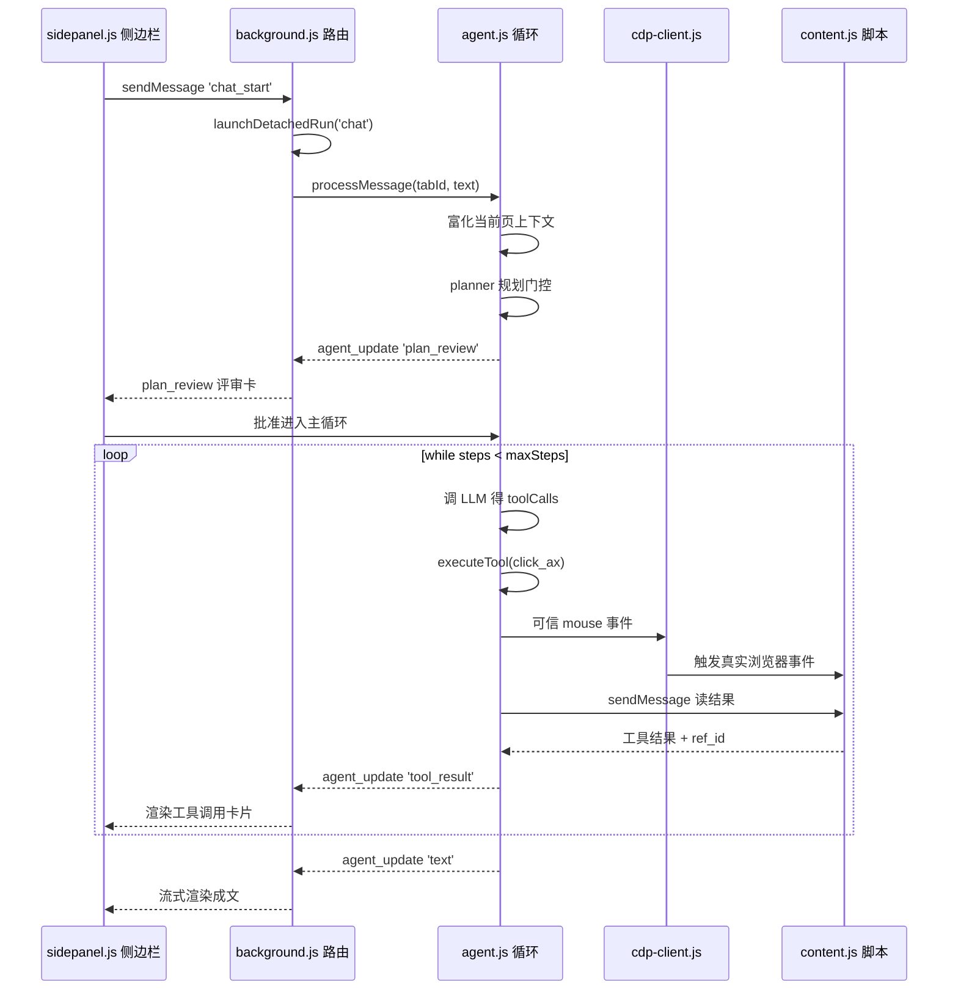
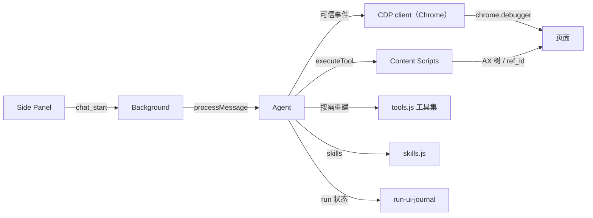

# WebBrain 架构深入解读

> 本文是 WebBrain 解读的架构关注面子文档，聚焦：分层架构、一次"用户提问 → 浏览器动作"的完整请求链路，以及 Chrome（MV3）与 Firefox（MV2）双构建的平台差异。所有 `路径:行号` 引用均可点开核对真源码。

## 根因：浏览器是最后一公里接口

大多数 LLM Agent 只看得见 API，够不到需要真浏览器会话才能完成的动作——登录态、验证码、富文本编辑器、混合 iframe 表单。WebBrain 的根本命题是：把「用户正在看、且已登录的那个标签页」变成 Agent 的一个行为工具面。它不自己起 headless Chrome，而是直接控制用户当前的活动 tab，所以天然继承用户的所有 cookie、会话、扩展状态，也天然受制于真实 DOM 的脏、乱、动态。

这带来三条架构约束，之后每一层设计都能回推到它们：
- **跨进程**：扩展 UI、后台、内容脚本、页面本身分属四个隔离世界，必须显式传消息。
- **渐进注入**：同一份代码要同时驱动"读页面 → 规划 → 点击 → 观察结果"的自治循环，每步都涉及可信/不可信边界的切换。
- **双引擎**：Chrome 与 Firefox 对"可编程注入真实输入"能力不同，逼迫同一逻辑走两套落地点。

## Layered Architecture（分层总览）

WebBrain 是典型的四层扩展：Side Panel（UI）→ Background Script / Service Worker（中枢 + Agent）→ Content Scripts（页面内执行体）→ 目标页面（DOM）。官方设计文档给出了一致的层次图（[docs/architecture.md:17-62]()），下面这张图把消息数据流标了进去。

各层职责一句话：
- **Side Panel** `ui/sidepanel.js`：聊天 UI，负责发送 `chat_start` 并把后台推回的 `agent_update` 流式渲染成工具调用卡片、plan 评审卡、最终答案。
- **Background / Service Worker** `background.js`：纯消息路由器，不做推理，只按 action 分发给 agent、provider、scheduler 等子模块。
- **Agent** `agent/agent.js`：真正的大脑，持有 agent loop 与工具分发 `executeTool`。
- **CDP client** `cdp/cdp-client.js`（Chrome only）：用 `chrome.debugger` 产生浏览器级可信事件，是 Chrome 可信输入的落地点。
- **Content Scripts**：页面内的执行体，`accessibility-tree.js` 造 AX 树，`content.js` 干脏活。

### 为什么用 accessibility-tree 而非 CSS 选择器

页面交互的首要难题是"如何定位一个元素"。CSS 选择器看似直接，但 WebBrain 放弃它作为主路径，原因有二：

一是**选择器对动态页面极脆**。SPA 每次 re-render 都可能改 class、挪 DOM 深度，上一轮拿到的 `#app > div:nth-child(3)` 下一轮就指向别处。WebBrain 的 AX 树给每个 survived 元素一个**跨调用稳定**的 `ref_id`，并且是挂在元素上、随元素生命周期走，而不是随文档结构走：

ref_id 存在 `window.__wbElementMap` 里的 WeakRef 中，只要元素还在 DOM 里，它就一直持有同一个 `ref_N` 标识；每次调用清扫 deref 已亡的条目，映射不会无限增长（[src/chrome/src/content/accessibility-tree.js:21-24]()）。
<!-- anchor: * 2. ref_id IS STABLE ACROSS CALLS. ref_ids live in window.__wbElementMap as … *    gone, so the map doesn't grow unbounded. -->

二是**可读性即模型可消费性**。AX 树输出的是一份**扁平、缩进的纯文本字符串**，每个节点一行携带 role、可访问名、`ref_id` 与关键属性（[src/chrome/src/content/accessibility-tree.js:10-15]()）。

AX 树输出不是 JSON，而是一棵扁平缩进的文本树——如 `button "Sign in" [ref_42] type="submit"`，缩进按树深递增，跳过的通用容器被压平，让模型读一份紧凑的页面语义摘要而非整棵 DOM。
<!-- anchor: * 1. OUTPUT IS A FLAT INDENTED TEXT STRING, not a JSON tree. Each kept node … *        button "Sign in" [ref_42] type="submit" -->

这样做的权衡是：AX 树是**有损压缩**（丢失视觉位置、非语义文本、精确坐标），所以视觉信息靠截图补位，精确定位靠 ref_id → 元素的反查（[src/chrome/src/content/content.js:2314]() 用 `__wb_ax_lookup(ref_id)` 把 id 解析回 Element）。模型先看文本树规划，需要坐标时截图 + 点击互转，错误时靠 `content.js` 的 AX 反查纠偏。可见"文本为主、坐标为辅"是显式的设计选择，不是偷懒。

## 启动流程

WebBrain 没有传统意义的"应用启动"，因为它是被浏览器按需激活的扩展。真正的初始化工序发生在两个时点：

一是**Background 模块被构造**时同步建立全局单例状态。Chrome 侧是 MV3 的 service worker（可被生命周期回收重造），Firefox 侧是 MV2 常驻 background page。初始化集中在 `status` 应用启动分支：构造 `ProviderManager`、`ScheduledJobManager`、每个被 trace 修复的后台任务（[src/chrome/src/background.js:112-119]()）。

二是**每个标签页加载内容脚本**时：`accessibility-tree.js` 先注入并安装 `window.__generateAccessibilityTree()` 和 `window.__wb_ax_lookup()`，随后 `content.js` 才进来（设计文档 [docs/architecture.md:122-125]()）。顺序敏感是因为 content.js 的工具 handler 会直接调用两者。

MV3 特有的启动语义是**惰性 + 断电恢复**。service worker 在无事件时被回收，被唤醒时所有模块 fresh start：
- `launchDetachedRun` 用 `detachedRunStarts` Map 记住每 tab 的进行中 run，配合日志（run-ui-journal）把 run 状态持久化，从而面板中途关闭/重载也不丢 run（[src/chrome/src/background.js:1873-1899]()）。
- 侧边栏端 `sendRunWithReconnect` 提供探测 `agent_run_state` + 重连恢复的语义，正是为应对 background 重启而设计（[src/chrome/src/ui/sidepanel.js:12023-12061]()）。

## 核心请求链路：一次"用户提问 → 浏览器动作"

以设计文档 [docs/architecture.md:137-158]() 给出的示例任务（创建商品）为准，完整链路如下。它是理解整份代码的脊椎：**UI（无状态）→ 路由（薄）→ Agent（状态机）→ 执行体（IO）**。

链路每一步的真实落点与设计意图：

**① UI 发送 `chat_start`**。侧边栏把本轮需要的一切状态打包（[src/chrome/src/ui/sidepanel.js:8335-8354]()）：文本、mode、附件、API 变更许可、前台标记、截图指令等。设计上故意做成"**detached + 可重连**"——不是同步等一个回合返回，而是发一个 started 请求，再订阅后台为这个 run 维护的事件流。

**② Background 路由 `chat_start`**。`handleMessage` 的 `case 'chat_start'`（[src/chrome/src/background.js:2707-2742]()）先做完 provider 校验，再交给 `launchDetachedRun`。`launchDetachedRun` 的真正价值是**所有权与重连**：把 run 挂到 `detachedRunStarts` 上，即使 side panel 关闭/重载也不会中止 run；之后 agent 内部通过 `processMessage` 进入真正的状态机（[src/chrome/src/background.js:2869]()）。
<!-- anchor: case 'chat_start': { … throw error; -->

**③ 首条用户消息富化**。`_enrichUserMessageWithCurrentPage` 把"当前页面是谁"注入用户消息：URL+title、站点 adapter 脚本、录音状态、API 变更许可、可选截图——但**明确不加原始 HTML/DOM 转储**（见设计文档 [docs/architecture.md:175-187]()：默认只给 url+title+截图，需要内容时按需请求 AX 树或提取文本）。这条刻意克制是预算与隐私的权衡：把整页塞进 prompt 既贵又引入无关噪声，改为"按需、限量、分页"。

**④ Plan-before-Act 门控**。动作模式的 run 在主循环前再用同一 LLM 跑一次结构化 JSON 规划（planner.js），产出步骤列表、可选中 skills，并生成一个 `plan_review` 事件给 UI 渲染成可编辑的评审卡。批准才把计划钉入 scratchpad 并进入工具循环；被拒/超时/用户中止则在**任何浏览器工具执行前**停手（设计文档 [docs/architecture.md:189-193]()）。这是安全设计：宁可多一次 LLM 调用，也不让未确认的步骤动浏览器。

**⑤ 主 Agent loop**。`processMessage` 里的 `while (steps < this.maxSteps)` 是这个自治核心。主循环每轮最优先检查用户 abort——abort 触及时立即置 `[Stopped by user]`、记录 cancelled 状态并突破循环，绝不继续执行浏览器工具（[src/chrome/src/agent/agent.js:27531-27539]()）。每轮先查 abort、重建工具集、调 LLM 得 toolCalls、逐批执行工具、把结果 push 回 messages、再循环；`maxSteps: 130` 是对自治"无限循环"的安全上限。
<!-- anchor: while (steps < this.maxSteps) … messages.push(this._localCancellationMessage(finalResponse)); -->

**⑥ 工具分发 `executeTool`**。`executeTool(tabId, name, args)` 是最大的 dispatch 边界：按 name 分流到内容脚本、CDP、`chrome.tabs`、网络工具或技能注册表（[src/chrome/src/agent/agent.js:20040-20077]()）。这同时也是所有安全护栏的**收口点**，富文本工具栏阻断、受保护页面阻断、坐标截图回退、消息收件人守卫都先于真实 dispatch 跑一遍——任何阻断落在 `richTextToolbarBlock` / `protectedFailure` 上直接 return，不让动作真正发出（design 文档 [docs/architecture.md:296-316]() 给出完整工具表格）。
<!-- anchor: async executeTool(tabId, name, args, onUpdate = null, executionContext = null) { … const richTextToolbarBlock = await this._richTextToolbarToolBlock( -->

**⑦ 浏览器动作落地（分 chrome / firefox 两条路）**。Chrome 走 CDP 可信事件，Firefox 走内容脚本合成事件。这是全文最关键的平台差异，详见下节。

**⑧ 结果回流 UI**。agent 每步通过 `onUpdate(type, data)` 广播 `tool_call` / `tool_result` / `text` / `plan_review` 等事件，background 转成 `agent_update` 消息发给侧边栏流式渲染（设计文档 [docs/architecture.md:531-540]()）。UI 从不等一整个 run，而是靠事件流逐步重建"正在发生什么"。

## Chrome / Firefox 双构建：共享逻辑，两套落地

### 为什么可以共享绝大部分代码

两套构建的差异被刻意收敛在**"浏览器动作如何注入（trusted vs synthetic）"**和**"用 CDP 还是纯 WebExtension API"**这两件事上。逻辑层（agent loop、规划、技能、工具 schema、消息路由骨架）不含任何浏览器专属 API，因此 `agent/`、`providers/`、`trace/`、`ui/` 近乎逐字节共享。证据：`src/chrome/src/agent/` 与 `src/firefox/src/agent/` 同名文件并存，Firefox 侧 `background.js` 只有 3109 行而 Chrome 侧 3663 行，差的 554 行几乎全是为 CDP / WebMCP / offscreen 等 Chrome 专属能力。这种"一个仓库、两套 build"而非"抽公共包"的做法，换来的是**改逻辑只需改一处，PR diff 可预测**；代价是构建时需从两份源码拼出两个产物（`package.json` 的 `build:zip` 等脚本驱动）。

### 可信事件 vs 合成事件：核心差异

页面行为最不受控的一点是 **`event.isTrusted`**。多数现代框架（React、富文本编辑器、anti-bot 脚本）会**拒绝合成事件**——它们判断"是不是真人操作"的方式就是看 `isTrusted`。这直接决定了两边能走多远：

- **Chrome 有 CDP，能产生可信输入**。`cdp-client.js` 封装 `chrome.debugger` 的 `Input.dispatchMouseEvent` / `Input.dispatchKeyEvent`，这些事件在页面侧以 `isTrusted === true` 出现，等于浏览器键盘/鼠标驱动，能把点、键入绕过拦截框架的 `isTrusted` 检查直达应用逻辑：

CDP dispatchMouseEvent 通过发送 mousePressed/mouseReleased 让浏览器在页面侧合成可信 click，clickCount:1 是 React 等框架"见到 click"的必要条件（[src/chrome/src/cdp/cdp-client.js:2697-2711]()）。
<!-- anchor: async dispatchMouseEvent(tabId, type, x, y, button = 'left') { … clickCount: isMove ? 0 : 1, -->

- **Firefox 只能用合成事件**。MV2 的扩展 API 不开放可编程的 CDP 输入，content script 只能 `elementFromPoint` 定位 + `dispatchEvent(new MouseEvent(...))` 派发**合成事件**，`isTrusted` 恒为 `false`。代码里多处把这层能力边界写死成显式的失败说明：

Firefox 合成本地明确声明"无法为页面内容合成可信指针输入"，当一次合成 set_checked 没把复选框翻到位时，把它记为 `noProgress` 失败而非假装成功（[src/firefox/src/content/content.js:4603-4604]()）。
<!-- anchor: noProgress: true, … error: `Checkbox remained ${checkedAfter ? 'checked' : 'unchecked'} after one synthetic click. Firefox cannot synthesize trusted pointer input for page content.`, -->

这个差异的**后果分三档**，决定了两边能力上限：

| 差异 | Chrome（MV3 + CDP） | Firefox（MV2 + 合成事件） |
|---|---|---|
| 输入可信度 | `isTrusted === true`，穿透 React/富文本/anti-bot | 恒为 `false`，复杂编辑器 / 严格反爬受限 |
| 截图 | CDP `Page.captureScreenshot` 精准可控 | 无等价 CDP 截图，靠页面 API 近似 |
| shadow DOM / 求值 | CDP `Runtime.evaluate` 可穿透闭合并读内部状态 | 隔离世界有界，穿透受限 |
| 后台存活 | service worker 可被回收 → 需重连/恢复 | 常驻页面 → 状态更稳、少重连 |
| WebMCP / offscreen | 可（高速实验通道、本地推理/推理 worker） | 不可 |

所以设计文档的第一句就点明：**两者共享几乎一切代码，但能力边界不同**（[docs/architecture.md:9-13]()），Agent 必须在对内工具结果里传递这种不确定性（Firefox 的 noProgress 失败路径即是）。

### 共享代码层的平台解耦手法

共享层用三条手法保持跨平台，值得借鉴：

1. **`browser.*` / `chrome.*` 统一命名空间**。Firefox sidepanel 用 `browser.runtime.sendMessage`，Chrome 用 `chrome.runtime.sendMessage`，但消息契约（`{action, ...}` + agent_update 事件流）完全一致，UI/agent 无需分叉。
2. **消息契约先于实现**。后台的 `handleMessage` 两类实现（Chrome 3663 行 / Firefox 3109 行）都在同一个 `switch(msg.action)` 骨架下，新增 action 时可对照补齐。
3. **能力门控 + 显式降级**。Chrome 专属能力（CDP、WebMCP、offscreen）不在 Firefox 注册；Firefox 对不可为的行动给出显式错误而非静默失败（如上例复选框）。

## 设计决策小结

| 决策 | 为什么 | 权衡 |
|---|---|---|
| AX 树 + ref_id 取代 CSS 选择器 | 选择器对 SPA 动态 DOM 脆；ref_id 随元素生命周期稳定，且文本树可读 | 有损（丢坐标/视觉），用截图 + AX 反查补 |
| 默认不发整页 DOM 给模型 | 预算 + 隐私 + 噪声；改按需请求 AX 树/文本、限量分页 | 需额外往返读取 |
| Plan-before-Act 强制门控 | 动作前先规划并经用户批准，报错/中止在动浏览器前 | 多一次 LLM 调用 + 交互卡顿 |
| 共享逻辑 + 两套构建 | 差异只落在"动作注入"与"能力边界"，逻辑单点维护 | 构建产物双份、能力不齐需显式降级 |
| Chrome 可信 / Firefox 合成 | CDP 只存在 Chrome；Firefox 无等价输入 API | Firefox 严格反爬/富文本受限 |
| detached run + 重连 | 应对 MV3 service worker 可回收，run 不随 UI 关闭丢失 | 需维护 run 日志与状态恢复 |

## 依赖关系

核心依赖收敛在三处：**run-ui-journal**（run 状态持久化与重连的支柱）、**CDP client**（Chrome 可信输入的唯一下游）、**content scripts**（所有页面 IO 的执行体）。反向看，Agent 在上游对 provider（LLM）与 scheduler / skills / planner 是单向调用，无环；同 tab 内并发 run 由 `detachedRunStarts` / `assertNoActiveTabRun` 强制互斥，避免两个 run 抢同一页面。

这张依赖图闭上整个链路：UI 只是无状态的发件箱，Background 是薄路由，真正的状态与决策在 Agent，页面 IO 落在两套执行体（Chrome 的 CDP、两边的 content scripts）。整条链无一环是无谓的——每层都能回推到开篇的根因：**让 Agent 直接操作用户那个真实、已登录的浏览器**。可信输入做到什么程度、如何定位元素、如何安全地拦在动浏览器之前，都是这个命题下的必然权衡。因此 WebBrain 的架构不是"一堆消息事件凑起来的扩展"，而是一个围绕"隔离世界之间的动作注入"精心设计的分层状态机。