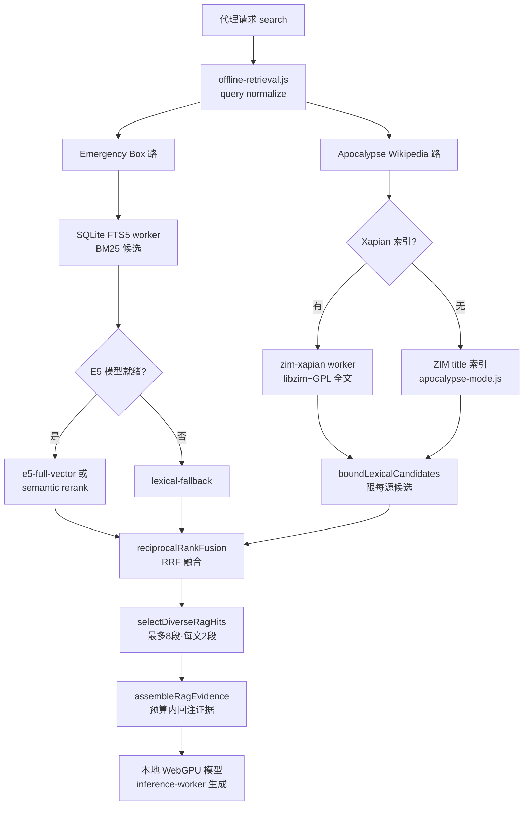

# 离线 RAG 与 Apocalypse Mode 深度解读

WebBrain 的差异化卖点之一，是在"什么都上云"的时代把一条完整的本地知识链路塞进一个浏览器扩展：**离线检索**（本地语义 + 全文索引）、**Apocalypse Mode**（本地安装多吉字节 Kiwix/ZIM 离线维基存档 + Xapian 全文索引）、以及**本地 WebGPU 推理**（graph 中的 `offline-semantic-runtime` / `inference-worker`）。本文档只讲这条"离线知识关注面"：为什么做、怎么做、以及为此付出的 licenses 代价。

> 本文所属更广的《WebBrain —— 开源 AI 浏览器 Agent 扩展》解读系列。所有行号均实测于本次读取的源码。

## 核心结构：三层内存，一个 offscreen 宿主

离线 RAG 不是单块逻辑，而是沿浏览器线程模型切出的三层结构：

- **编排层** `offline-rag.js` —— 纯函数、不碰网络、不下载模型/语料。负责 chunking、token 化、候选边界、互相排名融合（RRF）、多样性选择与证据组装。文件头自述「Browser-neutral」且要求 Chrome/Firefox 拷贝逐字节一致。
- **服务层** `offline-retrieval.js` —— 把 Wikipedia（ZIM/Xapian）、Emergency Box（SQLite FTS5 + E5 向量）两路检索编排进一个 `search()`，再统一走融合/去重。
- **worker 宿主** —— MV3 的 service worker 无法持有 OPFS 同步访问句柄，所以真实检索跑在 offscreen document 里，再由 `offline-rag-host.js` 用懒代理把共享 E5 reranker 挂进去。

```
正文：编排层明确声明浏览器中立、不做任何网络访问（[src/chrome/src/agent/offline-rag.js:2-5]()）。
<!-- anchor: * Browser-neutral retrieval and corpus integrity primitives … * Keep the Chrome and Firefox copies byte-identical. -->
```



图注：`MAX_FINAL_PASSAGES=8`、`MAX_PASSAGES_PER_DOCUMENT=2`、`MAX_GLOBAL_LEXICAL_CANDIDATES=80` 是整条链路的硬边界常量。

```
正文：检索的硬边界常量 —— 全局候选 80、最终段 8、每文上限 2（[src/chrome/src/agent/offline-rag.js:12-14]()）。
<!-- anchor: export const MAX_GLOBAL_LEXICAL_CANDIDATES = 80; … export const MAX_PASSAGES_PER_DOCUMENT = 2; -->
```

## 为什么做纯本地离线 RAG

三个动机叠在一起，正好命中 WebBrain 的使用场景：

1. **隐私/离线可用**：急救、野外求生这类 Emergency Box 语料，本来就是在「没有网络」的紧急时刻才最需要。在线 RAG 在断网时是零。本地缓存回填了三件事：断网可用、无请求出网、内容不经第三方可见。

2. **省大上下文钱**：本地检索先在海量语料里捞出 ≤8 段证据，再只把这 8 段拼进 prompt，而不是把多吉字节维基灌进上下文。`assembleRagEvidence` 会先算 `contextWindowTokens` 减去已预留的 system/history/question/generation，再定 `evidenceBudget`（上限 `MAX_EVIDENCE_TOKENS=6000`），保证证据不把窗口吃垮。

```
正文：证据预算先算上下文窗口减预留项，再封顶到 6000 token（[src/chrome/src/agent/offline-rag.js:768-781]()）。
<!-- anchor: export function assembleRagEvidence(hits = [], options = {}) { … const evidenceBudget = Math.min( -->
```

3. **断网救急的语义缺口**：Emergency Box 放的是 PDF 衍生的多语言野外参考文档，用户急用时拼错单词、时态错、语言混杂。所以它专门做了「放松前缀匹配 + 年龄分组同义词 + 多语言检测」这一整套词汇级补偿，而不是假设用户打字精确。

## 双路检索：Emergency Box（SQLite FTS5 + E5）与 Wikipedia（title / Xapian）

WebBrain 没有让两路共享同一套索引。原因在 `docs/offline-rag.md:24` 说得很直白：**Wikipedia 不是 FTS5**。两路有着完全不同的数据来源与授权边界。

### Emergency Box：预构建 FTS5 + 预计算 int8 向量

Emergency Box 是一个 ~502 MB 的公开领域纯文本语料（~304 MB 源文本）。它的索引**随 ZIP 一起预构建并校验**，不放运行时自建——所以它用了 Apache-2.0 的 SQLite Wasm + 自定义的 `WBVE5Q8` 二进制向量格式：

- FTS5 表用 `unicode61 remove_diacritics 2`，BM25 对 `body 7`、`search_terms 1`、`locator 0.6`、`collection 2`、`title 4` 加权。
- 向量索引是 4096 字节头（JSON 元数据）+ int8 量化的 384 维 passage 向量 + Float32 L2 范数。worker 用**暴力余弦**在整个 passage 空间上扫，因为 251K passage 对这种规模「可计算」，所以干脆不上 ANN（`docs/offline-rag.md:141-148`）。

文本先被切成 180–700 token（目标 ~420）的 passage，再用 heading 检测 + 句子边界 + 段落合并来保证 chunk 有上下文。

```
正文：切 passage 先按段落与标题边界切，再按句界合并到目标 token（[src/chrome/src/agent/offline-rag.js:416-419]()）。
<!-- anchor: const paragraphs = []; … const flushParagraph = () => { -->
```

### Wikipedia：title 索引 + 可选 GPL Xapian 全文

Wikipedia 存档走 Apocalypse Mode 的 ZIM reader：先按规范化标题/前缀二分查 directory，命中后解压 cluster、用 `relevantPassage` 取查询词最密窗口。只有**当存档自带 Xapian 索引**（Kiwix 会在 `X/fulltext/xapian` 或旧的 `Z//fulltextIndex/xapian` 塞入）时才启动 GPL worker 做全文检索。

`offline-retrieval.js` 把两路捆进一个 `search()`：`wikipedia` 与 `emergency-box` 并行 Promise 跑，然后各自过滤语言，再融合。关键在 fallback 的层级——每条下层失败都有语义明确的回退（见下文「检索的 fallback 层级」）。

## 为什么用 ZIM+Kiwix+Xapian 存档格式而不是自建

这是一个「吃别人生态」的刻意选择，而非偷懒：

1. **复用现成离线维基生态**：Kiwix 维护 OPDS 目录、library、mirror 下载、Metalink 完整性分片。WebBrain 直接用 `opds.library.kiwix.org/catalog/v2/entries` 和 `library_zim.xml`，白拿了一个覆盖数十种语言、按体积分层的归档网。

```
正文：Apocalypse Mode 直接消费 Kiwix 的 online 目录与归档清单（[src/chrome/src/agent/apocalypse-mode.js:3-8]()）。
<!-- anchor: const KIWIX_CATALOG_URL = 'https://opds.library.kiwix.org/catalog/v2/entries'; … const SHARED_KIWIX_ARCHIVE_CACHE = new Map(); -->
```

2. **ZIM 是自带全文索引的格式**：Kiwix 把 Xapian 全文索引放进 ZIM 作为一个普通 entry。这意味着「读文章」和「全文搜」可以走不同的作者边界——读走 MIT 的 fzstd 解码 reader，搜走 GPL worker。

3. **自建索引不可行**：多吉字节维基不能只靠运行时去切段 embedding，那是天文数字量的算力与时间。预构建 + 校验才是唯一现实路径。

代价是：WebBrain 成了「Kiwix 存档格式的一个浏览器端 reader/search」，而 Kiwix 的生态是 **GPL 的**。下面 Licensing 一节详述这一点。

## 存档字节存 OPFS、元数据存 IndexedDB

这是本关注面里最值得写的内存分配决策。多吉字节 ZIM 如果当 IndexedDB value 存，会立刻撞上浏览器配额/序列化成本。所以划分很明确：

- **IndexedDB（`webbrain_apocalypse_mode`）**：只存 opt-in 设置、存档元数据、字节游标、generation、重试状态、存储引用。
- **OPFS（`webbrain-apocalypse/` 桶）**：存档正体。

```
正文：IndexedDB 名称与 store 划分，只放配置与归档记录、不放本体（[src/chrome/src/agent/apocalypse-mode.js:796-802]()）。
<!-- anchor: const APOCALYPSE_DB_NAME = 'webbrain_apocalypse_mode'; … const ARCHIVE_DIRECTORY = 'webbrain-apocalypse'; -->
```

注释里明确解释了为什么不能在 OPFS 上马虎：Chrome 的 `FileSystemWritableFileStream` 写 `.crswap` 交换文件，`keepExistingData:true` 会整份复制归档，多次 wake 可漏几百 GB，所以专门有 `sweepOpfsSwapFiles`。下载优先用 durable writer（`createSyncAccessHandle` 只能从 offscreen document/worker 够到，MV3 service worker 没有）；当 durable writer 不可用时，>2 GiB 的归档直接**拒绝走**非持久流式 fallback，逼调用方去 offscreen document 跑，因为那个 fallback 会「每次 wake 重开 swap writable + 整档复制」，呈二次方增长。

```
正文：说明 `.crswap` 交换文件泄漏——多吉字节 ZIM 的 swap 是可复失的悲剧（[src/chrome/src/agent/apocalypse-mode.js:1008-1015]()）。
<!-- anchor: * Chrome writes `FileSystemWritableFileStream` data to a sibling … export const OPFS_SWAP_SUFFIX = '.crswap'; -->
```

## Apocalypse Mode：从「用时能读」到「多吉字节下载」

Apocalypse Mode 的运作分「选装校验」与「持久续传」两半：

**选装**先解析 Kiwix Metalink → 展示精确字节、归档日期、来源/许可、分片哈希数 → 用户确认后才下载。每条 Metalink 含 `pieceHashes`（SHA-1 或 SHA-256），下载按 piece 边界做 Range，写入前逐 piece 校验（`fetchArchivePiece`）。

**续传**依赖 MV3 的 ephemeral service worker：后台 worker 重启后由 `APOCALYPSE_DOWNLOAD_ALARM` 唤醒，靠 IndexedDB 里的字节游标 + generation + lease 续传。`generation` 在暂停/禁用时递增，让「过期 work 无法提交」；删除先删元数据再删字节，避免在途请求复活归档（`docs/apocalypse-mode.md:62-70`）。

一个专门设计：**lease** 防止两个扩展上下文认领同一个 piece。`claimNext` 带 `leaseDuration`（默认 5 分钟），过期才可被重新认领。

```
正文：带 lease 的认领机制，防止多个上下文并发抢同一 piece（[src/chrome/src/agent/apocalypse-mode.js:906-919]()）。
<!-- anchor: async claimNext(timestamp, leaseToken, leaseDuration = 5 * 60_000) { … }, -->
```

## ZIM reader 与 GPL Xapian worker 的边界

WebBrain 把「ZIM 读」与「ZIM 搜」切成两个许可证面，这是个精致的边界：

- **读方向**：`openKiwixZim` 直接用 MIT 的 `fzstd` 解出 ZIM 文档结构，是唯一文章阅读路径（`docs/apocalypse-mode.md:105-106`）。
- **搜方向**：`zim-xapian.js` 是「license-neutral adapter」，`zim-xapian-runtime.js` 是 worker driver，真正含 GPL 代码的是 vendored `vendor/libzim/libzim-wasm.js`。adapter 明确声明「This file stays license-neutral / This file contains no GPL code. It drives one.」。

### 在不开 worker 前先探测 hasFullTextIndex

libzim 0.95 没有 `hasFulltextIndex` 绑定，且它的 `search()` 自己 swallow 异常、返回空向量——这让「没索引」和「没命中」无法区分。WebBrain 的解法：Kiwix 把 Xapian 索引进 ZIM 当普通 entry，于是用自己的 reader 直接二分查目录（`X/fulltext/xapian` / `Z//fulltextIndex/xapian`）来判断，从而：

- 让「无索引 vs 无命中」的区分成立；
- 无索引的存档**连 worker 都不启动**（省一个几十 MB、耗时 45s 超时的 wasm runtime）。

```
正文：用自带 reader 探测 Xapian 索引，而不依赖 libzim（它区分不了无索引与无命中）（[src/chrome/src/agent/apocalypse-mode.js:675-680]()）。
<!-- anchor: // Kiwix bakes a Xapian full-text index into most ZIMs … // callers skip a runtime they would only fall back from. -->
```

如果 index 存在，`zim-xapian-runtime.openArchive` 才 `createWorker()` 并 `init`——注释里有一段非常坑的调机关：生成的 `libzim-wasm.js` 的 `init` handler 会**替换** `Module` 对象，所以 `createWorker()` 和 `init` 的 postMessage 必须在同一 turn、中间**不能有 await**，否则只能看到 `INITIALIZE_TIMEOUT_MS` 超时而无任何 worker 报错（`zim-xapian-runtime.js:100-127`）。没有索引时，`openArchive` 直接返回一个恒为假、搜索为空的 session，不产生任何 worker。

```
正文：无索引时返回一个不启 worker 的空 session，成本为零（[src/chrome/src/agent/zim-xapian-runtime.js:92-98]()）。
<!-- anchor: if (!indexPresent) { … });
```

## 检索的 fallback 层级：何时回退、回退到哪

本地检索设计成一条「能力越强越靠前、能力缺失就逐级降」的瀑布。`offline-retrieval.js` 的 `search()` 是核心：

1. **语义（E5）缺失**：E5 reranker 是被显式 `download()` 才拉取的 ~140 MB 模型（`offline-reranker.js:164-168`）。没下载或超时 → `semanticFailure` 被捕获，`semanticStatus='lexical-fallback'`，界面上提示「keyword fallback」。`runBoundedSemantic` 给语义操作加 30s 硬超时。
2. **Emergency Box 无 FTS5 向量索引**：状态 `vector-not-installed`，该路跳过。
3. **Wikipedia 无 Xapian 索引 / worker 失败**：`zim-xapian-provider` 捕获 runtime 错误后统一 fallback 到 title 索引，`retrievalMode='title-only-fallback'`（`zim-xapian.js:155-163`）。
4. **全部不可用**：`search()` 返回 `statuses` 全 skipped，报告离线检索不可用——但不让本地模型「瞎编医疗建议」。

融合发生在最后：`boundLexicalCandidates` 先压住每源候选，`reciprocalRankFusion` 按 `score = weight/(k+rank)` 把词法+语义排名 fuse，再用 `selectDiverseRagHits` 卡 8 段/每文 2 段。这个 fuse 让「词法高排名」与「语义高相关」都保留向下传递。

```
正文：语义 rerank 只有在词法命中存在且 E5 可用时才跑，超时则降级 lexical（[src/chrome/src/agent/offline-retrieval.js:324-327]()）。
<!-- anchor: if (lexical.length && !emergencyVector.hits.length … semantic = await runBoundedSemantic( -->
```

有一个精巧的细节：E5 用**用户原句**做查询 embedding，词法侧用去停用词的关键词——同一个 query 在语义与词法两端拿到的不是同一串字。`offline-retrieval.js:292-299` 的注释解释了：`semanticQuery` 会走 `embedQuery`，而词法则继续用 `query` 的 stopword-stripped 版，防止「把关键词汤喂给 embedder」丢掉句子语义。

## 检索结果如何回注在线 Agent 流程

离线检索不是独立功能，它被接进 web 的 agent 工具路由。整合方式是「先注入证据、再让模型只回答证据内内容」：

- `assembleRagEvidence` 把选中的 passage 拼进 `evidence` 字符串，每段前加一个 `citationToken`（`[WB-E-xxxx]` 或 `[WB-W-xxxx]`）加 provenance（来源|标题|定位|语言|日期|collection）。
- `instructions` 明确要求「只用所给离线证据作答、用精确 citation token 支撑、答得出就答、答不出的部分明说」。
- 每条引用带 `readerUrl`（`webbrain-reader://...`），reader 用 `validateRagReaderUrl` 白名单协议/scheme 后才放行——引用只能落到本地 reader，决不让 citation 跳转线上网页（`docs/offline-rag.md:37-41`）。
- 本地 WebGPU 生成被 2048 token 限制；模型若在 `<think>` 里烧光预算，WebBrain 会**用更短的证据 prompt 重试**而不是编答案（`docs/offline-rag.md:70-74`）。

```
正文：排名模式在三态间切换——full-vector / semantic-reranked / lexical-fallback（[src/chrome/src/agent/offline-retrieval.js:351-352]()）。
<!-- anchor: ? 'hybrid-full-vector' … : semanticStatus === 'ready' ? 'semantic-reranked' : 'lexical-fallback', -->
```

## 本地 WebGPU 推理（offline-semantic-runtime / inference-worker）

graph 里的 `offline-semantic-runtime`（`offline-semantic-runtime.js`）维护一个共享 E5 worker：检索与 Emergency 下载共用同一个 model 生命周期，`getSharedOfflineSemanticReranker()` 懒创建，用 `activeDownloads` 引用计数防止下载中被打断（`offline-semantic-runtime.js:8-28`）。

`inference-worker.js` / `bonsai-worker.js` 承载本地文本生成（LFM2.5 2.6B 默认、Bonsai 27B 可选），`vision-inference-host.js` 承载本地视觉 fallback。这些本地模型权重是「用户主动下载、运行时在本地跑」，与 RAG 检索的「用户已下载的语料/模型」一致——整条离线链路都遵循**模型权重与语料由用户下载、任何可执行代码不做运行时拉取**的原则（`docs/offline-rag.md:181-183`）。

## Licensing 权衡：GPL 的 Xapian/libzim 是 MIT→GPL-3.0-or-later 的根因

这是本关注面最沉重的决定，`docs/offline-rag-licensing.md` 是一份完整的决策记录。

**链条**：Xapian 全文检索需要 libzim 的检索 runtime，而 libzim 是 GPL-2.0-or-later，javascript-libzim 是 GPL-3.0-or-later，Xapian Core 是 GPL-2.0-or-later。版权作品的链接/分发会把整个 combined work 拉进 copyleft。所以：

- WebBrain **33.0.0 起整体改发 GPL-3.0-or-later**（仓库、Chrome、Edge、Firefox 包皆然）；
- 此前版本保留 MIT（`LICENSES/MIT.txt` 归档）；
- 独立成作品且自带 LICENSE 的子项目（MCP server、LM Studio plugin）可保留 MIT。

选 GPL-3.0 而非 GPL-2.0 是因为：javascript-libzim 是 GPL-3.0-or-later、libzim/Xapian 是 GPL-2.0-or-later，"or later" 让两者都能站到 3.0；而 3.0 又能兼容既有的 Apache-2.0 依赖（sqlite-wasm、Transformers.js、pdf.js）——Apache-2.0 与 GPL-2.0-**only** 冲突，但与 GPL-3.0 兼容（`docs/offline-rag-licensing.md:127-133`）。

**两个约束点值得如实指出**：

1. **用户关闭 Apocalypse Mode 不改变许可证**。Wasm 只要在包里，包就是 GPL。想要 MIT 包必须出一个**不含该 Wasm 的独立 artifact**，靠设置开关做不到（`offline-rag-licensing.md:134-137`）。
2. **必须走源码构建而非预编译**。上游 `make libzim_release` 会下载 openzim.org 的 prebuilt tarball，其对应源码「不是我们的」，所以 WebBrain 走 `all` 目标从固定 tarball 编译 xz/zlib/zstd/ICU/Xapian/libzim，并把对应源码树随版本发布。Emscripten 的 wasm-opt 在 `-O3` 会 segfault，因此链接用 `-O2`（`offline-rag-licensing.md:139-161`）。

这是 WebBrain 对"全 MIT"的主动放弃：**换取的是可复用的 GPL 离线维基全文检索生态，而非自担重建整个索引的工程量**。这条取舍与前面「为什么用 ZIM 存档」是对称的——复用现成生态的代价就是接受生态的许可证。

## 关键设计决策小结

| 决策 | 为什么 |
| --- | --- |
| 纯本地离线 RAG | 隐私 / 断网可用 / 大上下文省钱 |
| 用 Kiwix/ZIM/Xapian 生态，不自建 | 复用多语言归档网 + 预构建全文索引，工程量不可自担 |
| ZIM 用 OPFS 存字节、IndexedDB 存元数据 | 避免多吉字节进 IndexedDB 配额与序列化 |
| 独立 reader/search 边界 | 读走 MIT fzstd，搜走 GPL worker，license 面分开 |
| 无索引就不开 worker | libzim 区分不了"无索引"和"无命中"，用自己的 reader 提前探测省 worker 启动 |
| Emergency 用预构建 FTS5/vector | 251K passage 运行时自建不可能，预构建+校验是唯一现实途径 |
| 引入 GPL → 整体转 GPL-3.0-or-later | 组合作品分发必须 copyleft；3.0 兼容现有 Apache-2.0 依赖 |

## 四要素对照

- **核心结构**：编排层（`offline-rag.js`）→ 服务层（`offline-retrieval.js`）→ offscreen host + 三个 worker（SQLite FTS5 / E5 reranker / ZIM-Xapian），外加 Apocalypse 的 OPFS 存储 + IDB 元数据。
- **执行流程**：normalize query → 双路并行检索（FTS5/向量 + title/Xapian）→ 限候选 → RRF 融合 → 多样性选择 → 预算内组装证据 → 本地 WebGPU 生成，各层有明确 fallback。
- **设计决策**：ZIM 生态复用、OPFS/IDB 划分、reader/search license 边界、无索引不启 worker、预构建索引、整体转 GPL-3.0。
- **依赖**：SQLite Wasm（Apache-2.0）、Transformers.js + ONNX Runtime Web（Apache-2.0/MIT）、E5 模型（Apache-2.0）、fflate、fzstd（MIT）、Xapian/libzim（GPL-2.0/3.0-or-later，vendored）。

（本关注面的外部数据在使用时由用户显式下载，无任何可执行代码做运行时拉取。）
