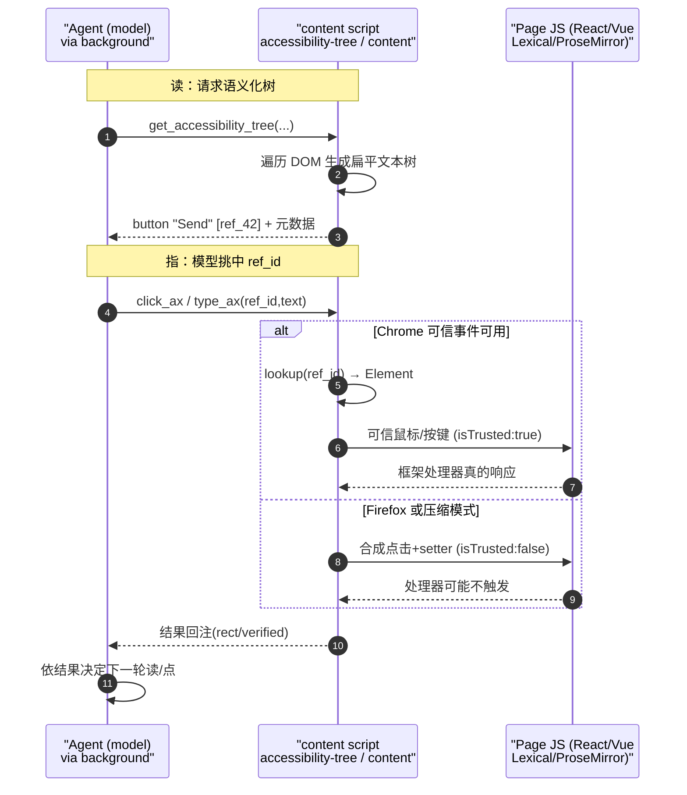

# WebBrain 页面交互与浏览器控制深入解读

> 本文是 WebBrain 系列解读的「页面交互/浏览器控制」关注面子文档。它回答一个问题：WebBrain 作为浏览器 Agent，**如何把一段抽象的意图（"把那封邮件回复给张三"）翻译成一连串真实、可信、能触发页面应用状态的浏览器操作**。"翻译"涉及三条互不重叠的难题链：怎么读、怎么指、怎么点。本文围绕这三条链分别拆解它们各自为了"小模型可用 + 框架杀伤"做了哪些工程权衡，而不是罗列功能。

## 根因：Agent 需要"浏览器级"而非"脚本级"的操作能力

WebBrain 的典型用户跑的是 3–30B 量级的小型本地模型（qwen / phi / ollama 生态），它们既没有大模型的"截图即懂 UI"能力，也几乎从不遵守又长又软的指令。这决定了它操作浏览器的**最低标准**：

- **读**：给模型的必须是紧凑、语义化、能找到交互点的"页面骨架"，而不是几十 KB 的原始 HTML。为求稳还得能按模型的能力动态放大/分页。
- **指**：模型返回一个稳定的目标句柄，一句"点那个按钮"，之后不管页面怎么重渲染都别让它想错的元素；句柄本身还要能被翻译回真实 DOM。
- **点**：这一步最脆弱——`el.click()` 这类脚本级调用会发出 `isTrusted:false` 的事件，而现代 React / Vue / Lexical / ProseMirror 越来越倾向于拒绝非可信输入。Chrome 与 Firefox 在"能不能发出可信输入"上的能力鸿沟，直接决定了两条实现分支。

这三个标准环环相扣：读得再准，指不稳就白读；指得再稳，一点不发可信事件就被页面零成本顶回去。

## 概览：三条关注线各自承担什么

页面交互不是单个模块，而是分散在 **content 脚本（页面侧执行）** 与 **background 的 agent/cdp（扩展侧编排）** 之间的一组协议。核心能力清单如下：

| 关注线 | 关键组件 | 承担职责 |
|---|---|---|
| 读 | `accessibility-tree.js` (content) | 把 DOM 折叠成语义化扁平文本树，按 `filter` 决定保真度，给每个候选交互元素发 `ref_id` |
| 读 | `content.js` → `getPageInfoFull` | 面向"读文章"的粗读层：正文提取、去 chrome、媒体/表单/iframe 摘要 |
| 读 | `read-page-window.js` / `read-completeness.js` (background) | 给读到的文本设窗口上限、算 `continuationArgs`，并记账"整篇是否确实读完了" |
| 指 | `accessibility-tree.js` WeakRef registry | `ref_N` ↔ `Element` 双向解析，跨调用保持稳定 |
| 点 | `content.js`(合成路径) + `cdp-client.js`(可信路径) | 点击、输入、按键、滚动；两个浏览器两套事件源 |
| 防 | `rich-text-toolbar-guard.js` / `probe.js` | 富文本格式工具条义务账本，防止模型误触格式化控件 |
| 防 | `content.js` 文件选择器守卫 | 拦截 `<input type=file>.click()` 打开的 OS 文件框 |
| 防 | `credential-fields.js` | 识别密码/密钥字段，抑制模型在摘要里回显敏感值 |

技术栈一览：纯 ESM + 浏览器扩展 API（`chrome.scripting` / `browser.*`），Chrome 侧多一个基于 CDP 协议的本地 client（不依赖 Puppeteer 运行时，直接 `sendCommand` 走 DevTools 协议），Firefox 侧无 CDP，只能退化为合成事件。无任何第三方 UI 控件库。

## 核心结构：AX 树与 ref_id registry 是"读与指"的共同根基

### 为什么默认不把整页 HTML/DOM 发给模型

这是整个交互体系的第一层权衡。把 `document.documentElement.outerHTML` 直接塞给模型是最省事的"读"，但它是**给渲染器看的，不是给决策者看的**：

- 一个 `<button>` 会被它的数层 span/svg/伪元素包裹撑成几百字节，而模型真正需要的只是语义：`button "Send" [ref_42] disabled=true`。
- 纯文本 dump（`innerText`）又丢了结构——模型不知道"这是可点的按钮还是不可点的文本"。
- 把脚本/样式/无意义容器层全算上，token 消耗离谱，小模型立刻爆窗。

`accessibility-tree.js` 因此走了第三条路：输出**扁平的缩进文本树**，每行一个"值得保留的节点"，跳过 generic 容器（但让它们的子节点上浮到父级深度，从而视觉上"折叠"）。这个输出格式是设计文档从 Claude for Chrome 移植后重写的（见 [docs/accessibility-tree-and-refs.md:34-50]()），它同时满足紧凑与"可行动"两个要求——树里的每个非结构节点几乎都是模型真的能点或该看的对象。

`shouldInclude` 把"是否保留"和"是否继续向下走"解耦：保留与否取决于 `filter`（`all` 整页 / `visible` 视口内可见 / `interactive` 仅可交互），但**子节点无论如何都会被遍历**，只是被跳过节点的深度不增加。这是"读"的核心复杂度所在——同一个 walker，靠一个开关就能在"给大模型的完整图景"和"给小模型的最短路径"之间切换：

```ts
if (opts.filter === 'interactive') return isInteractive(el);
const role = getRole(el);
if (opts.filter === 'visible') {
  if (isInteractive(el)) return true;
  if (/^h[1-6]$/.test(el.tagName.toLowerCase())) return true;
  if (USEFUL_NON_INTERACTIVE_ROLES.has(role)) return true;
  return false;
}
```
（[src/chrome/src/content/accessibility-tree.js:581-595]()）
<!-- anchor:     if (opts.filter === 'interactive') return isInteractive(el); …     if (USEFUL_NON_INTERACTIVE_ROLES.has(role)) return true; -->

树还会把 `[open overlays]`（对话框/菜单/下拉/`aria-expanded` 的 combobox）**提到输出顶部优先渲染**，门户组件（React 的 Portal）常把这些弹层渲染在 `<body>` 末尾大量内容之后，DOM 序遍历在软截断下会直接漏掉它们：

```ts
if (overlayEls.length) {
  lines.push('[open overlays — rendered first so they survive truncation]');
  for (const n of overlayEls) walk(n, 0, opts, lines);
  ...
  lines.push('[/open overlays]');
}
```
（[src/chrome/src/content/accessibility-tree.js:1279-1286]()）
<!-- anchor:         if (overlayEls.length) { …           lines.push('[/open overlays]'); -->

### ref_id：为什么它比 CSS 选择器可读性/稳定性都好，也有限制

一旦模型看到 `button "Send" [ref_42]`，它的"指"就落在这个 `ref_42` 上。ref_id 是整个方案的稳定句柄，它解决了选择器解决不了的两类问题：

**选择器可读性差**：CSS 选择器要么太泛（`button:nth-of-type(3)` 全页共享、极易漂移），要么太长（`#root > div.app > div > form > div > button`，一改结构就碎）。ref_id 是模型无脑照抄的短 token。

**跨调用稳定性是选择器给不了的**：选择器在每次调用时都要重新求值，同一个"语义按钮"如果页面重排，选中的可能就是另一个按钮。ref_id 则通过一个**持久 WeakRef 注册表**来锚定"同一个真实 Element 对象"——只要那个元素还活着、还连着 DOM，它的编号就保持。

`getOrMintRef` 的分配逻辑讲清了 registry 的结构：一个 `Object.create(null)` 普通对象按 `ref_N` 键存 `WeakRef`，先去重（同 Element 复用旧编号）再递增计数器发新号：

```ts
function getOrMintRef(el) {
  const prefix = `ref_${ensureRefScope().id}`;
  for (const key in window.__wbElementMap) {
    if (window.__wbElementMap[key].deref() === el) return key;
  }
  const key = prefix + (++window.__wbRefCounter);
  window.__wbElementMap[key] = new WeakRef(el);
  return key;
}
```
（[src/chrome/src/content/accessibility-tree.js:609-616]()）
<!-- anchor:   function getOrMintRef(el) { …     window.__wbElementMap[key] = new WeakRef(el); -->

而 `click_ax`/`type_ax` 落地时的反向解析在 `lookup` 里 `deref()` 出一个存活、仍在 DOM 上的真实 `Element`，解析失败才从注册表清除并返回 null：

```ts
function lookup(refId) {
  if (refOrdinal(refId) == null) return null;
  const weak = window.__wbElementMap[refId];
  if (!weak) return null;
  const el = weak.deref();
  if (!el || !el.isConnected) {
    delete window.__wbElementMap[refId];
    return null;
  }
  return el;
}
```
（[src/chrome/src/content/accessibility-tree.js:1393-1399]()）
<!-- anchor:   function lookup(refId) { …       delete window.__wbElementMap[refId]; -->

**为什么用 WeakRef 而不是普通引用**：若 registry 存的是强引用，任何被索引过的元素都会永远被钉住无法 GC——在 Gmail / 聊天这类长活页面上这是明确的内存泄漏。WeakRef 让浏览器能照常回收已移除的元素，代价是 `deref()` 在 GC 后可能返回 null。但设计文档明确这个代价在单次 agent turn（亚秒级）内几乎永不触发，因为 agent 本来就会在导航后重读树（[docs/accessibility-tree-and-refs.md:77-79]()）。这是"长期正确性"与"短期可命中"之间的刻意取舍。

**ref_id 的两层限制**（这也是"比选择器更好"那部分背后清醒的代价）：

1. **它能锚定的前提是元素仍存活**。导航或 DOM 移除后编号自然失效——这其实是特性而非缺陷：失效正好告知模型"页面对不上旧读了，重读"。为了不让失效变成死胡同，`suggestNearRefs` 会在模型问了不存在的 ref 时给出按编号距离排序的"附近还活着的 ref"，把一次失败变成可重试。
2. **编号按 route 分作用域**，防止 SPA 切路由后旧编号错配到新路由的同号元素。`ensureRefScope` 一旦发现 URL 变化就整体重置 registry 与计数器：

```ts
if (!scope || scope.pageUrl !== pageUrl || !/^\d{12}$/.test(scope.id)) {
  window.__wbElementMap = Object.create(null);
  window.__wbRefCounter = 0;
  ...
  window.__wbAxRefScope = { pageUrl, id: mintRefScopeId() };
}
```
（[src/chrome/src/content/accessibility-tree.js:68-79]()）
<!-- anchor:   function ensureRefScope() { …     window.__wbAxRefScope = { pageUrl, id: mintRefScopeId() }; -->

### 读取的"预算"与"完整性"分层

AX 树是小模型能看懂的第一层，但它不是唯一读法。`getPageInfoFull`（[src/chrome/src/content/content.js:2687-2858]()）提供面向读文章的粗读：按文章语义容器优先级挑正文、克隆后剥掉 nav/footer/ad/cookie 等 chrome、顺带返回媒体/表单/iframe/开放 shadow root 摘要。它会识别 paywall，命中时只返回 gate 文本并清空媒体与表单。

往下还有两层"账本"在 background 侧：

- **`read-page-window.js`** 给"读文章"设硬窗口。默认 `READ_PAGE_DEFAULT_LIMIT=4000`，`applyReadPageWindow` 按 `offset/limit` 切片并回传 `continuationArgs`；当整个结果超 8k 字符时，`fitReadPageWindowResult` 会先压缩辅助内容（link/form/shadow/media 数量），再对正文文本做二分截断，保证任何超限结果都能在预算内交出去（[src/chrome/src/agent/read-page-window.js:125-163]()）。
- **`read-completeness.js`** 不限制长度，而是记账"这次读到底完不完整"。`recordReadCompleteness` 只对 `get_accessibility_tree` 记账，跟踪树的页码集合、终页、是否出现 `hasMore`，并针对 Gmail 会话要求"已展开"证据；`readCompletenessBlock` 在一个明确请求"读完整个会话"但覆盖不完整时，会产出一段强制的 `[COMPLETE THREAD READ REQUIRED...]` 前缀，挡掉模型拿半截树就下结论的行为（[src/chrome/src/agent/read-completeness.js:460-477]()）。

## 执行流程：读 → 指 → 点的完整链路（可信 vs 合成分支）

下面这张时序图是本文关注面的核心链路，区分了 Chrome 可信事件与 Firefox 合成事件两条分支：



关键观察：**"读"、"指"两条线在 Chrome 与 Firefox 上是共享同一套 AX 树与 ref_id 逻辑的；真正分道扬镳的只有"点"这一步的事件源。** AX 树、WeakRef registry、overlay hoisting 在 `src/firefox/src/content/` 下都有一份等价实现，差异集中在 `el.click()`/合成事件（Firefox）与 CDP 可信事件（Chrome）。这是两条实现分支能长期共存的根本原因——分歧被压缩到了极窄的"事件发射"层。

### 点：可信事件是 Chrome 的法宝，却是 Firefox 的硬伤

Chrome 有 CDP，能越过页面 JS 直接向合成器发"真实输入"，产出 `isTrusted:true` 的事件。这是让 React 看到 `click`、让受控组件看到 `input/change`、让 `contenteditable` 被识别为真正编辑的最可靠手段。

`dispatchMouseEvent` 的写法里藏着几个为了"框架真的响应"而刻意处理的坑：`buttons` 必须用位掩码（按住=1）、`clickCount` 在 `mousePressed` 和 `mouseReleased` 上**都必须为 1**，否则浏览器不会合成出 `click` DOM 事件，React 就永远看不到这次点击：

```ts
async dispatchMouseEvent(tabId, type, x, y, button = 'left') {
  // Use string button names as required by CDP Input.dispatchMouseEvent.
  // 'buttons' is a bitmask: 1 = left held. clickCount must be 1 on BOTH
  // mousePressed AND mouseReleased for the browser to synthesize a 'click'
  // DOM event — without it, React and other frameworks never see the click.
  const isDown = type === 'mousePressed';
  ...
  return await this.sendCommand(tabId, 'Input.dispatchMouseEvent', {
    type, x, y, button: isMove ? 'none' : button,
    buttons: isDown ? 1 : 0, clickCount: isMove ? 0 : 1,
  });
}
```
（[src/chrome/src/cdp/cdp-client.js:2697-2711]()）
<!-- anchor:   async dispatchMouseEvent(tabId, type, x, y, button = 'left') { …       clickCount: isMove ? 0 : 1, -->

输入则分两条子路径。普通 `<input>/<textarea>` 用 `Input.insertText`，它是**原子操作**，能正确触发 `beforeinput`/`input` 事件，框架天然接受；只有当它被拒绝（元素在 closed shadow root 里、CDP 找不到命中点）时，才退化为 JS 级原生 setter + 手工 dispatch `input/change`：

```ts
// Type via Input.insertText — atomic, fires beforeinput/input correctly.
let typed = false;
try {
  dispatched = true;
  await this.sendCommand(tabId, 'Input.insertText', { text });
  typed = true;
} catch (e) { /* fall through to JS setter */ }
```
（[src/chrome/src/cdp/cdp-client.js:4557-4563]()）
<!-- anchor:     // Type via Input.insertText — atomic, fires beforeinput/input correctly. …     } catch (e) { /* fall through to JS setter */ } -->

原生 `<select>` 是特例中的特例：它无法用 `Input.insertText` 输入，Click 会打开浏览器原生下拉（CDP 够不着）。于是输入路径直接放弃"typed input"，改为先 `Escape` 收起可能展开的列表，再用 `Input.dispatchKeyEvent` 发一串 `ArrowDown/ArrowUp` 键来导航到目标 option——用真实键盘事件驱动原生控件，React 能识别这些按键事件：

```ts
// Navigate with arrow keys
const delta = sInfo.targetIndex - sInfo.currentIndex;
const arrowKey = delta > 0 ? 'ArrowDown' : 'ArrowUp';
for (let i = 0; i < Math.abs(delta); i++) {
  await this.sendCommand(tabId, 'Input.dispatchKeyEvent', {
    type: 'keyDown', key: arrowKey, code: arrowKey, windowsVirtualKeyCode: 40,
  });
  ...
}
```
（[src/chrome/src/cdp/cdp-client.js:4364-4368]()）
<!-- anchor:       // Navigate with arrow keys …       for (let i = 0; i < Math.abs(delta); i++) { -->

**Firefox 没有 CDP**，这是它能被等价实现但"点"永远打折扣的根源。Firefox 内容脚本能做的只有合成事件：`el.click()`、`dispatchEvent(new KeyboardEvent(...))`、native setter + `dispatch input/change`。这些事件 `isTrusted:false`，其后果在 checkbox 上暴露得最直白——Firefox 侧直接给出失败文案承认这一点：

```ts
error: `Checkbox remained ${checkedAfter ? 'checked' : 'unchecked'} after one synthetic click. Firefox cannot synthesize trusted pointer input for page content.`,
```
（[src/firefox/src/content/content.js:4604-4604]()）
<!-- anchor:               error: `Checkbox remained ${checkedAfter ? 'checked' : 'unchecked'} after one synthetic click. Firefox cannot synthesize trusted pointer input for page content.`, -->

我把这里的两条路径并排：Chrome 的 `typeText` 会优先 `Input.dispatchMouseEvent` 在元素坐标上做一次**真实鼠标点击来聚焦**（注释原文："real mouse click (most reliable, fires trusted events)"），只有失败才退回 `DOM.focus`，再退 JS `.focus()`（[src/chrome/src/cdp/cdp-client.js:4491-4506]()）。而 Chrome 的 `pressKeys` 则干脆在注释里明说：这条合成路径只发 `isTrusted:false` 的 `KeyboardEvent`，能可靠到达 JS 的 `keydown` 监听器，但**不能保证让原生控件动起来**——这正是"浏览器的原生默认行为通常只有可信事件才触发"的字面证据：

```ts
// NOTE: this path dispatches untrusted (isTrusted: false) KeyboardEvents,
// used only when CDP is unavailable (agent.js prefers the trusted CDP
// dispatch — see agent.js's press_keys handler). Native browser default
// actions (e.g. a range input actually moving) are only guaranteed for
// trusted events, so arrow keys here reliably reach JS keydown listeners
// but may not step native controls the way the CDP path does.
```
（[src/chrome/src/content/content.js:2042-2047]()）
<!-- anchor:     // NOTE: this path dispatches untrusted (isTrusted: false) KeyboardEvents, …     // but may not step native controls the way the CDP path does. -->

这段注释道出了全系统最重要的分野：**可信事件决定"能否触发框架业务逻辑"，合成事件只保证"JS 监听器能看见"。** 对 React 这类决定是否更新 DOM 的逻辑，前者是硬门槛，后者是碰运气。WebBrain 为此在 Chrome 上把所有更可靠的交互统统推到 CDP；合成 `el.click()` + native setter 只作为没有 CDP / 没有 selector 时的 fallback（[src/chrome/src/content/content.js:1825-1835]() 对 `contenteditable` 手工 `dispatch beforeinput/input/change`，[src/chrome/src/content/content.js:1866-1873]() 对普通 input 用 `HTMLInputElement.prototype` 的原生 setter property 绕过 React 受控组件的 value 拦截）。

### 点：content 侧的"可见可点"圈定，守住安全边界

`cdp-client.js` 只负责发射，谁来**圈定"哪些元素值得点"**？答案是 `content.js`。`queryInteractiveFull` 在收集交互元素时做了几层裁剪：排除 `aria-hidden/inert` 与 offscreen 元素、顶部的 modal 打开时只保留 modal 内元素（防止点到 overlay 底下被遮挡的按钮——这是 Stripe 上"想填表单却点了导出"的头号元凶）、按可视位置排序让 index 在两次调用间稳定、并追加常被 CSS 隐藏的上传 input（[src/chrome/src/content/content.js:2860-2970]()）。`queryInteractiveForToolIndex` 保证 `click({index})` / `type_text({index})` 里的 index 与 `get_interactive_elements` 看到的完全同源，从根上避免"不同代码路径用不同排序导致 index 指向错误元素"这类历史 bug（[src/chrome/src/content/content.js:2972-2979]()）。

点击前还有一道**遮挡命中测试**（occlusion hit-test）：对非坐标定位的点击，用 `elementFromPoint(中心点)` 验证最顶层的可绘制元素确实是要点的东西，若被 overlay/toast 盖住就拒绝点击并返回"是什么挡住了、怎么解除"的可行动提示，而不是静默点错（[src/chrome/src/content/content.js:1651-1683]()）。

### 防：富文本工具条守卫，为什么模型提交内容时不能误触"字体、颜色、加粗"

富文本编辑器（Lexical、ProseMirror、Google Docs 风格）是合成事件的雷区，也是模型最容易被带偏的"格式化控件"陷阱。模型的任务是"填正文"，但树里通常能看到一排排"字号、字族、样式预设、文字颜色、链接"微调控件（它们往往长着和正文输入框几乎一样的文本外观）。模型若把正文误写进这个工具条（`type_text` 进了 `font-size` 输入），会立刻污染用户要的正文。

`rich-text-toolbar-guard.js` 把这个做成**每 tab 一份"义务账本"（ledger）**：一旦在一次文本输入尝试中检测到"刚才的目标其实在格式工具条里"，就在 ledger 里登记一条 obligation，记录被拦的 ref/selector、尝试的内容、以及**它真正关联的编辑器本体**（editor body）的身份标签（`tag/id/name/role/pageX/pageY/w/h`）。此后：

- 再次对那批被拦 ref/selector 的点击/输入会被返回一条硬拒绝文案，并提示"先重读树、聚焦编辑器本体、把内容输入到那里"（[src/chrome/src/agent/rich-text-toolbar-guard.js:361-373]() 的 `retryBlock`）。
- 更智能的是 `recover`：当模型随后真的把**同样的内容文本**输向了编辑器本体，且通过编辑器身份 / selector / ref / iframe 载体任一匹配校验成功时，账本才会销掉那笔义务（[src/chrome/src/agent/rich-text-toolbar-guard.js:688-711]()）。

这个"义务必须被正确履行才消除"的设计，本质是把一次误触从"静默失败"升级为"可持续追踪的待完成义务"。由于小型模型普遍不善长指令，这个守卫几乎不走"让模型自觉读规则"的路，而走**结构化的、每次点击都要查账**的路。配合 `evaluateProbe`，它在每次输入前先探测目标所在区域是否为 `rich_text_toolbar`，并把命中判定回退到"结构强信号"（numeric preset、密集控件簇等），即使视觉审计模型没给出高置信度（[src/chrome/src/agent/rich-text-toolbar-guard.js:553-606]()）。

在实现上，这套守卫要和「点击目标在预检后没变」的背书绑定：Chrome 的 `typeText` 在预检后会用 `Runtime.callFunctionOn` 给目标打一个**一次性 dispatch-binding 标记**，保存其 `backendNodeId`，下次真正操作前校验目标仍是同一节点，变了就拒绝——保证"预检拦下的工具条"和"真正点击/输入的目标"是同一元素（[src/chrome/src/cdp/cdp-client.js:4212-4244]()）。

### 防：文件上传守卫与凭据字段探测

另一条"防"是文件上传。网络表单里的 `<input type=file>` 是唯一无法用 CDP 直接点开赋值的控件——点击会弹出**操作系统级文件选择框**，这框一旦打开就无法被扩展程序关掉。`content.js` 的 `clickWithoutNativeFilePicker` 在真实点击前装一个捕获阶段监听，一旦发现 `click` 的 `composedPath()` 里经过 `<input type=file>`，就 `preventDefault` + `stopImmediatePropagation` 拦下，并反查该输入的唯一 CSS 选择器，引导模型改用 `upload_file` 直接注入字节（[src/chrome/src/content/content.js:1189-1276]()）。这避免了遗留一个用户看不懂的孤儿 OS 弹窗。

最后是输出卫生：`credential-fields.js` 在 `set_field` 填了密码/API key/OTP 后，用一段窄正则识别字段是否敏感（`type=password`、`autocomplete` 值、或字段名里的 `password/secret/token/api-key/otp/pin` 词汇），命中就给模型追加一条"不要在摘要里回显这个值"的提醒（[src/chrome/src/agent/credential-fields.js:74-94]()）。它的正则刻意收紧（`auth`/`auto`/`key` 单独出现都不算，因为它们太常见），作者注释里明说这是刻意的成本不对称：误报只多一句无害提示，漏报则可能让密钥溜进用户会粘贴出去的 `done` 摘要（[src/chrome/src/agent/credential-fields.js:21-27]()）。

## 设计决策小结

| 决策 | 取舍 | 理由 |
|---|---|---|
| AX 文本树，不发原始 DOM | 紧凑可行动 vs 完整无漏 | 模型能真读懂的最短图景；`filter` 档位按模型能力伸缩 |
| ref_id + WeakRef registry | 跨调用稳定 vs 元素消失即失效 | 锚定"真实 Element 对象"而非"位置/序号"；失效本身就是重读信号 |
| 树按 route 分作用域重置 | 防错配 vs 多一次重读 | SPA 切路由时旧 ref 绝不静默指错到新路由同号元素 |
| Chrome 可信 / Firefox 合成 | 框架必达 vs 仅监听器可见 | 平台能力不同；CDP 是唯一能产生 `isTrusted:true` 的通道 |
| 工具条义务账本 | 防误触投入 vs 正常编辑不误伤 | 只拦"同一批被标 ref/selector"，并允诺"正确内容输入对地方"即可销账 |
| 文件选择器拦截 + 唯一 selector | 拦住 OS 弹窗 vs 需要能反查选择器 | 阻止用户无感知的孤儿弹窗，转交给字节级 upload_file |

## 依赖与边界

页面交互依赖一组**跨文件契约**：`accessibility-tree.js` 挂在 `window` 上的导出（`__wb_ax_lookup` / `__wb_ax_ref` / `__generateAccessibilityTree` 等，见 [src/chrome/src/content/accessibility-tree.js:1479-1487]()）是 content 脚本其他部分与 background `executeScript` 共同调用的唯一入口。`content.js` 的 index 族工具依赖 `_siteInteractiveSelectors()`（来自 `accessibility-tree.js` 注入的 `window.__wbSiteInteractions`），保证 Chrome/Firefox/不同枚举工具看到同一份"可交互清单"。Chrome 与 Firefox 两套 `agent/` 各自编排 CDP 与合成路径，但共享同一份 `docs/accessibility-tree-and-refs.md` 描述的语义契约。

**边界**：AX 树不递归 iframe——跨域 iframe 需显式 `iframe_read`/`get_frames` 读取，或 `promote_iframe` 把运行 tab 导航到子 frame 自身的 URL 后再用常规工具操作（[docs/accessibility-tree-and-refs.md:226-262]()）。Shadow DOM 方面，Chrome 的 CDP 可通过 `Runtime.evaluate`/`DOM.querySelector` 穿透**闭包** root，而 Firefox 只能访问开放的 `element.shadowRoot`。这两条能力边界直接复用本章节"可信事件 vs 合成事件"的同源矛盾：平台能力差异最终都落到同一套设计——能力强的那端（Chrome）用更真实的输入，能力弱的那端（Firefox）用尽力而为的合成路径并诚实地把限制回传给模型。
