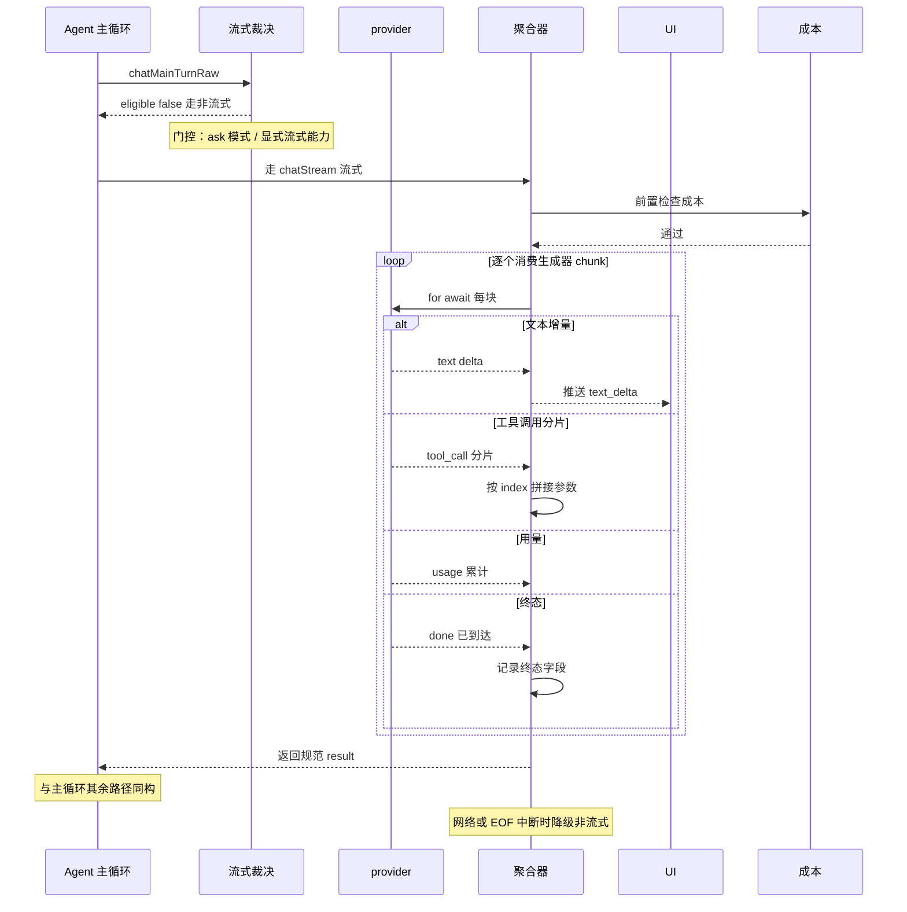

# LLM Provider 抽象：归一化 17+ 异构推理后端

> 本子文档聚焦 WebBrain 的 **Provider 关注面**：一套 `BaseLLMProvider` trait 如何把 OpenAI / Anthropic / Gemini / Azure / Bedrock / Vertex / 本地 llama.cpp / Ollama / vLLM / 在浏览器里跑的 WebGPU 等 106 张 provider 卡统一成 `{ content, toolCalls, usage }` 单一输出契约；`provider.promptTier` 三级 prompt tier 与上下文窗口如何反过来决定 agent 的提示词与工具面；Ask 模式在满足极其苛刻条件时才启用的流式渲染聚合；以及每个协议 parser 如何等一个「终态事件」而不是浅尝辄止。

先读根因，再进核心结构，最后深入三个设计决策——这是本文的叙事线。

## 根因：浏览器 agent 怎么接住「上百个各说各话的推理后端」

WebBrain 是浏览器里的自主 agent：它读页面、调工具、把结果回填给模型、再想下一步，每一轮都要真正调用一次「大脑」。但这个大脑不是固定的——Settings 里躺着 **107 张（Chromium）/ 106 张（Firefox）** provider 卡，从 OpenAI、Anthropic 到自家 WebGPU 本地推理。

真正棘手的是这些后端**协议各异**：

- OpenAI 类后端说 `/v1/chat/completions` 的 SSE，工具调用叫 `tool_calls`。
- Anthropic 说 `/v1/messages`，工具调用是 content 里的 `tool_use` block，thinking 是 `thinking` block。
- Bedrock 走 AWS SigV4 签名 + `/converse`，当前实现甚至**没有做**流式 event-frame 解析。
- Vertex Anthropic 复用 Anthropic 协议但换了一整套 `rawPredict`/`streamRawPredict` 端点与 `x-goog-api-key` 鉴权。
- WebGPU 根本不联网，没有 base URL、没有 API key，token 计数都是 null。

如果 agent 主循环为每一种协议写一份去重逻辑，代码会随 provider 数线性爆炸，且每加一个后端都要改主循环。WebBrain 的回答是把差异**收敛到一个接口后面**：所有 provider 实现同一个 `BaseLLMProvider` trait，向 agent 暴露统一签名 `chat()` / `chatStream()`，前者返回 `{ content, toolCalls, usage }`，后者是 yield 归一化 chunk 的异步生成器。agent 主循环永远只面对这一种「语言」。

正文：`chat()` 是异步方法、返回 `{ content, reasoningContent?, toolCalls, usage }`；`chatStream()` 是异步生成器、yield 带 `type` 的流式块。[src/chrome/src/providers/base.js:27-39]()
<!-- anchor:   async chat(messages, options = {}) { …   async *chatStream(messages, options = {}) { -->

## 核心结构：一个 trait、三条实现路径、一个门面

### 配置门面：ProviderManager 把 ID 映射成实例

`ProviderManager`（`providers/manager.js`，2266 行）是 Provider 的门面：它持有 provider 实例集合、负责真正的工厂创建、切换、持久化、连接测试与上下文窗口自动探测。真正的实例化只有一个入口 `_createProvider(id, config)`，它先归一化 config（补 `category`、按类型推断 `supportsAskStreaming` 缺省、剥掉存储里不该出现的 `_providerId`），再按 `config.type` 走工厂 switch——`llamacpp` 造 `LlamaCppProvider`，`webgpu` 造 `WebGPUProvider`，`openai` 一律造 `OpenAICompatibleProvider`，`anthropic` 造 `AnthropicProvider`，等等。

正文：工厂 switch 是唯一的构造入口——config 里的 `type` 决定具体类；`openai` 类型被复用于 Ollama、vLLM、SGLang、LM Studio、Alibaba 等所有 OpenAI 兼容后端。[src/chrome/src/providers/manager.js:922-941]()
<!-- anchor:     switch (normalizedConfig.type) { …         throw new Error(`Unknown provider type: ${normalizedConfig.type}`); -->

这个工厂为什么**不是** provider 清单里每个 ID 一个 case？因为大多数推理后端共享**同一个 OpenAI 兼容契约**——`/v1/chat/completions` + bearer key 就是它们的「普通话」。于是 manager 只在 wire protocol 真正不同时才新建类，其余全部落到 `OpenAICompatibleProvider`。配合 `provider-catalog.js` 里一张 `provider()` 卡（endpoint / model / contextWindow / 能力位）即可描述一个新后端。设计文档的「Adding a Provider」明确写出这条规则：口语 OpenAI 兼容卡只需加一个配置条目，只有协议偏离才建类。

正文：目录 `provider()` 卡封装 endpoint/model/contextWindow/能力位，默认 `supportsTools` 与 `supportsAskStreaming` 为 true，唯独 `supportsStreamUsageOptions`（`stream_options.include_usage`）恒为 false，要 trust 才显式开。[src/chrome/src/providers/provider-catalog.js:12-45]()
<!-- anchor: function provider(id, label, baseUrl, model, contextWindow, options = {}) { …       supportsStreamUsageOptions: false, -->

### 三条实现路径

粗略地说，18 个内置 provider 加 88 张目录卡被三条路径吸收：

| 路径 | 覆盖 | 特点 |
|---|---|---|
| `OpenAICompatibleProvider` | OpenAI、Gemini、Ollama、vLLM、SGLang、LM Studio、Jan、DeepSeek、xAI、Groq、Mistral、Router 等绝大多数 | 同一套 Chat Completions 归一化；按 config/模型名决定走 Chat Completions 还是 Responses API |
| `AnthropicProvider` + `VertexAnthropicProvider` | Anthropic、OAuth、Vertex Anthropic | 把 OpenAI 格式消息转换后再归一化回同一结果；`tool_use`/`thinking` block 拆回 `toolCalls`/`reasoningContent` |
| 原生特调 | `LlamaCppProvider`、`WebGPUProvider`、`AzureOpenAIProvider`、`AwsBedrockProvider` | 各自 wire 协议，但同样吐同一归一化结果 |

无论走哪条路径，最外层都收敛到同一个对象形状。以 Anthropic 为例：它把响应的非流式 `content` 数组逐 block 归类——`text` 拼进 `content`、`thinking` 拼进 `reasoningContent`、`tool_use` 转成与 OpenAI 相同形状的 `{ id, type:'function', function:{ name, arguments } }`（arguments 用 `JSON.stringify(block.input)` 还原），再经 `_normalizeUsage` 把 `cache_read_input_tokens`/`cache_creation_input_tokens` 等对到统一的 `prompt_tokens`/`completion_tokens` 形态。这与 OpenAI 的 `tool_calls` 数组在 agent 眼里完全同构。

正文：Anthropic 归一化是「把 block 数组翻译回 OpenAI 语义」的典型——`tool_use` block 变成 `{ id, type:'function', function:{name, arguments} }`，arguments 由 `JSON.stringify(block.input)` 还原。[src/chrome/src/providers/anthropic.js:376-388]()
<!-- anchor:     for (const block of responseContent) { …             arguments: JSON.stringify(block.input ?? {}), -->

正文：usage 归一化的核心在 `_normalizeUsage`——读 `input_tokens`/`output_tokens`（Anthropic 命名）缺省回退 `prompt_tokens`/`completion_tokens`，cache 读写单独归类并在总和中相加。[src/chrome/src/providers/anthropic.js:313-333]()
<!-- anchor:   _normalizeUsage(usage) { …     return normalized; -->

### 归一化结果在 agent 主循环里只被当作一种数据

agent 的主循环拿到 `chatMainTurn` 的返回后，不关心它来自哪个后端——只读 `result.content`、`result.toolCalls`、`result.usage`。这层「结果不感知协议」是 `{ content, toolCalls, usage }` 契约存在的全部意义：agent 逻辑与推理后端解耦，加新 provider 不动主循环。

## 设计决策一：为什么是 `{ content, toolCalls, usage }` 而不是别的

选择这三个字段产出，不是随便挑的。它们正好对应 agent 循环最关心的三个事实：

- **`content`**：模型要「说」的回答——给用户/给 UI 的文本。
- **`toolCalls`**：模型要「做」的动作——驱动主循环继续执行工具的关键数据；没有它就是纯对话终止。
- **`usage`**：这一轮烧了多少 token——驱动 cost allowance 与上下文压缩预算。

这三个字段构成 agent「想、做、算账」三件事的最小完备集。刻意**不**把它提升成带策略的层——没有类型体系、没有抽象的「结果类」，就是普通 object。好处是 provider 实现极轻：任何后端只要能把响应规整成这三个字段就算「接上了」，而这恰好是各协议差异最集中、也最容易出 bug 的地方。代价是 agent 侧看到的协议细节最少——比如 reasoning token、cache 计费、Response Items 这类更精细的信息，是**通过可选的 `reasoningContent`、`responseItems`、`raw` 附加字段**携带的，不参与核心契约。

为什么 `toolCalls` 用数组而非字符串？因为 agent 需要一次拿到「同一轮里模型想调的一整批工具」（主循环按批执行），字符串无法表达多个并行工具调用。`usage` 之所以允许为 `null`，是因为本地后端（llama.cpp 可能不报、WebGPU 恒为 null）并不总是返回计费数据——agent 对缺失 usage 的处理是「按字符估算」，而不是中断（见 ask 流式一节）。

## 设计决策二：三级 prompt tier 与上下文窗口——小模型活法

### provider.promptTier 决定「用它跑什么提示词」

一个思路是让所有模型共用同一套 agent 提示词。但 WebBrain 面对的模型从 2B 的本地模型到 200k 窗口的云旗舰，跨度极大。用全量 40+ 工具的 `SYSTEM_PROMPT_ACT` 去喂一个 8k 窗口的本地模型，系统提示词 + 全部工具 schema 就可能把上下文吃光，或者模型在几十个工具里反复挑错。

于是有了 `promptTier` 三级：`compact` / `mid` / `full`。它由 provider 解析（`base.js` 的 `get promptTier()`），约束是——**cloud 一律强制 `full`，只有本地与 router 才允许降级**。解析顺序：cloud → `full`；显式 `config.promptTier` → 它；遗留布尔 `useCompactPrompt` → `compact`；否则 local → `mid`、其余 → `full`。

正文：`get promptTier()` 的解析链——cloud 直接强制 `full`，显式 config 优先，其次遗留布尔，最后按 `category` 给 local 默认 `mid`。[src/chrome/src/providers/base.js:209-215]()
<!-- anchor:   get promptTier() { …     return this.config.category === 'local' ? 'mid' : 'full'; -->

这个 tier 下钻到 agent 侧就变成了「选哪份系统提示词 + 哪个工具面」：

正文：`_getActPrompt()` 按 tier 选系统提示词——`compact` 用 `SYSTEM_PROMPT_ACT_COMPACT`，`mid` 用 `SYSTEM_PROMPT_ACT_MID`，否则用全量 `SYSTEM_PROMPT_ACT`。[src/chrome/src/agent/agent.js:14508-14513]()
<!-- anchor:   _getActPrompt() { …     return SYSTEM_PROMPT_ACT; -->

紧凑是最极端的活法。`SYSTEM_PROMPT_ACT_COMPACT` 只有完整版约三分之一的体积，`COMPACT_TOOL_NAMES` 把工具收敛到约 25 个核心项——注释里直说「小型模型看到更多选项会挑错工具或编造参数」。

正文：Compact 提示词的取舍写在注释里——约三分之一的体积，砍掉示例、边角段落与 iframe/API 变更段；理由是省 token 而大多数任务用不到。[src/chrome/src/agent/tools.js:2013-2016]()
<!-- anchor:  * Compact system prompt for small/local models (< 8B parameters). … * eat tokens without helping on most tasks. -->

正文：Compact 工具集收敛的根本动机——全量 schema 有 40+ 工具，小型模型看到这么多选项会挑错工具或编造参数，所以砍到约 25 个核心项降低决策面与幻觉。[src/chrome/src/agent/tools.js:2018-2024]()
<!-- anchor:  * Compact tool set for small models (2B–8B). Keeps only the core tools … export const COMPACT_TOOL_NAMES = new Set([ -->

### 上下文窗口：自动压缩的尺子，本地模型尤其要诚实

`provider.contextWindow` 是 agent 决定何时自动压缩对话的尺子——一旦运行中的输入 token 超过窗口的一定比例，早期轮次会被摘要掉（见主循环子文档的「上下文自动压缩」）。问题是**这条尺子不能是臆测的**：报错了窗口会让 agent 在模型实际早就溢出时仍不压缩，导致请求失败甚至偏题；报小了会让 agent 过早压缩，丢失关键信息。

WebBrain 对窗口的处理分两层：

1. **无配置时的保守默认**：`base.js` 的 `get contextWindow()` 优先读显式 `config.contextWindow`，否则交给 `inferContextWindow(config)`。后者对 local 直接给保守 16k，因为本地服务的真实窗口取决于服务器/模型怎么启动；对 cloud/router 则按模型名做细粒度推断（`gpt-5.6` → 105 万，`gpt-5` → 40 万，`claude-` → 20 万，`qwen-max` → 32768，等等）。

正文：`get contextWindow()` 优先显式 `config.contextWindow`，否则交给 `inferContextWindow`；local 回落到保守 16k 因为真实窗口取决于服务器如何启动。[src/chrome/src/providers/base.js:125-129]()
<!-- anchor:   get contextWindow() { …     return inferContextWindow(this.config); -->

正文：`inferContextWindow` 对 `local` 直接给保留默认，cloud/router 则按模型名逐步推断——注释点明本地模型是运行时配置的，只能靠 Settings 或自动探测填值。[src/chrome/src/providers/context-windows.js:270-277]()
<!-- anchor: export function inferContextWindow(config = {}) { …   if (!model) return DEFAULT_CLOUD_CONTEXT_WINDOW; -->

2. **自动探测修正默认**：Test connection / Load models 会对 llama.cpp、Ollama、LM Studio（以及 vLLM/SGLang/LocalAI）发起元数据请求读取真实窗口——llama.cpp `GET /props` 的 `n_ctx`、Ollama 先 `GET /api/ps` 取活上下文再 `POST /api/show` 取 `num_ctx`、LM Studio `/api/v0/models` 的 `loaded_context_length`。探测结果经 `shouldApplyDetectedContextWindow` 判定后写回 config，刷新那个 16k 默认。

这里有一个微妙的安全语义：**来自活/运行时分配的窗口（`shrinkOverride: true`）才允许缩小手动覆盖值；仅来自 Ollama `/api/show`（非活、`shrinkOverride: false`）的值只能放大/刷新，不能把用户手动填的大窗口缩小。** 因为活上下文才是模型当时真实的可用窗口，而 `/api/show` 的 `num_ctx` 可能只是模型配置里的参数而非实际分配量。

正文：Ollama 探测首选活分配的 `/api/ps`（honors runtime num_ctx），回退 `/api/show`；关键在 `shrinkOverride` 标志——活的可以收缩，show-only 不能。[src/chrome/src/providers/manager.js:2124-2147]()
<!-- anchor:       if (definitionId === 'ollama') { …         return { contextWindow, shrinkOverride: false }; -->

正文：本地探测的守卫是 `shouldApplyDetectedContextWindow`——按 `shrinkOverride` 决定能否收缩一个已有的手动覆盖，通过后才写回。[src/chrome/src/providers/manager.js:2065-2076]()
<!-- anchor:     const detected = await this._detectLocalContextWindow(id, provider, options); …     return { ...result, contextWindow: detected.contextWindow }; -->

为什么对本地模型这么谨慎？因为本地模型的窗口是「服务器启动参数」决定的，WebBrain 无法从任何地方拿到标准答案，只能去探测或靠用户填。报错比报小的代价高得多——`llama-server -c 4096` 只会让 agent 每轮都触发压缩、模型能力被严重抑制。文档直接给出血淋淋的经验线：**至少 16k 才够可靠跑 agent；8k 配合 Compact tier 可以；4k 连系统提示词 + 工具 schema 都装不下**。

## 设计决策三：Ask 流式渲染——只对「恰好满足条件」启用的增量输出

非流式的 `chat()` 一次性返回整段回答，交互上要等模型生成完才显示。Ask 模式要给用户「正在打字」的即时反馈，所以需要流式。但 WebBrain 的流式**不是对所有 Ask 请求无条件开**——它由一长串条件门控，命中才开：

- 模式必须是 `ask`；
- 必须是交互式聊天（`runOptions.interactiveChat`）；
- 设置未关闭；
- 不是 trusted continuation、不是 cloud run；
- 本 run 未被 fallback 禁流式（`disabledForRun`）；
- provider 必须实现 `chatStream`；
- 且 provider 必须**显式** `_supportsInteractiveAskStreaming()` 为 true（光实现 `chatStream()` 不够，因为部分 adapter 保留非流式的兼容 shim）。

正文：Ask 流式资格裁决是一连串守卫——mode、交互标志、设置、trusted/cloud、fallback 态、`chatStream` 存在、显式 capability，全部通过才 eligible。[src/chrome/src/agent/agent.js:2314-2332]()
<!-- anchor:   _interactiveAskStreamingDecision(provider, mode, runOptions = {}, disabledForRun = false) { …     return { eligible: true, reason: 'eligible' }; -->

这才是「为什么不是所有 provider 都能流式」的核心：`supportsAskStreaming` 是**显式 opt-in**。工厂 `_createProvider` 只在 `type` 属于一小撮白名单（llamacpp/openai/azure_openai/anthropic/anthropic_oauth/vertex_anthropic）时默认置 true，其余 provider 卡即使实现了 `chatStream` 也要 config 显式声明。为什么要 opt-in 而不是看「有没有 `chatStream` 方法」？设计文档说得很直白：**有的 adapter 留着非流式兼容 shim，方法在但语义不完整**——实现 `chatStream()` 不代表协议完整得能支撑交互式 Ask UI。

正文：工厂按 `type` 白名单推断 `supportsAskStreaming` 缺省——llamacpp/openai/anthropic/vertex 等才默认流式，其余卡必须显式声明。[src/chrome/src/providers/manager.js:890-903]()
<!-- anchor:     const normalizedConfig = { …       ].includes(config.type), -->
<!-- anchor:         'anthropic_oauth', …         'vertex_anthropic', -->

正文：`get supportsAskStreaming()` 的语义在这里定死——必须 config 显式 `supportsAskStreaming === true`，仅实现 `chatStream()` 不够，因为 adapter 可能保留非流式 shim。[src/chrome/src/providers/base.js:92-94]()
<!-- anchor:   get supportsAskStreaming() { …     return this.config.supportsAskStreaming === true; -->

### 流式聚合：把归一化 chunk 拼回规范结果

真正执行流式的是 `_chatStreamWithCostAllowance`（agent.js）。它 `for await` provider 的 `chatStream` 生成器，按 chunk 的 `type` 聚合：`text` 累进 `content` 并回调 `onTextDelta` 把增量推给 UI；`reasoning` 累进 `reasoningContent`（打完后再剥 `</think>` 标签）；`tool_call`/`tool_call_start`/`tool_call_delta` 按 `index` 合并进一个 `Map`（流式分片补全参数）；`done` 收集 `finishReason`/`usage`/raw 并标记 terminal。

最后它产出的**不是**生成器，而是与被调 `_chatStreamWithCostAllowance` 外层的非流式 `_chatWithCostAllowance` 相同形状的普通 result——即被归一化回 `{ content, toolCalls, usage }`。这就是「Ask 流式渲染聚合」的本质：流式只在**传输/增量 UI** 层面发生，产物与 agent 循环的其余路径完全一致，主循环无感知。

工具调用的关键约束在 `mergeToolCall`：流式里同一 `index`（工具在整轮里的序号）的分片要**拼接**起来——`id`/`type`/`function.name`/`function.arguments` 一段段 accumulate。因为 OpenAI 兼容流式的 `delta.tool_calls` 是 `arguments` 的增量分片而非完整 JSON，单独 yield 出去 agent 无法解析。

正文：流式聚合器按 `chatStream` 的 chunk-type 分支累加——`text` 推 UI、`tool_call` 按 index 合并进 `Map`、`usage` 累积、`done` 收终态档位。[src/chrome/src/agent/agent.js:2434-2474]()
<!-- anchor:       for await (const chunk of provider.chatStream(messages, streamOptions)) { …             sawCompleted = true; -->

正文：聚合完的产物被归一化回规范结构 `{ content, toolCalls, usage, responseItems, finishReason }`——与主循环其余路径形状一致，主循环对「是否流式」无感知。[src/chrome/src/agent/agent.js:2490-2503]()
<!-- anchor:     estimateUsageIfMissing(true); …     return result; -->

### 等一个「终态事件」而不是浅尝辄止

每个流式 parser 的共同纪律：**必须等到协议自己的终态事件**才视为完成。OpenAI Chat Completions / llama.cpp / Ollama 等的 SSE 要 `[DONE]`；Anthropic 要 `message_stop`；Responses API 要 `response.completed`。在终态之前，`finish_reason`、usage 可能都还没到齐；工具的完整 `arguments`、reasoning 的最终形态都只在终态时确定。

正文：llama.cpp 的 `chatStream` 只有见到 `[DONE]` 哨兵才 yield `done` 并 return；流式工具/文本在 `delta` 里逐段 yield，usage 累积到 `finalUsage`。[src/chrome/src/providers/llamacpp.js:148-157]()
<!-- anchor:         if (payload === '[DONE]') { …           return; -->

正文：OpenAI Responses 流在终态之前清理 EOF 被刻意视为失败——因为 text/function-call/reasoning items 只会在 completion 时才齐，提前当 done 会丢内容。[src/chrome/src/providers/openai.js:930-935]()
<!-- anchor:     // A clean transport EOF is still a failure when no terminal Responses …     }, { stream: true }); -->

### 失败处理：kill switch + circuit breaker

流式比非流式更容易半途失败（网络断裂、分片不齐、provider 中途 error），所以 WebBrain 有一套显式的失败分级：

- **transport 类错误**（网络失败、未到终态的 EOF、解析失败）标记 `isAskStreamFallbackSafe`，是**可安全 fallback** 的：出错时机不依赖已有输出。
- **terminal 类错误**（HTTP 失败、provider 在流里报的 API 错误、`content_filter` 终因）标记 `isAskStreamTerminalError`，**绝不触发重复请求**——重试只会重复同一个失败。

`chatMainTurnRaw` 的 catch 逻辑据此决定：若是 fallback-safe 且已发出过文本 delta，先 `onUpdate('text', { replace:true })` 清掉屏幕上半截，设 `askStreamingDisabledForRun = true`（**本 run 剩余轮次不再流式**——circuit breaker），显示警告后**用非流式 `_chatWithCostAllowance` 重试这一轮**。若 `emittedText` 为 false（还没推任何增量），则新文本不会推送。这就是「kill switch」：一旦一次流式中断，之后便降级为普通 chat，保住可用性。

正文：fallback 决策——fallback-safe 且已 emit 文本则清屏，否则设 `askStreamingDisabledForRun` 禁用本 run 后续流式（circuit breaker），随后走非流式重试这一轮。[src/chrome/src/agent/agent.js:27458-27461]()
<!-- anchor:         if (this._isCostAllowanceError(error)) throw error; …         askStreamingDisabledForRun = true; -->

正文：失败分级标准——transport 错误（网络、未到终态 EOF）标 fallback-safe，terminal 错误（provider API 报错、content_filter）标 terminal 不可重试。[src/chrome/src/providers/base.js:50-57]()
<!-- anchor:   _askStreamTransportError(message) { …   _askStreamTerminalError(message) { -->

### usage 缺失时按字符估算

流式比非流式更容易拿不到 usage——本地/部分 rourer 的流不报 token。为了让流式不能绕过配置的 cost allowance，`_estimateAskStreamUsage` 用字符/4 的启发式估算 prompt 与 completion token，并在聚合缺使用量时填入。注释强调这是「保守」估算——宁可多算也不放行超预算。流式 provider 最终只贡献其累计 usage 快照。

正文：流式缺 usage 时的字符估算——prompt 与 completion token 都按明文长度 /4 粗估，标记 `estimated: true`，确保流式不能逃过 cost allowance。[src/chrome/src/agent/agent.js:2293-2305]()
<!-- anchor:   _estimateAskStreamUsage(messages, options, content, reasoningContent, toolCalls) { …     const completionTokens = completionChars > 0 ? Math.max(1, Math.ceil(completionChars / 4)) : 0; -->

### 为什么 Alibaba Cloud 保持非流式

一个反例最能说明 opt-in 设计的价值：Alibaba Cloud（Qwen）与两个 Alibaba Coding Plan 卡都**保持非流式**。原因写在设计文档里——DashScope 不允许 `tools` + `stream=True` 同时使用，而 Ask 永远携带它的 read-only 工具目录。如果强行给 Alibaba 开流式，工具调用会直接不可用。这正是「`supportsAskStreaming` 由每张卡自述而非由有没有实现 `chatStream` 推断」的实证：能力语义（这片协议能不能在带工具的情况下流式）必须由卡作者显式声明，框架不能替你猜。Alibaba 卡上就显式写了 `supportsAskStreaming: false`。

正文：Alibaba Coding Plan 卡显式关掉 Ask 流式——因为 DashScope 不允许 `tools` 与 `stream:true` 并存，而 Ask 恒带只读工具目录。目录卡用 `supportsAskStreaming: false` 表达这一协议事实。[src/chrome/src/providers/provider-catalog.js:66]()
<!-- anchor:   provider('alibaba-coding-plan', 'Alibaba Coding Plan', 'https://coding-intl.dashscope.aliyuncs.com/v1', 'qwen3-coder-plus', 1000000, { category: 'cloud', apiKeyUrl: 'https://www.alibabacloud.com/help/en/model-studio/coding-plan', supportsAskStreaming: false }), -->

同样，AWS Bedrock 虽然实现了 `chatStream`，但它的实现是**非流式的兼容 shim**——直接调用内部的 `chat()` 拿到完整结果再一次性 yield 出来。这正是 `supportsAskStreaming` 必须显式 opt-in 的反面教材：方法在，但没有任何流式语义，方法存在与否完全不能代表能力。

正文：Bedrock 的 `chatStream` 是非流式 shim——调用一次完整 `chat()` 再把结果逐条 yield，注释明说「先保留非流回退让 UI 可用」。方法在但无流式语义，这正是为何流式能力必须显式声明而非靠存在性推断。[src/chrome/src/providers/aws-bedrock.js:310-316]()
<!-- anchor:   async *chatStream(messages, options = {}) { …     if (res.usage) yield { type: 'usage', usage: res.usage }; -->

### Ask 流式主链路

下面这张时序图把六个「为什么」（归一化契约、tier、窗口、opt-in 门控、终态等待、fallback）串进一个 Ask 交互回合：

## 依赖与合成

Provider 关注面不是孤立的，它与主循环、安全、成本三处强耦合：

| 依赖方 | 消费 Provider 抽象的那一面 |
|---|---|
| `agent.js` 主循环 | `result.content`/`result.toolCalls`/`result.usage`；`_resolvePromptTier` 决定提示词；`provider.contextWindow` 驱动自动压缩 |
| `agent.js` cost allowance | 流式聚合夹的 `_estimateAskStreamUsage` 字符估算 + `_checkCostAllowance` 前置检查 |
| `tools.js` prompt 档案 | `promptTier` 选 `SYSTEM_PROMPT_ACT` / `SYSTEM_PROMPT_ACT_MID` / `SYSTEM_PROMPT_ACT_COMPACT` 以及对应工具集 |
| `manager.js` 探测 | 上下文窗口自动检测回写 `config.contextWindow`，再反过来被 `get contextWindow()` 消费 |
| Vision 子模块 | `supportsVision` / `visionMode` 决定截图是否进请求，本地探测交回 `manager` |

`provider-catalog.js` 的 `provider()` 卡把「能力位」（`supportsTools`/`supportsVision`/`supportsAskStreaming`/`supportsStreamUsageOptions`/cost rates）与 endpoint/model 一起打包——它是 Provider 关注面的「表驱动」核心：新后端= 一张卡，无需改任何 agent 代码。卡里的能力位与 `_createProvider` 的 type 白名单、以及 `_createProvider` 对部分能力的自动推断，共同构成「配置优先、代码兜底」的组合：说的常识走默认，协议事实由卡显式。

## 不足与权衡

- **协议归一化的信息损失**：`{ content, toolCalls, usage }` 契约刻意丢弃 reasoning token、精细 cache 计费、Response Items 等细节——它们只作为可选字段附在后面，靠各 provider 自觉携带，没有统一强制。
- **`supportsAskStreaming` 双轨制**：config 缺省 + 卡自述 + `base.js` getter 三处语义容易让人困惑（`config.supportsAskStreaming` 与 getter 名重复但含义相同）。设计文档与注释反复解释，仍属认知负担。
- **本地上下文窗口高度依赖探测**：lmstudio/llamacpp/ollama 自动探测做得扎实，但 Jan/vLLM/SGLang/LocalAI 没有 `shrinkOverride` 的正确语义，且探测结果是否可信完全押在服务器元数据上。
- **Bedrock 流式是「假流式」**：非流式 shim 让 Ask 在 Bedrock 上没有增量反馈，这是显式的取舍而非疏漏，属已知能力缺口。

## 可借鉴的设计

1. **用「输出契约 + 能力位」而非「抽象基类 + 多态」**：不强制继承深度，只要返回 `{content, toolCalls, usage}` 就算接上；能力（vision/ask-streaming/tools）用 config 位自述而非方法存在性推断。加后端成本 = 写一张卡。
2. **终态事件纪律**：流式 parser 必须等协议自己的终态（`[DONE]`/`message_stop`/`response.completed`），把「提前 EOF」显式当失败而非成功——防住「半截文本被当成完整回答」的严重错误。
3. **transport 与 terminal 错误分级 + circuit breaker**：可重试的错（网络/EOF）与不可重试的错（provider 报错/过滤）分开标记；一次流式中断后本 run 降级非流式，用「一次可用性牺牲换整体可靠」。
