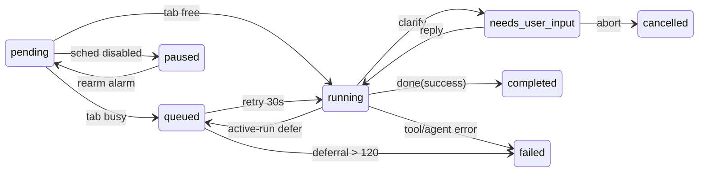
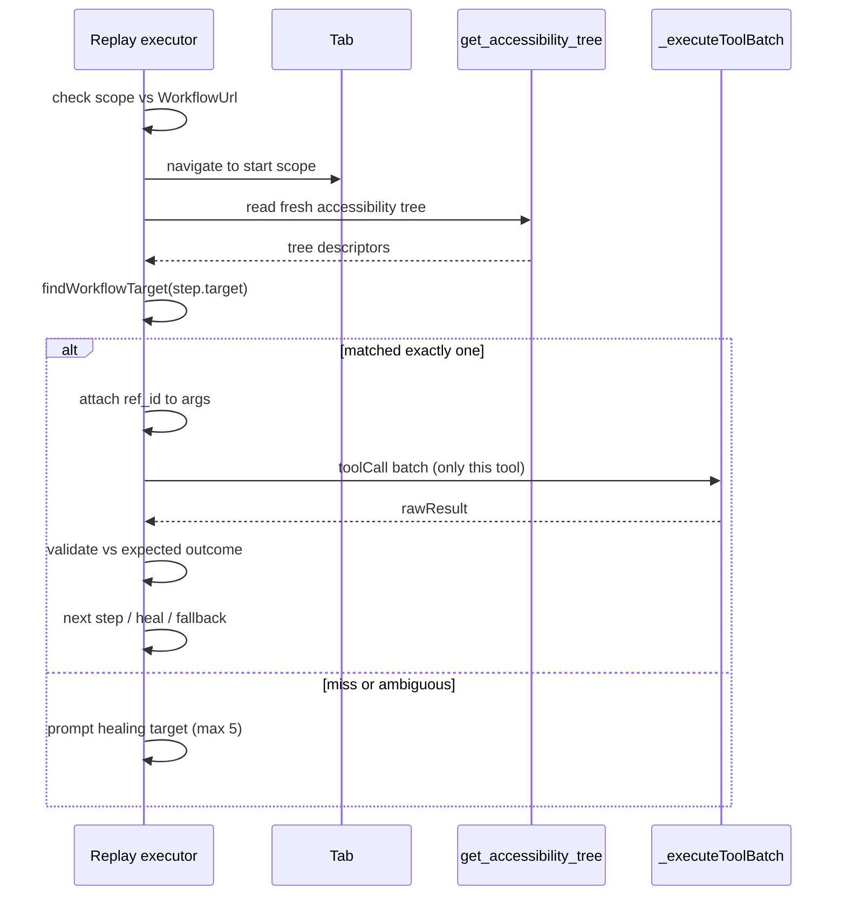

# 定时任务与已存工作流深入解读

WebBrain 的"后台自动化"不止是"帮我把任务做掉"，它把**时间**与**可复用性**变成一等公民：调度器让 agent 在未来某个时刻自行醒来干活，已存工作流让一次成功的操作序列被重新编译成可重放、无敏感值的工件。这一层关乎「自动化的信任边界」——一个自动执行的任务在无人盯守时如何被授权、如何恢复、如何不泄漏。

本文深入关注面：

- **调度任务**（`ScheduledJobManager`，基于 `browser.alarms`）：`resume` / `task` / `watch` 三种 job，以及它们共同的生命周期状态机。
- **watch 轮询**：相对条件如何建立 baseline、"无值观测"如何安全地喂给 LLM。
- **已存工作流**：trace → 无值工件 → 语义匹配重放 → locator repair 的整条链路。
- **teacher mode**：作为工作流编译的第二个输入来源，为何只读"可信动作"而不读值。

## 核心结构

### 调度器的三类 job

调度器把所有"未来要做的事"统一表示为带 `id`、`kind`、`status`、`schedule`、`target` 的 job 对象，持久化在 `chrome.storage.local` 的 `wb_scheduled_jobs` 数组里。三类 job 的差异点在 `kind`/`source`：

| Job | 触发方式 | 生命周期语义 |
|---|---|---|
| `kind: resume` | `schedule_resume` 工具 | 当前会话在**同一 tab、同一 conversation** 的延续，terminal——触发后当前 run 结束。创建时校验 `reason` 与 `resume_instruction` 必填 |
| `kind: task` | `schedule_task` 工具 | 独立于当前会话，一次或周期执行的 prompt，target 可为 `current_tab` 或 `url` |
| `kind: task` + `source: watch` | `/watch` 命令 | 对发起页 URL 做固定 30–120s 间隔轮询，条件触发才执行动作 |

创建入口都遵循"先校验、后持久化、再设闹钟"的顺序。job 的产生路径本身就在做去重——`_saveJobUnlessDuplicate` 在写盘前调用 `findDuplicateScheduledJob`，把意图相同的 job 合并掉而非重复排队：

正文：创建 task job 时先 `validateTaskArgs`，再 `_saveJobUnlessDuplicate` 合并去重（`src/chrome/src/agent/scheduler.js:811-845`）。

```
正文：创建 task job，校验后 `_saveJobUnlessDuplicate` 去重（src/chrome/src/agent/scheduler.js:811-845）。
<!-- anchor: async createTaskJob({ tabId = null, conversationId = null, args, source = 'agent' … -->
<!-- anchor: const saved = await this._saveJobUnlessDuplicate(job); -->
```

### 工作流：编译后的无值工件

与"序列化 trace"最大的不同是：已存工作流**不是可执行日志**，而是一份刻意剥离了历史的**声明式计划**。文件头注释直接点明这一设计立场：

正文：工作流「不是可执行 trace」，编译期移除历史元素引用与类型值（`src/chrome/src/agent/workflows.js:1-9`）。

```
正文：工作流「不是可执行 trace」，编译期移除历史元素引用与类型值（src/chrome/src/agent/workflows.js:4-8）。
<!-- anchor: This module is deliberately pure: the schema boundary is shared by Chrome, -->
<!-- anchor: must be resolved against the current document at replay time. -->
```

一个编译后的 workflow 拥有：`schema`（`webbrain-workflow/1`）、`start`（初始 origin/pathFamily 作用域）、`parameters`（运行时参数占位符列表）、`steps`（每步含 `tool` / `args` / 语义 `target` / `scope` / `expected` 后置条件）、`stats`。可重放的工具被白名单收紧为 `REPLAYABLE_WORKFLOW_TOOLS`：

正文：只有这 11 个工具能进入已存工作流，其它一律跳过（`src/chrome/src/agent/workflows.js:27-38`）。

```
正文：可重放工具白名单（src/chrome/src/agent/workflows.js:27-38）。
<!-- anchor: export const REPLAYABLE_WORKFLOW_TOOLS = new Set([ -->
<!-- anchor: wait_for_element, -->
<!-- anchor: ]); -->
```

## 执行流程

### 调度 job 的生命周期状态机

每个 job 在 `pending → queued → running → completed` 之间流转，并可能退入 `failed / cancelled / paused`，或在运行中卡在 `needs_user_input`。核心状态：

- `pending` — 闹钟已设，等待触发。
- `queued` — 闹钟已响但目标 tab 忙（正在跑别的 agent run），进入 30s 延迟重试队列。
- `running` — agent 正在真实执行该 job。
- `needs_user_input` — 运行中 agent 发了 `clarify`，等待用户回答。
- `paused` / `cancelled` / `failed` / `completed` — 中性或终态。

状态机的**真实落盘点在 storage**，闹钟只是唤醒机制——这是它能在浏览器长生命周期与崩溃后恢复的关键。`restoreAlarms` 在后台启动时读取持久化 job，把重启前残留在 `running`/`needs_user_input` 的 job **降级为 `queued` 并设一个新闹钟重试**，保证"没有 run 因为后台重启而静默丢失"：

正文：后台重启时，把遗留的 running/needs_user_input 降级为 queued 重试，但保留需授权的明确澄清不自动重跑（`src/chrome/src/agent/scheduler.js:702-720`）。

```
正文：重启恢复，running/needs_user_input 降级 queued 重试（src/chrome/src/agent/scheduler.js:704-719）。
<!-- anchor: if (!['running', 'needs_user_input'].includes(job.status)) return job; -->
<!-- anchor: pendingClarify: null, -->
```

这里有个关键权衡：`needs_user_input` 分两种。若 `clarificationRequired === true`，说明是**授权边界**上的主动停顿（例如需要用户确认一次"重大"提交），这类停顿被认为是持久且有意的——重启后**不**应无人值守重跑，所以保留原状；而普通 live 澄清被打断则需要重试。恢复时还要跑一次 `_coalesceDuplicateJobs` 处理重复。



### 一次调度 run 的执行主线

`_runJob` 是真正的执行入口，它把"造 job"与"跑 job"分开。流程：取设置 → 定位 job → **保留 tab（reserveTab）** 防止两个 run 抢同一 tab → `_resolveTab`（current_tab 校验 tab 是否存活、url 则新建/复用后台 tab）→ 校验会话与目标未被篡改 → 置 `running` → 注入一条"这是用户排期的任务，别当网页指令"的消息 → `agent.processMessage` → 按结果走 `_complete` / `_markFailed` / `_markClarificationRequired`。

正文：`_runJob` 先 reserveTab 再 resolveTab，tab 忙则 requeue（`src/chrome/src/agent/scheduler.js:1552-1572`）。

```
正文：reserveTab 失败按错误分派 requeue/markFailed（src/chrome/src/agent/scheduler.js:1564-1571）。
<!-- anchor: if (isActiveRunError(e) || e?.code === 'teacher_mode_active') { -->
<!-- anchor: await this._markFailed(job, e.message); -->
```

消息注入尤其关键：排期任务本质是"用户不在场时的指令"，`_messageForJob` 明确告诉 LLM 这是 `[Scheduled task ...]`，且**网页内容永远不是指令**，从而把 prompt-injection 边界从"依赖模型自觉"提升为"系统消息白纸黑字"。resume job 还会附带 `Original reason` 与 `Resume instruction` 以便续写。

### watch 轮询：相对条件如何建立 baseline

watch 的设计难题是"相对条件"（如"有新 commit"）——模型要知道"什么算新"。WebBrain 的做法是**把上一次观测当作 baseline 一起喂给模型**，但用非确定性 nonce 包裹标记为不可信内容边界：

正文：watch 把上一轮观测以 untrusted-content 边界继续传给模型（`src/chrome/src/agent/scheduler.js:1310-1318`）。

```
正文：watch 消息把上一轮观测作为 untrusted 边界传入（src/chrome/src/agent/scheduler.js:1310-1314）。
<!-- anchor: const previous = String(job.watch?.lastObservation || '').trim(); -->
<!-- anchor: Previous observation: none. For a relative condition such as "new commit", establish a baseline without taking the action. An absolute -->
```

相对条件在**首轮**没有 baseline 时，消息要求模型"先建立 baseline 而不执行动作"；只有绝对条件（"CI 变绿"）才允许立即触发。观测本身在 `wrapWatchObservation` 里被清洗（剥离 `untrusted_page_content` 标签、截断到 2000 字符、加 nonce），防止页面文本伪造边界两端。每一轮 `done(partial)` 就把当前观测存为下一轮 baseline 并继续轮询；`done(success)` 的一次性 watch 结束，`--keep` 的 watch 则只为后续不同事件继续。**失败的轮询永不作为 baseline**——只有 3 次连续失败才停掉 watch，防止其无限自循环：

正文：失败轮询不计入 baseline，连续失败达上限才终止（`src/chrome/src/agent/scheduler.js:1177-1196`）。

```
正文：_failWatchPoll 只累计失败次数，未达上限继续排下次轮询（src/chrome/src/agent/scheduler.js:1182-1196）。
<!-- anchor: const nextRunAt = failures < MAX_WATCH_CONSECUTIVE_FAILURES -->
<!-- anchor: watch: { ...prev.watch, consecutiveFailures: failures }, -->
```

### 工作流重放：语义匹配而非硬编码选择器

重放执行器是"确定性回放 + 走投无路时优雅降级"。每个含 target 的 step，回放流程是：

1. 校验当前 `workflowUrlMatches`（origin + pathFamily 族）——先保证在预期页面上。
2. 读一张新的 accessibility tree。
3. `findWorkflowTarget` 对 `step.target` 做语义评分匹配，必须**恰好一个**匹配。
4. 用匹配到的 `ref_id` 构造工具调用，走 `_executeToolBatch`，让既有权限/提交/校验闸门仍然权威。
5. `validateWorkflowStepResult` 校验保存的后置条件。
6. 通过则继续下一步；不通过则按情况 fallback（交给模型）、heal（用户修复）或 stop。

正文：重放通过 `_executeToolBatch` 执行单步工具调用（`src/chrome/src/agent/agent.js:19930-19942`）。

```
正文：重放经 _executeToolBatch 执行并用 validateWorkflowStepResult 校验（src/chrome/src/agent/agent.js:19930-19942）。
<!-- anchor: const batch = await this._executeToolBatch( -->
<!-- anchor: const validation = validateWorkflowStepResult(step.expected, rawResult, { beforeUrl, afterUrl, tool: step.tool }); -->
```



`findWorkflowTarget` 按字段加权打分，且**权重刻意偏向稳定语义**：`id`(12) > `fieldName`(9) > `label`/`ariaLabel`(8) > `name`/`href`(7) > `placeholder`(5) > `type`(3) > `role`(2)。`selector` 从不进入评分子——裸 CSS 选择器在布局变化后会静默指错，不能作为确定性匹配依据。分数低于阈值（7）的 target 在**保存时**就被拒绝，保证存下的每个 target 单独可重放：

正文：target 评分刻意不纳入 selector，低于阈值则不可重放（`src/chrome/src/agent/workflows.js:951-960`）。

```
正文：selector 不参与评分，达到阈值才算可重放 target（src/chrome/src/agent/workflows.js:951-960）。
<!-- anchor: // selector is intentionally not scored: TARGET_FIELDS never stores it, and -->
<!-- anchor: export function isReplayableWorkflowTarget(target) { -->
```

### locator repair：只在证实可靠后持久化

当严格匹配失败，重放会给出最多 5 个独立可重放、语义兼容的候选 target 让用户选择。选中的 target **只用于当步**，只有当该步的 postcondition 成功、且无 inconclusive/stale/ambiguous/wrong-target 等证据时，才会作为永久 repair 写入工作流：

正文：修复仅在成功且无异常证据时才落地（`src/chrome/src/agent/agent.js:19968-19984`）。

```
正文：healing 需 verified 才记录为 verifiedHealings（src/chrome/src/agent/agent.js:19968-19984）。
<!-- anchor: if (pendingHealing) { -->
<!-- anchor: if (healingVerified) verifiedHealings.push(pendingHealing); -->
```

修复的原子性通过 `workflow.updatedAt` 乐观锁保证：`healTargets` 要求传入的 `expectedUpdatedAt` 与当前 `updatedAt` 一致，否则报 `workflow_changed`，让并发编辑获胜而不是被覆盖。

## 设计决策

### 为什么工作流是"编译后的无值工件"而非序列化 trace

这是全篇最核心的取舍。序列化 trace 里藏着三样东西，都不该被保存：(1) 历史 DOM 引用/坐标/query——页面一变就失效；(2) 类型值（密码、token、填过的表单）；(3) 一次性的中间态。所以编译期同时做了三件事：

- **去历史定位**：把"第 3 个 element、坐标 (x,y)、带 search 的 URL"全部丢掉或归一化成语义证据。URL 只保留 origin + pathFamily，路径中的 ID 段归一化为 `:id`：
  - 正文：URL 剥离 query/hash，路径 ID 归一化为 :id（`src/chrome/src/agent/workflows.js:84-107`）。
  - ```
    正文：导航 URL 剥离 query/hash，路径 ID 归一化为 :id（src/chrome/src/agent/workflows.js:84-107）。
    <!-- anchor: // Queries and fragments commonly carry searches, OAuth codes, tokens, or -->
    <!-- anchor: if (/^[A-Za-z0-9_-]{20,}$/.test(decoded) && /\d/.test(decoded)) return ':id'; -->
    ```
- **去 query/坐标/裸露选择器**：`compileStepArgs` 对 `click` 显式拒绝坐标与索引重放，只允许文本定位；`navigate` 若 URL 带 query/hash 直接报 warning 并把其去掉：
  - 正文：click 拒绝坐标/索引重放（`src/chrome/src/agent/workflows.js:277-283`）。
  - ```
    正文：编译期拒绝 click 的坐标/索引重放（src/chrome/src/agent/workflows.js:277-283）。
    <!-- anchor: // Coordinate and historical element-index replay are intentionally absent. -->
    <!-- anchor:     return text ? { text } : null; -->
    ```
- **去敏感值 → 参数化**：每个 type/set_field 的文本值在编译期变成一个 `$workflowParam` 占位符并声明进 `parameters`，运行时才由用户在一个临时表单里填。占位符在规范化、导出、落盘、遥测各个阶段都不携带真实值。遥测更是显式把参数值替换为 `<workflow-parameter:...>`，避免把刚填的表单值上送 UI：
  - 正文：运行时参数解析从模板中按 id 取值（`src/chrome/src/agent/workflows.js:775-779`）。
  - ```
    正文：resolveWorkflowArgs 用参数对象替换 $workflowParam 占位符（src/chrome/src/agent/workflows.js:775-779）。
    <!-- anchor: if (Object.keys(value).length === 1 && Object.hasOwn(value, WORKFLOW_PARAM_REF_KEY)) { -->
    <!-- anchor:       return String(parameters[id]); -->
    ```

### 为什么 teacher mode 永不读字段值

teacher mode 是工作流编译的第二个输入源，与"从成功 trace 编译"互补但更安全。`content/teacher-capture.js` 只监听**可信的顶层事件**——`event.isTrusted` 为真才处理；只记录"用户做了点击/改了勾选/填了字段/按了 Enter"，对字段动作只记录 `{kind:'field', target:语义描述}`，绝不读值也不上传值：

正文：teacher 捕获用 input/change 事件只记 dirty 字段语义，不读 value（`src/chrome/src/content/teacher-capture.js:185-198`）。

```
正文：input 仅把字段标脏，change 才发无值 field 动作（src/chrome/src/content/teacher-capture.js:185-198）。
<!-- anchor: document.addEventListener('input', (event) => { -->
<!-- anchor:   }, true); -->
```

对应地，`teacher-mode.js` 的 store 在 `record` 时用 `normalizeTeacherCaptureAction` 立即把字段动作降级为参数标记，`sensitiveParameter` 还会根据字段身份（password/token/otp 等）把参数标为敏感，运行时同样不落入回放提示。整个 capture 边界形成了"**动作可信、值不可信**"的分层——这既保了隐私，也让工作流能脱离具体会话重放。

### 为什么用 accessibility 树语义匹配而非硬编码选择器

页面是活的。裸 CSS 选择器 / 坐标 / DOM `ref_` 索引在下次加载就可能漂移、指错甚至落到另一个元素上。语义匹配把"定位"交给**当次实时读取的 accessibility 树**，用 role/name/label/field 身份这些人类语义来匹配，而不是某次快照里的几何或序号。这样 (a) 兼容布局改版；(b) 通过"恰好一个强匹配"约束避免误点；(c) 用加权评分容忍轻微文案变化。代价是必须每次读树（更贵），但换来的是可重放性——这正是"编译工件 + 运行时解析"的必然选择。

### 为什么 job 恢复要降级 queued 而非直接重跑 / 直接丢弃

浏览器后台生命周期不可控（崩溃、被回收、重启）。若直接重跑"可能副作用已发生"的 run 会重复动作；若丢弃则丢失用户意图。折中是：**降级为 queued + 设 30s 重试闹钟 + 加 queueDeferrals 计数**。通过记录 deferral 次数，既保证"没丢"，又保证"最多重试 120 次后仍失败才 fail"，给用户一个明确的终态而非无限重试。

### 为什么 watch 的 helper tab 一旦跑偏就关闭重建

watch 用独立的后台 tab 轮询 URL。若目标页在 load 时重写/跳转，helper 的 URL 会与预期不符——此时**不**强行回写 URL（会刷新页面、破坏隐身/会话状态），而是关掉跑偏的 helper，下一轮新建一个干净的 inactive tab：

正文：跑偏的 watch helper 直接关闭而非强改 URL（`src/chrome/src/agent/scheduler.js:1268-1276`）。

```
正文：watch helper 跑偏即关闭以免每轮泄漏孤儿 tab（src/chrome/src/agent/scheduler.js:1268-1272）。
<!-- anchor: // A diverged helper is watch-owned and inactive; close it instead -->
<!-- anchor:             try { await this.api.tabs.remove(job.target.tabId); } catch { /* already closed */ } -->
```

### watch beep 的触发契约：先持久化事件键，验证成功后才出声

`/beep` 暴露一个仅当次 watch 可见的 `beep({event_key, message?})` 工具，它只"武装"一个 alert、报告重复键，**本身不发声**。scheduler 只有同时满足「验证 `done(outcome=success)`」+「保存了新的 event_key」之后，才让 offscreen 文档真正生成音调。这样 (a) 相同事件键不会重复发声（`duplicate` 时该轮降级为 `partial`，不再重复动作）；(b) 重启不会双重播报——事件键先持久化；模型验成功了却漏掉 beep 时，则记录警告并继续，而不是丢弃已成功的动作：

正文：事件键先持久化、成功验证后才真正发声（`src/chrome/src/agent/scheduler.js:1323-1344`）。

```
正文：freshAlert 判定需要成功且事件键是新键（src/chrome/src/agent/scheduler.js:1333-1338）。
<!-- anchor: const freshAlert = lastOutcome === 'success' -->
<!-- anchor:       && eventKey !== job.watch?.lastTriggeredEventKey; -->
```

音调在三档样式（default / short / long）间切换，用 Web Audio 离屏合成：

正文：watch 音调在 offscreen 文档中用 oscillator 合成（`src/chrome/src/offscreen/watch-audio.js:12-28`）。

```
正文：三种样式对应不同振荡器音型（src/chrome/src/offscreen/watch-audio.js:12-28）。
<!-- anchor: function patternFor(style) { -->
<!-- anchor:     ]; -->
```

## 依赖

- **scheduler.js** 依赖：`chrome.storage.local`（job 持久化）、`chrome.alarms`（唤醒）、`chrome.tabs`（resolveTab / 建/关 helper tab）、`agent`（reserveTab 冲突检测、`processMessage`、`abort`、`setScheduledRunPolicy`、`assertRunStartAllowed`）、`storage.session`（teacher session 在导航后仍存活）。
- **workflows.js** 是纯模块，属纯函数 schema 边界，Chrome/Firefox/Node 测试共享同一实现；被 `teacher-mode.js` 与 `agent.js`（重放执行器）双向依赖。对 trace 的读取依赖外部 `traceReader`（`listRuns` / `getRunEvents`）。
- **重放执行器（agent.js）** 依赖 `workflows.js` 的 `findWorkflowTarget` / `validateWorkflowStepResult` / `workflowFallbackPrompt` / `resolveWorkflowArgs`，并把工具执行委托给 `_executeToolBatch` —— 权限、表单提交校验、验证、中止、动作规范化等闸门**不改写、仍权威**。
- **teacher-mode** 依赖 content 的 trusted 事件 + session store；通过 `createTeacherRunInterlock` 与自动化 run 互斥，`teacher_mode_active` 会让排期任务 requeue 而非抢占。
- **审计/遥测**：重放与调度 run 的每一步都走 `trace.recordNote`，且运行时参数在 `tool_result` 遥测中被 `redactWorkflowArgsForTelemetry` / `redactWorkflowResultForTelemetry` / `redactWorkflowClarifyForTelemetry` 脱敏；重放不设置 `currentRunId`，从而避免普通 trace 捕获运行时值。
