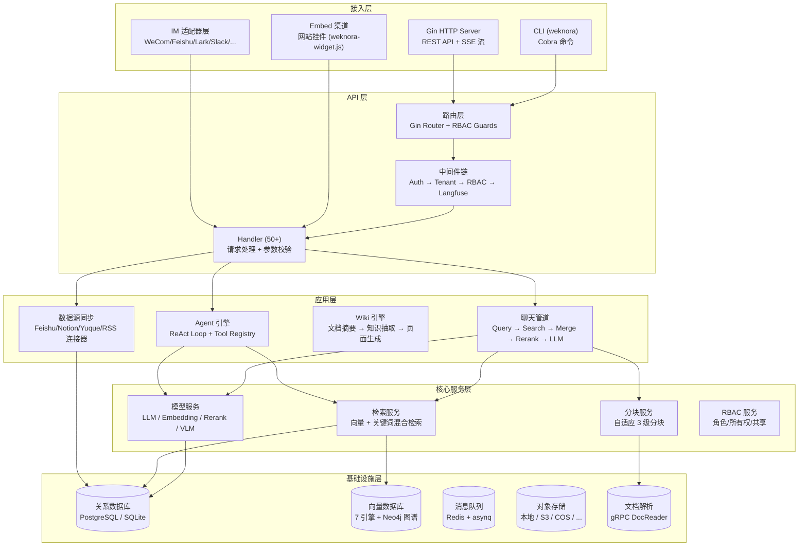
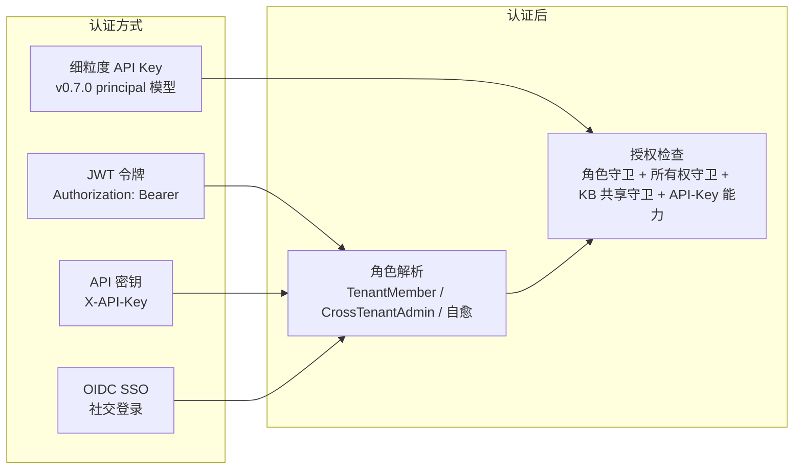
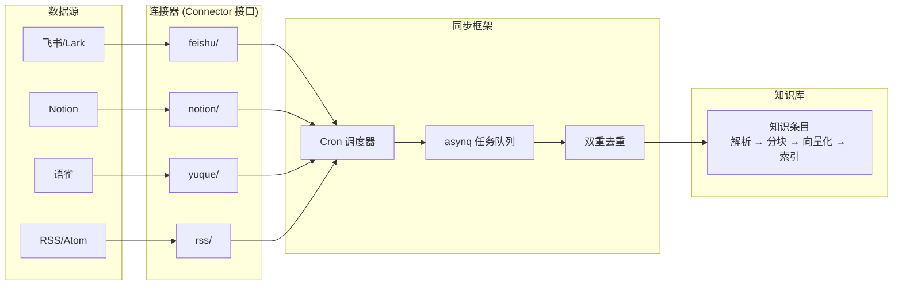

# WeKnora — 企业级 RAG 与知识推理框架解读

> **GitHub:** [github.com/Tencent/WeKnora](https://github.com/Tencent/WeKnora)

## 第一部分：快速概览

### 这是什么

**WeKnora（维娜拉）** 是腾讯开源的企业级 AI 知识管理框架，基于大语言模型构建。它将 RAG 检索增强生成、ReAct Agent 智能推理和自动 Wiki 知识库三大能力整合在一个平台中。Go 后端 + Vue 3 前端，单体架构但模块化程度极高（当前版本 **v0.7.1**，2026-07-24）。

### 解决的痛点

企业知识管理有三个核心矛盾：**文档分散**（散落在飞书/Notion/语雀/本地）、**查找困难**（传统的目录树和关键词搜索在信息量大的场景下效率低）、**知识僵化**（文档写完后很快过时，缺乏持续维护）。

WeKnora 的解法：通过多源数据连接器自动同步分散的文档 → 解析/分块/向量化建立语义索引 → Agent 自动从文档中提取知识生成 Wiki → 用户通过对话或 Wiki 浏览器查询。整个链条把"文档"变成"活的知识库"。

### 适用场景

- 企业内部知识库的智能问答和知识管理
- 团队文档的自动整理和 Wiki 化
- 需要对接多个 IM 平台（企微、飞书、Slack 等）的知识服务
- 需要多租户隔离的企业级 SaaS 场景
- 作为 RAG 基础设施的二次开发平台（模块化设计，组件可替换）

### 核心能力清单

| 能力 | 说明 |
|------|------|
| RAG 问答 | 基于知识库的检索增强生成，支持多种检索策略融合 |
| ReAct Agent | 多步推理代理，自主编排知识检索、MCP 工具、网络搜索 |
| Wiki 模式 | Agent 自动从文档生成结构化、互链的 Markdown Wiki + 知识图谱，支持文件夹层级 |
| 多源数据导入 | 飞书(含Lark)/Notion/语雀/RSS 已实现 + 12+ 连接器注册，增量/全量 |
| 多租户 RBAC | 4 级角色矩阵（Owner/Admin/Contributor/Viewer）+ 资源归属 + 审计日志 |
| IM 集成 | 企微/飞书/Lark/Slack/Telegram/钉钉/Mattermost/微信/QQBot/云之家 共 10 个平台 |
| 工具调用 | MCP 协议工具(OAuth2)+ 内置工具 + 网络搜索 + Agent 技能系统 |
| 多模型支持 | 26 个 LLM 厂商 + 自定义 API，支持 Embedding/Rerank/VLM |
| 多向量库 | ES/Milvus/Qdrant/Weaviate/Doris/Tencent/OpenSearch 7 引擎 + pgvector/sqlite + Neo4j 图谱 |
| 网站挂件 | Embed 渠道：将 Agent 发布到任意外部网站，域名白名单 + 限流 + secure-mode 令牌 |
| 可观测性 | Langfuse 全链路追踪（OTel OTLP/HTTP）+ OpenTelemetry |
| 部署 | Docker / Kubernetes(Helm) / 私有化离线 / 桌面端(Wails) |

### 技术栈一览

| 层面 | 技术 |
|------|------|
| 语言 | Go 1.26 |
| HTTP 框架 | Gin + GORM |
| 前端 | Vue 3 + TypeScript + Vite + TDesign + Pinia |
| 消息队列 | asynq (Redis) |
| 配置 | Viper + YAML + 环境变量覆盖 |
| 依赖注入 | uber-go/dig |
| 向量数据库 | pgvector、Elasticsearch、Milvus、Qdrant、Weaviate、Doris、Tencent、OpenSearch 等 7+ 引擎 |
| LLM SDK | go-openai (兼容 OpenAI 协议)、ollama、Anthropic 等 26 家 |
| 文档解析 | 自研 docreader (gRPC 服务，TLS/Token 认证) |
| IM SDK | 飞书/Lark SDK、钉钉 Stream SDK、Slack SDK、QQBot、云之家 |
| 可观测性 | OpenTelemetry OTLP/HTTP → Langfuse v3+ OTel 标准 |
| 存储 | 本地/MinIO/S3/COS/TOS/OBS/KS3/OSS 共 8 后端，支持多实例绑定 |
| 任务调度 | robfig/cron |
| 搜索 | 结巴分词、BM25、Dense 向量、RRF 融合 |
| MCP | mark3labs/mcp-go（SSE/HTTP-Streamable + OAuth2） |

---

## 第二部分：架构深读

### 架构总览

WeKnora 是一个典型的多层单体架构，但模块间通过接口解耦，核心依赖通过 uber-go/dig 注入：



### 目录结构与模块映射

```
WeKnora/
├── cmd/server/              # 主入口
├── config/                  # YAML 配置 + 提示词模板
├── frontend/                # Vue 3 SPA (Vite + TDesign)
├── internal/
│   ├── agent/               # ReAct 代理引擎
│   │   ├── engine.go        # AgentEngine 核心 (executeLoop)
│   │   ├── think.go         # LLM 流式调用 + 重试
│   │   ├── act.go           # 工具执行 (串行/并行)
│   │   ├── observe.go       # 响应分析 + 上下文管理
│   │   ├── tools/           # 22 个工具实现 (知识搜索/MCP/网络/技能)
│   │   ├── skills/          # 技能系统 (SKILL.md 沙箱)
│   │   ├── memory/          # 记忆整合 (上下文压缩)
│   │   ├── token/           # BPE 分词估计 + 消息压缩
│   │   └── approval/        # MCP 工具人工审批
│   ├── application/         # 应用层 (服务编排 + 仓库)
│   │   └── repository/retriever/  # 7 向量引擎 + Neo4j 图谱实现
│   ├── handler/             # HTTP 处理器 (50+ 文件)
│   ├── router/              # 路由注册 + RBAC 守卫
│   ├── middleware/          # Gin 中间件 (Auth/Workspace/RBAC/Audit)
│   ├── config/              # 配置加载 (Viper)
│   ├── datasource/          # 数据源同步框架
│   │   └── connector/feishu|notion|yuque|rss/  # 连接器实现
│   ├── im/                  # IM 通道集成 (10 个平台)
│   ├── mcp/                 # MCP 协议客户端 (OAuth2)
│   ├── tracing/langfuse/    # Langfuse 可观测性 (OTel OTLP/HTTP)
│   ├── sandbox/             # Agent 技能沙箱
│   ├── stream/              # SSE 事件流管理
│   ├── infrastructure/      # 基础设施 (分块器等)
│   │   └── chunker/         # 自适应三级分块
│   ├── types/               # 全局类型定义 + 接口
│   └── searchutil/          # 搜索工具函数
├── docreader/               # 文档解析 gRPC 服务
├── mcp-server/              # 独立的 MCP 服务器
├── cli/                     # weknora CLI
├── helm/                    # Kubernetes Helm Chart
└── docker/                  # Docker 多阶段构建
```

### 启动流程

```
Config.Load() (Viper: YAML → 环境变量 → 验证)
  │
  ▼
依赖注入容器 (uber-go/dig: 200+ 提供者)
  │
  ▼
数据库连接 + 迁移 (PostgreSQL/SQLite)
  │
  ▼
向量存储初始化 (环境变量 + 数据库存储)
  │
  ▼
模型/Embedding/Rerank 服务初始化
  │
  ▼
服务层初始化 (按依赖顺序: Store → Service → Handler)
  │
  ▼
路由注册 + RBAC Guards (500+ 路由端点)
  │
  ▼
后台任务启动 (asynq Worker / cron / 审计清理)
  │
  ▼
IM WebSocket/长连接启动 (按需)
  │
  ▼
HTTP 监听 (:8080)
```

### 一次完整 RAG 问答的请求链路

```
用户输入问题
  │
  ▼
Handler (解析消息, 检查权限)
  │
  ▼
AgentEngine.Execute()
  ├── 构建系统提示 (知识库上下文 + 工具定义)
  ├── runReActIteration (最多 N 轮)
  │     ├── [思考] callLLMWithRetry() → 流式输出
  │     ├── [分析] analyzeResponse() → 选择工具
  │     └── [行动] executeToolCalls()
  │           ├── knowledge_search → 检索管道
  │           │     ├── 计算查询 Embedding
  │           │     ├── 向量检索 (Cosine Similarity)
  │           │     ├── 关键词检索 (BM25)
  │           │     ├── RRF 融合 + 去重
  │           │     ├── 知识图谱上下文扩展
  │           │     └── Rerank 重排序
  │           ├── web_search (可选, 带 RAG 压缩)
  │           └── 其他工具 (MCP/技能/数据库查询等)
  │
  └── [最终] finalize() → 合成最终答案 + 引用
  │
  ▼
持久化 (会话 + 消息 + Agent 步骤)
  │
  ▼
SSE 流式返回前端
```

---

## 第三部分：RAG 引擎实现

### 文档处理管道

文档从上传到可检索经历 4 个阶段：

```
上传 → DocReader(gRPC) → 分块 → 向量化 → 索引
```

**DocReader** 是独立的 gRPC 服务（`docreader/`），支持 PDF/Word/Excel/PPT/图片/HTML 等 10+ 格式。解析结果以结构化 Markdown 返回。

### 自适应三级分块

分块器（`internal/infrastructure/chunker/`）实现了 WeKnora 最精巧的算法之一。它是一个三级回退链，根据文档特征动态选择最优策略：

| 层级 | 策略 | 触发条件 |
|------|------|----------|
| **1 级（标题分割）** | 按 Markdown 标题分割 | 文档 >= 3 个标题且密度 > 0.005 |
| **2 级（启发式分割）** | 扫描换页符/章节标记/视觉分隔符等 10 种边界 | 检测到 >= 5 个启发式标记 |
| **3 级（递归分割）** | 按分隔符优先级递归分割 | 始终可用作为保底 |

三级之间通过 `ProfileDocument()` 预分析文档特征，然后 `SelectStrategy()` 决策，`ValidateChunks()` 验证结果质量，不满足则自动降级。

**父子分块**是另一个关键设计：文档先切成大块（父块），每块再细分成小块（子块）。子块用于检索，父块作为检索结果附加上下文。这样既保证了检索精度（小块语义聚焦），又保证了回答质量（大块提供完整上下文）。

```go
// 分块器配置
type SplitterConfig struct {
    ChunkSize    int      // 默认 512 字符
    ChunkOverlap int      // 默认 80 字符
    Strategy     string   // "auto" / "heading" / "heuristic" / "recursive"
    TokenLimit   int      // 可选的 token 预算
}
```

### 多引擎向量检索架构

WeKnora 通过统一的 `RetrieveEngineRepository` 接口 + 注册表模式抽象多存储后端：

```go
// internal/interfaces/retriever.go
type RetrieveEngine interface {
    EngineType() types.RetrieverEngineType
    Retrieve(ctx context.Context, params types.RetrieveParams) ([]*types.RetrieveResult, error)
    Support() []types.RetrieverType
}
```

需澄清的是：并非"10+ 引擎"都能独立部署。真正可作为独立存储实例注册（可通过 UI 配置）的引擎有 **7 个**，其余是绑定应用默认数据库的 env store 或专用后端。

| 类别 | 引擎 | 关键技术 | 驱动方式 |
|------|------|----------|----------|
| **独立实例** | Elasticsearch | cosineSimilarity 脚本分数 | UI 配置 |
| | Milvus | gRPC, COSINE 度量模式 | UI 配置 |
| | Qdrant | gRPC 点集合 | UI 配置 |
| | Weaviate | GraphQL API | UI 配置 |
| | Apache Doris | MySQL 协议 + HTTP Stream Load | UI 配置 |
| | Tencent VectorDB | 专有 SDK | UI 配置 |
| | OpenSearch | k-NN 插件 | UI 配置 |
| **绑定默认库** | PostgreSQL | pgvector + ParadeDB BM25（`|||` 算子） | 环境变量 |
| | SQLite | sqlite-vec 扩展 | 环境变量 |
| **知识图谱** | Neo4j | Cypher + apoc.merge，实体/关系节点 | 独立部署 |

> 注意：`neo4j` 引擎专用于**知识图谱检索**，不参与向量检索；PostgreSQL 发行版默认走 ParadeDB 镜像同时提供 pgvector 与 BM25。此外 `infinity` 和 `elasticfaiss` 仅残留为历史枚举，无可部署实例。

### 多向量库扇出（多 KB 跨存储检索）

当一个查询横跨多个知识库，而这些 KB 绑定到不同向量存储时，检索服务按 `(VectorStoreID, TenantID)` 把 KB 分桶成若干 `storeGroup`（每组共享同一引擎），然后用 `errgroup` 并发 `retrieveFromStores` 拉取并合并结果。引擎注册表支持"同引擎类型多个实例"（`RegisterWithStoreID`）。

```go
// 分桶语义（storegroup.go 注释）
// one fan-out unit of HybridSearch: a set of KB IDs that share the same VectorStore
```

并发上限默认 4，单组超时 30s（`MULTI_STORE_RETRIEVE_TIMEOUT_SEC` 可配）。当结果横跨 >1 种引擎类型时，向量分数经 `EngineAwareNormalizer` 归一化到 [0,1] 再融合。

### 检索管道：混合搜索与 RRF 融合

```
HybridSearch()
├── 向量检索 (余弦相似度)
├── 关键词检索 (BM25 / ParadeDB)
├── EngineAwareNormalizer (分数归一化到 [0,1])
│     └── Milvus: (score+1)/2 ; 其他: clamp01
├── RRF 融合: score = vw/(k+vRank) + kw/(k+kRank)
│     └── 默认: k=60, vectorWeight=0.7, keywordWeight=0.3
├── 父块/附近块/知识图谱相关块扩展
└── (可选) Rerank 重排序
```

RRF（加权倒数排名融合）是融合策略的核心，解决了不同检索引擎分数不可比的问题。WeKnora 允许在 `RetrievalConfig` 中调节向量和关键词的权重比例。

### Embedding 集成

Embedding 调用通过 `KeywordsVectorHybridRetrieveEngineService` 编排：
1. 内容清理（去除 base64 图像负载）
2. 安全截断（20,000 字符）
3. 指数退避重试（5 次，200ms 基数）
4. 并发批处理（每批 40 条，最多 5 并发）
5. 同一嵌入模型的多个 KB 共享一次嵌入计算

---

## 第四部分：Agent 系统

WeKnora 的 Agent 系统是其最复杂的模块（`internal/agent/` ~30 个文件），实现了完整的 ReAct 模式。

### AgentEngine 核心

```go
type AgentEngine struct {
    config             *types.AgentConfig
    toolRegistry       *ToolRegistry     // 工具注册表
    chatModel          chat.Chat         // LLM
    eventBus           *event.EventBus   // SSE 事件
    skillsManager      *skills.Manager   // 技能系统
    memoryConsolidator *memory.Consolidator // 记忆整合
    tokenEstimator     *token.Estimator  // BPE 估算
}
```

### ReAct 循环流程

```
Execute() → executeLoop() → runReActIteration() 循环:
  ├── 1. [思考] callLLMWithRetry()
  │       ├── 流式输出思考内容 → EventBus → SSE → 前端
  │       └── 自动重试 429/5xx/超时，优雅降级
  ├── 2. [分析] analyzeResponse()
  │       ├── content_filter → 内容过滤终止
  │       ├── finish=stop + 无工具调用 → 自然结束
  │       ├── FinalAnswer 状态 → 流式合成答案 → 完成
  │       └── 卡住循环检测（重复相同内容）
  └── 3. [行动] executeToolCalls()
          ├── 串行或并行（可配置）
          ├── 参数解析 → JSON 修复 → 类型转换 → Schema 验证
          ├── 每个工具发出事件 (tool-hint/exec/result)
          └── 每个工具创建 Langfuse Span
```

关键设计决策：
- **无状态引擎**：每一轮调用由调用方重建历史（`service.LoadAgentHistory`）
- **EventBus 驱动**：所有输出通过事件总线流向 SSE 处理器
- **Langfuse 追踪嵌套**：`agent.execute` → `agent.round.N` → `agent.tool.<name>`
- **上下文窗口管理**：超过 `MaxContextTokens * 0.8` 时压缩历史，超过 `0.5` 时 LLM 驱动整合

### 工具系统（22 个工具）

工具注册在 `agents_service.go:registerTools()` 中编排，分为几类：

| 类别 | 工具 | 说明 |
|------|------|------|
| **知识检索** | `knowledge_search`, `grep_chunks`, `list_knowledge_chunks` | 核心 RAG 检索工具 |
| **知识图谱** | `query_knowledge_graph` | 图查询 |
| **文档** | `get_document_info` | 元数据查询 |
| **数据库** | `database_query` | 数据库查询 |
| **Wiki** | `wiki_search`, `wiki_read_page`, `wiki_write_page`, `wiki_rename_page`, `wiki_delete_page`, `wiki_replace_text`, `wiki_read_source_doc`, `wiki_flag_issue`, `wiki_read_issue`, `wiki_update_issue` 等 10 个 | Wiki 生成和管理 |
| **网络** | `web_search` (RAG 压缩), `web_fetch` (Chromedp/HTTP, SSRF 保护) | 联网搜索 |
| **MCP** | `mcp_{service}_{tool}` (动态注册) | MCP 协议工具调用 |
| **技能** | `read_skill`, `execute_skill_script` | 技能系统 |
| **分析** | `data_analysis`, `data_schema` | 数据分析 |
| **认知** | `thinking`（即 sequentialthinking）, `todo_write` | 控制流 |

> 注意：**`final_answer` 并非工具**——它是引擎内部的状态字段与流式答案合成流程（`streamFinalAnswerToEventBus`），由 Agent 自行判定何时结束；`sequentialthinking` 注册名是 `thinking`。

### MCP 工具集成

MCP（Model Context Protocol）是 Agent 扩展的关键机制（v0.6.3 起新增完整 OAuth2 支持）。

- 支持 SSE 和 HTTP Streamable 传输（**Stdio 因安全原因仍禁用**，服务端两个层面均拒绝）
- 每个 MCP 工具包装为 `MCPTool` 实例，名称格式 `mcp_{service}_{tool}`
- **HITL 审批**：可配置需要人工审批的 MCP 工具，通过 UI 事件阻塞等待审批/拒绝/超时（10 分钟），支持 Redis Pub/Sub 跨实例协调；状态持久化，刷新不丢失
- **MCP OAuth2 授权**：基于 mcp-go 的 OAuth transport，支持 authorization-code + PKCE + 动态客户端注册，token 按 `(tenant, user, service)` 存于 `mcp_oauth_tokens` 表，支持 token 刷新与 RFC 9728/8414 自动发现；v0.7.0 起支持**会话中（mid-conversation）OAuth 授权**，在对话内弹出授权卡片
- **安全措施**：工具名称冲突先到先得防劫持、输出添加 `"[MCP tool result from %q]"` 前缀防提示注入、图像 MIME 验证 + 大小限制、上传沙箱跨传输强制

> **两套 MCP 易混淆**：服务端 `internal/mcp/` 是 agent 消费外部 MCP 服务（stdio 禁用，走 OAuth）；CLI 的 `cli/internal/mcp` 是 weknora 命令行对外导出的一个 stdio MCP 服务器（提供 `kb_list`/`doc_list`/`search_chunks`/`chat` 等只读工具，供 Claude Code/Cursor 等驱动 WeKnora）。

### 技能系统

遵循 Claude 的**渐进式披露**三级设计：

| 级别 | 内容 | 可见性 |
|------|------|--------|
| 1 - 元数据 | 技能名称 + 描述 | 始终在系统提示中 |
| 2 - 指令 | 完整 SKILL.md | 通过 `read_skill` 按需加载 |
| 3 - 资源 | 脚本文件 | 通过 `execute_skill_script` 沙箱执行 |

技能目录结构：
```
skills/
  └── <skill-name>/
      ├── SKILL.md       # YAML 前置元数据 + Markdown 指令
      └── scripts/        # 可执行脚本（沙箱隔离）
```

沙箱模式：`docker`（首选，隔离执行）、`local`（本地执行）、`disabled`（禁止）。

---

## 第五部分：Wiki 模式

Wiki 模式是 WeKnora v0.5 引入的核心能力，让 Agent 从原始文档自动生成结构化、相互链接的 Markdown Wiki 知识库。到 v0.6.3 新增了 **文件夹与层级**（folder CRUD、页面移动、分类层级元数据），到 v0.7.1 将 Wiki 操作历史统一收敛到知识库 Activity 视图。

### 工作流程

```
用户上传文档 → 文档解析 + 分块
  │
  ▼
Agent Wiki 摄取管道 (wiki_ingest*.go + prompts_wiki.go)
  ├── 文档摘要生成
  ├── 知识点提取 (LLM 驱动的实体/概念抽取)
  ├── 分块引用 (每个知识段落关联原始文档)
  ├── 页面创建 (按主题生成 Markdown 页面)
  ├── 文件夹归类 (按分类层级元数据)
  └── 页面链接 (自动建立跨页面引用)
  │
  ▼
可视化知识图谱 (Neo4j 后端)
  ├── 实体节点 (概念、文档、章节)
  └── 关系边 (引用、包含、相关)
  │
  ▼
Wiki 浏览器 (前端 Vue 组件)
  ├── 目录树浏览 + 文件夹层级
  ├── 全文搜索
  └── 图谱交互
```

### Wiki 工具集

Agent 在 ReAct 循环中通过 10 个专用工具操作 Wiki：

| 工具 | 功能 |
|------|------|
| `wiki_search` | 搜索 Wiki 页面 |
| `wiki_read_page` | 读取页面内容 |
| `wiki_write_page` | 创建/更新页面 |
| `wiki_rename_page` | 重命名并自动修复链接 |
| `wiki_delete_page` | 删除页面 |
| `wiki_replace_text` | 全局替换文本 |
| `wiki_read_source_doc` | 查看原始文档 |
| `wiki_flag_issue` | 标记质量问题 |
| `wiki_read_issue` | 查看质量问题 |
| `wiki_update_issue` | 更新质量问题状态 |

### 知识图谱

知识图谱基于 Neo4j 图数据库，存储文档中提取的实体和关系（v0.7.1 **保留的正是这部分**——被移除的是基于 Neo4j 的 episodic 会话记忆，而非知识图谱本体）：

- 实体类型：概念、文档标题、章节、关键术语
- 关系类型：引用、包含、相关、对比
- 检索增强：命中某个节点后扩展其关联节点作为上下文（`RetrieveGraphRepository`，Cypher + apoc.merge）

> **会话记忆架构变更（v0.7.1）**：早期版本曾用 Neo4j 存储 episodic 对话记忆做图回顾，该管道已整体移除，聊天不再依赖 Neo4j graph 存储，简化了部署。现有的对话记忆是 `internal/agent/memory/consolidator.go`——纯 LLM 摘要压缩：当上下文超过 `MaxContextTokens * 0.5`（阈值可配）时，把旧消息用低温度 LLM 摘要成紧凑 memory 块，降低 token 消耗与成本。Neo4j 现在只为文档知识图谱服务。

---

## 第六部分：多租户 RBAC 权限体系

WeKnora 的 RBAC 不仅是一个权限模型，更是一套完整的**多租户治理方案**。

> **术语提示**：v0.7.0 起用户界面与文案已将 "tenant" 统一改叫 "workspace"，但代码内部的标识符仍为 `TenantRole*` / `tenant_*`。同版本还引入了组织 `OrgRole` 作为组织级共享 KB 的第二套角色模型。

### 四级角色矩阵

| 角色 | 层级值 | 关键能力 |
|------|--------|----------|
| Owner | 40 | 删除租户、轮换 API 密钥、管理所有成员 |
| Admin | 30 | 管理成员、配置租户基础设施（模型/向量库/MCP/IM） |
| Contributor | 20 | 创建/编辑自己的知识库和 Agent |
| Viewer | 10 | 对所有资源只读，可运行标记为 runnable_by_viewer 的 Agent |

角色通过 `TenantRole.HasPermission(required)` 比较 `Level()` 实现层级继承。

### 三重认证



1. **JWT 令牌** — 邮箱+密码登录，支持刷新和登出，JWT 载荷携带 `tenant_id` 声明
2. **API 密钥** — `X-API-Key` 头，恒定时间比较防时序攻击，合成 `system-<ID>` 用户，固定 Admin 角色
3. **OIDC SSO** — 授权码流程 + nonce 状态验证

**v0.7.0 引入的 Principal 模型（重大演进）**：不再只有"人类用户"这一种身份。现在的认证主体（principal）包括 8 种——`web_user`、`api_tenant`、`api_platform`、`api_external_user`、`im_user`、`embed_channel`、`embed_session`、`embed_visitor`。核心变化：

- **细粒度 scoped API Key** — 取代"一键 Admin"，每个 API Key 携带显式角色 + 能力授权（capabilities，如 `manage_kbs`、`manage_storage_backends`、成员/空间能力等），可限定到特定知识库，并更新 `last_used_at`（节流）。路由级 `DenyAPIKeyPrincipal` / `api_key_gate` 守卫堵住 IDOR/权限越界。
- **非人类外部用户** — 通过 `X-External-User-ID` / `X-External-User-Token` 头授权，用于外部系统集成。
- **v0.7.1 平台级 API Key** — 面向控制平面自动化（租户管理、系统设置、运行时队列、审计日志），带系统级 capabilities 与管理员生命周期 UI。
- MCP OAuth、Embed 会话均按 principal 范围隔离，外部集成相互隔离。

### 守卫层设计

守卫是 Gin 中间件，在路由层组合使用。Router 在注册路由时通过 `rbacGuards` 结构体注入守卫：

```go
// router/rbac.go — 路由注册示例
kb.PUT("/:id", g.OwnedKBOrAdmin(), handler.UpdateKB)
kb.POST("/:id/members", g.Owner(), handler.AddMember)
```

守卫层级：

| 守卫类型 | 变体 | 职责 |
|----------|------|------|
| **纯角色** | Viewer/Contributor/Admin/Owner/SystemAdmin | 检查角色层级 >= 最低要求 |
| **所有权** | OwnedXxxOrAdmin(6 种) | 创建者 OR Admin+ |
| **KB 访问** | KBAccessRead/KBAccessWrite(6 种) | 自有/组织共享/Agent 共享 |
| **跨租户** | RequirePathTenantMatch/RequireCrossTenantAccess | 路由级隔离 |

所有权守卫的解析链：`ChunkID → KnowledgeID → KB ID → knowledge_bases.creator_id`，通过 `internal/handler/rbac_lookups.go` 中的查找函数实现。

### 灰度和降级

配置 `tenant.enable_rbac` 控制 RBAC 的强制执行模式：
- `true` — 实际拒绝（403），写入审计日志
- `false` — 仅记录拒绝但放行请求，"fail open"将所有用户授予 Admin

这种设计让团队可以渐进式启用 RBAC，先观察日志确认规则正确再强制执行。

### 审计日志

| 属性 | 说明 |
|------|------|
| 存储 | `audit_logs` 表，仅追加 |
| 关键事件 | 成员增删改、邀请生命周期、RBAC 拒绝、向量库变更、系统设置变更 |
| 去重 | 相同 `(tenant, actor, action, request_path)` 在 1 分钟窗口内只写一行 |
| 保留 | 默认 90 天，后台 goroutine 每 24 小时清理 |
| 访问 | `GET /tenants/:id/audit-log` (Admin+)，`GET /system/admin/audit-log` (SystemAdmin) |
| 范围 | v0.7.1 新增 **per-KB 活动审计**（migration `000073_kb_activity_scope`），记录知识操作（含 FAQ 导入）到 `ScopeType=knowledge_base` 的审计行，KB Activity 视图可精细化查看 |

### 凭据安全

所有静态凭据使用 **AES-256-GCM** 加密：
- 加密值以 `enc:v1:` 为前缀
- 密钥从 `SYSTEM_AES_KEY` 环境变量读取（32 字节）
- 解密提供宽松模式（`DecryptStoredSecretLenient`），即使密钥缺失也能加载行数据
- 覆盖范围：租户 API Key、IM 凭据、数据源凭据、MCP 凭据、模型凭据、Web 搜索凭据、存储后端凭据
- v0.6.0 起引入 **`/credentials` 子资源模式**（`PUT /:id/credentials` + `DELETE /:id/credentials/:field`），覆盖 models / MCP services / web search providers / data sources 四类资源，敏感字段在响应中脱敏、编辑时不丢失凭据

---

## 第七部分：多源数据导入

### 连接器架构

数据源同步框架（`internal/datasource/`）采用**适配器模式**。核心接口：

```go
type Connector interface {
    Type() string
    Validate(ctx, config) error
    ListResources(ctx, config) ([]Resource, error)
    FetchAll(ctx, config, resourceIDs) ([]FetchedItem, error)
    FetchIncremental(ctx, config, cursor) ([]FetchedItem, *SyncCursor, error)
}
```



### 已实现的连接器

只有 4 个连接器真正可实现同步（其余仅在前端 metadata 中枚举展示，无实现代码）：

| 连接器 | 认证 | 同步方式 | 实现状态 |
|--------|------|----------|----------|
| 飞书 / Lark | OAuth2 | 增量 + Webhook + 删除同步（大 wiki 空间可重试/断点续传） | ✅ 完整 |
| Notion | API Key | 增量 | ✅ 完整 |
| 语雀 | API Key | 增量 | ✅ 完整 |
| RSS | 无（可配请求头） | RSS/Atom/JSON feed，增量 | ✅ 完整 |

> **"注册未实现"的连接器**（`ConnectorMetadataRegistry` 中声明、前端可见，但无实现代码）：Confluence、GitHub、Google Drive、OneDrive、钉钉、Slack、IMAP、Web Crawler 等共 12+ 项。

### 调度与去重

- 使用 `robfig/cron` 管理定时同步任务
- **双重去重机制**：L1 = `HasRunningSync` 状态检查防止重叠；L2 = `asynq.TaskID`（`dataSourceID:minute` 确定性 ID）实现 Redis 级去重
- 增量同步通过 `SyncCursor` 游标追踪，避免全量拉取

---

## 第八部分：IM 通道集成

IM 模块是 WeKnora 最复杂的子系统之一，支持 **10 个平台**，每个平台有独立的适配器实现。

### 适配器接口

```go
type Adapter interface {
    Platform() Platform
    VerifyCallback(c *gin.Context) error
    ParseCallback(c *gin.Context) (*IncomingMessage, error)
    SendReply(ctx, incoming, reply) error
    HandleURLVerification(c *gin.Context) bool
}
```

平台特有的扩展接口：
- `StreamSender` — 流式回复（企微/飞书/Lark/Slack/Telegram/钉钉/云之家）
- `FileDownloader` — 文件下载（企微/飞书）

### 十平台对比

| 平台 | 连接方式 | 流式支持 | 特点 |
|------|----------|----------|------|
| 企业微信 | WebSocket + Webhook | ✅ | AES 解密、引用回复 |
| 飞书 | Webhook | ✅ (CardKit) | 富文本解析、加密事件 |
| Lark (飞书国际版) | Webhook | ✅ | v0.7.0 新增，region 感知路由、线程内回复 |
| Slack | WebSocket + Webhook | ✅ | 线程支持 |
| Telegram | Long Poll | ✅ | Bot API、主题支持 |
| 钉钉 | Webhook + WebSocket | ✅ | Stream SDK、文件/图片入库、`pictureDownloadCode` 兜底 |
| Mattermost | Webhook | ❌ | 出站 Webhook |
| 微信 | Long Poll | ❌ | 二维码登录、ilink |
| QQBot | WebSocket | ✅ | v0.7.0 新增 |
| 云之家 | WebSocket | ✅ | v0.7.1 新增，请求签名、图片 SSRF 校验、默认 Markdown 回复 |

### 消息处理管道

```
IM 消息到达
  │
  ├── 1. 去重 (Redis SetNX / sync.Map)
  ├── 2. 长度截断 (4096 runes)
  ├── 3. 限流 (滑动窗口, Redis ZSET / 本地)
  ├── 4. 会话解析 (user 或 thread 模式)
  ├── 5. 命令分发 (/help /clear /stop /info /search)
  ├── 6. QA 入队 (有界队列 + 固定工作池)
  │     ├── Workers=5 (默认)
  │     ├── MaxQueueSize=50 (默认)
  │     └── GlobalMaxWorkers (Redis 分布式)
  └── 7. 执行 (流式/完整回复)
```

### 输出内容处理

`cleanIMContent` 对 IM 出站内容进行三层转换：
1. `<image>...</image>` → Markdown 图片
2. `<kb />` / `<web />` → 移除
3. `provider://` URL → HTTP 签名 URL

**Holdback 机制**：检测到末尾有不完整的 Markdown 图片或 `provider://` URL 时，保留到下一刷新批次，避免渲染中断。

---

## 第九部分：可观测性设计

### OpenTelemetry 基础

- 使用 `go.opentelemetry.io/otel` SDK
- 导出器走 **OTLP/HTTP**（v0.7.1，可从 Jaeger/Zipkin 等 OTLP 接收端选择）
- 全局传播器：TraceContext + Baggage，支持 W3C `traceparent` 跨服务传播
- v0.6.2 移除独立的 Jaeger 集成，Langfuse 为唯一可观测后端（简化启动与配置）

### Langfuse 集成

WeKnora 自 v0.7.1 起，Langfuse 追踪**迁移到 OpenTelemetry 标准 exporter**（此前是自研直连 HTTP ingestion 的轻量客户端）。实现位于 `internal/tracing/langfuse/`：

**关键设计：**

| 组件 | 职责 |
|------|------|
| `exporter.go` | OTLP/HTTP trace exporter，Basic Auth 到 `/api/public/otel/v1/traces`（Langfuse v3+ / LiteFuse 标准） |
| `manager.go` | 单例管理 + 追踪上下文 |
| `tracer.go` | Trace/Span/Generation 创建与完成 |
| `middleware.go` | Gin 中间件，自动为 API 请求建 Trace |
| `asynq.go` | asynq 任务中间件，拼接 HTTP ↔ 异步追踪 |
| `retrieval_obs.go` | 检索/重排链路可观测 |

**迁移到 OTel 的要点**：`exporter.go` 通过 `otlptracehttp` 构建 exporter，指向 OTel 端点，`Authorization: Basic (public_key:secret_key)`，并发送 `x-langfuse-ingestion-version` 头（网关参与 Langfuse v3+ / LiteFuse 的直接写入通道）。相比旧的自研 /api/public/ingestion 批处理方案，现在的实现是**完全标准的 OpenTelemetry 后端**——不再需要维护 Langfuse 私有批量 API 的模拟逻辑，反而更精简、更符合 Langfuse v3+ 规范。

**追踪模型：**
```
Trace (HTTP 请求 / asynq 任务)
├── Span (子工作单元)
│   ├── Generation (LLM 调用: chat/embedding/vlm/rerank)
│   └── Generation (嵌套 LLM 调用)
```

**`AsynqMiddleware`** 是关键设计——它将 asynq 异步任务与 HTTP 请求关联起来。任务 payload 携带 `TracingContext`（traceID、parentObservationID），任务处理时恢复追踪上下文；HTTP 侧则通过 W3C `traceparent` 继承上游 trace ID。

**采样控制**：`LANGFUSE_SAMPLE_RATE`（0.0–1.0）控制采样比例。

---

## 第十部分：设计与扩展性

### 模块化架构

WeKnora 的模块化体现在三个层面：

**层面 1 — LLM/Embedding/Rerank 可替换**：所有模型通过统一接口接入，新增模型厂商只需实现 `chat.Chat` 接口。目前支持 **26 个厂商**（含 Requesty、Novita、Azure OpenAI、Zhipu、Volcengine/火山等新增），Embedding 有专属实现或走 OpenAI 兼容默认。

**层面 2 — 向量数据库可替换**：统一的 `RetrieveEngineRepository` 接口 + 注册表模式，新增引擎只需在一个目录下实现接口并注册。目前可部署的独立向量引擎 7 个（ES/Milvus/Qdrant/Weaviate/Doris/Tencent/OpenSearch），另有 pgvector/sqlite env store 与 Neo4j 图谱。

**层面 3 — 存储后段可替换**：文件存储接口抽象，支持 **8 种后端**——本地/MinIO/COS/TOS/S3/OSS/KS3/OBS。v0.7.0 起支持**一个工作区注册多个存储实例**并绑定到不同知识库，工作区级默认值 + CRUD/连通性测试 API + 凭据读取脱敏。

### 依赖注入

使用 `uber-go/dig` 管理 200+ 个依赖提供者。启动过程中按依赖关系自动解析：

```
无依赖的优先建 (LLM/Embedding)
  → 依赖服务的后建 (Agent/检索/数据源)
  → 路由注册 (依赖所有服务)
```

这种设计让新增服务只需要添加提供者 + 在 dig 容器中注册，启动流程无需修改。

### Agent 技能系统

AI Agent 的技能系统采用了 Claude 的**渐进式披露**模式——Agent 的指令不是一次性加载到上下文中，而是分三级逐步暴露。这种设计在大上下文模型的时代仍然有意义，因为它减少了每轮调用中的干扰信息。

### 工具注册表模式

工具系统使用注册表模式：每个工具实现 `types.Tool` 接口，使用 `ToolRegistry` 注册。Agent 引擎只与注册表交互，不关心具体工具的实现。

```go
type Tool interface {
    Name() string
    Description() string
    Parameters() json.RawMessage  // JSON Schema
    Execute(ctx context.Context, args json.RawMessage) (*ToolResult, error)
}
```

MCP 工具在运行时动态注册，普通工具在引擎创建时注册。注册表还负责冲突检测、参数转换和验证。

### RAG 管道设计

RAG 管道使用**分阶段处理 + 事件钩子**模式：

```
PluginSearch (检索) → PluginMerge (合并) → (Rerank) → (LLM 生成)
```

每个阶段通过事件系统解耦，方便在关键路径插入自定义逻辑。

### 配置即代码

使用 Viper + YAML + 环境变量覆盖的三层配置加载链。配置结构通过 Go 结构体标签定义，生成 `.env.example` 保证文档与代码同步。

### CLI（weknora v0.10）

原本文档略过的 CLI 已经是一等公民。采用 `gh` 风格的 `<noun> <verb>` 命令树，包含 `api`、`auth`、`chat`、`config`、`doc`、`doctor`、`kb`、`search`、`session`、`message`、`agent`、`model`、`chunk`、`mcp`、`skills`、`profile`、`link`/`unlink`、`schema`、`exit-codes` 等命令组。亮点：

- **Agent 优先**的 `session ask` / `session resume`（原名 continue）、`session stop`、`session tool-approval`
- `mcp serve` — 导出一个只读 stdio MCP 服务器（含 `chat`/`kb_list`/`search_chunks` 等 10 工具），让 Claude Code / Cursor 直接驱动 WeKnora
- 项目级绑定 `weknora link`（写 `.weknora/project.yaml`，vercel/netlify 模式）
- 稳定 JSON 信封、`--jq`/`--format` 字段选择、NDJSON、裸 JSON 输出；流程内自带 2 个技能（`weknora-rag-search` 等）
- 多层上下文认证（OS keyring + 0600 文件兜底），支持 API-key 与 JWT 两种模式

### v0.6–v0.7 关键新增能力

文档以 v0.5 为基准，以下为后续版本新引入、值得关注的能力：

- **Embed 网站挂件**（v0.6.3）：把自定义 Agent 发布到任意外部网站。`weknora-widget.js` 独立 UI + 域名白名单（支持 `*.` 通配）+ per-minute/per-day 三层限流 + secure-mode token 交换（`em_` 发布令牌 → `ems_` 短时会话令牌，TTL 30 分钟）+ CSP `frame-ancestors` 按渠道收窄。
- **Website Embed 的 Integrations Center**：统一管理 IM + embed 渠道编辑、Agent 重绑、实时预览。
- **细粒度 scoped API Key / principal 模型**（v0.7.0）：见第六部分认证章节。
- **运行时任务队列治理**（v0.7.0）：系统管理端 Runtime Queues 仪表盘（队列深度、每模型并发、失败任务检视/重试），摄取管道从单一 worker 池拆为每阶段保证池（core/post-process/enrichment/maintenance）+ 共享弹性池，每模型后台并发治理 `model.max_concurrency`（默认 32）包裹 chat/embedding/rerank/VLM 调用。
- **RAG 管道进度事件**（v0.6.3）：后端在检索/重排/合并阶段发出 stage 级进度事件，前端用 timeline 组件实时展示。
- **文档处理演进**：批量 reparse、`process_config` 覆盖（每次上传/重解析可覆盖解析/分块/多模态/问题生成/图谱抽取）、EPUB/MHTML 解析、扫描 PDF OCR 覆盖。
- **工具调用与编程生态**：文档多标签、KB 复制流程、临时附件、问题/追问建议、`res://` 稳定资源别名压缩 LLM 上下文、`@Skill/@MCP` 提及按轮次限定 Agent 运行时、Redis TLS 支持。
- **答案缓存与提示缓存**：推理模式内联展示，prompt-cache 可观测性。

---

## 第十一部分：同类项目对比

WeKnora 的定位在 RAG 领域比较独特——它既不是一个纯粹的 RAG 框架（如 LangChain/LlamaIndex），也不是一个低代码平台（如 Dify），而是一个**开箱即用的企业级知识管理产品**。

| 维度 | WeKnora | Dify | FastGPT | MaxKB | RAGFlow |
|------|---------|------|---------|-------|---------|
| **语言** | Go + Vue 3 | Python + React | Node + React | Go + Vue 3 | Python + React |
| **部署** | Docker/K8s/Helm | Docker | Docker | Docker | Docker |
| **数据库** | PostgreSQL/SQLite | PostgreSQL/Redis | MongoDB/PostgreSQL | PostgreSQL | Elasticsearch |
| **Agent** | ReAct + 22 工具 + MCP(OAuth) | Workflow + Agent | 简单 Agent | 无 | 无 |
| **Wiki 模式** | ✅ Agent 自动生成 | ❌ | ❌ | ❌ | ❌ |
| **多源导入** | 飞书/Notion/语雀/RSS 已实现 + 12+ 注册 | 文件/网页/API | 文件/API | 文件/API | 文件/API |
| **多向量库** | 7 独立引擎 + pgvector/Neo4j | 单一 | 单一 | 单一 | 单一 |
| **IM 集成** | 10 个平台 | 单聊/Slack/飞书 | 企微/飞书 | 企微/飞书/公众号 | ❌ |
| **多租户 RBAC** | ✅ 4 级角色 + 所有权 + 共享 | ✅ 工作空间 | ✅ 团队 | ❌ | ✅ 团队 |
| **MCP 协议** | ✅ 完整支持 + OAuth2 | ✅ | ❌ | ❌ | ❌ |
| **Langfuse** | ✅ OTel 原生集成 | ✅ | ❌ | ❌ | ❌ |
| **前端 SDK** | Vue 3 + TDesign | React + Ant Design | React + Chakra | Vue 3 + Element | React |
| **多模型厂商** | 26 | 10+ | 10+ | 主流 | 主流 |

**WeKnora 的差异化优势：**

1. **Wiki 模式** — Agent 自动从文档生成结构化 Wiki + 知识图谱，这是其他 RAG 项目没有的能力
2. **多源数据导入** — 12+ 连接器注册（飞书/Notion/语雀/RSS 已实现），Lark 国际版 + RSS 支持
3. **IM 集成广度** — 10 个平台，且每个平台都有深度适配（流式、文件、引用回复）
4. **多向量库支持 + 跨库扇出** — 多引擎统一接口 + 多 KB 跨存储并行检索
5. **可观测性 OTel 标准化** — Langfuse 走 OpenTelemetry 标准 exporter，全链路 + W3C 传播
6. **Go 单体的性能优势** — 相比 Python 方案，在并发和资源占用上更有优势

**WeKnora 的局限性：**

1. **前端风格** — TDesign 组件库在美观度上比 Ant Design 稍逊
2. **社区规模** — 相比 Dify 等 Python 方案，Go 生态的 RAG 社区较小
3. **工作流编排** — 没有 Dify 那样的可视化 Workflow 编辑器
4. **插件市场** — 目前第三方插件/技能生态刚起步（ClawHub）
5. **工具/生态深度** — CLI、Embed 渠道虽已成熟，但相比 Dify 庞大的插件与模板生态仍有差距

---

## 第十二部分：总结与评价

WeKnora 是我目前看到的最"重"的开源 RAG 项目。它的**复杂度来自广度**——不是在一个点上做深，而是覆盖了 RAG 领域从文档解析、向量检索、Agent 推理、Wiki 生成、IM 集成到企业级多租户 RBAC 的整条链路。

**最值得学习的设计决策：**

1. **自适应三级分块器** — 通过文档特征分析动态选择分块策略，比固定策略的分块器（如 LangChain 的 RecursiveCharacterTextSplitter）更智能。`ProfileDocument → SelectStrategy → ValidateChunks → Fallback` 的链式设计值得借鉴。

2. **RBAC 守卫组合模式** — 4 种纯角色守卫 × 6 种所有权守卫 × 6 种 KB 访问守卫，在路由层通过函数组合实现灵活的权限控制。比传统的注解或声明式权限注解更灵活，测试也更简单。

3. **Agent 无状态引擎 + EventBus** — Agent 每一轮重建，所有输出通过事件总线流式推送。这种设计让 Agent 的执行与前端展示完全解耦，同一个引擎可以同时服务于 HTTP SSE、IM 流式、WebSocket 等不同消费端。

4. **数据源连接器框架** — Connector 接口 + 注册表 + 双重去重调度器 + 增量游标的组合，为"接入外部数据源"这个通用问题提供了一个干净的可扩展方案。新增一个连接器只需要实现接口并注册。

5. **可观测性迁移到 OTel 标准** — v0.7.1 从自研直连 Langfuse ingestion 的轻量客户端迁移到 OpenTelemetry SDK 的 OTLP/HTTP exporter。这个方向很值得注意：与其维护私有批量 API 的模拟逻辑，不如直接采用统一的可观测性标准，既简化代码又天然获得 W3C `traceparent` 跨服务传播、与既有 OTel 生态打通，还被 Langfuse v3+ 视为一等公民。体现了"标准优于自研"的演进取舍。

**对 RAG 领域的影响：**

WeKnora 展示了 RAG 产品化的一个方向——不仅仅是"问答机器人"，而是**知识管理平台**。它的 Wiki 模式、多源导入、IM 集成构筑了从文档摄取→索引→问答→知识沉淀的闭环。对于需要在组织内部署私有化知识管理系统的团队，WeKnora 是一个功能覆盖度很高的选择。

从 v0.6 到 v0.7.1 的演进可以看出它正从"RAG 产品"走向"企业知识操作系统"：Embed 网站挂件把 Agent 能力输出到任意站点、细粒度 API Key + principal 模型支撑可编程集成与自动化、运行时队列治理面向运维、CLI v0.10 走向 agent-first 的开发体验。同时它也在主动做减法——移除 Neo4j episodic 记忆、统一 Wiki 操作历史、收敛可观测性后端，降低部署与维护负担。这种"广度扩张 + 持续收敛"的节奏，是长线企业级产品比较健康的演进方式。

> **仓库：** [github.com/Tencent/WeKnora](https://github.com/Tencent/WeKnora) | **网站：** [weknora.weixin.qq.com](https://weknora.weixin.qq.com)
