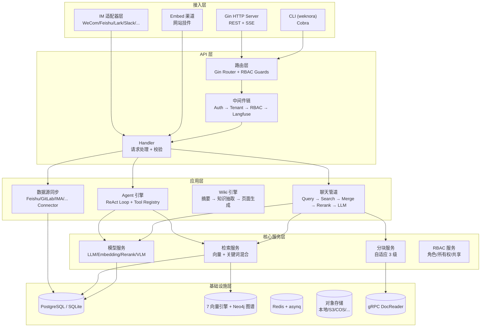

# WeKnora — 企业级 RAG 与知识推理平台深度解读

> **本解读按 ai-infra ⊗ ai-agent 类规格产出**（RAG 编排 + 智能体双关注面叠加）。
> **GitHub:** [github.com/Tencent/WeKnora](https://github.com/Tencent/WeKnora)
> **本版基线：** v0.7.2（2026-08-07）· 跨版本变更见 [\`CHANGELOG.md\`](CHANGELOG.md)

## 根因

企业知识管理有三个根深蒂固的矛盾：**文档分散**（散落在飞书/Notion/语雀/RSS/本地）、**查找困难**（目录树与关键词在信息量大的场景下失效）、**知识僵化**（文档写完后很快过时、缺乏持续维护）。WeKnora 不是做成单点工具，而是把「**文档摄取 → 语义索引 → Agent 推理 → Wiki 沉淀 → 多渠道问答**」串成一条自我维护的闭环，让文档变成"活"的知识库。

## 概览

WeKnora（维娜拉）是腾讯开源的企业级 AI 知识管理框架。Go 后端 + Vue 3 前端，单体架构但模块化程度极高，在一套系统里整合了 RAG 检索增强生成、ReAct Agent 推理和自动 Wiki 知识库三大能力。它的定位既不是纯粹的 RAG 框架（如 LangChain/LlamaIndex），也不是低代码平台（如 Dify），而是**开箱即用、可二次开发的企业级知识管理产品**。

### 核心能力清单

| 能力 | 说明 |
|------|------|
| RAG 问答 | 多检索策略融合（向量 + BM25 + 知识图谱），跨存储扇出并行检索，RRF 融合 + Rerank |
| ReAct Agent | 多步推理代理，自主编排知识检索、MCP 工具、网络搜索；EventBus 驱动流式输出 |
| Wiki 模式 | Agent 从文档自动生成结构化、互链的 Markdown Wiki + 知识图谱，支持文件夹层级与修订历史 |
| 多源数据导入 | 飞书(含 Lark/Drive)/Notion/语雀/RSS/GitLab/IMA 已实现 + 12+ 连接器注册 |
| 多租户 RBAC | 4 级角色矩阵（Owner/Admin/Contributor/Viewer）+ 资源归属 + 审计日志 + principal 模型 |
| IM 集成 | 企微/飞书/Lark/Slack/Telegram/钉钉/Mattermost/微信/QQBot/云之家 共 10 个平台 |
| 工具调用 | MCP 协议工具(OAuth2) + 内置工具 + 网络搜索 + Agent 技能系统（渐进式披露） |
| 多模型支持 | 26 个 LLM 厂商 + 自定义 API，支持 Embedding/Rerank/VLM |
| 多向量库 | ES/Milvus/Qdrant/Weaviate/Doris/Tencent/OpenSearch 7 独立引擎 + pgvector/sqlite + Neo4j 图谱 |
| 网站挂件 | Embed 渠道：域名白名单 + 限流 + secure-mode 令牌，把 Agent 发布到任意外部网站 |
| 可观测性 | Langfuse 全链路追踪（OTel OTLP/HTTP）+ W3C traceparent 跨服务传播 |
| 部署 | Docker / Kubernetes(Helm) / 私有化离线 / 桌面端(Wails) / 官方文档站(wiki-docs) |

### 技术栈一览

| 层面 | 技术 |
|------|------|
| 语言 | Go 1.26 + Vue 3 |
| HTTP 框架 | Gin + GORM |
| 前端 | Vue 3 + TypeScript + Vite + TDesign + Pinia |
| 消息队列 | asynq (Redis) |
| 配置 / DI | Viper + YAML + 环境变量覆盖 · uber-go/dig |
| 向量数据库 | pgvector、Elasticsearch、Milvus、Qdrant、Weaviate、Doris、Tencent、OpenSearch + sqlite-vec |
| LLM SDK | go-openai (兼容 OpenAI 协议)、ollama、Anthropic 等 26 家 |
| 文档解析 | 自研 docreader（gRPC 服务，含 HTML 解析） |
| IM SDK | 飞书/Lark、钉钉 Stream、Slack、QQBot、云之家 |
| 可观测性 | OpenTelemetry OTLP/HTTP → Langfuse v3+ OTel 标准 |
| 存储 | 本地/MinIO/S3/COS/TOS/OBS/KS3/OSS 共 8 后端，支持多实例绑定 |
| 搜索 | 结巴分词、BM25、Dense、RRF 融合 |
| MCP | mcp-go（SSE/HTTP-Streamable + OAuth2）；Python 侧 mcp 2.x MCPServer |

- [\`CHANGELOG.md\`](CHANGELOG.md) — 各版本变更汇总

## 架构总览

WeKnora 是典型的多层单体，模块间通过接口解耦、依赖通过 uber-go/dig 注入，200+ 提供者由容器按依赖解析：



### 启动流程

```
Config.Load()（Viper：YAML → 环境变量 → 验证）
  ▼
依赖注入容器（uber-go/dig，200+ 提供者）
  ▼
数据库连接 + 迁移（PostgreSQL / SQLite）
  ▼
向量存储初始化（环境变量 + 数据库存储）
  ▼
模型 / Embedding / Rerank 服务初始化
  ▼
服务层初始化（Store → Service → Handler）
  ▼
路由注册 + RBAC Guards（500+ 路由端点，按域拆 routes_*.go）
  ▼
后台任务启动（asynq Worker / cron / 审计清理）
  ▼
IM WebSocket / 长连接启动（按需）
  ▼
HTTP 监听（:8080）
```

### 核心模块导读表

| 模块/文件 | 职责 | 深读 |
|-----------|------|------|
| `internal/agent/` | ReAct Agent 引擎（executeLoop / 工具注册表 / MCP / 技能） | [\`agent-system.md\`](agent-system.md) |
| `internal/infrastructure/chunker/` + 检索管道 | 自适应三级分块、多引擎混合检索、RRF 融合 | [\`rag-engine.md\`](rag-engine.md) |
| `internal/.../wiki_*` + `wiki_ingest` | Agent 自动建 Wiki + 知识图谱 + 修订历史 | [\`wiki-mode.md\`](wiki-mode.md) |
| `internal/router/rbac.go` + `internal/handler/rbac_*` | 多租户 RBAC、principal 模型、守卫组合、审计 | [\`rbac-auth.md\`](rbac-auth.md) |
| `internal/datasource/connector/` | 多源数据同步框架（gitlab/ima/feishu-drive…） | [\`datasource-connector.md\`](datasource-connector.md) |
| `internal/im/` | 10 个 IM 平台适配器 + 消息管道 | [\`im-integration.md\`](im-integration.md) |
| `internal/tracing/langfuse/` | OTel OTLP → Langfuse 全链路追踪 | [\`observability.md\`](observability.md) |
| `internal/storageurl/` + 模块化/CLI | resource_urls 直链、三层面可替换、CLI | [\`design-and-extension.md\`](design-and-extension.md) |

## 子文档索引

- [\`rag-engine.md\`](rag-engine.md) — 文档管道、自适应分块、多引擎检索、RRF 融合、v0.7.2 chunk 编辑
- [\`agent-system.md\`](agent-system.md) — ReAct 引擎、工具系统、MCP 集成、技能系统、记忆整合
- [\`wiki-mode.md\`](wiki-mode.md) — Wiki 自动生成、知识图谱、v0.7.2 修订历史与文件夹树
- [\`rbac-auth.md\`](rbac-auth.md) — 多租户角色、principal 模型、守卫层、审计、凭据安全
- [\`datasource-connector.md\`](datasource-connector.md) — 连接器框架、飞书/GitLab/IMA 等、调度去重
- [\`im-integration.md\`](im-integration.md) — 十平台适配器、消息管道、输出清洗
- [\`observability.md\`](observability.md) — OTel → Langfuse、asynq 桥接、采样
- [\`design-and-extension.md\`](design-and-extension.md) — 三层面可替换、DI、resource_urls、CLI、演进方向
- [\`CHANGELOG.md\`](CHANGELOG.md) — 各版本变更汇总

## 同类项目对比

| 维度 | WeKnora | Dify | FastGPT | MaxKB | RAGFlow |
|------|---------|------|---------|-------|---------|
| 语言 | Go + Vue 3 | Python + React | Node + React | Go + Vue 3 | Python + React |
| 数据库 | PostgreSQL/SQLite | PostgreSQL/Redis | MongoDB/PostgreSQL | PostgreSQL | Elasticsearch |
| Agent | ReAct + MCP(OAuth) | Workflow + Agent | 简单 Agent | 无 | 无 |
| Wiki 模式 | ✅ Agent 自动生成 | ❌ | ❌ | ❌ | ❌ |
| 多源导入 | 飞书/Notion/语雀/RSS/GitLab/IMA | 文件/网页/API | 文件/API | 文件/API | 文件/API |
| 多向量库 | 7 独立引擎 + pgvector/Neo4j | 单一 | 单一 | 单一 | 单一 |
| IM 集成 | 10 个平台 | 单聊/Slack/飞书 | 企微/飞书 | 企微/飞书/公众号 | ❌ |
| 多租户 RBAC | ✅ 4 级角色 + principal + 审计 | ✅ 工作空间 | ✅ 团队 | ❌ | ✅ 团队 |
| MCP 协议 | ✅ 完整支持 + OAuth2 | ✅ | ❌ | ❌ | ❌ |
| 可观测性 | ✅ Langfuse OTel 原生 | ✅ | ❌ | ❌ | ❌ |

**差异化优势：**
- **Wiki 模式**是独有能力——Agent 自动把文档变成结构化 Wiki + 知识图谱，这是其他 RAG 项目没有的。
- **多源导入广度**——飞书 wiki+Drive、GitLab、IMA、Notion、语雀、RSS 均已实现，增量游标 + 断点续传。
- **IM 集成广度**——10 个平台，且各有深度适配（流式、文件、回复）。
- **多向量库 + 跨库扇出**——统一 `RetrieveEngine` 接口，多 KB 跨存储并行检索 + 分数归一。
- **Go 单体的性能优势**——相比 Python 方案并发与资源占用更优。

**局限性：**
- 前端 TDesign 美观度略逊 Ant Design。
- 相比 Dify 缺少可视化 Workflow 编辑器；第三方插件/技能生态刚开始（ClawHub）。

## 总结与评价

WeKnora 是复杂度**来自广度**的重型 RAG 项目——不是在某一点做深，而是覆盖文档解析、向量检索、Agent 推理、Wiki 生成、IM 集成到企业级多租户 RBAC 的整条链路。最值得借鉴的五个设计决策：

1. **自适应三级分块器**——`ProfileDocument → SelectStrategy → ValidateChunks → Fallback` 的链式决策（[internal/infrastructure/chunker/profiler.go:220-241]()），比固定策略分块器更智能。

<!-- anchor: func SelectStrategy(p *DocProfile) []StrategyTier { … chain = append(chain, TierLegacy) -->

2. **RBAC 守卫组合模式**——纯角色守卫 × 所有权守卫 × KB 访问守卫在路由层函数组合（[internal/router/rbac.go:552-560]()），比声明式权限注解更灵活。

<!-- anchor: func (g *rbacGuards) KBAccessRead(param string) gin.HandlerFunc { … g.cfg, -->

3. **Agent 无状态引擎 + EventBus**——每轮重建、输出全走事件总线，同一引擎同时服务 HTTP SSE / IM / WebSocket。
4. **数据源连接器框架**——`Connector` 接口 + 注册表 + 双重去重 + 增量游标，新增连接器只实现接口即注册。
5. **标准优于自研**——可观测性从自研直连 Langfuse ingestion 迁到 OTel OTLP 标准 exporter（v0.7.1）；v0.7.2 的 `resource_urls` 也用带时间窗的派生 token 让只读端点不再写库。

从 v0.6 到 v0.7.2 的演进脉络是从"RAG 产品"走向"企业知识操作系统"：细粒度 principal 模型、运行时队列治理、CLI、Embed 挂件、官方文档站；同时主动做减法（移除 Neo4j episodic 记忆、统一 Wiki 操作历史）。这种"广度扩张 + 持续收敛"的节奏是长线企业级产品健康的演进方式。

> **仓库：** [github.com/Tencent/WeKnora](https://github.com/Tencent/WeKnora) | **网站：** [weknora.weixin.qq.com](https://weknora.weixin.qq.com)
