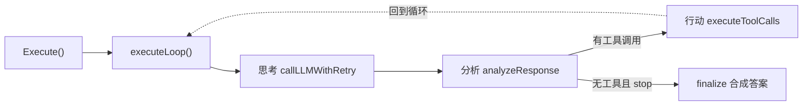
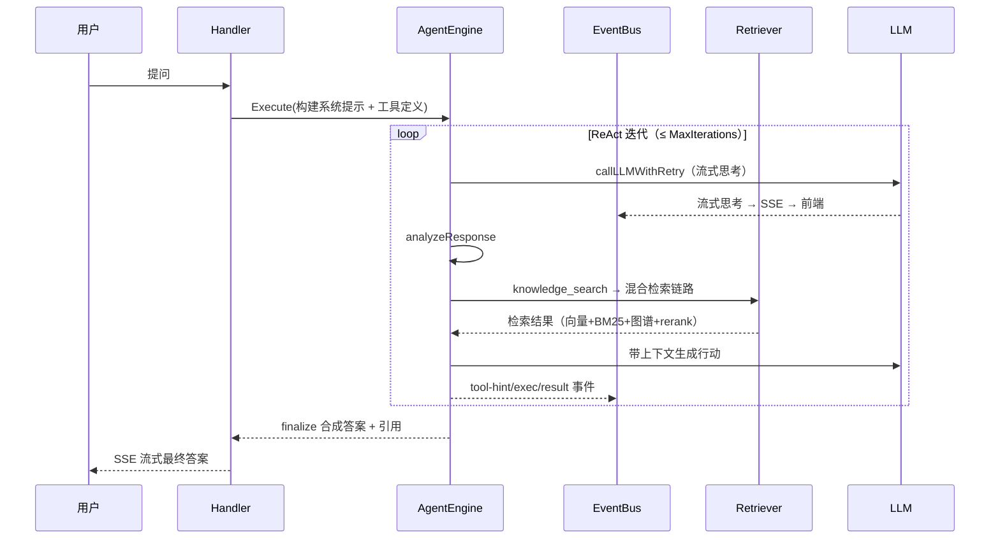

# Agent 系统实现 — WeKnora 深入解析

> 所属项目：[WeKnora](./README.md) · 关注面：ReAct 引擎 / 工具系统 / MCP / 技能系统 / 记忆整合

## AgentEngine 核心

Agent 系统是 WeKnora 最复杂的模块（`internal/agent/`），实现完整 ReAct 模式。引擎本身**无状态**——每一轮调用由调用方重建完整历史（`service.LoadAgentHistory`），所有输出通过 `event.EventBus` 流向 SSE 处理器，同一个引擎可同时服务 HTTP SSE、IM 流式、WebSocket 等不同消费端。

引擎把"能力"注入为字段：`toolRegistry`（工具注册表）、`skillsManager`（技能）、`memoryConsolidator`（记忆整合）、`tokenEstimator`（BPE 估算），配合 `chatModel` 与 `eventBus`。`Execute` 是入口，`executeLoop` 是循环主体——它保证**任何退出路径都恰好发出一次 `EventAgentComplete`**（正常结束、ctx 取消、迭代错误都覆盖），因为该事件要触发把 `RoundSteps`（思考 + 工具调用历史）写进 `AssistantSteps` 以便持续化（[internal/agent/engine.go:362-391]()）：

<!-- anchor: func (e *AgentEngine) executeLoop( … defer emitCompletion() -->

## ReAct 循环流程

每一步的职责：

- **[思考]** `callLLMWithRetry` 流式输出思考内容推给 EventBus → SSE → 前端；自动重试 429/5xx/超时并优雅降级。
- **[分析]** `analyzeResponse` 分多路终止判断：`content_filter` 命中则内容过滤终止；`finish=stop` 且无工具调用则自然结束；进入 `FinalAnswer` 状态则流式合成答案；另有**卡住循环检测**（重复输出相同内容）。
- **[行动]** `executeToolCalls` 支持串行或并行（可配置），处理 JSON 修复、类型转换、Schema 验证，每个工具发出一组事件（tool-hint/exec/result）并为每条工具调用建一个 Langfuse Span。

**关键设计决策：**
- **EventBus 驱动**：引擎不直接写响应，所有中间产物经事件总线——这让 Agent 执行与前端展示完全解耦。
- **上下文窗口管理**：超过 `MaxContextTokens * 0.8` 压缩历史，超过 `0.5` 阈值时由 LLM 驱动整合（见下文记忆）。
- **Langfuse 追踪嵌套**：`agent.execute` → `agent.round.N` → `agent.tool.<name>`。

## 工具系统

工具统一实现 `types.Tool` 接口（`Name()`/`Description()`/`Parameters()`/`Execute()`），经 `ToolRegistry` 注册。Agent 引擎只与注册表交互、不关心具体工具实现——这种**注册表模式**让扩展工具零侵入核心循环。普通工具在引擎创建时注册，MCP 工具在运行时动态注册；注册表同时负责冲突检测（先到先得防劫持）、参数转换与 Schema 验证。

| 类别 | 工具 |
|------|------|
| 知识检索 | `knowledge_search`, `grep_chunks`, `list_knowledge_chunks` |
| 知识图谱 | `query_knowledge_graph` |
| Wiki | `wiki_search` 等 10 个（生成与管理） |
| 网络 | `web_search`(RAG 压缩), `web_fetch`(SSRF 保护) |
| MCP | `mcp_{service}_{tool}`（动态注册） |
| 技能 | `read_skill`, `execute_skill_script` |
| 分析 | `data_analysis`, `data_schema` |
| 认知 | `thinking`（sequentialthinking）, `todo_write` |

> 注意：`final_answer` 并非工具——它是引擎内部的状态字段与流式答案合成（`streamFinalAnswerToEventBus`），由 Agent 自行判定何时结束；`sequentialthinking` 注册名是 `thinking`。

## MCP 集成

MCP（Model Context Protocol）是 Agent 扩展外部能力的关键机制（v0.6.3 起新增完整 OAuth2 支持）：

- 支持 **SSE** 与 **HTTP Streamable** 传输；**Stdio 因安全原因仍禁用**（服务端两个层面均拒绝）。
- 每个 MCP 服务打包成 `MCPTool`，工具名 `mcp_{service}_{tool}`。
- **HITL 审批**：可配置需人工审批的 MCP 工具，通过 UI 事件阻塞等审批/拒绝/超时（10 分钟），支持 Redis Pub/Sub 跨实例协调，状态持久化、刷新不丢失。
- **MCP OAuth2**：基于 mcp-go，支持 authorization-code + PKCE + 动态客户端注册，token 按 `(tenant, user, service)` 存于 `mcp_oauth_tokens` 表，支持刷新与 RFC 9728/8414 自动发现；v0.7.0 起支持会话中（mid-conversation）OAuth 授权。
- **安全措施**：工具名冲突先到先得、输出加 `"[MCP tool result from %q]"` 前缀防提示注入、图片 MIME 验证 + 大小限制、上传沙箱跨传输强制。

> **两套 MCP 易混淆**：服务端 `internal/mcp/` 是 agent 消费外部 MCP 服务（stdio 禁用）；CLI 的 `cli/internal/mcp` 是 weknora 命令行对外导出的一个 stdio MCP 服务器（只读工具，供 Claude Code/Cursor 驱动 WeKnora）。

## 技能系统

技能遵循 Claude 的**渐进式披露**三级设计——Agent 的指令不一次性全载入上下文，而是分三级逐步暴露（角色越接近要使用时披露越全），减少每轮调用的干扰 token：

| 级别 | 内容 | 可见性 |
|------|------|--------|
| 1 - 元数据 | 技能名称 + 描述 | 始终在系统提示 |
| 2 - 指令 | 完整 SKILL.md | `read_skill` 按需加载 |
| 3 - 资源 | 脚本文件 | `execute_skill_script` 沙箱执行 |

技能目录结构：`skills/<name>/SKILL.md`（YAML 前置元数据 + Markdown 指令）+ `scripts/`（沙箱隔离脚本）。沙箱模式三档：`docker`（首选隔离）/`local`（本地）/`disabled`（禁止）。

## 记忆整合

对话记忆是 `internal/agent/memory/consolidator.go`——纯 LLM 摘要压缩：当上下文超过阈值（`MaxContextTokens * 0.5`，可配）时，把旧消息用低温度 LLM 摘要成紧凑 memory 块，降低 token 消耗与成本并保住上下文窗口。

> **演进说明（v0.7.1）**：早期版本曾用 Neo4j 存 episodic 对话记忆做图回顾，该管道已在 v0.7.1 整体移除——聊天不再依赖 Neo4j graph 存储，简化部署；Neo4j 现在只为文档知识图谱服务。当前记忆是纯 LLM 摘要压缩，不是图回顾。

## 一次完整 Agent 推理链路

## 设计决策要义

- **Why 无状态 + EventBus**：无状态让引擎天然可重入、可水平扩展、可测试；事件总线把"执行"与"呈现"解耦，一个引擎服务 N 种前端形态。
- **Why 注册表模式管理工具**：引擎循环不感知具体工具，新增能力只加一个注册项，核心逻辑零改动；注册表统一承担冲突检测与参数校验的安全职责。
- **Why 渐进式披露技能**：即使模型有大上下文，每轮也只暴露必要元数据，靠 `read_skill` 按需拉全量——既省 token 又减少干扰。
