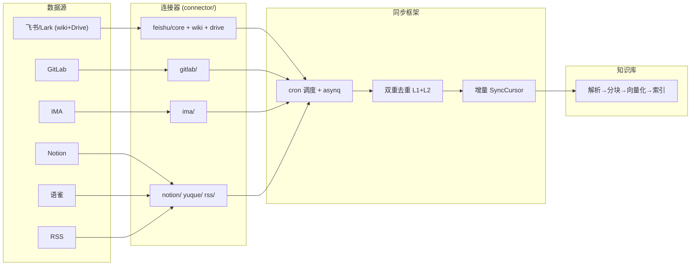

# 多源数据导入 — WeKnora 深入解析

> 所属项目：[WeKnora](./README.md) · 关注面：连接器框架 / 飞书 wiki+Drive / GitLab / IMA / 调度去重

## 根因

企业知识最分散的形态不是本地文件，而是**散落在各 SaaS 里的结构化/半结构化内容**（飞书 Wiki、Notion、语雀、GitLab 仓库、腾讯 IMA）。WeKnora 的 `datasource` 是一个"接外部数据源进知识库"的通用框架——用统一接口消化不同平台的认证、层级、增量语义差异，把外部文档变成可检索的 KB 条目。

## 连接器框架

核心是 `Connector` 接口 + 注册表 + 双重去重调度器 + 增量游标。`StreamingConnector` 更进一步支持流式 `FetchStream`（逐文件 emit 控内存），是生产主路径；服务优先走 FetchStream，否则退化到 FetchAll/FetchIncremental。每个连接器**无状态**（凭据加密存于 DataSource 配置，调用时按 config 重建 client）。

## 已实现的连接器

> **演进说明（v0.7.2）**：连接器从 v0.7.1 的"飞书 wiki/Notion/语雀/RSS 四个"扩展到 v0.7.2 的**飞书(含 Drive)/GitLab/IMA**。目录实测含 `feishu/{core,wiki,drive}`、`gitlab/`、`ima/`、`notion/`、`yuque/`、`rss/` 六个。其余仍在 `ConnectorMetadataRegistry` 注册但无实现代码（Confluence/GitHub/Google Drive/OneDrive/钉钉等）。

| 连接器 | 认证 | 同步方式 | 特点 |
|--------|------|----------|------|
| 飞书 / Lark (wiki) | OAuth2/app_id+secret | 增量 + Webhook + 删除同步 | 大 wiki 空间重试/断点续传 |
| 飞书 / Lark (Drive) | app_id + app_secret | 增量（ModifiedTime 游标，断点续传） | 新格式 docx 走 blocks API 逐块钻取 |
| GitLab | base_url + access_token | 增量（每 project commit SHA 对比）| compare API 生成 tombstone |
| IMA | OpenAPI token | 增量（logical_key 游标） | 原地替换映射为 update |
| Notion | API Key | 增量 | — |
| 语雀 | API Key | 增量 | — |
| RSS | 无（可配请求头） | 增量 | RSS/Atom/JSON feed |

### GitLab 连接器

支持 `StreamingConnector`。认证用 `base_url` + `access_token`，Validate 用 ping。增量核心是**每个 project 的 commit SHA 变化检测**：SHA 变了走 GitLab compare API，`diff.Diffs` 中 deleted/renamed 生成 tombstone；compare 不可用（历史重写/超时）则回退全量重枚举。新游标记录各 project head SHA（[internal/datasource/connector/gitlab/connector.go:17-25]()）：

<!-- anchor: type Connector struct { … func (c *Connector) Type() string { return types.ConnectorTypeGitLab } -->

### IMA 连接器

腾讯 ima.qq.com，用 `logical_key`（稳定键）而非 `media_id` 作身份——因为 IMA 同名文件原地替换会改写 media_id，用 logical_key 才能把替换识别为 **UPDATE 而非 delete+insert**。增量四判据：logical_key 新增→add、media_id 变→update、都不变→skip、上次有本次无→tombstone（[internal/datasource/connector/ima/connector.go:173-188]()）：

<!-- anchor: // Each IMA item is identified by a stable logical_key (see logicalKey), NOT by … // LIMITATION: IMA still exposes no per-item updated_at, so an in-place edit -->

<!-- anchor: Each IMA item is identified by a stable logical_key (see logicalKey), NOT by … refresh should periodically run a Full sync. -->

> **已知限制**：IMA 无 per-item `updated_at`，同 media_id 的原地改写对增量不可见，需要周期 Full sync——这是"上游不提供更新时间戳"时增量精确性的固有权衡，文档如实标注。

### 飞书 Drive 连接器

与 wiki 连接器共用 `core/`（client/config/region/blocks/markdown/engine）但枚举层不同：**Drive 没有 space 列表 API**，根文件夹由用户 `config.ResourceIDs[0]` 的 `folder_token` 提供，文件夹只能 `ListDriveFilesAllPages` 懒加载逐层展开；ancestors 因 Drive 无单文件 parent 查询 API，改用自根向下 BFS 共享遍历（[internal/datasource/connector/feishu/drive/connector.go:34-51]()）：

<!-- anchor: var _ datasource.StreamingConnector = (*DriveConnector)(nil) … if err := client.Ping(ctx); err != nil { -->

<!-- anchor: var _ datasource.StreamingConnector = (*DriveConnector)(nil) … client.Ping(ctx) -->

解析上，docx 走 blocks API（`FetchDocxWithBlocks`）逐块转 Markdown：text-run 聚合、表格/多选/文件/图片 token 引用转换，嵌入 sheet/bitable 表格走范围读取；`maxDocumentBlocks=50000` 防病态文档。doc/sheet/bitable 走 `ExportAndDownload` 转 docx/xlsx，file 走 `DownloadDriveFile` 原样，mindnote/slides/board 则跳过。

## 调度与去重

- `robfig/cron` 管理定时同步任务。
- **双重去重**：L1 = `HasRunningSync` 状态检查防重叠；L2 = `asynq.TaskID`（`dataSourceID:minute` 确定性 ID）实现 Redis 级去重。
- 增量同步通过 `SyncCursor` 游标追踪，避免全量拉取；各连接器把连接器特定游标（如 `FeishuDriveCursor{FileTimes}`、GitLab project head SHA）序列化进 `ConnectorCursor`，支持断点续传。

## 设计决策要义

- **Why 接口统一 + 各连接器内部适配**：认证、层级枚举、增量语义差异巨大，但统一 `Connector` 接口让同步框架（调度/去重/游标）与具体源解耦——新增连接器只实现接口并注册，调度层零改动。
- **Why 有 `logical_key` 这种"稳定身份"而非原始 ID**：上游变更 ID 的语义（IMA 原地替换改写 media_id）是增量同步最隐蔽的坑——用稳定键才能把"替换"映射为 update，避免 delete+insert 污染知识库。
- **Why 游标随源而变化**：每个源的时间戳/版本语义不同（commit SHA vs ModifiedTime vs logical_key），把游标做成可序列化的 `ConnectorCursor`，比强求统一"最后修改时间"更贴各源真实语义。
