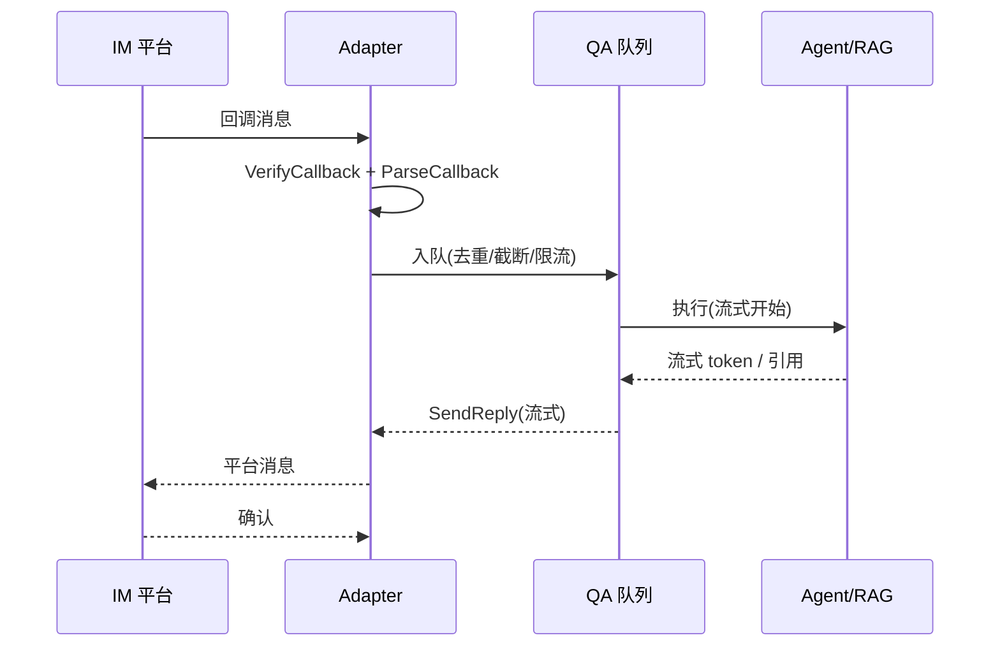

# IM 通道集成 — WeKnora 深入解析

> 所属项目：[WeKnora](./README.md) · 关注面：十平台适配器 / 消息管道 / 输出清洗

## 根因

知识问答的价值一半取决于**用户在哪里提问**。WeKnora 把 Agent 能力以"聊天"形态接到用户已经在用的 10 个 IM 平台上，让知识库在会话里就能被查询——这是它覆盖"企业内部高频使用场景"的关键。

## 适配器接口

IM 模块是复杂度非常高的子系统。核心是统一 `Adapter` 接口，把各平台差异（回调验证、消息解析、回复、URL 验证）收敛成一个契约（[internal/im/adapter.go:126-132]()）：

<!-- anchor: type Adapter interface { … VerifyCallback(c *gin.Context) error -->

平台特有接口再按需扩展：`StreamSender`（流式回复，internal/im/adapter.go:149）与 `FileDownloader`（文件下载，internal/im/adapter.go:169）等。这层抽象让 10 个平台共享同一套 QA 入队/执行的管道逻辑。

## 十平台对比

| 平台 | 连接方式 | 流式 | 特点 |
|------|----------|------|------|
| 企业微信 | WebSocket + Webhook | ✅ | AES 解密、引用回复 |
| 飞书 | Webhook | ✅ (CardKit) | 富文本、加密事件 |
| Lark (国际版) | Webhook | ✅ | v0.7.0 新增，region 感知、线程内回复 |
| Slack | WebSocket + Webhook | ✅ | 线程支持 |
| Telegram | Long Poll | ✅ | Bot API、主题支持 |
| 钉钉 | Webhook + WebSocket | ✅ | Stream SDK、文件/图片入库 |
| Mattermost | Webhook | ❌ | 出站 Webhook |
| 微信 | Long Poll | ❌ | 二维码登录、ilink |
| QQBot | WebSocket | ✅ | v0.7.0 新增，v0.7.2 支持 Markdown 回复 |
| 云之家 | WebSocket | ✅ | v0.7.1 新增，签名/图片 SSRF 校验/默认 Markdown 回复 |

## 消息处理管道

```
IM 消息到达
  │
  ├── 1. 去重（Redis SetNX / sync.Map）
  ├── 2. 长度截断（4096 runes）
  ├── 3. 限流（滑动窗口，Redis ZSET / 本地）
  ├── 4. 会话解析（user 或 thread 模式）
  ├── 5. 命令分发（/help /clear /stop /info /search）
  ├── 6. QA 入队（有界队列 + 固定工作池，默认 Workers=5 / MaxQueueSize=50）
  └── 7. 执行（流式 / 完整回复）
```

有界队列 + 固定工作池把并发控制在下游可承受范围，`GlobalMaxWorkers` 用 Redis 做跨实例分布式限流——避免多副本同时打爆模型 API。

## 输出内容处理

`cleanIMContent`（[internal/im/service.go:148-150]()）对 IM 出站内容做三层转换：

<!-- anchor: func cleanIMContent(ctx context.Context, content string, tenant *types.Tenant, defaultFileSvc interfaces.FileService, storageResolvers ...interfaces.StorageBackendResolver) string { -->

1. `<image>...</image>` → Markdown 图片
2. `<kb />` / `<web />` → 移除
3. `provider://` URL → HTTP 签名 URL

**Holdback 机制**：检测到末尾有不完整的 Markdown 图片或 `provider://` URL 时，保留到下一刷新批次，避免渲染中断——这是流式分块下保证"内容不以残缺态发出"的关键细节（与 `internal/storageurl/stream.go` 的流式改写是同一思想）。

## IM 会话链路



## 设计决策要义

- **Why 统一 Adapter 接口**：10 个平台的差异（连接方式、加密、消息格式、回复通道）极大，但收敛到统一接口后，消息管道（去重/限流/入队/执行）只写一遍，各平台只是不同的 Adapter——这是"变体很多、变在哪都清楚"的分层解耦。
- **Why 有界队列 + 分布式限流**：IM 突发流量（群聊 @、大批量用户）远高于 Web API，固定工作池 + Redis 全局并发上限防止下游模型被打爆。
- **Why Holdback / 流式改写一致性**：流式回复时 URL 和图片引用可能被截断在分块边界，必须等片段补全才发，否则用户看到坏链接——这是流式协议里最容易疏忽的正确性问题。
