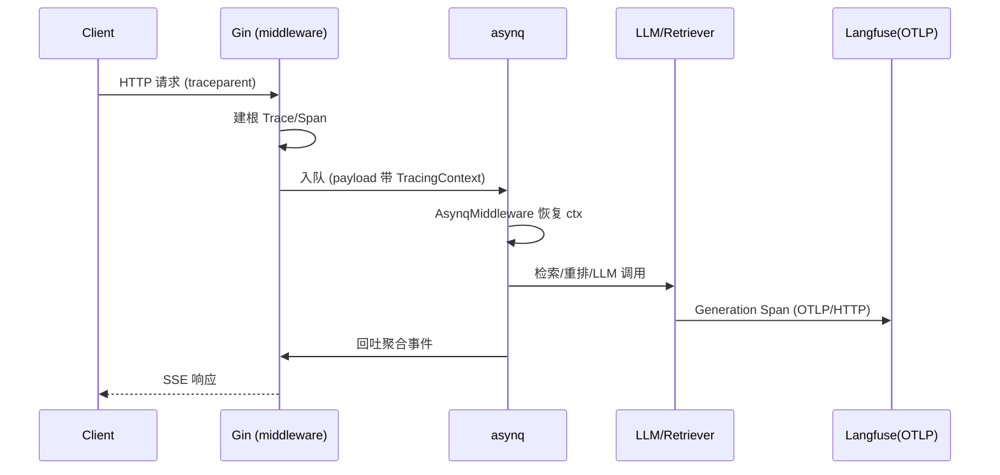

# 可观测性设计 — WeKnora 深入解析

> 所属项目：[WeKnora](./README.md) · 关注面：OTel → Langfuse / asynq 桥接 / 采样

## 根因

一个跨 Agent 推理、检索重排、asynq 异步任务、IM/Embed 多端的长链路系统，出错时最难的是**把零散日志拼回一次完整调用**。WeKnora 用 OpenTelemetry 标准把整个链路串成可追踪的 Trace/Span/Generation，并落到 Langfuse 作为分析后端。

> **演进说明（v0.7.1）**：Langfuse 追踪从自研直连 ingestion 批处理 API 的轻量客户端，迁移到 **OpenTelemetry 标准 exporter**——用 `otlptracehttp` 构建 exporter 指向 `/api/public/otel/v1/traces`（Langfuse v3+ / LiteFuse 标准），并发送 `x-langfuse-ingestion-version` 头（[internal/tracing/langfuse/exporter.go:24-28]()）：

<!-- anchor: opts := []otlptracehttp.Option{ … "Authorization":                "Basic " + base64.StdEncoding.EncodeToString([]byte(creds)), -->

相比自研私有批量 API 模拟逻辑，改用 OTel 标准后代码更精简、天然获得 W3C traceparent 跨服务传播，且被 Langfuse v3+ 视为一等公民。

## OTel 基础

- `go.opentelemetry.io/otel` SDK，导出器走 **OTLP/HTTP**（可在 Jaeger/Zipkin 等 OTLP 接收端中选择）。
- 全局传播器：TraceContext + Baggage，支持 W3C `traceparent` 跨服务传播。
- v0.6.2 移除独立的 Jaeger 集成，Langfuse 为唯一可观测后端（简化启动与配置）。

## Langfuse 集成组件

| 组件 | 职责 |
|------|------|
| `exporter.go` | OTLP/HTTP trace exporter，Basic Auth 到 Langfuse 标准端点 |
| `manager.go` | 单例管理 + 追踪上下文 |
| `tracer.go` | Trace/Span/Generation 创建与完成 |
| `middleware.go` | Gin 中间件，自动为 API 请求建 Trace |
| `asynq.go` | asynq 任务中间件，拼接 HTTP ↔ 异步追踪 |
| `retrieval_obs.go` | 检索/重排链路可观测 |

## 追踪模型

```
Trace（HTTP 请求 / asynq 任务）
├── Span（子工作单元）
│   ├── Generation（LLM 调用：chat/embedding/vlm/rerank）
│   └── Generation（嵌套 LLM 调用）
```

**AsynqMiddleware 是关键设计**——它把 asynq 异步任务与 HTTP 请求关联起来（[internal/tracing/langfuse/asynq.go:82-88]()）：任务 payload 携带 `TracingContext`（traceID、parentObservationID），任务处理时恢复追踪上下文；HTTP 侧通过 W3C `traceparent` 继承上游 trace ID。这样"用户发请求 → 入队 → worker 消费 → 模型调用"整条链路在 Langfuse 里是一个完整 Trace，而不是断裂的多段日志。

<!-- anchor: func AsynqMiddleware() asynq.MiddlewareFunc { … if !mgr.Enabled() { -->

Agent 推理则嵌套追踪：`agent.execute` → `agent.round.N` → `agent.tool.<name>`，每次工具调用一个 Span——调试一个多步 ReAct 循环时能精确定位是哪一步、哪个工具、消耗多少 token。

## 采样控制

`LANGFUSE_SAMPLE_RATE`（0.0–1.0）控制采样比例——高并发生产环境不必全量落 Trace，按比例采样控制成本与存储，同时保留统计意义上的可观测性。

## 全链路追踪时序



## 设计决策要义

- **Why 标准优于自研**：可观测后端迭代太快，自己维护 Langfuse 私有批量 API 的模拟逻辑既脆弱又不通用；迁到 OTel OTLP 标准后，导出器可对任何兼容端复用，也顺带获得 W3C 传播、采样等标准能力。
- **Why 异步任务带 ctx 桥接**：长链路的大部分耗时藏在 asynq 后台任务里，若异步段不带父 trace，Trace 就断了——AsynqMiddleware 在 payload 序列化 TracingContext、在 worker 恢复，是"端到端可观测"的落地关键。
