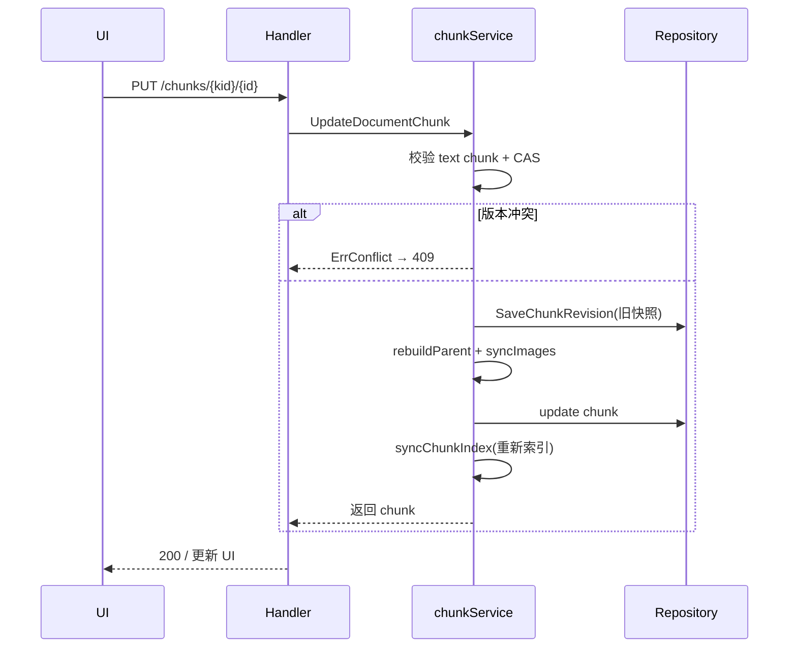

# RAG 引擎实现 — WeKnora 深入解析

> 所属项目：[WeKnora](./README.md) · 关注面：文档管道 / 分块 / 多引擎检索 / RRF 融合 / v0.7.2 chunk 编辑

## 文档处理管道

文档从上传到可检索经历 4 个阶段：

```
上传 → DocReader(gRPC) → 分块 → 向量化 → 索引
```

**DocReader** 是独立的 gRPC 服务（`docreader/`），支持 PDF/Word/Excel/PPT/图片/HTML 等 10+ 格式，解析结果以结构化 Markdown 返回。v0.7.2 起 `.html` 文件可直接上传（此前只能 URL 导入），"受支持扩展集"成为直传与 URL 导入的唯一门槛（[`docreader/`](docreader)）。

## 自适应三级分块

分块器（`internal/infrastructure/chunker/`）实现了 WeKnora 最精巧的算法之一——三级回退链，根据文档特征动态选择最优策略。核心在 `ProfileDocument → SelectStrategy → ValidateChunks → Fallback` 的决策链。

`SelectStrategy` 先把文档特征映射成一份有序策略链——`DocProfile` 判定 Markdown 标题数量与密度够不够走标题分割、启发式边界够不够走启发式分割，**Legacy（递归）永远是兜底**，即使前两级校验失败也保证有结果，调用方永远不会拿到空集（[internal/infrastructure/chunker/profiler.go:220-241]()）：

<!-- anchor: func SelectStrategy(p *DocProfile) []StrategyTier { … chain = append(chain, TierLegacy) -->

分层触发条件如下：

| 层级 | 策略 | 触发条件 |
|------|------|----------|
| **1 级（标题分割）** | 按 Markdown 标题分割 | 标题数 ≥ 3 且标题密度 > 0.005 |
| **2 级（启发式分割）** | 扫描换页符/章节标记/视觉分隔符等边界 | 启发式标记 ≥ 5 个 |
| **3 级（递归分割）** | 按分隔符优先级递归分割 | 始终可用作为保底 |

`ProfileDocument` 完成特征预分析：统计字符数、换页符、行数，并逐行做一次 pass 用三反引号前缀检测代码围栏，避免把代码块误判为普通文本（[internal/infrastructure/chunker/profiler.go:88-97]()）：

<!-- anchor: func ProfileDocument(text string) *DocProfile { … p.FormFeedCount = strings.Count(text, "\f") -->

再经 `ValidateChunks` 验证分块质量，不满足自动降级到下一级。

再经 `ValidateChunks` 验证分块质量，不满足自动降级到下一级。

**父子分块** 是另一个关键设计：文档先切成大块（父块），每块再细分成小块（子块）。子块用于检索（语义聚焦），父块作为检索结果附加上下文（完整信息），兼顾检索精度与回答质量。

## 多引擎向量检索架构

通过统一的 `RetrieveEngine` 接口 + 注册表模式抽象多存储后端。真正的独立存储实例 **7 个**（ES/Milvus/Qdrant/Weaviate/Doris/Tencent/OpenSearch），其余是绑定应用默认数据库的 env store 或专用后端：

| 类别 | 引擎 | 关键技术 |
|------|------|----------|
| 独立实例 | Elasticsearch | cosineSimilarity 脚本分数 |
| | Milvus | gRPC, COSINE 度量 |
| | Qdrant | gRPC 点集合 |
| | Weaviate | GraphQL API |
| | Doris | MySQL 协议 + HTTP Stream Load |
| | Tencent VectorDB | 专有 SDK |
| | OpenSearch | k-NN 插件 |
| 绑定默认库 | PostgreSQL | pgvector + ParadeDB BM25 |
| | SQLite | sqlite-vec |
| 知识图谱 | Neo4j | Cypher + apoc.merge |

> **注意**：`neo4j` 专用于**知识图谱检索**，不参与向量检索；`infinity`/`elasticfaiss` 仅残留为历史枚举，无部署实例。

### 多向量库扇出（跨 KB 跨存储检索）

当一个查询横跨多个绑定到不同向量存储的知识库时，检索服务按 `(VectorStoreID, TenantID)` 把 KB 分桶成若干 `storeGroup`（每组共享同一引擎），再用 `errgroup` 并发 `retrieveFromStores` 拉取并合并。并发上限默认 4、单组超时 30s；结果横跨 >1 种引擎类型时，向量分数经 `EngineAwareNormalizer` 归一化后再融合。

## 混合检索与 RRF 融合

```
HybridSearch()
├── 向量检索（余弦相似度）
├── 关键词检索（BM25 / ParadeDB）
├── 分数归一化到 [0,1]
├── RRF 融合，默认 k=60, vectorWeight=0.7, keywordWeight=0.3
├── 父块 / 附近块 / 知识图谱相关块扩展
└──（可选）Rerank 重排序
```

RRF（加权倒数排名融合）解决了不同检索引擎**分数不可比**的问题——不用绝对分数相加，而是按排名倒数融合，并允许在 `RetrievalConfig` 里调节向量/关键词权重。

## Embedding 集成

`KeywordsVectorHybridRetrieveEngineService` 编排 Embedding 调用：内容清理（去除 base64 图像负载）→ 安全截断 → 指数退避重试 → 并发批处理（每批 40 条、最多 5 并发）→ 同一嵌入模型的多个 KB 共享一次嵌入计算。

## v0.7.2：可编辑 Chunk 与修订历史

v0.7.2 起 chunk 可以直接在 UI 编辑，每次覆盖前快照、可 diff、可一键回滚，编辑后自动重建索引。数据模型由迁移 `000078_chunk_editing_and_custom_metadata` 落地：`chunks` 表新增 `source_content`（存编辑前的原始内容，用于重建父块）/`content_revision`（乐观版本号）/`index_status`/`last_editor_id`，并新建 `chunk_revisions` 历史表（[migrations/versioned/000078_chunk_editing_and_custom_metadata.up.sql:2-25]()）：

<!-- anchor: ALTER TABLE chunks ADD COLUMN IF NOT EXISTS source_content … CREATE UNIQUE INDEX IF NOT EXISTS idx_chunk_revisions_chunk_revision -->

编辑走**乐观并发控制（CAS）**：`UpdateDocumentChunk` 只允许 text chunk 可编辑、校验 `expectedRevision` 与当前 `ContentRevision` 匹配，不匹配抛 `ErrChunkRevisionConflict`（前端映射 409），随后把被取代的旧版本快照进 `chunk_revisions`、`ContentRevision++` 并把 `IndexStatus` 置 `processing`（[internal/application/service/chunk.go:382-394]()）：

<!-- anchor: func (s *chunkService) UpdateDocumentChunk( … return nil, ErrChunkRevisionConflict -->

编辑不是直接改存储里的 chunk 完事，而是触发一连串一致性操作——① `rebuildParentContent` 在不可变的父 `SourceContent` 上按逆序区间叠加人工编辑子块重建父块；② `syncEditedChunkImages` 同步附件子块（删除改下线以便回滚恢复）；③ `syncChunkIndex` 删旧索引、按 `EmbeddingContent` 与生成的问题重新 batch index，任一步失败把 `index_status` 置 `failed` 而**不向 UI 假装成功**。这个设计把"编辑一个 chunk"从单行 UPDATE 变成微型事务链，代价是复杂度，换来的是一致性与可回滚。

## 核心链路



## 设计决策要义

- **Why RRF 而非加权求和**：跨引擎向量分数尺度不同、不可相加，RRF 用排名抵消尺度差异，且天然容忍某一路完全 miss。
- **Why 父子分块**：小块检索精度高但上下文碎片化，父块补全但粒度粗，两者正交互补。
- **Why chunk 编辑用乐观锁**：编辑是低频操作，乐观并发比悲观锁省去长事务，冲突时让用户重试比阻塞更友好；CAS + 快照让"编辑"成为可审计、可回滚的一等操作。
