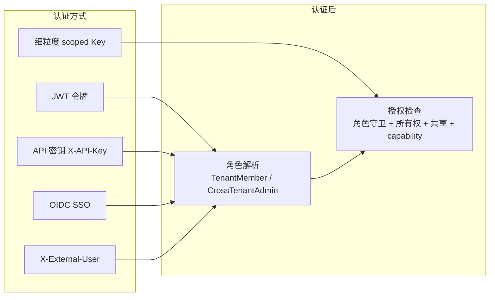

# 多租户 RBAC 权限体系 — WeKnora 深入解析

> 所属项目：[WeKnora](./README.md) · 关注面：角色模型 / principal / 守卫层 / 审计 / 凭据安全

## 根因

一个企业级多租户 RAG 平台最难的不是检索质量，而是**在共享基础设施上把每个租户、每个资源、每种身份的权限边界划清楚**。WeKnora 的 RBAC 不止是权限模型，更是一套完整的多租户治理方案——从人类用户到 API Key、IM/Embed 会话，都用同一套 principal 化身份来授权。

> **术语提示**：v0.7.0 起 UI 把 "tenant" 改叫 "workspace"，但代码标识符仍为 `TenantRole*`/`tenant_*`。同版本引入组织 `OrgRole` 作为组织级共享 KB 的第二套角色模型。

## 四级角色矩阵

| 角色 | 层级值 | 关键能力 |
|------|--------|----------|
| Owner | 40 | 删除租户、轮换 API 密钥、管理所有成员 |
| Admin | 30 | 管理成员、配置租户基础设施（模型/向量库/MCP/IM） |
| Contributor | 20 | 创建/编辑自己的知识库和 Agent |
| Viewer | 10 | 对所有资源只读，可运行标记为 runnable_by_viewer 的 Agent |

角色通过 `TenantRole.HasPermission(required)` 比较 `Level()` 实现层级继承——不是枚举比较而是数值比较，天然支持"Admin+ 也拥有 Viewer 的一切权限"。

## v0.7.0 的 principal 模型（重大演进）

不再只有"人类用户"一种身份。现在的认证主体（principal）有 8 种：`web_user`、`api_tenant`、`api_platform`、`api_external_user`、`im_user`、`embed_channel`、`embed_session`、`embed_visitor`。核心变化：

- **细粒度 scoped API Key**：取代"一键 Admin"，每个 Key 携带显式角色 + 能力授权（capabilities，如 `manage_kbs`/`manage_storage_backends`/成员与空间能力），可限定到特定知识库，更新 `last_used_at`（节流）。路由级 `DenyAPIKeyPrincipal`/`api_key_gate` 守卫堵住 IDOR/越界。
- **非人类外部用户**：通过 `X-External-User-ID`/`X-External-User-Token` 头授权，用于外部系统集成。
- **v0.7.1 平台级 API Key**：面向控制平面自动化（租户管理、系统设置、运行时队列、审计），带系统级 capabilities。
- MCP OAuth、Embed 会话均按 principal 范围隔离，外部集成相互隔离。

## 三重认证

1. **JWT** — 邮箱+密码登录，载荷携带 `tenant_id` 声明。
2. **API 密钥** — `X-API-Key`，恒定时间比较防时序攻击。
3. **OIDC SSO** — 授权码流程 + nonce 状态验证。

## 守卫层设计

守卫是 Gin 中间件，在路由层组合使用。Router 注册路由时通过 `rbacGuards` 结构注入守卫（[internal/router/rbac.go:113-113]()）：守卫种类丰富但层次清晰。

<!-- anchor: type rbacGuards struct { -->

| 守卫类型 | 变体 | 职责 |
|----------|------|------|
| 纯角色 | Viewer/Contributor/Admin/Owner/SystemAdmin | 检查角色层级 ≥ 最低要求 |
| 所有权 | 6 种 `OwnedXxxOrAdmin` | 创建者 OR Admin+ |
| KB 访问 | 6 种 `KBAccessRead/Write` | 自有/组织共享/Agent 共享 |
| 跨租户 | `RequirePathTenantMatch` 等 | 路由级隔离 |

以 `KBAccessRead` 为例，它把 KB 访问判定委托给 `RequireKBAccess` 中间件，传入 KB 定位函数 + 最低角色 + KB 共享/Agent 共享服务——读访问是"自有或共享"的复合判断，不是简单角色比较（[internal/router/rbac.go:552-560]()）。

<!-- anchor: func (g *rbacGuards) KBAccessRead(param string) gin.HandlerFunc { … g.cfg, -->

所有权守卫的解析链（`ChunkID → KnowledgeID → KB ID → knowledge_bases.creator_id`）经由 `internal/handler/rbac_lookups.go` 实现——把"Chunk 属于哪个租户哪个老板"层层向上归并，才能对每个 API 请求做资源级判断。

## 灰度和降级

配置 `tenant.enable_rbac` 控制强制模式：`true` 实际拒绝（403，写审计）；`false` 仅记录拒绝但放行（"fail open"，全部按 Admin 授予）。这让团队可以先观察日志确认规则正确再强制执行——是"渐进式安全"的工程化体现。

## 审计日志

| 属性 | 说明 |
|------|------|
| 存储 | `audit_logs` 表，仅追加 |
| 关键事件 | 成员增删、邀请、RBAC 拒绝、向量库变更、系统设置变更 |
| 去重 | 相同 `(tenant, actor, action, request_path)` 1 分钟窗口内只写一行 |
| 保留 | 默认 90 天，后台每 24h 清理 |
| 范围 | v0.7.1 新增 per-KB 活动审计（`ScopeType=knowledge_base`） |

## 凭据安全

所有静态凭据用 **AES-256-GCM** 加密，加密值以 `enc:v1:` 前缀，密钥来自 `SYSTEM_AES_KEY`（32 字节）；解密提供宽松模式（密钥缺失也能加载行数据）。覆盖范围：租户 API Key、IM 凭据、数据源凭据、MCP 凭据、模型凭据、存储后端凭据。v0.6.0 起采用 `/credentials` 子资源模式，敏感字段在响应中脱敏、编辑时不丢失凭据。

## 设计决策要义

- **Why principal 化身份**：把 API Key / IM / Embed 会话都纳入统一 principal，才能在各渠道收紧边界，防止"通过 API Key 拿到超人类用户该有的权限"的越权。
- **Why 守卫函数组合**：比声明式权限注解更灵活——同一资源入口用不同守卫叠加（OwnedXxxOrAdmin + KBAccessRead），组合即语义，且可由链式查询自上而下归并资源归属。
- **Why fail-open 灰度**：在权限模型复杂的多租户平台里，一步到位强制可能误伤生产；先记录后强制是务实的发布策略。
