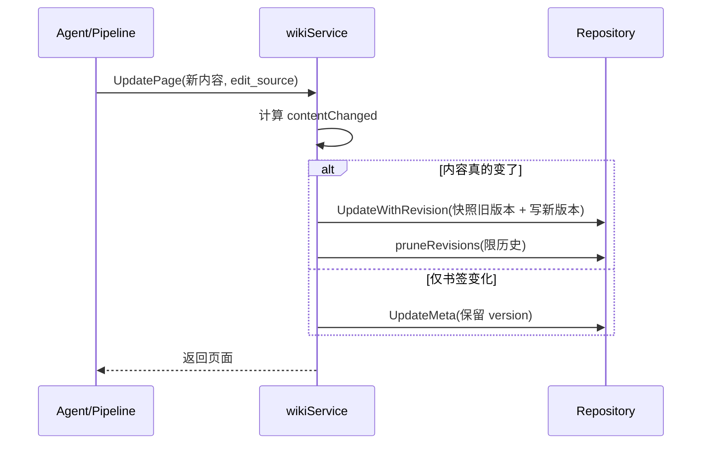

# Wiki 模式实现 — WeKnora 深入解析

> 所属项目：[WeKnora](./README.md) · 关注面：Wiki 自动生成 / 知识图谱 / v0.7.2 修订历史与文件夹树

## 根因

企业文档最大的问题不是生成，而是**写完就过时**。WeKnora 的 Wiki 模式用 Agent 把原始文档自动改造成结构化、互链、可维护的 Markdown Wiki + 知识图谱，并把"人的知识沉淀"变成 Agent 可读写的闭环——这是它区别于纯 RAG 问答项目的标志性能力。

## 工作流程

```
用户上传文档 → 解析 + 分块
  ▼
Agent Wiki 摄取管道（wiki_ingest*.go + prompts_wiki.go）
  ├── 文档摘要生成
  ├── 知识点提取（LLM 驱动的实体/概念抽取）
  ├── 分块引用（每个知识段落关联原始文档）
  ├── 页面创建（按主题生成 Markdown 页面）
  ├── 文件夹归类（按分类层级元数据）
  └── 页面链接（自动建立跨页引用）
  ▼
可视化知识图谱（Neo4j 后端）
  ├── 实体节点（概念、文档、章节）
  └── 关系边（引用、包含、相关）
  ▼
Wiki 浏览器（前端 Vue 组件）
  ├── 目录树浏览 + 文件夹层级
  ├── 全文搜索
  └── 图谱交互
```

Agent 在 ReAct 循环中通过一组专用工具操作 Wiki（`wiki_search`/`wiki_read_page`/`wiki_write_page`/`wiki_rename_page`/`wiki_delete_page`/`wiki_replace_text`/`wiki_read_source_doc`/`wiki_flag_issue`/`wiki_read_issue`/`wiki_update_issue`），让 Wiki 不仅是只读产物，而是 Agent 与用户共同维护的活文档。

## 知识图谱

知识图谱基于 Neo4j（Cypher + apoc.merge），存储文档中提取的实体/关系。检索增强时命中某个节点后扩展其关联节点作为上下文（`RetrieveGraphRepository`）。实体类型含概念、文档标题、章节、关键术语；关系类型含引用、包含、相关、对比。

> **演进说明（v0.7.1）**：v0.7.1 保留的关键图的正是这一部分——被移除的是基于 Neo4j 的 episodic 会话记忆，而非知识图谱本体（详见 agent-system 记忆节）。

## v0.7.2：Wiki 页面修订历史、Diff 与手动编辑

v0.7.2 起每个 wiki 页面被覆盖前先保留旧版本，支持逐行 diff 与一键回滚，页面还能在浏览器里手工编辑。数据模型由迁移 `000075_wiki_page_revisions` 落定：给 `wiki_pages` 加 `last_edit_source`（`pipeline`/`agent`/`user`/`revert`，空串视为 legacy=pipeline）与 `last_editor_id`，并新建 `wiki_page_revisions` 历史表（含 slug/version/content/edit_source/editor_id/edited_at，唯一索引 `(page_id, version)`）。

关键设计：**当前版本只存在 body 里，编辑时先把被取代的旧版本快照再写新版本**，所以任何历史版本都可 diff、可回滚，且版本名 `editor`/`edit_source` 记录的是"该版本当时由谁产生"而非写入者。

Service 层的 `UpdatePage` 手工编辑先计算 `contentChanged`（对比用户可见字段：Title/Content/Summary/PageType/Status/Aliases），若真变了才走 `UpdateWithRevision` 原子快照+更新（失败不留下半截快照），然后 `pruneRevisions` 限制历史数量——机器版本掉出窗口即丢，人工/agent/revert 版本存活到硬上限（[internal/application/service/wiki_page.go:132-182]()）：

<!-- anchor: contentChanged := existing.Title != page.Title || … s.pruneRevisions(ctx, existing.ID, existing.Version) -->

回滚 `RevertPageToVersion` 只回滚 content/title/summary 等用户可见内容、保留文件夹与排序，再走 `UpdatePage` 且以 `edit_source=revert` 记录——这样每次 revert 本身也成为一个可追溯的版本。

> **Diff 计算异构点**：后端不提供差量 diff 计算——diff 由前端通过 `GET /revisions/{slug}?version=N` 拉取指定版本的**全文**后对比渲染。这是刻意的前后端分工：把逐行 diff（如 Myers diff）放前端，后端只负责存取版本全文，避免为每一种 diff 算法做服务端封装。

## v0.7.2：KB 文件夹树

此前文件夹层级是被"塞"进 `file_name` 的相对路径，v0.7.2 把它独立为 `folder_path` 列，让文档列表能渲染真正的侧边栏目录树。迁移 `000079_knowledge_folder_path` 用 `REGEXP_REPLACE` 把旧 `file_name` 中的相对目录回填到 `folder_path`、`file_name` 只留 basename，并对 `(tenant_id, kb_id, folder_path)` 建索引。

实现要点：目录树由 `GROUP BY folder_path` 聚合计数后在内存组装（中间空文件夹也 materialized 以保持层级连通）；**重命名/移动只改 `folder_path` 展示列，不触发重新解析分块**——因为 chunk/embedding/存储文件仍指向原 chunk，re-filing 不产生昂贵的重处理（[internal/application/service/knowledge.go:571-626]()）：

<!-- anchor: func (s *knowledgeService) ListKnowledgeFolderTree( … if strings.HasPrefix(target, source+"/") { -->

关键细节：
- `RenameKnowledgeFolder` 阻止把文件夹"移进自己的子目录"（否则自身子树不可达），重命名到已存在路径即合并。
- `MoveKnowledgeToFolder` 批量 re-file；不存在目标文件夹则创建、最后一个条目移走后文件夹自动消失。
- 读写权限分离：读侧 Viewer 共享可见，写侧要求 OrgRoleAdmin/Editor + 所有权。

## Wiki 修订生命周期核心链路



## 设计决策要义

- **Why 快照式修订而非 diff 存储**：存每版全文 + 前端做 diff，换来后端极简（无需 diff 算法/补丁应用）、任何历史版本可独立回滚，代价是存储量略增（用 `pruneRevisions` 收口）。
- **Why 文件夹独立成列**：把层级从文件名里"拆"出来，才能支持树浏览、原地重命名、批量 re-file 而不牵连解析管线——这是"展示"与"内容"解耦。
- **Why 人与 Agent 共写 Wiki**：Wiki 不是只读产物，而是 Agent 用工具持续维护、用户可手工编辑与回滚的活知识——这构成"文档→知识→沉淀"闭环的关键一环。
