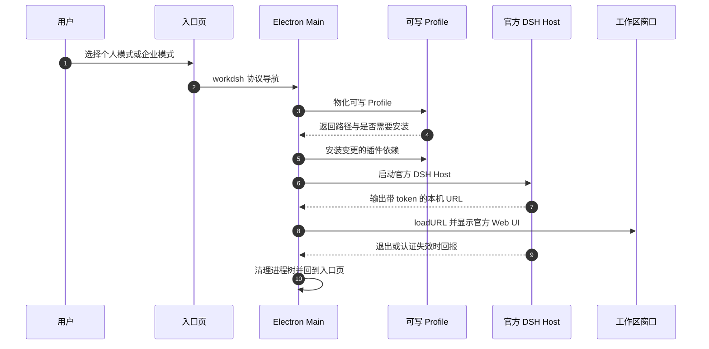

# WorkDSH

> 本解读按 **ai-agent ⊗ framework** 类规格产出（ai-agent 主类型 + framework 副类型叠加：WorkDSH 是构建在 DSH 之上的 agent 产品，同时把 DSH 插件接口当作对外的扩展面）。判定依据：README 自述「A WorkBuddy-style workspace built on DeepSeek Harness plugins」+ 顶层 `packages/plugins/*` 独立插件包 + 每包 `package.json` 里的 `dsh.bundle`/`dsh.client` 扩展声明。
>
> **解读基线**：`main`（`acbfd5a4be`）。仓库**没有稳定版 tag**（56 个 tag 全为 `-alpha.N` 预发布或 monorepo 分包子 tag），`scripts/select-baseline.mjs` 按「无稳定 tag/分支 → 回落默认分支」选定 `main`。与文档对齐的发行版是 Desktop `2.0.6-alpha.5`、Web/插件 `0.1.0-alpha.14`，官方运行时 pin 为 **DSH `0.2.0-rc.2`**（`upstream.json:3`）。
> 上游 DSH 本体的解读见 [`../deepseek-harness/`](../deepseek-harness/)；本篇只讲 WorkDSH 在其之上加了什么、以及为什么这样加。

## 子文档索引

- [`architecture-design.md`](architecture-design.md) — 叙述型架构设计说明，**建议先读**：设计信条、模块责任矩阵、关键决策的代价与复审触发条件
- [`plugin-architecture.md`](plugin-architecture.md) — 一个 WorkDSH 插件包的四类出口、cordis patch 分层组合与 Cordis Service 生命周期
- [`desktop-runtime.md`](desktop-runtime.md) — Electron 载体、可写 Profile 的所有权迁移、bundled runtime 与发布门禁
- [`enterprise-identity.md`](enterprise-identity.md) — 身份提供方替换、成员凭据只留 Main、回环桥与会话归属的 fail-closed 授权审计
- [`capability-assets.md`](capability-assets.md) — 专家/技能/连接器：不可变修订、preset 编译与执行绑定
- [`material-deliverables.md`](material-deliverables.md) — 资料库/项目/Office/活动：从原件修订到可编辑交付物
- [`data-model.md`](data-model.md) — 自有域存储的表结构、归属键、CAS 与 schema 演进
- [`CHANGELOG.md`](CHANGELOG.md) — 各版本变更汇总（含本次解读的基线状态与覆盖范围）

## 根因：让 agent 进企业，而不是再造一套 agent 运行时

WorkDSH 要回答的不是「怎么做一个 agent」，而是**「一个已经在跑 agent 的框架，怎么变成普通人能装、企业能管的产品」**。这两个约束相互拉扯：

- 面向个人，它必须**开箱即用**——用户机器上不该先准备 Node.js 和 Python（`docs/why-desktop.md` 明说这是选 Electron 而不是「一份改过的 Harness」的理由）。
- 面向企业，它必须**可治理**——公司账号、组织、权限、模型转发、审计正文，而且员工不能改后台地址。
- 但两者**不能各维护一套实现**：上游 DSH 迭代很快（本仓库从 `0.1.0-alpha.1` 一路到 `0.2.0-rc.2`），复制一份内核意味着每次上游升级都要迁移私有分支。

所以 WorkDSH 把自己压缩成三件事：**载体（carrier）+ 组合（profile/patch）+ 业务插件（bundles）**。官方 DSH 的 Host、Web Client、Conversation、Workspace、Session、Loader、Skill runtime 与 **Agent loop 全部来自锁定的上游发布包，一行不改**——`docs/architecture.md` 开篇就是这个自我约束：「WorkDSH Desktop 是一个 Electron 外壳，运行一套固定版本的 DeepSeek Harness Profile」`[docs/architecture.md:5-5]()`。

<!-- anchor: WorkDSH Desktop 是一个 Electron 外壳，运行一套固定版本的 DeepSeek Harness Profile。 -->

这条边界的价值在升级时才显现：上游换版本时，要动的是「Profile 兼容性 + 安装包验证」，而不是「把另一套复制的源码迁移过去」。代价同样明确——**所有自有功能只能在官方插件接口的约束下生长**，官方没给的扩展点（比如新的 UI 位置、新的传输协议）就得绕路或等待上游（见 [`capability-assets.md`](capability-assets.md) 里技能管理被迫使用官方 Client Connection 精确 route 的例子）。

## 概览

**是什么**：一个「WorkBuddy 式」的 AI 工作台。项目、资料库、专家、技能、连接器、Office 交付物是它自己的功能层；对话、模型设置、插件管理、右侧面板则完全是官方 DSH 客户端。两种交付形态共用同一套功能包：Desktop（Agent 与工具在员工电脑上跑）和 Web/企业部署（服务器按账号跑官方 DSH 进程）。

**痛点**：

- 官方 DSH 的 `npx dsh web` 对开发者友好，对「双击安装就能用」的普通用户不友好，也没有项目/资料库这类工作台语义。
- 企业要的账号、组织、权限、模型转发、正文审计，在纯个人工具里没有落点；而常见做法（fork 一份内核 + 打企业补丁）会让上游升级变成迁移工程。
- 员工本机跑 Agent 与「公司能看见发生了什么」天然冲突：既要不把成员凭据放到渲染进程，又要让业务插件复用登录。

**适用场景**：想给非技术同事一个可安装的 agent 工作台；或在企业内需要「本机执行 + 中心管控」的 agent 落地；或想学习**如何在不 fork 上游的前提下做一个衍生产品**。

**明确不做什么**（README 与文档反复声明，属于设计纪律而非欠账）：不做第二套 Host 或 Web Client；不做企业模型 provider 或自动同步模型配置；不把技能/专家做成插件市场的预装内容；不把企业账号插件装进个人默认组合。

**部署形态**：桌面侧是通过安装器分发的应用产物（macOS 为未签名预览，Windows/Linux 走各自的打包脚本），企业侧是"按账号在服务器上起官方 DSH 进程"，仓库内**没有容器化编排**（无 Dockerfile / compose / systemd 单元），部署与升级的运维要点见 [`architecture-design.md`](architecture-design.md) 第十一章。

### 核心能力清单表

| 能力 | 说明 | 子文档 |
|------|------|--------|
| Electron 载体与可写 Profile | 安装包只含 Electron 入口与不可变 runtime；每个个人/成员一份可写 Profile，升级时按 digest 只迁移「仍是安装包默认值」的条目 | [`desktop-runtime.md`](desktop-runtime.md) |
| Profile 组合与插件装载 | `dsh.profile.bundles` 选择 + `cordis.patch.yml` 分层（默认组合 / 企业 patch / 用户安装） | [`plugin-architecture.md`](plugin-architecture.md) |
| 自有功能插件 | experts、skills、connectors、library、projects、office、activity、access、audit、bundle：各自独立包版本、独立入口、独立迁移 | [`plugin-architecture.md`](plugin-architecture.md) |
| 能力资产的修订固定 | 专家草稿 → 发布不可变修订 → 任务用 `compositionDigest` 绑定；技能/连接器把运行目录交给官方 registry/provider | [`capability-assets.md`](capability-assets.md) |
| 资料到交付物 | 原件不可变 + 修订链 + 引用钉住修订号；Office 用租约 + CAS 出可编辑工作副本 | [`material-deliverables.md`](material-deliverables.md) |
| 企业身份与治理 | identity 提供方按 profile 二选一；成员 token 只在 Main；回环桥白名单转发；会话归属 + 工具入口 fail-closed 授权与审计 | [`enterprise-identity.md`](enterprise-identity.md) |
| 自有域存储 | 10 个 `dsh-storage-domain` 域声明 + per-record 布局 + CAS 写路径 | [`data-model.md`](data-model.md) |

### 技术栈一览表

| 层 | 选型 | 出处 |
|----|------|------|
| 桌面载体 | Electron `43.3.0` + electron-builder `26.15.7`（`afterPack` 门禁挂在 `verify-workdsh-carrier.ts`） | `apps/desktop/package.json` |
| 插件运行时 | Cordis `4.0.4`（Service / Fiber / Loader）+ `@deepseek-ai/dsh` `0.2.0-rc.2` 精确钉版本 | `packages/plugins/*/package.json` |
| 语言与构建 | TypeScript（Desktop 侧 `6.0.3`、Web 侧 `5.9.3`）+ `tsdown` 打包；Desktop 用 yarn `4.18.0` workspace，Web/插件用 pnpm `10.34.5` | `package.json` / `apps/web/package.json` |
| 前端 | React `19.2.4` + 官方 Slot，组件只接收公开 props，不持有 Cordis ctx | `packages/plugins/skills/package.json` |
| 持久化 | `@deepseek-ai/dsh-storage-domain`（zod schema + `defineDomain`/`domainTable`，`per-record`） | `packages/plugins/library/src/storage/domain.ts` |
| Office 交付物 | Tiptap/ProseMirror（Word）、`pptx-viewer`（PPT）、pdf-lib + 内嵌 Noto Sans SC（PDF）、ExcelJS/Univer（表格，实验性） | `packages/plugins/office/package.json` |

### 项目规模

| 指标 | 数值 |
|------|------|
| 受版本控制的文件 | 1149 |
| 自有 TS/TSX 源码 | 约 3.3 万行（`packages/plugins` 20.2k、`apps/desktop` 7.1k、`apps/web` 1.7k、`packages/providers` 1.7k、`packages/contracts` 1.4k、`packages/bundle` 0.6k、`packages/ui` 0.2k，含测试） |
| 插件/提供方包 | 19 个插件目录（11 个已有 TS/TSX 源码、8 个仅 README 与 `.gitkeep` 脚手架）+ 6 个 provider 目录 |
| 自有存储域 | 10 个 `defineDomain` 声明（含同一包内的两个域） |
| 官方运行时 pin | DSH `0.2.0-rc.2`，本仓库 56 个 tag 全部为预发布 |
| 协议 | MIT |

> 规模数字来自 `git ls-files` 与按目录的行数统计，不含上游依赖与包内资源（Office 内嵌字体等）。

## 架构总览

WorkDSH 的架构可以一句话概括：**载体在上，运行时在下，中间那层是可写 Profile，功能全部挂在官方插件树上**。


这张图想说明的不是「有哪些模块」，而是**边界在哪、谁拥有谁**：Electron 载体（左列）只做入口、窗口/进程生命周期、管理员部署配置、企业回环桥与本机空间隔离；安装包内的不可变 runtime（②）与每个账号一份的可写 Profile（③）是两套东西，前者供应默认依赖、后者拥有用户选择；官方 DSH（④）与 WorkDSH 自有插件（⑤）跑在**同一棵 Cordis 插件树**上，区别只是由谁提供；自有插件的业务数据落在自己的 per-record 域表（⑥），而账号、组织与模型转发在仓库之外的企业后台（⑦）。

图的代价也要说清楚：把「官方运行时」和「WorkDSH 功能」放在同一棵树里，意味着**插件与官方版本的耦合是硬耦合**——每个功能包都在 `package.json` 的 `peerDependencies` 里精确钉住 `@deepseek-ai/dsh-*`，官方改接口就得跟着改包版本，这是「不 fork」这条设计换来的账单。

### 模块职责映射

```text
workdsh/
├── apps/
│   ├── desktop/                     # Electron 载体：窗口、登录、本机进程、安装包
│   │   ├── src/workdsh-main.ts      # 唯一应用入口：入口页 → profile → 启动官方 Host
│   │   ├── src/local-runtime.ts     # 可写 Profile 物化 + 官方启动器 + 企业 patch
│   │   ├── src/enterprise-auth.ts   # Main 侧登录与会话 + 回环 bridge
│   │   └── scripts/                 # 打包、运行时校验、发布清单门禁
│   └── web/                         # Web/插件工作区：构建、探针、验收与发行脚本
├── packages/
│   ├── contracts/                   # 跨插件领域契约（小、无实现）
│   ├── ui/                          # 无持久业务状态的展示组件
│   ├── bundle/                      # 默认组合包：导航/展示/诊断
│   ├── plugins/<domain>/            # 业务插件：domain/services/storage/tools/remote/client
│   ├── providers/<name>/            # 身份、存储、执行差异的显式适配
│   └── enterprise-connection/       # 企业连接外部单包交付
├── profiles/                        # 个人与企业共用的官方客户端与功能来源清单
├── docs/                            # 架构、边界、企业接入与产品说明
└── upstream.json                    # 唯一上游 pin：DSH 版本与 Desktop 发布产物校验值
```

## 启动链路

Desktop 的启动是一条「把不可变 runtime 拼成一个可写工作区，再让官方 Host 自己起来」的链路。它与常见 Electron 应用不同：**窗口不是应用主体，官方 DSH 才是**——窗口先是一个入口页，等从子进程 stdout 里捞到带 token 的本机 URL 后才真正加载产品界面。



链路里「启动官方 DSH Host」这一步，是载体用安装包内的 Node 直接拉起官方 `runProfile` 启动器，并把默认组合的 `cordis.patch.yml` 与企业 patch 作为层列表一起传进去 `[apps/desktop/src/workdsh-main.ts:227-234]()`。

<!-- anchor: function startRuntime(home: string, connection: DesktopConnection, patches: stri … const launcher = officialHostLauncher(bundledProfileDirectory(), home, executable, -->

链路里最值得注意的第一处细节，是**就绪判定靠正则从 stdout 里捞 URL**：`const READY_PATTERN = /dsh web:\s+(http:\/\/127\.0\.0\.1:\d+\/?\?token=[^\s]+)/u` `[apps/desktop/src/workdsh-main.ts:24-24]()`，同时所有输出里的 `?token=` 都被替换成 `[redacted]` 再转发到 stderr。

<!-- anchor: const READY_PATTERN = /dsh web:\s+(http:\/\/127\.0\.0\.1:\d+\/?\?token= -->

第二处细节是启动前必须确认 profile 可写：如果 `node_modules` 还是指向安装包的符号链接，直接拒绝启动并提示选择独立空间 `[apps/desktop/src/local-runtime.ts:66-66]()`。

<!-- anchor: if (existsSync(modules) && lstatSync(modules).isSymbolicLink()) -->

企业模式在这条链路上插了两层：登录后先把企业插件**打包搬运**进成员 profile，再叠一层企业 patch——禁用本地身份、插入企业身份与协作、打开固定成员的会话自动绑定 `[apps/desktop/src/local-runtime.ts:166-166]()`。

<!-- anchor: export function desktopEnterprisePatch(home: string, authority: Authority, -->

完整时序见 [`enterprise-identity.md`](enterprise-identity.md)。

## 核心模块导读表

| 模块 | 职责 | 关键入口 | 深读 |
|------|------|----------|------|
| Electron 载体 | 入口页、窗口与进程生命周期、管理员部署配置、企业回环桥 | `apps/desktop/src/workdsh-main.ts` | [`desktop-runtime.md`](desktop-runtime.md) |
| 可写 Profile 与运行时 | digest 所有权迁移、官方启动器、bundled Node/pnpm | `apps/desktop/src/local-runtime.ts` | [`desktop-runtime.md`](desktop-runtime.md) |
| 发布清单与打包门禁 | 唯一发布清单 + profile/carrier 校验 + `afterPack` | `apps/desktop/scripts/workdsh-package-boundary.mjs` | [`desktop-runtime.md`](desktop-runtime.md) |
| 插件包与组合 | `dsh.bundle`/`dsh.client` 声明、cordis patch 分层、四类出口 | `packages/plugins/skills/package.json` | [`plugin-architecture.md`](plugin-architecture.md) |
| 能力资产 | 专家修订、preset 编译、技能生命周期、连接器定义 | `packages/plugins/experts/src/runtime/preset-compiler.ts` | [`capability-assets.md`](capability-assets.md) |
| 资料与交付物 | 原件/修订/引用、项目引用、Office 工作副本 | `packages/plugins/library/src/services/library-manager.ts` | [`material-deliverables.md`](material-deliverables.md) |
| 授权与审计 | 会话归属绑定、工具入口闸门、审计事件 | `packages/plugins/access/src/index.ts` | [`enterprise-identity.md`](enterprise-identity.md) |
| 自有域存储 | 10 个域、per-record 键、CAS 写路径 | `packages/plugins/library/src/storage/domain.ts` | [`data-model.md`](data-model.md) |

已实现与规划的分界由代码自己维护：`apps/web/docs/modules.json` 给每个模块标 `implemented` / `in_progress` / `planned`（33 个模块条目中只有 8 个 `implemented`），而 `packages/plugins/` 下 `admin`、`applications`、`automations`、`identity`、`model-policy`、`pages`、`tables`、`usage` 八个目录目前只有 README 与 `.gitkeep` 脚手架——**源码路径不等于已交付能力**。

## 上游承担的 agent 关注面：哪些是依赖、哪些是自有

WorkDSH 是 agent 产品，但**主循环、上下文压缩、会话持久化、系统提示拼装、工具管线、Skill 运行时与 MCP 客户端全部来自上游**。这一节把这条边界逐项写明，避免读者误以为产品自己实现了这些——同时也说明 WorkDSH 在每个关注面上的"对应物"是什么。

- **主 Agent 循环**（感知/推理/行动、停止条件、token 预算与上下文耗尽时的行为）由官方 `dsh-agent` 与 `dsh-agent-loop` 承担 `[apps/web/package.json:61-62]()`；WorkDSH 侧的对应物不是循环，而是**专家 preset 编译 + 执行绑定**，即把"用哪套提示与哪些能力"变成任务建立时就钉死的输入。
  <!-- anchor: "@deepseek-ai/dsh-agent": "0.2.0-rc.2", … "@deepseek-ai/dsh-agent-loop": "0.2.0-rc.2", -->
- **上下文压缩与记忆**由官方 `dsh-command-compact` 与 `dsh-compaction` 族（基础压缩、图片卸载、工具结果裁剪三个可插拔策略）承担 `[apps/web/package.json:173-180]()`；WorkDSH 侧只做**资料引用的注入与字符预算裁剪**（把选定资料送进上下文，超预算就裁），不实现分层记忆，也不介入压缩策略。
  <!-- anchor: "@deepseek-ai/dsh-command-compact": "0.2.0-rc.2", … "@deepseek-ai/dsh-compaction-tool-result-pruner": "0.2.0-rc.2", -->
- **会话与状态持久化**由官方 `dsh-session`、JSONL 持久化后端与投影层承担 `[apps/web/package.json:69-71]()`；WorkDSH 只补两件事：会话的**归属绑定**（谁在哪个组织/成员上下文里开会话）与执行绑定（这次任务用了哪版能力资产）。
  <!-- anchor: "@deepseek-ai/dsh-session": "0.2.0-rc.2", … "@deepseek-ai/dsh-session-projection": "0.2.0-rc.2", -->
- **系统提示拼装**由官方 `dsh-system-prompt` 承担 `[apps/web/package.json:77-77]()`；WorkDSH 把资料引用与专家 preset 接进这条链路，而不自建提示模板体系——这是"资料能进上下文、专家能生效"却又不与上游提示格式冲突的前提。
  <!-- anchor: "@deepseek-ai/dsh-system-prompt": "0.2.0-rc.2", -->
- **工具管线与 Skill 工具**由官方 `dsh-tools` 与 `dsh-tool-skill` 承担 `[apps/web/package.json:78-79]()`；WorkDSH 的对应物是**在管线入口加一道授权闸门**，并把自有工具按同一套注册方式挂上去。
  <!-- anchor: "@deepseek-ai/dsh-tool-skill": "0.2.0-rc.2", … "@deepseek-ai/dsh-tools": "0.2.0-rc.2", -->
- **Skill 运行时**（技能发现、加载与注入）由官方 `dsh-skill` 与 `dsh-skill-filesystem` 承担 `[apps/web/package.json:72-73]()`；WorkDSH 做的是**管理层**：导入校验、修订与指纹、租约与引用——运行目录交给官方，不另起一套加载 order。
  <!-- anchor: "@deepseek-ai/dsh-skill": "0.2.0-rc.2", … "@deepseek-ai/dsh-skill-filesystem": "0.2.0-rc.2", -->
- **MCP 与外部能力接入**由官方 `dsh-mcp-client` 与 `dsh-mcp-resources` 承担 `[apps/web/package.json:66-67]()`；WorkDSH 的"连接器"只做**定义与选择**（连什么、给谁用），不拥有 transport、不治理重连与流式半开。
  <!-- anchor: "@deepseek-ai/dsh-mcp-client": "0.2.0-rc.2", … "@deepseek-ai/dsh-mcp-resources": "0.2.0-rc.2", -->
- **宿主接入协议（ACP）既非自研、也不在自有交付面上**：官方版本族本身包含 `dsh-acp` 与 `dsh-acp-app`，工作区在依赖覆盖表里一并钉版本 `[apps/web/package.json:94-95]()`；但 WorkDSH 自有代码、功能清单与 patch 层里没有任何 ACP 引用（全仓检索确认），它在这个协议里是**宿主侧消费者**（被 Electron 拉起、经本机桥访问企业后台），而不是对外提供 client–agent 服务的 agent server。
  <!-- anchor: "@deepseek-ai/dsh-acp": "0.2.0-rc.2", … "@deepseek-ai/dsh-acp-app": "0.2.0-rc.2", -->

一句话总结这条边界：**循环与引擎归上游，语义与治理归 WorkDSH**。这也解释了为什么本仓库的插件几乎都不碰会话与模型调用，而集中在"能力资产、资料、交付物、授权、审计"这些语义层。

## 设计亮点

**亮点一：用「digest 所有权迁移」解决「安装包默认值 vs 用户改动」的冲突。**
升级桌面端时，profile 里既有安装包塞进去的默认依赖与 bundle 选择，也有用户自己的增删。WorkDSH 的做法是把「安装包拥有的默认值」连同版本一起做 sha256 记进 `.workdsh-desktop-base.json`，下次启动算出新 digest 后**只删除/更新那些仍然等于旧默认值的条目**，用户显式改过的条目保留 `[apps/desktop/src/local-runtime.ts:54-54]()`。

<!-- anchor: export function materializeRuntimeProfile(source: string, home: string): { prof -->

这比「覆盖式升级」（丢用户改动）和「绝不改动」（用户拿不到新默认值）都更精确，代价是必须严格记录 base——一旦缺少这份记录，代码选择直接报错要求人工核对，而不是猜。

**亮点二：把「组合」做成数据，而不是代码分支。**
个人与企业共用同一批业务插件，差异全部表达在 `cordis.patch.yml` 里：`- insert:` 插插件、按 id 改 config、`disabled` 关能力，甚至能用 `!!js` 表达式按环境变量切换实现——默认组合包里用 `disabled: !!js "!!process.env.DSH_ELECTRON_EXECUTABLE"` 决定浏览器能力走 Electron 还是 Playwright MCP `[packages/bundle/cordis.patch.yml:12-12]()`。

<!-- anchor: disabled: !!js "!!process.env.DSH_ELECTRON_EXECUTABLE" -->

这意味着「企业版」不是一个分支，而是一个 patch 文件；也意味着测试可以针对 patch 组合做，而不需要维护两份源码。

**亮点三：成员凭据不下发，用「能力受限的回环桥」替代「把 token 给页面」。**
企业登录拿到的是不透明 token，它只存在于 Main 进程的私有字段里；宿主插件要调公司后台，走的是本机回环 HTTP 服务，用 32 字节随机 key + `timingSafeEqual` 鉴权、拒绝带 `Origin` 的浏览器请求、只放行白名单路由正则 `[apps/desktop/src/enterprise-auth.ts:100-100]()`。

<!-- anchor: export async function startEnterpriseAuthority(login: EnterpriseLogin, deviceId: -->

这条设计的收益是渲染进程和第三方插件都拿不到 bearer；代价是**每一次业务调用都要绕一圈本机 HTTP**，而且桥必须自己承担超时、体积上限与关停顺序（`closing` 先拒后关）。

**亮点四：授权不是中间件，而是会被审计的失败关闭（fail-closed）路径。**
`access` 插件把自己挂在官方工具管道的入口上 `[packages/plugins/access/src/index.ts:569-569]()`，先解析可信身份、再确认会话归属、再判定资源授权，任一步不满足就返回 deny reason 并写审计；跨组织、非活跃成员、未绑定归属的既有会话全部拒绝。

<!-- anchor: ctx.on('tools/pre-execute', async (exec, next) => this.authorizeTool(exec, -->

这里没有「默认放行」，因为宿主侧一旦漏判，模型就有机会直接改到别人的数据。

**亮点五：能力资产用不可变修订换可复现性。**
专家发布时冻结 `definitionDigest`、技能依赖锁 `dependencyLock`、组合指纹 `compositionDigest`，任务建立时把 `expertRevisionRef` 与 `skillRevisionRefs` 写进 `ExecutionBinding`——之后别人改专家、升级技能，都不会改变这个任务已经固定的执行语义 `[packages/plugins/experts/src/storage/domain.ts:127-127]()`。

<!-- anchor: export const expertsDomainSpec = defineDomain({ -->

代价是旧任务永远不会自动获得新能力，必须显式重新绑定，这也是 README 专门写「升级专家需要显式重新发布」的原因。

## 不足与风险

- **文档口径与实现口径存在不一致，且不是笔误级别**。`docs/desktop-boundaries.md` 与根 README 宣称企业账号插件「随安装包不可变携带、员工无需安装 tgz」，但桌面实现是先检查**个人 profile 里是否已安装**企业插件、再用 `pnpm pack` 把它搬进成员 profile，若没装则直接报错要求用户先去装（`apps/desktop/src/enterprise-plugins.ts`）。对读者而言这两条路线意味着完全不同的运维动作，解读时按实现为准。详见 [`enterprise-identity.md`](enterprise-identity.md)。
- **平台与图形验收明显滞后于源码检查**。文档反复声明「图形窗口、本机工具、平台安装与退出行为需要分别验收」，macOS DMG 目前是未签名预览；`docs/desktop-boundaries.md` 里「产品目标版本与用户已安装应用的实际版本须分别核对」也说明升级链路尚未走完真实用户场景。
- **约四成的插件目录只有脚手架**。`packages/plugins/` 下 19 个目录里有 8 个（`admin`、`applications`、`automations`、`identity`、`model-policy`、`pages`、`tables`、`usage`）只有 README 与 `.gitkeep`，企业管理后台、自动化、用量统计、在线表格都还在 `planned`；根 README 的「产品方向」与这些空目录之间的距离需要读者自己折算。
- **插件与官方版本的硬耦合**。每个包精确钉住 `@deepseek-ai/dsh-*`，官方一次接口调整就要动所有受影响包；`apps/web` 里存在大量针对上游客户端的构建期 patch（`apps/web/scripts/desktop/patches/upstream/`），这是「不改上游源码」在工程上的真实成本。
- **没有关系型存储与跨域事务**。自有数据走 per-record 域表，跨域一致性靠业务层（CAS + 操作阶段机）而不是数据库事务；数据量增长后 per-record 的读放大与无跨域回滚是明确上限，详见 [`data-model.md`](data-model.md)。
- **企业审计的边界被文档自己承认**：「正文同步依赖客户端提交，不构成不可绕过的完整终端审计」——想拿它当合规证据需要额外手段。

## 可借鉴的设计

1. **衍生产品的「载体 + 组合 + 插件」三层切分**：把「进程/窗口/安装」和「业务能力」分开，中间只留一层可写组合描述（profile + patch）。上游升级时改动面被压缩到组合层，这对任何基于快速迭代框架做产品化的团队都适用。
2. **用 digest 表达「谁拥有这一行配置」**：升级时不是全量覆盖，而是「只迁移仍是当初默认值的条目」。这是配置所有权的一般化解法，可直接迁移到任何「框架默认值 + 用户覆盖」的场景。
3. **能力受限的本机回环桥**：把凭据留在特权进程，给非特权进程一个「白名单操作的 HTTP 面」，比「下发 token + 前端自律」可审计得多；关键细节是随机 key、常量时间比较、拒收浏览器 Origin、路由白名单正则与显式关停顺序，五者缺一不可。
4. **把授权挂到框架的执行入口上，而不是散落在业务代码里**：`tools/pre-execute` 一处拦截就能覆盖原生与 PTC 两条工具调用路径，避免「某个新工具忘了加权限检查」。
5. **不可变修订 + 组合指纹固定执行语义**：对 agent 产品尤其重要——prompt 与技能一变，历史任务就不可复现；用修订引用把「当时用的什么」钉死，是让 agent 产出可被追责的前提。
6. **数据模型交给框架的域存储**：不引入第二套数据库，用 zod + `defineDomain` 声明表并让框架负责落盘格式，代价是放弃关系查询与跨域事务，收益是升级与迁移面大幅收窄。

## 总结

WorkDSH 的价值不在「又一个 agent 工作台」，而在于它示范了一种**衍生产品的克制**：把上游当不可变依赖，把差异全部收进可写的组合层，把自有能力做成遵守同一套契约的插件，把治理做成可撤销、可审计的失败关闭路径。它换来的是升级成本可控、个人与企业同源；付出的代价是与官方版本硬耦合、以及一批尚未验收的平台与图形工作面。

读这个项目时，最值得对照的两个问题：如果上游明天改了插件接口，我的改动面有多大？如果企业客户问我「员工本机跑了什么、谁授权过」，我能不能不靠日志猜？本篇各子文档分别给出了它在这两个问题上的答案与欠账。
