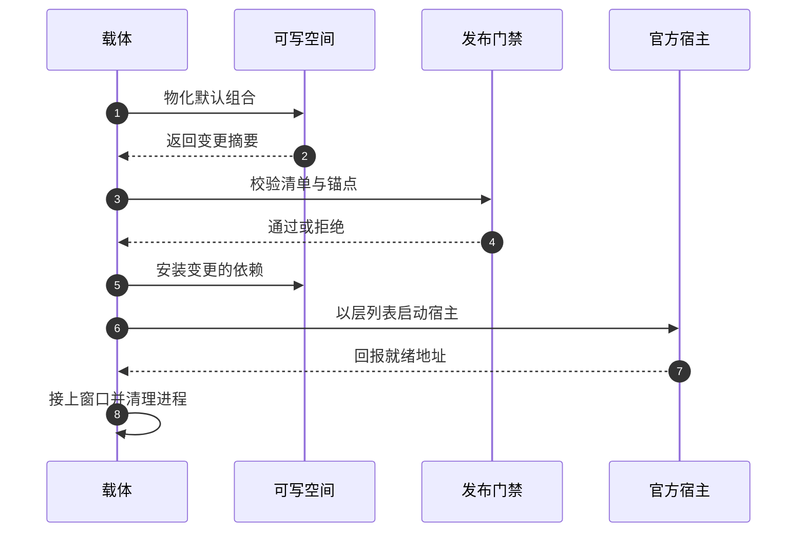
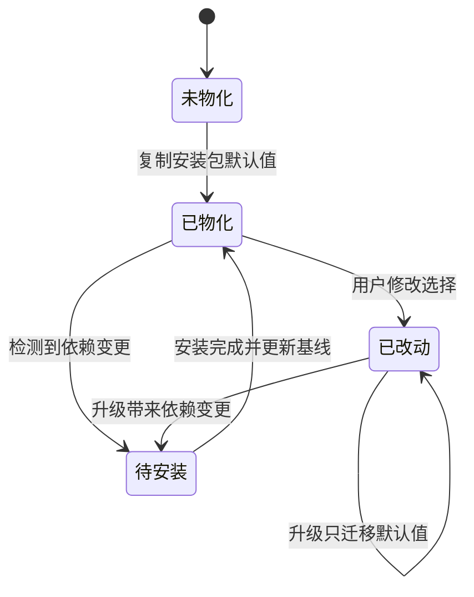
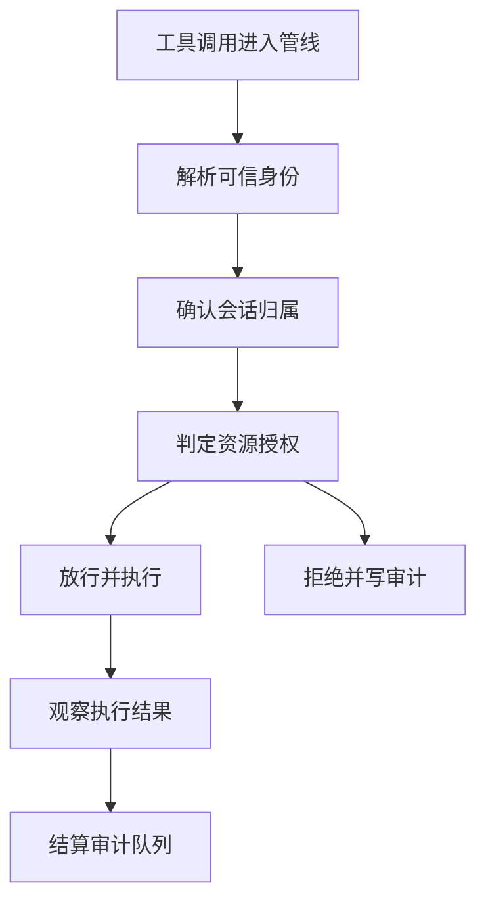
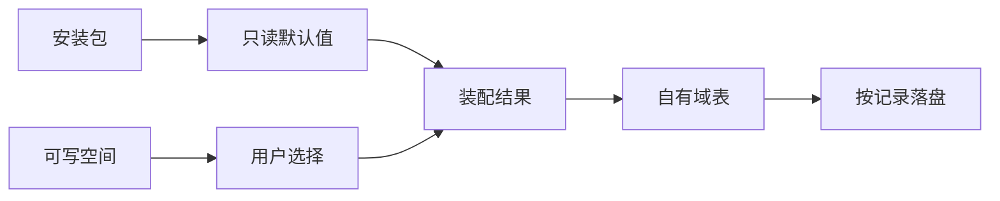

# WorkDSH 架构设计说明

> 这是一篇**叙述型**文档：它讲"系统为什么长成这样、约束在哪、代价是什么、什么条件下该重新评估"，**不含源码索引**。所有论断的逐条证据在同类解读的证据型文档中，二者刻意隔离：本文可独立阅读，核对时回到证据型文档。
>
> 基线为默认分支的一次快照（提交号与发行形态记录在解读根文档与变更记录里），工作树干净。产品版本号不进本文正文——版本一变，设计意图通常不变，而数字会过期。

本文的结构按"为什么做 → 怎么落地"推进：前四章交代定位、输入、总体架构与模块责任；第五到第九章走一遍关键链路（装配、处理、读取、执行、状态）；第十到第十四章是决策与代价、部署形态、容量口径、已知边界和验收标准。附录给术语对照与"我要做 X → 看哪一节"的场景索引。

## 一、背景与定位：为什么做、要解决什么问题

### 1.1 产品定位

WorkDSH 是一个**桌面工作台形态的 agent 产品**：它的功能层是项目、资料库、专家、技能、连接器与 Office 交付物；它的对话、模型设置、插件管理与右侧面板则完全来自 DeepSeek Harness（下称"官方运行时"）的既有客户端。它不做自己的 agent 内核，也不重写官方 Web 界面。

这一定位里最重要的词是"工作台"而不是"agent"：agent 能力由官方运行时提供，WorkDSH 回答的是**这些能力如何被一个组织里的普通人日常使用**。

### 1.2 目标用户与两种交付形态

目标用户有三层：一线员工（要开箱即用的桌面应用）、团队负责人（要项目与交付物的可追溯）、企业 IT（要账号、权限、模型转发与审计）。同一套功能代码，以两种形态交付：

- **桌面形态**：应用装在员工电脑上，agent 循环与工具执行在本机进程里，资料与交付物落在本机可写空间。
- **服务端形态**：企业按账号在服务器上起官方运行时进程，浏览器访问；功能包同源，只是宿主不装桌面载体。

两者共用功能代码，是"不做第二个内核"这条纪律的直接结果，也是后面大部分权衡的来源。

### 1.3 问题的起点：三个同时成立的约束

这个问题之所以值得设计，是因为三个约束同时成立，而且互相拉扯：

1. **开箱即用**。目标用户不该先准备 Node 与 Python 运行时。若要求用户自行安装运行环境，产品的实际可用率会在第一步就崩掉——这是"必须打包一个安装器"的硬约束，而不是体验优化。
2. **企业可治理**。企业客户要账号体系、组织隔离、权限判定、模型统一转发与审计留痕，并且**员工不能自行改掉后台地址**。
3. **只有一个内核**。上游运行时迭代很快（同一仓内跨越了多个预发布序列），如果为了让功能成立而复制一份内核，每次上游升级都会变成一次私有分支迁移。

不解决会怎样：只做 1 就是一个玩具；只做 2 就是一个内部管控系统，员工不会用；放弃 3 则在半年内被上游的迭代速度拖垮——团队大部分精力会消耗在把上游补丁搬进私有分支上。

### 1.4 设计信条与质量模型

由此得到四条设计信条，后文所有决策都可回溯到它们：

- **上游不可变**：官方运行时按锁定版本作为依赖引入，不改源码、不打断点、不私有化分支。
- **所有权显式**：任何一份配置或数据，必须能回答"谁拥有它"。所有权不明是升级事故的主要来源。
- **治理失败关闭**：授权、身份、归属判定在不确定时一律拒绝，且拒绝本身要可对账。
- **可撤销优先**：任何在运行期装上去的东西（服务、订阅、桥、进程）都要有对称的撤销路径。

质量模型按"错了会怎样"排序：数据与权限错误（不可接受）> 升级不可预测（不可接受）> 功能缺失（可接受，登记为缺口）> 界面粗糙（可接受，属于后期打磨）。

## 二、设计输入：约束、非目标与技术选型

### 2.1 需求与约束

| 类别 | 约束 | 对设计的影响 |
|------|------|--------------|
| 交付 | 必须有可双击安装的桌面产物，覆盖主流桌面平台 | 需要一个进程与窗口的载体，且安装器要能携带运行时 |
| 运行环境 | 用户机器上不预设 Node 与 Python | 运行时必须随包携带，并由载体在受控路径下拉起 |
| 后端 | 企业侧后端不在本仓，接口由外部定义 | 客户端只能依赖契约与版本协商，不能假设后端细节 |
| 可靠性 | 升级不得丢用户配置；进程退出不得留下孤儿 | 需要配置所有权模型与显式进程治理 |
| 多租户 | 同一台机器可能有多个个人/成员空间 | 每个账号一份可写空间，互相不能写串 |
| 许可 | 上游为宽松许可，衍生产品需保留声明 | 需要第三方声明与上游版本锚定 |
| 演进 | 上游频繁预发布，接口可能变动 | 精确钉版本 + 组合层隔离，接受"跟版改包"的成本 |

### 2.2 非目标

明确不做，是这份设计里最省成本的一节：

- 不做第二套宿主或第二个 Web 客户端。
- 不做企业模型 provider，不替企业自动下发模型配置。
- 不把技能与专家做成"目录预装内容"：第三方目录只是同一运行环境内的集成点，目录里有什么不等于产品背书什么。
- 不把企业身份装进个人默认组合：两种身份实现互斥，按空间二选一。
- 不提供终端级的不可绕过审计承诺：正文同步依赖客户端提交，这一点在需求文档里就写明并接受。
- 不做关系型数据库与跨域事务（见 9.1 的真源划分）。

### 2.3 无法复原的输入

有一类输入在设计中无法追溯，必须显式承认，而不是用推断填充：

- **上游运行时的内部实现细节**：它作为依赖引入，部分行为只能通过用法与注释间接确认，不能从本仓源码断言其内部语义。凡涉及这类断言，本文只写"我方如何依赖它"。
- **企业后端的接口历史与目标指标**：后端不在本仓，历史性能目标与容量基线没有留存。
- **实测性能基线**：本文第十二章因此走"可校准口径"而不是给数字。
- **图形与平台验收的原始结果**：源码里只有脚本与清单，真实窗口行为、安装器行为、签名与公证结果只能人工验收，不能从源码推断。

### 2.4 技术选型与其代价

| 选型 | 为什么选 | 代价 |
|------|----------|------|
| 桌面载体用 Electron | 用户机器不预设运行时；打包、原生能力与窗口治理成熟 | 产物大；载体自身要处理进程树、单实例、退出时序等平台差异 |
| 插件运行时用 Cordis 系 | 与上游同构：官方能力与自有能力挂在同一棵插件树上，无需另造扩展机制 | 与官方版本硬耦合，上游改接口就得跟着改包版本 |
| 组合用声明式补丁层 | 个人与企业共用代码，差异表达为数据而非分支 | 补丁是字符串与 YAML 的拼接，隔离强度与可读性都不如代码分支直观 |
| 身份做成可替换提供方 | 个人与企业身份互斥，同一份业务代码不动 | 需要契约稳定；非默认提供方缺少真实消费者时，"可替换"只是声明 |
| 持久化复用官方域存储机制 | 与上游同构、无需第二套数据库；schema 演进集中在声明处 | 放弃关系查询与跨域事务；按记录落盘会带来读放大 |
| 前端用 React 并只接收公开属性 | 组件不与插件上下文耦合，可独立测试 | 复杂交互需要把状态重新组织到服务层，前期更慢 |

## 三、总体架构：边界、部件与依赖方向

### 3.1 系统边界视图

先看边界：**哪些东西在产品边界内、哪些在边界外**。边界内是"载体 + 可写组合 + 自有插件 + 自有域数据"；边界外是官方运行时（作为不可变依赖）、企业后端与模型供应商、第三方目录。


读图要点，也是这一节真正的设计主张：安装包里的运行时是**只读**的，可写空间是**每个账号一份**的，而官方能力与自有能力跑在**同一棵树**上——同树带来"不 fork"的收益，也带来与官方版本的硬耦合。企业后端与模型调用都在边界外，产品对它们只承诺"按契约调用、失败要能对账"。

### 3.2 分层与依赖方向

依赖方向被刻意限制为单向，从外到内依次是：

1. **载体层**：进程与窗口生命周期、入口页、管理员部署配置、本机桥、空间隔离。它不承载业务逻辑，只负责"把环境准备好、把界面接上、把进程收干净"。
2. **组合层**：可写空间清单（依赖与功能包选择）、补丁层（默认组合、企业补丁、用户安装）。它是数据，不是代码。
3. **运行时层**（边界外、版本锁定）：插件加载器、会话与 Agent 循环、工具管线、Web 客户端与插槽。
4. **自有功能层**：领域插件（专家、技能、连接器、资料库、项目、办公、活动、授权、审计、组合包）。每个插件只允许依赖契约包与展示组件包，不允许互相直接依赖内部实现。
5. **数据层**：自有域表，按记录落盘。

关键的依赖纪律有两条：**功能层不得反向依赖载体层**（否则同一功能无法在服务端形态运行）；**契约包不得依赖任何实现**（否则会形成隐式循环）。展示组件包被限定为"无持久业务状态"，就是为了让功能包可以自由替换自己的服务实现而不牵动界面。

### 3.3 三种运行形态

| 形态 | 宿主 | 身份实现 | 数据落点 | 典型场景 |
|------|------|----------|----------|----------|
| 个人桌面 | 本机进程 | 本地身份 | 本机可写空间 | 个人用户开箱即用 |
| 企业桌面 | 本机进程 | 企业身份 | 本机按组织/成员隔离的空间 | 员工带着公司账号用本机算力 |
| 企业服务端 | 服务器进程 | 企业身份 | 服务端按账号隔离 | 统一算力与管控 |

三种形态的差异被压缩到两个维度：**用哪个身份实现**、**空间落在哪**。功能代码一行不改——这是"组合是数据"的直接兑现。代价是载体必须足够"薄"，任何为了让桌面形态好用而加进功能层的载体假设，都会在服务端形态暴露为故障。

### 3.4 部件之间的协作承诺

- 载体向运行时承诺：给一个可写空间、给你正确的层列表、把就绪地址接上窗口、退出时清干净。
- 运行时向功能层承诺：提供会话、工具管线、客户端插槽与服务容器，接口按锁定版本。
- 功能层向用户承诺：资料与资产可追溯、授权失败有原因、跨空间不串数据。
- 组合层向所有人承诺：**它只声明装什么、不声明行为**——所以它出问题时的表现是"某个能力不在"，而不是"系统行为诡异"。

## 四、核心模块与职责

### 4.1 组织原则

模块划分按**领域**而不是按技术分层，因为领域边界恰好等于权限与数据的边界：一个领域的服务、存储、工具、远程接口、界面都在同一个包内闭合，跨领域的交互只能走契约。这样做的收益是"改一个领域不会炸另一个"，代价是同一领域的横切关注（例如都要写审计）需要在契约层提供统一形状。

### 4.2 模块责任矩阵

| 模块 | 负责 | 对外提供 | 明确不做什么 | 依赖 |
|------|------|----------|--------------|------|
| 载体 | 窗口与进程、入口页导航、部署配置、本机桥、空间隔离 | 一个已被接好的运行环境 | 不实现任何业务能力；不解析业务数据 | 组合层、运行时（进程级） |
| 组合层 | 声明依赖与功能包选择、叠加补丁层 | 装配输入 | 不声明行为、不写业务数据 | 无（是数据） |
| 契约 | 跨领域的数据形状与错误语义 | 类型与不变式 | 不含实现、不含默认值 | 无 |
| 展示组件 | 无持久状态的展示与交互外壳 | 可复用组件 | 不持有持久业务状态、不访问存储 | 契约 |
| 能力资产 | 专家、技能、连接器：草稿、校验、不可变修订、组合与绑定 | 可被会话引用的执行描述 | 不执行模型、不管理会话生命周期 | 契约、运行时提供的注册点 |
| 资料与交付物 | 资料原件与修订、引用、项目、办公工作副本、活动投影 | 可追溯的资料视图与可编辑交付物 | 不做检索排序算法本身；不做跨域事务 | 契约、域存储 |
| 治理 | 身份解析、会话归属、授权判定、审计事件 | 决策与可对账的记录 | 不做认证（认证在载体与企业后端）；不缓存越权结果 | 契约、身份提供方 |
| 身份提供方 | 本地与企业两种身份实现 | 统一的身份解析接口 | 不持有长期凭据（凭据在载体与企业侧的受保护位置） | 契约、载体提供的受保护通道 |
| 组合包 | 导航、展示与诊断等默认装配 | 默认装配结果 | 不含领域数据模型 | 契约、展示组件 |

### 4.3 明确不做什么

这张表里"明确不做什么"一列不是客套：它是复审时的检查项。历史上最容易出问题的是两处——**载体里长业务逻辑**（导致服务端形态行为不同）、**展示组件里存状态**（导致同一功能在两种形态下表现不一致）。

## 五、装配链路：从安装包到一棵运行中的插件树

### 5.1 端到端全景

装配是这套架构里最独特的一条链路：它不是"启动一个应用"，而是"把只读的运行时、用户可写的选择、以及若干补丁层，拼成一棵可运行的插件树，再让运行时自己起来"。窗口在这里不是主体，而是一个等待就绪地址的容器。



读这张图的三个要点：门禁在**启动之前**而不是之后（不合格的装配根本起不来）；依赖安装只在**检测到变更**时发生（这是启动耗时方差的主要来源）；就绪地址由宿主的输出反向解析，因此"宿主说什么"是载体与运行时之间唯一的隐式协议——它一旦变化，载体就会表现为"卡在入口页"。

### 5.2 所有权迁移状态机

可写空间里同时存在安装包拥有的默认值和用户的选择，二者会冲突。设计上把"谁拥有这一行"显式记录成基线摘要，升级时只迁移**仍然等于旧默认值**的条目。



这张状态机的关键不是状态，而是那两条自环与"缺失基线即拒绝"的失败方式：**没有基线时不猜**——直接要求人工核对。这条规则避免了一个很常见的生产事故：升级后把用户的显式选择当成"过期默认值"删掉。

需要如实说明的一点：当前默认值里**依赖级条目为空**，因此"依赖级所有权迁移"这条分支在多数场景近似空转，真正被迁移的是功能包选择与兼容性豁免。这是设计先于需要落地的一处冗余，不是缺陷，但也不该被宣传成已完成的能力。

### 5.3 并发与重复投递

装配链路的并发风险来自三处：同一台机器上多开（必须单实例，否则两个进程会同时改同一份可写空间）；安装过程中的再次启动（必须把"待安装"状态持久化，让下次启动续上，而不是当作全新安装）；退出时子进程未收干净（必须按进程组回收，并且在真正退出前先取消未完成的装配）。

### 5.4 本章边界

本章只讲到"插件树起来"。树起来之后的服务注册、撤销与生命周期属于运行时语义，产品侧只依赖它的公开承诺；凭据、桥与授权判定属于治理链路，见第八章。

## 六、处理策略：从原始资料到可引用的单元

### 6.1 策略主张

资料进入系统后，**原件永不改写**，一切处理产物都是新修订。用户看到的"一份资料"实际是"原件 + 修订序列 + 当前选择"。这条主张换来三件事：引用可以指向确定内容；处理失败不损坏原件；模型看到的文本与用户看到的一致。

处理策略本身是"内联在写入路径上、可失败、可观测"：导入时同步转换出可读文本；转换失败不阻断入库，而是把状态标为失败并把原因留给用户。

### 6.2 执行约束与可调参数

- 注入到会话上下文的资料文本有**字符上限**，超限按预算裁剪而不是整篇塞入；预算是可调参数，不是常量。
- 转换只在导入与修订产生时发生，读取路径不做转换——保证"读"是廉价的。
- 工作副本（可编辑交付物）用**租约 + 版本比较**保护：写入必须带期望版本，版本不符即拒绝，避免人和模型同时改一份文档时静默覆盖。

### 6.3 代价

- 存储按修订增长，长期是主要容量项（见第十二章）。
- 转换是同步路径上的失败点：格式越复杂，导入失败率越高，因此必须有"失败也入库 + 可见原因"的兜底，否则用户会以为文件丢了。
- 修订不可变意味着**没有回收机制**时磁盘只增不减；当前这也是一个登记在案的缺口。

## 七、读取链路：从一次提问到一次可溯源的回答

### 7.1 运行时视图

读取链路上，产品侧只做三件事：把用户选定的资料按预算注入系统提示、把资料查询能力作为工具暴露给模型、在工具层强制把范围收敛到"任务建立时钉住的那个修订"。其余（模型调用、会话组织、流式输出）全是运行时的事。

### 7.2 注入与选择

注入是**任务级**的：任务建立时记录引用与当时的修订号，之后模型每次读取都落在同一修订上，即使原资料已被更新。这条约束的实现点是工具层过滤——不是为了防模型"调皮"，而是为了让历史任务可复现：同一个任务今天重放，看到的资料必须与当初一致。

### 7.3 引用与溯源

引用的价值在于"回答可对账"：模型读到的是哪个修订、用户当时选的是哪些资料、最终产出物关联到哪次交付，三者都能回到同一组标识。代价是**引用的新鲜度不自动保证**：资料被更新后，旧引用不会自动升级，也不会提示"你引用的内容已过期"。这是当前明确接受的取舍——保证一致性优先于保证新鲜度。

## 八、执行模型：会话、工具面与能力资产

### 8.1 会话与 Agent 循环的归属

会话、Agent 循环、工具管线的调度都归官方运行时。产品侧不介入循环，只在三个位置挂钩：**工具执行前**（授权）、**工具执行后**（审计与结果观察）、**会话结束前**（结算与刷新）。这三个钩子位置的选择本身就是一个设计结论：它让治理能力覆盖到**所有**工具调用路径，而不是某个工具的实现里。

### 8.2 工具面与授权闸门



这张图里有一个刻意的"不对称"：放行路径很短，拒绝路径要写审计。也就是说，**拒绝是昂贵且必须留痕的操作**，而放行不带额外副作用。设计上宁可让拒绝多花一点成本，也不允许"不确定就放行"——因为宿主侧一旦漏判，模型就有机会直接改到别人的数据，后果不可逆。

### 8.3 能力资产与执行绑定

专家与技能这类"能力资产"采用**草稿—发布—修订**模型：草稿可以随意改，发布产生不可变修订，任务建立时把所用修订与组合指纹钉住。这样做的收益是执行语义可复现、可追责；代价是能力升级不会自动作用于历史任务——必须显式重新绑定。这条取舍对 agent 产品是必须的：prompt 与技能一变，历史产出的可解释性就没了。

### 8.4 团队与成员

团队维度的资产继承走的是官方团队机制（成员资格与根绑定），而不是早期设计里的"子任务继承"通道——后者已退役并对旧数据显式报错。这一点值得记录，因为它体现了对兼容的处理原则：**遇到已退役的旧语义，宁可显式失败，也不做静默降级**——静默降级会让"看起来成功但语义已变"的任务混进数据里，事后再也无法分辨。

## 九、状态与持久化全景

### 9.1 真源划分



真源被切成四份，各自的权威性不同：**安装包**是默认值的真源；**可写空间**是用户选择的真源（并且用基线摘要记住哪几行属于默认值）；**装配结果**是运行时的输入，不持久保存为"另一份配置"；**域表**是业务数据的真源。刻意没有第五个真源（例如"数据库里的配置"），因为多一个真源就多一处不一致。

### 9.2 幂等与冲突

- 写入用**版本比较**而不是"最后写入者获胜"：版本不符即拒绝，由调用方决定重试还是放弃。
- 需要多次外部动作的操作（例如一次导出）用**阶段机 + 操作记录**表达，使中断后可判断"做到哪一步"，而不是靠猜。
- 记录在读取时校验：不合规的记录会被显式暴露为异常，而不是被静默丢弃——宁可让上层看见脏数据，也不要让它在统计里消失。

### 9.3 迁移与演进策略

没有迁移脚本，也没有数据库模式版本表。演进方式是**声明的模式 + 未知字段容忍**：新增字段用默认值补齐，读取时按声明校验，发现不合规就报错。收益是升级面极小（不需要为每个域维护迁移链），代价是**没有跨域回滚**，并且历史数据一旦不合规只能人工修。对当前规模这是合适的；数据量与协作复杂度上升后，这会成为需要重新评估的点（见 10.2）。

## 十、关键设计决策与代价

### 10.1 决策表

| 决策 | 选了什么 | 代价 | 放弃了什么 |
|------|----------|------|------------|
| 不 fork 上游 | 上游作为锁定依赖，自有能力以插件接入 | 接口变动要跟版改包；与上游硬耦合 | 修改内核的自由度；也放弃了"想改哪就改哪"的短期速度 |
| 安装器携带运行时 | 用户零环境准备 | 产物大、构建链复杂、需要发布门禁 | 轻量分发 |
| 组合做成补丁层 | 个人与企业同源 | 补丁是数据，隔离强度与可读性较弱 | 用分支表达差异的直观性 |
| 每个账号一份可写空间 | 空间隔离、互不写串 | 每份空间都有自己的依赖与缓存，磁盘占用与安装次数上升 | 共享一份空间的省事 |
| 所有权摘要 + 只迁移默认值 | 升级不丢用户改动 | 必须严格维护摘要；缺摘要时只能拒绝启动 | "无脑覆盖"的简单实现 |
| 凭据留在载体进程、经本机桥转发 | 界面与第三方插件拿不到凭据 | 每次业务调用绕一圈本机 HTTP；桥要自己承担超时、体积与关停 | 直接把令牌给前端 |
| 授权挂在工具管线入口 | 一处覆盖所有工具路径 | 判定必须自包含、不能依赖各工具自觉 | 分散在业务代码里的灵活 |
| 治理失败关闭 | 不确定即拒绝 | 误拒会打断用户；需要可读的拒绝原因与对账手段 | "尽量放行"的顺滑体验 |
| 能力资产不可变修订 | 执行语义可复现 | 升级不自动生效；旧修订长期留存 | 自动获得最新能力 |
| 复用域存储、不引入关系库 | 无第二套数据库、演进面小 | 无关系查询、无跨域事务、按记录读放大 | 复杂查询与强一致跨域写入 |

### 10.2 备选方案与复审触发条件

| 决策 | 曾经/可能的备选 | 什么条件下该回头评估 |
|------|------------------|----------------------|
| 不 fork 上游 | 维护私有分支，按上游发布做 rebase | 上游连续多个版本不提供所需扩展点，且业务价值足以支撑长期维护成本 |
| 携带运行时 | 要求用户自备运行时，或改为纯服务端交付 | 桌面安装产物的构建与签名成本长期高于其带来的可用率提升 |
| 组合是补丁层 | 用构建期变体（不同入口或不同包组合）表达差异 | 补丁层出现跨层语义冲突，或补丁数量增长到无法人工审阅 |
| 每账号一份空间 | 全机共享一份空间 + 账号级数据隔离 | 空间数量增长到磁盘与安装耗时成为主要投诉项 |
| 无数据库 | 引入关系型数据库承担查询与事务 | 出现必须跨域原子写的业务流，或按记录读放大成为可观测瓶颈 |
| 身份可替换 | 只支持企业身份 / 只支持本地身份 | 出现第三种真实身份来源，且当前契约无法表达其差异 |
| 桌面企业插件来源 | 安装包直接携带，或由企业后台统一下发 | 企业侧无法保证"员工先在个人空间装过"这个前置条件，或该前置条件被判定为不可接受的安全姿势 |

最后一行是本文最需要读者注意的一条：**设计意图（企业客户零安装）与当前实现（从个人空间搬运）不一致**，证据型文档中已如实记录。它不该被当成"实现细节"，而应作为一个待收敛的产品决策进入复审——两条路线对运维、对安全审查、对企业交付动作的要求完全不同。

## 十一、部署形态与运行拓扑

### 11.1 进程与外部依赖

桌面形态是一个短进程树：载体进程（窗口与治理）派生一个宿主进程（运行时与插件树），宿主再按需派生工具子进程（浏览器工作进程、命令执行）。服务端形态则只有宿主进程，按账号实例化。外部依赖统一为三类：企业后端（认证、组织、模型转发、正文同步）、模型供应商、第三方目录。

### 11.2 配置分层

配置从低到高有明确的覆盖关系：**安装包默认组合 → 插件自带补丁 → 企业部署补丁 → 用户安装**。前三层由发布与企业侧提供，用户层只能增删自己能增删的部分。管理员部署配置（例如后台地址）单独一份固定文件，用户不可改——这是"员工不能改后台地址"这条约束的落点，也让企业侧可以把它当作受控配置来审计。

### 11.3 启动期易错点

- **就绪地址解析失败**：载体依赖宿主输出中的就绪行，输出格式变化会导致永久停在入口页。
- **符号链接陷阱**：如果可写空间的依赖仍指向安装包（早期版本或手工操作留下的状态），必须拒绝启动而不是将就——将就的后果是运行期写入只读区域，故障点离原因很远。
- **令牌泄漏到日志**：运行时会输出带令牌的地址，载体必须在转发日志前打码。
- **退出未收干净**：需要按进程组回收，并在退出前先取消未完成的装配，否则会出现"应用已退出但插件仍在跑"的状态。

## 十二、容量与性能口径

本章没有实测数据（原因见 2.3），因此按**可校准口径**写：给出因果式、参数表、档位示例与校准步骤。**这是估算口径，不是承诺**。

### 12.1 因果式与参数表

```text
首次启动耗时 ≈ 装配扫描 + 依赖安装 + 宿主引导 + 就绪探测
升级启动耗时 ≈ 装配扫描 + 变更时的依赖安装 + 宿主引导 + 就绪探测
磁盘占用 ≈ 安装包 + 空间数 × 空间体积 + 资料条数 × 平均修订体积 × 修订数 × 系数
```

| 参数 | 含义 | 取值来源与测法 |
|------|------|----------------|
| 装配扫描 | 遍历可写空间、比对基线摘要 | 可实测：同一空间连续两次启动，取第二次 |
| 依赖安装 | 变更依赖的下载与链接 | 分冷/热缓存两档测；这是方差最大的一项 |
| 宿主引导 | 宿主进程加载插件树并注册服务 | 可实测：从进程派发到首行日志 |
| 就绪探测 | 从首行日志到解析出就绪地址 | 与输出的缓冲与刷新策略相关，按档位观察 |
| 平均修订体积 | 单次导入产生的修订大小 | 按真实语料抽样统计 |
| 修订数 | 每份资料的历史修订条数 | 由更新频率决定，随时间线性增长 |
| 系数 | 索引、导出副本、回收缺位带来的放大 | 实测磁盘与逻辑体积之比 |

### 12.2 档位示例

| 档位 | 场景 | 主导项 | 数量级差异 |
|------|------|--------|------------|
| 冷启动 | 新机器首次打开 | 依赖安装（冷缓存） | 相对热启动可差一个数量级 |
| 热启动 | 已装好、无变更 | 宿主引导 + 就绪探测 | 与安装无关，相对稳定 |
| 升级启动（无依赖变更） | 只改了默认选择 | 装配扫描 | 接近热启动 |
| 升级启动（有依赖变更） | 默认依赖变化 | 依赖安装（热缓存） | 介于两者之间 |
| 大量资料空间 | 资料修订累积 | 按记录读取的放大效应 | 随条数线性恶化，是长期风险项 |

### 12.3 校准步骤与免责声明

1. 在一台目标配置的机器上，分别测"冷缓存首次启动"与"二次启动"，得到装配扫描、宿主引导、就绪探测三项。
2. 用真实语料导入 100 份资料并统计平均修订体积与修订数，按增长模型外推磁盘。
3. 用真实使用强度测依赖安装的冷/热两档，作为升级耗时区间。
4. 关键规则：容量规划用 **p95** 而不是均值——排队由长尾决定，装配链路的方差主要来自依赖安装与磁盘。

**免责声明**：以上是估算口径，不是性能承诺；任何容量规划都必须先在目标环境上完成校准。相关缺失基线已登记进开放问题（见 14.3）。

## 十三、已知边界与缺口

### 13.1 按影响面排序的限制

1. **企业插件的交付路线与设计意图不一致**（见 10.2）：文档说随包携带、员工零安装，实现是从个人空间搬运并要求先装好。这是影响交付与安全审查的第一位缺口。
2. **平台与图形验收滞后于源码检查**：桌面安装产物的签名、公证、真实窗口行为、退出时序与升级行为都需要人工验收，目前只有脚本与清单层面的保障。
3. **规划中的模块大量停留在脚手架**：多个目录只有占位文件，管理后台、自动化、用量统计、在线表格等尚未交付。"源码里有目录"不等于"能力已交付"。
4. **审计不是不可绕过的终端审计**：正文同步依赖客户端提交，需求文档已明确接受这一边界；把它当合规证据需要额外手段。
5. **没有跨域事务与回收机制**：域表之间靠业务层保证一致；单修订与导出副本没有垃圾回收，长期只增不减。
6. **治理链路上存在"只记录不校验"的字段**：某些版本指纹被写入审计与绑定但没有任何比对点，它是可对账信息，不是强制失效校验；同一约束在多处重复实现（同一路由规则有三份），存在漂移风险。
7. **仓内无消费者的扩展通道**：面向外部插件的受限扩展传输只有实现、没有本仓消费者，其"兼容性"由文档与版本声明保证，而不是集成测试。

### 13.2 文档与实现的漂移

解读过程中出现了若干处可核实的文档/实现漂移：功能包数量在文档里比代码少一个；第三方目录集成的版本号在文档里落后于代码；技能相关文档称"不可变修订与租约尚未实现"，而代码里已实现整套修订租约；能力继承的旧语义已退役但部分表述仍在。这些都已记录在证据型文档里，本文只做归纳：**在这个仓里，发布边界以代码与门禁为准，文档是投影**，读到冲突时应以可执行的部分为准。

## 十四、验收标准与开放问题

### 14.1 可自动化验收点

- 发布门禁：安装产物中不得出现第二套运行时；企业相关包不得进入基础安装器；产品包清单与实际产物一致。
- 装配正确性：可写空间的所有权摘要缺省时拒绝启动；依赖指向安装包时拒绝启动；升级后用户的显式选择不变。
- 治理正确性：未绑定归属的会话拒绝执行；跨组织访问拒绝；拒绝路径必须产生审计记录；日志中不得出现原始令牌。
- 存储正确性：版本不符的写入必须失败；不合规记录必须显式暴露而不是被静默忽略。

### 14.2 只能人工抽样的部分

窗口与入口页交互、安装器在各平台的安装/升级/卸载行为、系统托盘与多窗口行为、企业登录的真实后端联调、图形化的办公文档编辑与导出结果观感。这些无法由源码检查替代，必须留有验收记录。

### 14.3 开放问题

1. 企业插件的交付路线最终收敛到哪一条？如果坚持"零安装"，代码与门禁需要改；如果接受"从个人空间搬运"，文档、企业交付手册与安全说明需要同步改。
2. 缺少性能与容量实测基线：第十二章的口径参数需要一次目标环境校准，并作为后续容量决策的输入。
3. 治理链路中"只记录不校验"的指纹是否应当升级为强制校验？升级会增加拒绝面，不升级则审计只是事后证据。
4. 重复的路由约束是否收敛到一处声明？当前三份实现意味着任何修改都可能漂移。
5. 资料修订与导出副本何时引入回收机制？不引入则磁盘增长不可控，引入则需要重新定义"引用是否仍然有效"。
6. 已退役语义（如旧的团队继承通道）在真实升级路径下会出现多少存量数据？显式失败是正确策略，但需要给出用户可操作的迁移说明。

## 附录 A 概念与实现用词对照

| 读者用词 | 本文用词 | 实现处常见称呼 |
|---|---|---|
| 桌面程序 | 载体 | 桌面外壳 / 应用入口 |
| 工作空间 | 可写空间 / 空间 | 配置档案 / 可写配置目录 |
| 功能包 | 领域插件 | 产品插件 / 功能插件 |
| 默认组合 | 补丁层 / 组合层 | 组合补丁 / 层列表 |
| 资料 | 资料原件与修订 | 资料库记录 / 修订 |
| 专家 / 技能 | 能力资产 | 专家定义 / 技能修订 |
| 公司账号 | 企业身份 | 企业身份提供方 |
| 权限检查 | 治理 / 授权闸门 | 访问控制 / 执行前钩子 |
| 本机转发 | 本机桥 | 回环桥 / 授权通道 |
| 数据表 | 域表 | 存储域 / 记录表 |

## 附录 B 场景索引：问题到架构位置

| 我要做的事 | 看哪一节 |
|---|---|
| 搞清产品与上游各自负责什么 | 1.1、2.2、3.2 |
| 判断某个需求该不该做 | 2.2（非目标）、10.2（复审触发条件） |
| 新增一个功能模块 | 4.1（组织原则）、4.2（责任矩阵） |
| 改装配或升级行为 | 5.1、5.2、5.3 |
| 改资料导入或转换 | 6.1、6.2、6.3 |
| 改注入上下文或引用语义 | 7.1、7.2、7.3 |
| 改权限或审计 | 8.2、9.2、13.1 |
| 接入新的身份来源 | 2.4、3.3、10.2 |
| 评估磁盘或启动耗时 | 12.1、12.2、12.3 |
| 判断哪些还不能用 | 13.1、14.3 |
| 写验收用例 | 14.1、14.2 |
| 对齐术语 | 附录 A |
