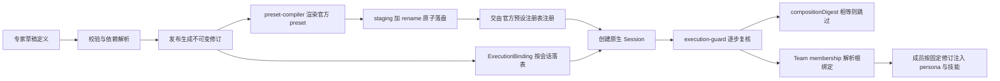
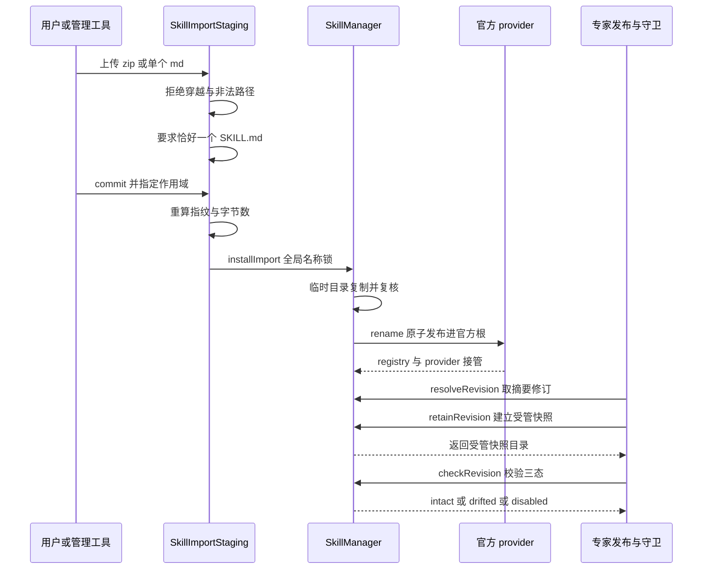

# WorkDSH 能力资产：专家、技能与连接器的修订固定

WorkDSH 把「专家」「技能」「连接器」并列为三类能力资产。三者在实现上分属三个插件，却共享同一条设计主线：**资产可以被作者反复修改，但一旦被任务引用就必须固定成一个不可变修订**；同时**运行目录与执行机制整体留给官方 DSH**，WorkDSH 只做声明、校验、冻结与选择。本篇只讨论这条主线，不展开页面与交互组织。

## 根因：能力不能只是一个可变配置对象

如果专家只是一份可变的配置对象、技能只是磁盘上一个随手可编辑的目录，长任务会遇到三个无法回避的问题：任务恢复或重启后读到的是「最新」而不是「当初」的配置；审计无法回答某次交付究竟用了哪个版本的技能；作者修改草稿会静默改变已经发布过的内容。WorkDSH 把这些问题前移到两个时刻解决——**发布**时把作者意图冻结成带摘要的修订，**任务建立**时把修订号写进一张持久绑定表。

契约层把这条边界写成了领域所有权表：专家「发布固定不可变修订」，技能由「官方 registry/provider 拥有运行目录」，连接器「官方 MCP/Tools/Credentials 拥有传输和运行」[apps/web/docs/CONTRACTS.md:17-19]()
<!-- anchor: | experts | 草稿、校验、发布、归档、解析执行；发布固定不可变修订 | … | connectors | 定义、实例、健康与发现、授权选择；官方 MCP/Tools/Credentials 拥有传输和运行 | -->
同一份契约还给出了跨领域的执行口径：任务建立时固定专家与技能修订、preset 指纹、模型、项目、资产和连接账号，恢复、fork、交接与每个子任务都重新解析授权，**不能回退到最新修订或其他连接账号** [apps/web/docs/CONTRACTS.md:29-29]()
<!-- anchor: 专家、应用或项目提供默认值，用户明确选择优先；组织限制始终单独约束。任务建立时固定专家/技能修订、preset 指纹、模型、项目、资产和连接账号。恢复、fork … 专家、应用或项目提供默认值，用户明确选择优先；组织限制始终单独约束。任务建立时固定专家/技能修订、preset 指纹、模型、项目、资产和连接账号。恢复、fork -->

## 专家：草稿与发布分离的不可变修订

专家这一层最厚，因为它同时承担「可编辑」与「可复现」两个互相拉扯的诉求。

### 专家记录只持有发布指针

存储 schema 把可变记录与不可变修订拆成两张表。`Expert` 上只有 CAS 令牌 `revision`、草稿令牌 `draftRevision` 与一个可选的 `publishedRevisionRef`，**没有内联的已发布定义正文** [packages/plugins/experts/src/storage/domain.ts:51-61]()
<!-- anchor: const expertSchema: z.ZodType<Expert> = z.object({ … teamParentId: bounded.optional(), -->

### 发布产出一份只增不改的 ExpertRevision

修订表把发布结果整体冻结：`definition`、`definitionDigest`、`dependencyLock`、`dependencyLockDigest`、`teamMembers`、`presetRevisionRef`、`compilerVersion`、`compositionDigest`、`publishedAt` 与 `publishedBy` 一起落盘 [packages/plugins/experts/src/storage/domain.ts:71-83]()
<!-- anchor: const revisionSchema: z.ZodType<ExpertRevision> = z.object({ … publishedBy: bounded, -->
契约注释把语义说得很直接——**永不覆盖，可被多个任务引用** [packages/contracts/src/experts.ts:152-166]()
<!-- anchor: /** One immutable published revision. Never overwritten; may be referenced by ma … readonly publishedBy: string; -->

三个摘要各管一件事，这是理解整套设计的关键：

- `definitionDigest` 锁作者意图，即定义本身；
- `dependencyLockDigest` 锁技能快照清单，即引用了哪些技能的哪个内容摘要；
- `compositionDigest` 锁**实际生成的官方 preset 文本字节**，而不是「应该生成什么」的意图摘要 [packages/contracts/src/experts.ts:152-166]()
<!-- anchor: /** One immutable published revision. Never overwritten; may be referenced by ma … readonly publishedBy: string; -->

契约同时把依赖清单的元素类型定义为含 `contentDigest` 的 `SkillRevisionRef`，即技能依赖在专家侧是**内容寻址**，而不是「名字指向最新」 [packages/contracts/src/experts.ts:152-166]()
<!-- anchor: /** One immutable published revision. Never overwritten; may be referenced by ma … readonly publishedBy: string; -->

修订 id 由四个输入共同派生：`definitionDigest`、`dependencyLockDigest`、编译出的 preset id 与 `compilerVersion`。同一份定义重复发布必然得到同一个 id，这让「重放发布」天然幂等 [packages/plugins/experts/src/services/experts-manager.ts:137-139]()
<!-- anchor: /** Deterministic revision id from the frozen definition, dependency lock and co … return `rev-${shortDigest({ definitionDigest: defDigest, dependencyLockDigest, p -->
`compilerVersion` 进入 id 派生这一点常被忽略：它意味着**编译器升级会让旧修订被判定为非当前版本**，从而触发迁移路径，而不是静默复用旧产物。

### 摘要计算必须跨进程稳定

整套机制完全押在摘要的确定性上，所以 WorkDSH 没有直接用 `JSON.stringify`，而是自己实现规范 JSON：对象键按字典序排序、数组保序、去掉无意义空白、`undefined` 省略 [packages/plugins/experts/src/domain/digest.ts:9-10]()
<!-- anchor: export function canonicalJson(value: unknown): string { … return stringify(value); -->
再由 `digestOf` 取 SHA-256，并用 12 位短摘要塞进 kebab-case 的 id [packages/plugins/experts/src/domain/digest.ts:40-46]()
<!-- anchor: export function digestOf(value: unknown): string { … return digestOf(value).slice(0, 12); -->
替代方案是复用现成的 canonical JSON 库；自实现的代价是要自己保证不引入浮点与键序差异，收益是零依赖且语义恰好够用。

### 校验把声明的技能名解析成冻结快照

`computeValidation` 是无副作用的：先跑结构与限额校验，再把主定义与**团队成员定义**里声明的每个 Skill 依赖解析成含 `contentDigest` 的 `SkillRevisionRef`，最后给出 `publishable` [packages/plugins/experts/src/services/experts-manager.ts:847-875]()
<!-- anchor: private async computeValidation(draft: ExpertDraft, signal?: AbortSignal): Promi … return { issues, definitionDigest: defDigest, dependencyLock, dependencyLockDige -->
不可解析、已停用或已漂移的依赖会变成 `DomainIssue` 出现在返回值里，**而不是被静默跳过**，这与「失败关闭」的整体口径一致，代价是用户必须先修好依赖才能发布。

发布时再复核一次：草稿修订号必须未变、`dependencyLockDigest` 必须与确认时一致，否则抛 `experts/conflict` 或 `experts/confirmation-stale` [packages/plugins/experts/src/services/experts-manager.ts:1103-1104]()
<!-- anchor: if (validation.dependencyLockDigest !== dependencyLockDigest) { … throw new ExpertsError('experts/confirmation-stale', '依赖已变化，请重新校验并确认后再发布。', { ex -->
通过后才为每个依赖建立受管快照、编译 preset，并把不可变修订写进表 [packages/plugins/experts/src/services/experts-manager.ts:1142-1162]()
<!-- anchor: // Freeze each declared Skill dependency into a retained, managed snapshot. … await this.revisionsTable().put(keys.revision(expertId, revisionId), revision); -->

### 发布权威只能来自可信用户动作

`ConfirmationStore` 实现了挑战、证明、消费三段式：签发挑战时绑定确切的两个摘要；`confirm` 只由可信 UI 用户动作调用；`publish` 在提交点消费证明，并重新比对摘要、主体、过期与一次性标记，任何一项不符即 `experts/confirmation-stale` 或 `experts/confirmation-required` [packages/plugins/experts/src/runtime/confirmation.ts:85-93]()
<!-- anchor: if (!record) throw new ExpertsError('experts/confirmation-required', '缺少发布确认，请在界 … if (!safeEqual(record.definitionDigest, check.definitionDigest) || !safeEqual(re -->
多付的代价是一次交互往返和一张进程内表，进程重启即失效；换来的是模型输出、prompt 文本或 `confirmed: true` 这类布尔值在结构上无法伪造发布权威。

与之配套，执行计划、草稿交接与导入预检刻意**不做持久化**：它们有 TTL，丢了只需用户重新准备；真正的幂等与崩溃恢复放在 `operations` 表 [packages/plugins/experts/src/runtime/plans.ts:2-5]()
<!-- anchor: * Short-lived, process-local stores for execution plans, draft handoffs and … * recovery live in the `operations` table, not here. -->
把短生命周期票据与持久幂等对象分开，避免为一次性对象设计恢复协议。

## preset 编译：把专家定义变成官方可加载的组合

专家修订本身不能执行，它必须先编译成一个官方 preset。这一节回答「编译产物为什么必须是内容寻址的」。

### 编译器版本与确定性标识

编译产物是官方 `PresetDefinition`，编译器自带语义版本 `COMPILER_VERSION`，而这个常量同时参与 preset id 与修订 id 的派生 [packages/plugins/experts/src/runtime/preset-compiler.ts:13-14]()
<!-- anchor: /** Expert revisions declare official presets; Loader and AgentPresetRegistry ow … export const COMPILER_VERSION = 'workdsh-expert-compiler/0.4-declarative-presets -->
`presetIdFor` 把编译器版本、基础 preset、定义、技能快照目录、是否禁用默认技能扫描以及团队成员修订一起喂进短摘要，拼成 `wd-exp-<kebab>-<digest>`，**同样内容必然得到同样的 id** [packages/plugins/experts/src/runtime/preset-compiler.ts:65-74]()
<!-- anchor: export function presetIdFor(input: CompileInput): string { … return `wd-exp-${kebab(input.expertId)}-${digest}`; -->
这是幂等编译的地基：发布重试、并发发布、编译器迁移都靠 id 相等来判断能否复用。

### 原子落盘与注册

编译在一个 `mkdtemp` 出来的 staging 目录里完成，写入 `preset.json`、清单与专家包资源，最后用一次 `rename` 原子落到正式目录；若另一个发布者先到一步，则回退到「校验既有不可变产物」的分支，而不是覆盖它 [packages/plugins/experts/src/runtime/preset-compiler.ts:146-171]()
<!-- anchor: const staging = await mkdtemp(presetDir + '.staging-'); … } finally { await rm(staging, { recursive: true, force: true }); } -->
这套「staging 加 rename、冲突即复核」的模式在同仓多处复用，代价是每次编译都要多一次目录创建与清理。

注册路径同样先校验再注册：读到 `preset.json` 后先比对期望摘要，不符即 `experts/preset-drift` [packages/plugins/experts/src/runtime/preset-compiler.ts:98-99]()
<!-- anchor: const text = await readExpertPreset(presetId, agentsHome); … if (sha256(text) !== expectedDigest) throw Object.assign(new Error('专家预设内容已变化，请重 -->
校验通过后才交给官方 `agentPresets.register`，激活权仍在官方 Loader 与 Registry。

### 旧目录预设必须显式重新发布

如果某个历史修订的 preset 目录已经不存在，读取会抛出带稳定 code 的 `experts/preset-broken`，提示文案明确写着**此专家为旧目录预设，请重新发布后创建新任务，历史任务不会自动换用新组合** [packages/plugins/experts/src/runtime/preset-compiler.ts:89-93]()
<!-- anchor: export async function readExpertPreset(presetId: string, agentsHome?: string): P … throw error; -->
换言之，WorkDSH 选择了「宁可拒绝执行，也不猜一个新组合」；代价是升级后用户需要手动重新发布一次，CHANGELOG 也把这条写成了已知行为 [packages/plugins/experts/CHANGELOG.md:10-10]()
<!-- anchor: - 适配 DeepSeek Harness 0.1.7-alpha.1、Cordis 4.0.3，更新精确依赖。 专家使用官方声明式预设注册表，冻结配置并在重启 … - 适配 DeepSeek Harness 0.1.7-alpha.1、Cordis 4.0.3，更新精确依赖。 专家使用官方声明式预设注册表，冻结配置并在重启 -->

## 执行绑定：任务建立时把修订钉死

下面这张图给出本篇的主链路。它的重点是：**专家定义只有先变成不可变修订、再变成官方 preset，才可能被任务引用；而任务引用的是修订号，不是专家名**。

图中两条支线值得单独说明：`E` 与 `G` 是**两个独立的持久事实**，preset 目录在文件系统里，绑定行在存储域里，任何一边漂移都会被检测出来；`K` 则是官方 Team 成员的资产继承入口，**成员不写自己的绑定行**，而是回落到根会话的绑定。

### 绑定表是执行事实的唯一来源

`ExecutionBinding` 以 `sessionId` 为键，冻结 `expertRevisionRef`、`presetRevisionRef`、`compositionDigest`、`skillRevisionRefs`、owner 与 `creationOperationId` [packages/plugins/experts/src/storage/domain.ts:86-102]()
<!-- anchor: const bindingSchema: z.ZodType<ExecutionBinding> = z.object({ … createdAt: iso, -->
契约注释写明它的生命周期语义：**任务创建前预留，之后永不重绑** [packages/contracts/src/experts.ts:201-218]()
<!-- anchor: /** Durable Session → expert-revision binding. Reserved before task creation; ne … readonly createdAt: string; -->
`delegation` 字段仍留在类型里，含父会话与父 composition digest，但 schema 注释说明它只是「读旧数据而不重写用户数据」的兼容字段 [packages/plugins/experts/src/storage/domain.ts:86-102]()
<!-- anchor: const bindingSchema: z.ZodType<ExecutionBinding> = z.object({ … createdAt: iso, -->

### 创建路径与幂等恢复

`createExecution` 先看是否已有一条 committed 操作记录，命中就直接重放，连一次性 plan 都不需要 [packages/plugins/experts/src/services/experts-manager.ts:1383-1394]()
<!-- anchor: const binding: ExecutionBinding = { … await this.bindingsTable().put(keys.binding(boundSessionId), binding); -->
真正创建时，sessionId 由 `operationId` 的摘要派生，因此**同一个 operationId 最多产生一个原生 Session**，重试不会留下孤儿任务 [packages/plugins/experts/src/services/experts-manager.ts:1359-1360]()
<!-- anchor: const sessionId = `session-${digestOf(context.operationId).slice(0, 32)}`; … const prior = this.bindingsTable().get(keys.binding(sessionId)); -->
随后写入 binding，其中的 `compositionDigest` 与 `skillRevisionRefs` 直接取自那个已固定的修订 [packages/plugins/experts/src/services/experts-manager.ts:1383-1394]()
<!-- anchor: const binding: ExecutionBinding = { … await this.bindingsTable().put(keys.binding(boundSessionId), binding); -->

### 执行守卫在每一步复核

`verifyBinding` 是运行时唯一入口。它先确认存在绑定行，**未绑定或派生会话在这里被直接拒绝**；再确认主体与组织一致 [packages/plugins/experts/src/services/experts-manager.ts:1585-1586]()
<!-- anchor: if (binding.owner.ownerPrincipalId !== actor.principalId || binding.owner.organi … throw new ExpertsError('experts/forbidden', '没有权限校验该任务的专家绑定。'); -->
接着确认修订的 preset id、composition digest 与依赖清单摘要同绑定逐项一致，最后逐项校验每个技能依赖的快照状态 [packages/plugins/experts/src/services/experts-manager.ts:1579-1596]()
<!-- anchor: async verifyBinding(actor: ActorContext, sessionId: string, signal?: AbortSignal … return binding; -->

技能依赖校验刻意把**完整性、来源启停、当前授权**分开：`drifted`、`missing` 与 `source-uninstalled`、`source-disabled`、`forbidden` 各自映射到不同的稳定错误码，绝不合并成一个「不可用」 [packages/plugins/experts/src/services/experts-manager.ts:1604-1610]()
<!-- anchor: for (const ref of revision.dependencyLock) { … if (check.status === 'forbidden') throw new ExpertsError('experts/forbidden', '当 -->
这正是官方契约所说的「冻结内容不等于冻结权限」——快照是死的，来源状态与使用授权是活的。

`execution-guard` 把校验接到官方的两个生命周期上：`agent/created` 与 `agent/pre-step`。它先从官方 Team 的 membership 解析出根会话 [packages/plugins/experts/src/runtime/execution-guard.ts:17-19]()
<!-- anchor: const membership = ctx.agentTeams.tryMembership(agent); … const header = agent.session.header; -->
再确认原生 Session header 上的 `agentPreset` 与绑定里的 `presetRevisionRef` 完全一致，不一致即 `experts/conflict` [packages/plugins/experts/src/runtime/execution-guard.ts:36-40]()
<!-- anchor: if (role.binding.presetRevisionRef !== header.agentPreset) throw new ExpertsErro … if (childActor.principalId !== actor.principalId || childActor.organizationId != -->
若已按同一个 `compositionDigest` 注入过，就直接返回，避免每一步重复挂载 [packages/plugins/experts/src/runtime/execution-guard.ts:44-49]()
<!-- anchor: if (installed.get(agent) === revision.compositionDigest) return; … if (!skills) throw new ExpertsError('experts/dependency-missing', '固定专家组合缺少技能目录。 -->
真正注入时，它只读自己已经验证过的不可变 preset，而不是任意插件，并把 persona 与技能目录挂到**官方 Agent scope** 上，由官方负责这些 provider 的释放 [packages/plugins/experts/src/runtime/execution-guard.ts:52-58]()
<!-- anchor: // The official Agent scope owns these providers and their disposal. … await skillFiles; -->
代价是每一步都要读一次绑定、比对若干摘要；收益是「静默切到最新修订」在结构上不可能发生。

### Team 子任务的资产继承并非 delegation

这里需要纠正一个容易形成的印象：`delegation` 字段**不代表当前的继承机制**。`verifyBinding` 一旦发现 binding 带 `delegation` 就直接抛 `experts/unsupported-capability`，文案是「旧版专家团执行器已退役」 [packages/plugins/experts/src/services/experts-manager.ts:1588-1588]()
<!-- anchor: if (binding.delegation) throw new ExpertsError('experts/unsupported-capability', … if (binding.delegation) throw new ExpertsError('experts/unsupported-capability', -->
当前的真实机制是：成员不拥有自己的绑定行，`resolveNativeRole` 通过官方 Team membership 找到根会话，用根会话的 binding 做校验，再按 `teamMembers[memberName]` 取出该成员的**固定成员修订** [packages/plugins/experts/src/services/experts-manager.ts:1557-1563]()
<!-- anchor: /** Asset resolution only; official Team owns roster, child creation and message … if (owner.availability !== 'enabled') throw new ExpertsError('experts/disabled', -->
所以「子任务继承父会话的 composition digest」这件事确实存在，但载体是官方 Team 的 membership 与 `teamMembers` 映射，而不是 `delegation` 记录。旧字段保留只为识别历史数据 [packages/plugins/experts/README.md:34-34]()
<!-- anchor: 用户的专家、技能、发布修订、文件和旧任务历史保留。旧版委派子任务不再续跑旧调度器，应从专家团重新召唤官方 Team 任务。旧团队运行表不会转写成伪造的官方执行记 … 用户的专家、技能、发布修订、文件和旧任务历史保留。旧版委派子任务不再续跑旧调度器，应从专家团重新召唤官方 Team 任务。旧团队运行表不会转写成伪造的官方执行记 -->

### 一条不对齐的迁移路径

有一个例外值得如实记录：`ensureCurrentExecutionRevision` 会在**召唤时**为旧 `compilerVersion` 的团队修订就地派生一个新修订，并把 `publishedRevisionRef` 前移，同时保证已有 Session 继续使用旧绑定 [packages/plugins/experts/src/services/experts-manager.ts:440-448]()
<!-- anchor: private async ensureCurrentExecutionRevision(actor: ActorContext, revision: Expe … if (current.compilerVersion === COMPILER_VERSION && current.definitionDigest === -->
它只对含 `team` 的定义生效。也就是说，团队型旧专家可以自动获得新编译产物，而非团队型旧专家只能走上面那条 `experts/preset-broken` 到手动重新发布的路径。「发布后不可改」在这里让位于「升级后仍然可用」，这是一个有意为之、但确实削弱了统一性的取舍。

## 技能：管理层与运行目录分离

技能这一层的边界感最强：**WorkDSH 拥有管理数据，官方拥有运行目录**。

### 谁拥有什么

构造 `SkillManager` 时把两个官方技能根定义为可管理的 `activeRoots`，即 `<agentsHome>/skills` 与 `<dshHome>/skills`，而把 WorkDSH 自己的禁用区、回收站、状态区、锁与草稿全部放在 `<agentsHome>/.workdsh-state/skills` 之下 [packages/plugins/skills/src/services/manager.ts:175-180]()
<!-- anchor: const dshHome = resolve(options.dshHome ?? process.env.DSH_HOME ?? join(homedir( … this.stateRoot = join(agentsHome, '.workdsh-state', 'skills'); -->
列表同样以官方注册表为真源：先 `ctx.skills.list()` 取官方发现结果，再判断哪些落在可管理根内；落在受管根之外的条目一律标成 `readonly`，**不能修改** [packages/plugins/skills/src/services/manager.ts:196-206]()
<!-- anchor: const skills = await this.ctx.skills.list({ signal }); … catch (error) { if ((error as NodeJS.ErrnoException).code === 'ENOENT' || (error -->
`isSafeManagedFile` 用 `realpath` 做最终判定，符号链接解析后仍须落在受管根内 [packages/plugins/skills/src/services/manager.ts:751-757]()
<!-- anchor: private async isSafeManagedFile(path: string, explicitRoot?: string): Promise<bo … if (inside(await realpath(root), resolvedPath)) return true; -->

这样做的代价是必须精确跟随官方 registry 的 `list`、`get`、`path`、`state` 等 API，任何官方侧语义变化都会直接打到这一层；收益是不存在第二套技能注册表，也就不会出现「两个 provider 各自发现同一技能、谁是赢家取决于加载顺序」的问题。

### 导入：从上传到原子发布

导入被拆成 staging 与 commit 两个可审计阶段。

staging 阶段的路径校验是自写的：统一分隔符、拒绝绝对路径与盘符、拒绝 `..` 段、过滤 `__MACOSX` 与 `.DS_Store`、限制深度 [packages/plugins/skills/src/services/import-staging.ts:17-24]()
<!-- anchor: function safeArchivePath(raw: string): string | undefined { … return segments.join('/'); -->
解压阶段再做一次越界检查，要求解析后的目标仍在 staging 目录内，并用 `wx` 独占标志写入，重复路径直接报错 [packages/plugins/skills/src/services/import-staging.ts:94-102]()
<!-- anchor: for (const [raw, bytes] of Object.entries(files)) { … await writeFile(destination, bytes, { flag: 'wx', mode: 0o600 }); -->
commit 时**重新读取 receipt 并重算源指纹**，指纹、名称或总字节任一不符即 `skill/import-verification-failed`，这也顺手挡住了 staging 目录被替换的 TOCTOU 场景 [packages/plugins/skills/src/services/import-staging.ts:167-177]()
<!-- anchor: private async readReceipt(id: string, signal?: AbortSignal): Promise<Receipt> { … return receipt; -->
commit 只负责把已经预检过的源交给安装路径，然后删除 staging 目录 [packages/plugins/skills/src/services/import-staging.ts:146-152]()
<!-- anchor: async commit(id: string, scope?: SkillInstallScope, signal?: AbortSignal): Promi … return installed; -->

真正落盘在 `installImport`：先看**名字锁**，`detail(name)` 会命中所有官方根与 bundled 或 remote provider，避免造出第二个候选者让胜负取决于 provider 顺序；然后在官方根下建临时目录、复制、再次校验 frontmatter name 与指纹，最后 `rename` 原子发布 [packages/plugins/skills/src/services/manager.ts:440-456]()
<!-- anchor: return this.withSkillLock(name, async () => { … return { name, state: 'enabled', path: target }; -->

### 草稿、发布、启停与卸载

`validateDocument` 是唯一的 SKILL.md 校验入口：frontmatter 必须可解析，`name` 必须是合法 kebab-case 且通过官方的 `isSkillName`，`description` 不能为空；注释还解释了为什么目录名可以不同于 frontmatter name——官方 loader 认的是 frontmatter [packages/plugins/skills/src/services/manager.ts:308-323]()
<!-- anchor: validateDocument(document: string, expectedName?: string): SkillValidationResult … return { valid: diagnostics.length === 0, ...(name ? { name } : {}), ...(descrip -->
`publishDraft` 在锁内做二次幂等校验，草稿修订号未变且目标不存在才继续，原子写入后再把内容读回来验证一次 [packages/plugins/skills/src/services/manager.ts:357-361]()
<!-- anchor: async publishDraft(id: string, expectedRevision: string): Promise<SkillMutationR … if (!validation.valid) throw new Error('skill/draft-invalid'); -->
[packages/plugins/skills/src/services/manager.ts:368-375]()
<!-- anchor: await this.assertAbsent(target); await this.assertAbsent(`${target}.md`); … return { name: draft.name, state: 'enabled', path: target }; -->
启停是**同盘重命名**而非删除，在 enabled 与 disabled 之间移动并记录原始位置以便还原，这与「归档和卸载保留历史引用」的口径一致。

### 修订租约：把技能变成可冻结依赖

这是技能与专家之间的接缝，也是 `SkillRevisionProvider` 契约的全部内容 [packages/plugins/skills/src/services/manager.ts:815-819]()
<!-- anchor: // ── Cross-domain revision capability (D04 dependency adaptation) ────────── … // checkRevision still reports a disabled/uninstalled source so the expert refus -->

- `resolveRevision` 对 SKILL.md 与资源做内容摘要，产出 `rev-` 前缀加摘要前 24 位；若来源已停用或非法则直接拒绝，**不允许把一个不能用的技能冻结进专家** [packages/plugins/skills/src/services/manager.ts:830-838]()
<!-- anchor: async resolveRevision(skillId: string, expectedDigest?: string, signal?: AbortSi … return { skillId, revisionId: `rev-${contentDigest.slice(0, 24)}`, name: skillId -->
- `retainRevision` 在 `.workdsh-state/skills/retained-revisions` 下建立受管快照并维护消费者清单；已存在且摘要一致的快照只追加消费者，**不重新复制** [packages/plugins/skills/src/services/manager.ts:841-869]()
<!-- anchor: async retainRevision(ref: SkillRevisionRef, consumer: SkillConsumerRef, signal?: … return { ref, snapshotDir, files: source.files, retainedBy }; -->
- `checkRevision` 把「快照是否完整」与「来源是否仍启用或安装」分成两个维度判断 [packages/plugins/skills/src/services/manager.ts:873-892]()
<!-- anchor: async checkRevision(ref: SkillRevisionRef, _actor: unknown, signal?: AbortSignal … return { ref, status, retained, ...(retained ? { snapshotDir } : {}), ...(status -->
- `releaseReference` 只有在最后一个可达引用被释放后才真正删除快照，实现引用计数式清理 [packages/plugins/skills/src/services/manager.ts:895-907]()
<!-- anchor: async releaseReference(ref: SkillRevisionRef, consumer: SkillConsumerRef, _signa … await this.writeJson(manifestPath, { ...manifest, retainedBy }); -->

「冻结内容不冻结权限」这句契约注释 [packages/plugins/skills/src/services/manager.ts:815-819]()
<!-- anchor: // ── Cross-domain revision capability (D04 dependency adaptation) ────────── … // checkRevision still reports a disabled/uninstalled source so the expert refus -->
解释了一个容易被误认为缺陷的行为：用户卸载某技能后，依赖它的专家任务会拒绝执行，而不是继续用快照跑。快照解决的是「内容漂移」，不是「授权撤回」。

### 从导入到被任务命中

下面的时序图把技能从上传到进入任务执行串起来。关键点是：WorkDSH 在 `rename` 之后就**退出运行目录的所有权**，官方 registry 与 provider 接管发现和执行；专家侧只通过内容摘要修订与之耦合。

图中的 `O` 与 `E` 之间**没有直接调用**：官方 provider 不知道专家的存在，专家也不去读技能的私有目录，两者只通过 `rev-` 摘要与受管快照目录耦合 [packages/plugins/skills/src/services/manager.ts:815-819]()
<!-- anchor: // ── Cross-domain revision capability (D04 dependency adaptation) ────────── … // checkRevision still reports a disabled/uninstalled source so the expert refus -->

### 管理接口的形态

技能的 Host 服务通过官方 Client Connection 的精确 Fetch route 暴露：`/api/workdsh-skills` 处理一元 RPC，`/api/workdsh-skills/import` 走流式上传，图标走带 rev 参数的 GET [packages/plugins/skills/src/services/connection-api.ts:139-142]()
<!-- anchor: /** Register the management API inside Connection's authenticated `/api` carrier … const manager = ctx.workdshSkills; -->
契约文档直言这是适配当前生成器兼容限制的做法，**不构成新的通用 transport** [apps/web/docs/CONTRACTS.md:47-47]()
<!-- anchor: 技能管理使用官方 Client Connection 的精确 JSON/流式 Fetch route 适配当前生成器兼容限制；Host 校验 payload、来 … 技能管理使用官方 Client Connection 的精确 JSON/流式 Fetch route 适配当前生成器兼容限制；Host 校验 payload、来 -->

### SkillHub 是第三方目录

SkillHub 不在本仓库实现。前端只是向同源相对路径 `./skillhub` 发 POST，复用已安装插件提供的检索与安装路径 [packages/plugins/skills/src/client/SkillHubPanel.tsx:25-33]()
<!-- anchor: async function skillHub<T extends { ok: boolean; error?: string }>(method: strin … return result; -->
该第三方插件在桌面打包边界里被显式 pin 住 [apps/desktop/scripts/workdsh-package-boundary.mjs:18-21]()
<!-- anchor: // Keep the already shipped community catalog integrations on the same Profile. … dshmarket: '1.66.8', -->
并在运行时组合校验中要求其存在 [apps/desktop/scripts/prepare-workdsh-runtime.mjs:72-73]()
<!-- anchor: for (const id of ['skillhub', 'dsh-market']) { … if (!config.stdout.includes('id: ' + id)) throw new Error('Missing community cat -->
第三方声明文件同时说明 SkillHub 的目录与 API 由外部项目维护，许可与兼容性由来源决定 [apps/desktop/THIRD_PARTY_NOTICES.md:16-24]()
<!-- anchor: - [`@cocofhu/skillhub`](https://www.npmjs.com/package/@cocofhu/skillhub) … [`Tencent/skillhub`](https://github.com/Tencent/skillhub). The plugin catalog -->
因此「技能浏览器里能装什么」不是 WorkDSH 的能力承诺，而是外部目录与用户选择的组合。

### 目录浏览只提供数据

本地目录是 WorkDSH 自己拥有的一块只读视图，落在共享 Agents home 下的 `catalog.json`、`icons/` 与 `payloads/`；store 只负责元数据、图标字节与负载路径解析，**安装本身仍然走技能管理器的导入路径**，从而让官方保持发现与执行的所有权 [packages/plugins/skills/src/services/catalog.ts:9-12]()
<!-- anchor: * The catalog is plain data below the shared Agents home (`catalog.json`, … * import path so Harness remains the discovery and execution owner. -->
负载路径同样做越界与符号链接检查，任何一个不满足就当作「无此负载」，而不是硬失败 [packages/plugins/skills/src/services/catalog.ts:143-155]()
<!-- anchor: async payloadPath(name: string): Promise<string | undefined> { … return target; -->

## 连接器：只声明与选择，不拥有传输

连接器把「声明」与「运行」分得最干净：WorkDSH 存定义与选择，官方 MCP client 存传输、发现与重连。

插件显式注入官方服务，包括 `mcpResources`、`credentials`、`agents` 与 `tools` [packages/plugins/connectors/src/index.ts:14-15]()
<!-- anchor: export const name = 'workdsh-plugin-connectors'; … export const inject = ['connection', 'tools', 'mcpResources', 'storageDomain', ' -->
管理器类的注释把职责划清：**持久化连接器实例在这里，协议、传输、发现与重连交给官方 MCP client** [packages/plugins/connectors/src/manager.ts:34-36]()
<!-- anchor: /** Persist connector instances here; delegate protocol, transport, discovery an … static inject = ['storageDomain', 'tools', 'mcpResources', 'agents', 'credential -->

### 两张表、两个 domain

连接定义与会话选择被拆成两个独立 domain：定义域只有 `definitions` 表，选择域只有 `selections` 表，注释写明**会话选择的生命周期独立于已安装的 MCP 定义** [packages/plugins/connectors/src/storage.ts:21-24]()
<!-- anchor: export const connectorSelectionSchema = z.object({ … updatedAt: z.string().min(1), -->
选择项 schema 限制每个会话最多 32 个连接器，与「一个会话一次只开放选定命名空间」的运行模型对应。

### 凭据只存引用

`config` 只向凭据服务询问是否已配置、是否可写，从不返回明文 [packages/plugins/connectors/src/manager.ts:76-83]()
<!-- anchor: async config(id: string): Promise<ConnectorConfigView> { … authorizationConfigured: credential.configured, authorizationWritable: credentia -->
启动时解析凭据得到 Authorization 头或 stdio 最小环境，然后把官方 `McpClient` 作为子 fiber 挂载，配置里带上工具调用超时、指令字节上限与重连参数 [packages/plugins/connectors/src/manager.ts:160-173]()
<!-- anchor: const authorization = definition.authorizationCredentialRef … reconnect: { enabled: true, initialDelayMs: 250, maxDelayMs: 5_000, maxAttempts: -->
凭据缺失不会降级成匿名连接，而是把状态置为 `offline` 并抛 `connector/authorization-missing` [packages/plugins/connectors/src/manager.ts:160-173]()
<!-- anchor: const authorization = definition.authorizationCredentialRef … reconnect: { enabled: true, initialDelayMs: 250, maxDelayMs: 5_000, maxAttempts: -->

### 健康来自真实发现而非配置存在

`health` 用 `mcp__` 前缀反查官方工具表；没有工具名时报告 `discovering`，有工具名后再尝试调用官方的资源列举工具，并把「资源能力缺失」与「连接失败」区分开，因此一个工具可用的服务器不会因为没有资源端点被误报离线 [packages/plugins/connectors/src/manager.ts:191-196]()
<!-- anchor: private async health(definition: ConnectorDefinition, signal?: AbortSignal): Pro … if (!toolNames.length) return { state: 'discovering', toolNames, resourceCount:  -->

### 选择与隔离

`setSelection` 每次读写前都调用 `workdshSessionAccess.inspect` 做会话归属校验，并且只允许选择处于 `ready` 的连接器；缺 SessionAccess 直接失败，不做「无校验降级」 [packages/plugins/connectors/src/manager.ts:141-152]()
<!-- anchor: async setSelection(sessionId: string, connectorIds: readonly string[]): Promise< … return unique; -->
隔离的实现是**按前缀 deny**：把该会话未选中的连接器对应的所有 `mcp__<server>__*` 工具名收集起来，交给官方 `agent.ctx.tools.restrict({ deny })` [packages/plugins/connectors/src/manager.ts:247-254]()
<!-- anchor: private applyRestriction(agent: Agent): void { … if (denied.length) this.restrictions.set(agent, agent.ctx.tools.restrict({ deny: -->
它同时挂在 `agent/created` 上，保证新会话从第一步起就是最小工具面。

代价有两处：一是健康检查依赖真实工具调用，因此需要至少一个已选中该连接器的会话，否则只能报「工具已连接，资源检查未完成」 [packages/plugins/connectors/src/manager.ts:191-196]()
<!-- anchor: private async health(definition: ConnectorDefinition, signal?: AbortSignal): Pro … if (!toolNames.length) return { state: 'discovering', toolNames, resourceCount:  -->
二是与官方 MCP 与 Credentials 的 API 形态强耦合，官方改动会直接穿透到这一层。

## Agent 工具的统一管道

能力资产最终要通过工具被模型使用，所以工具管道是这条主线的出口。

### 严格 schema 与 presentation 分离

工具用官方 `defineTool` 定义，参数与输出都是严格 JSON schema，并单独提供 `render` 把结果转成人类可读文本。以资料库发布为例：参数里显式带 `user_confirmed`，工具描述写明只有用户已明确确认发布时才能为 true [packages/plugins/library/src/tools/library-tools.ts:73-75]()
<!-- anchor: name: 'library_publish_revision', … parameters: { draft_id: { type: 'string', required: true }, expected_revision: { -->
Office 的导出工具同理，输出 schema 固定为 documentId、revision、path 与 status 为 presented，并把「官方 bash 审批与 present」写进描述 [packages/plugins/office/src/content/tools.ts:235-257]()
<!-- anchor: "Export a committed PDF working copy as its actual PDF file, or HTML webpage as  … exec.signal, -->
技能侧的草稿工具则把「保存草稿」与「安装或覆盖技能」明确切开，参数注释直接声明**永不安装或覆盖** [packages/plugins/skills/src/services/lifecycle-tools.ts:30-32]()
<!-- anchor: ctx.tools.register(defineTool({ … description: 'Create or revise a private WorkDSH skill draft. This never install -->
发布工具在执行体里先 `exec.signal.throwIfAborted()`，再校验 `user_confirmed`，缺一即抛稳定错误码 [packages/plugins/skills/src/services/lifecycle-tools.ts:93-94]()
<!-- anchor: exec.signal.throwIfAborted(); … if (!args.user_confirmed) throw new Error('skill/publish-confirmation-required') -->
这套约定被写进契约：**严格 schema、规范 JSON、模型内容与独立 UI presentation**，且原生与 PTC 调用经过同一 guard、授权、approval、审计与结算 [apps/web/docs/CONTRACTS.md:49-49]()
<!-- anchor: Agent 工具定义严格 schema、规范 JSON、模型内容和独立 UI presentation；原生与 PTC 调用经过同一 guard、授权、appr … Agent 工具定义严格 schema、规范 JSON、模型内容和独立 UI presentation；原生与 PTC 调用经过同一 guard、授权、appr -->

### 同一处授权、同一处结算

`ToolAccessBridge` 把官方工具管线接到 WorkDSH 的身份、会话归属、Access 与审计上：通过 `tools/pre-execute` 钩子统一授权，通过 `tools/result` 钩子统一结算审计 [packages/plugins/access/src/index.ts:569-572]()
<!-- anchor: ctx.on('tools/pre-execute', async (exec, next) => this.authorizeTool(exec, next) … return undefined; -->
授权失败时它返回官方的 deny 决策而不是抛异常，并把拒绝原因以稳定 code 写进审计 [packages/plugins/access/src/index.ts:583-609]()
<!-- anchor: private async authorizeTool(exec: ToolExecution, next: () => Promise<PreToolDeci … return next(); -->
结算时它区分三种结局：结果错误码含 ABORTED 记为 `cancelled`，其他错误记为 `failed`，成功记为 `succeeded`；审计写入串行化为一条尾链，避免并发工具把审计顺序打乱 [packages/plugins/access/src/index.ts:612-624]()
<!-- anchor: private observeResult(exec: Readonly<ToolExecution>, result: Readonly<ToolExecut … this.resultAuditTail = this.resultAuditTail.then(append, append); -->
这解释了为什么「取消」能被独立审计：它不是失败的一种，而是有自己结论的终态。

工具的取消语义统一走 `exec.signal`，上文多处工具实现都显式检查；而**一旦发布了后台 Job，取消与结算就交给 Job 生命周期拥有**，工具不再自己声明完成 [apps/web/docs/CONTRACTS.md:49-49]()
<!-- anchor: Agent 工具定义严格 schema、规范 JSON、模型内容和独立 UI presentation；原生与 PTC 调用经过同一 guard、授权、appr … Agent 工具定义严格 schema、规范 JSON、模型内容和独立 UI presentation；原生与 PTC 调用经过同一 guard、授权、appr -->

## 权衡主线

把「能力」做成有修订号的资产，本质是**用写时成本换读时确定性**。

**收益侧**是三件事同时成立：可复现，绑定表记下任务当初用的每一个修订与摘要；可审计，发布、执行与绑定校验各自落审计事件；可并发，内容寻址让重复发布与并发发布收敛到同一 id。

**代价侧**同样清晰：

- **摘要与校验开销**：定义、依赖清单、preset 文本三套摘要，加上每一步 `agent/pre-step` 的绑定复核与每个技能依赖的快照状态检查，这些都落在热路径上。
- **发布后不可改**：修订一旦写表就不覆盖，只能发新修订；改一个字也要走完整校验与用户确认。
- **旧任务不会自动升级**：绑定表加上官方 header 的 `agentPreset` 双重比对，让「悄悄用上新版本」在结构上不可能，因此旧目录预设只能显式重新发布 [packages/plugins/experts/src/runtime/preset-compiler.ts:89-93]()
<!-- anchor: export async function readExpertPreset(presetId: string, agentsHome?: string): P … throw error; -->
- **需要迁移补丁**：团队型旧修订走 `ensureCurrentExecutionRevision` 自动派生新编译产物 [packages/plugins/experts/src/services/experts-manager.ts:440-448]()
<!-- anchor: private async ensureCurrentExecutionRevision(actor: ActorContext, revision: Expe … if (current.compilerVersion === COMPILER_VERSION && current.definitionDigest === -->
而非团队型旧修订只能手动重新发布，同一个产品里出现了两种升级体验。

**替代方案与为何不选**：可以把摘要换成「专家名加发布时间」这类弱标识，代价是无法检测内容漂移；可以把技能依赖换成「引用最新技能」，代价是历史任务结果不可复现；可以让 WorkDSH 自建技能注册表与执行目录，代价是要与官方 provider 争夺发现权并维护一套并行的加载顺序语义。「技能运行目录归官方」正是为了避免最后这一项，代价则是与官方 registry、provider 和 Connection 的 API 形态强耦合，官方接口一改，技能的发现、导入与管理路由都要同步跟改。

## 全局关联

- **资产引用的资料**：专家定义里引用的资料，以及任务建立时钉住的那一版修订，见 [`material-deliverables.md`](material-deliverables.md)。
- **绑定真正落在哪张表**：执行绑定、修订与租约状态对应的域表与字段，见 [`data-model.md`](data-model.md)。
- **谁在执行前复核**：`execution-guard` 的逐步复核与 `access` 的工具入口拦截在同一次工具调用上相遇，可信身份与授权上下文见 [`enterprise-identity.md`](enterprise-identity.md)。
- **装载方式**：技能与专家本身就是插件，其 `bundle`/`client` 声明、`exports` 分流与 patch 分层见 [`plugin-architecture.md`](plugin-architecture.md)。

## 边界与不足

- **模块状态尚未宣告完成**：专家与连接器在模块清单里是 `in_progress`，只有技能是 `implemented` [apps/web/docs/modules.json:65-66]()
  <!-- anchor: "title": "专家管理", … "status": "in_progress", -->
  [apps/web/docs/modules.json:86-88]()
  <!-- anchor: "path": "../../packages/plugins/skills", … "status": "implemented", -->
  [apps/web/docs/modules.json:110-111]()
  <!-- anchor: "title": "连接器管理", … "status": "in_progress", -->
  产品 README 也明确说这是 alpha 预览，跨平台安装、长跑真实模型团队、任意 Office 保真度与多用户治理都未完全验收 [apps/web/README.md:111-111]()
  <!-- anchor: This is an alpha preview. Cross-platform installation, long-running real-model t … This is an alpha preview. Cross-platform installation, long-running real-model t -->
- **旧目录式专家预设必须显式重新发布**，且历史任务不会自动换用新组合；错误路径与提示语都是设计的一部分，不是临时兜底 [packages/plugins/experts/src/runtime/preset-compiler.ts:89-93]()
  <!-- anchor: export async function readExpertPreset(presetId: string, agentsHome?: string): P … throw error; -->
- **`delegation` 字段已被退役**：绑定里一旦存在该字段就拒绝执行，官方 Team 任务需要从专家团重新召唤，旧团队运行表不会转写成官方执行记录 [packages/plugins/experts/src/services/experts-manager.ts:1588-1588]()
  <!-- anchor: if (binding.delegation) throw new ExpertsError('experts/unsupported-capability', … if (binding.delegation) throw new ExpertsError('experts/unsupported-capability', -->
  [packages/plugins/experts/README.md:34-34]()
  <!-- anchor: 用户的专家、技能、发布修订、文件和旧任务历史保留。旧版委派子任务不再续跑旧调度器，应从专家团重新召唤官方 Team 任务。旧团队运行表不会转写成伪造的官方执行记 … 用户的专家、技能、发布修订、文件和旧任务历史保留。旧版委派子任务不再续跑旧调度器，应从专家团重新召唤官方 Team 任务。旧团队运行表不会转写成伪造的官方执行记 -->
  这使「子任务继承 composition digest」的现役机制只能通过官方 membership 与 `teamMembers` 说明，而不能沿用更直觉的 delegation 说法。
- **技能管理走的是精确 route 适配，文档自己承认这是兼容性妥协**：它复用官方 Client Connection 的认证 Fetch 扩展面，但明确不形成新的通用 transport，并记录了外部 workspace 的 Typert 生成问题 [apps/web/docs/CONTRACTS.md:47-47]()
  <!-- anchor: 技能管理使用官方 Client Connection 的精确 JSON/流式 Fetch route 适配当前生成器兼容限制；Host 校验 payload、来 … 技能管理使用官方 Client Connection 的精确 JSON/流式 Fetch route 适配当前生成器兼容限制；Host 校验 payload、来 -->
  [packages/plugins/skills/README.md:67-67]()
  <!-- anchor: 管理请求与流式上传复用官方 Connection 认证 exact Fetch 扩展面；公开版本的外部 workspace Typert 生成问题仍记录为兼容项 … 管理请求与流式上传复用官方 Connection 认证 exact Fetch 扩展面；公开版本的外部 workspace Typert 生成问题仍记录为兼容项 -->
- **README 与代码存在一处漂移**：技能 README 仍写着「不可变 SkillRevision、专家执行快照租约和多用户授权尚未实现」 [packages/plugins/skills/README.md:59-59]()
  <!-- anchor: 当前契约保留现有本地管理语义：完整正文、资源、冲突修订、导入、草稿发布、启停、依赖影响、回收和恢复。**不可变 SkillRevision、专家执行快照租约和多 … 当前契约保留现有本地管理语义：完整正文、资源、冲突修订、导入、草稿发布、启停、依赖影响、回收和恢复。**不可变 SkillRevision、专家执行快照租约和多 -->
  但当前源码已经实现了 `resolveRevision`、`retainRevision`、`checkRevision` 与 `releaseReference` 这整套修订租约 [packages/plugins/skills/src/services/manager.ts:841-869]()
  <!-- anchor: async retainRevision(ref: SkillRevisionRef, consumer: SkillConsumerRef, signal?: … return { ref, snapshotDir, files: source.files, retainedBy }; -->
  至少 SkillRevision 与快照租约两项已在代码中落地，README 的这句自述是过期的；多用户授权部分仍受模块状态所述范围限制。
- **旧任务的自动迁移只覆盖团队型专家**：`ensureCurrentExecutionRevision` 在首个 team 判断处直接返回非团队修订 [packages/plugins/experts/src/services/experts-manager.ts:440-448]()
  <!-- anchor: private async ensureCurrentExecutionRevision(actor: ActorContext, revision: Expe … if (current.compilerVersion === COMPILER_VERSION && current.definitionDigest === -->
  因此升级后「哪些专家还能继续召唤」取决于它是否含团队定义，这个差异没有在类型或文档层面显式建模。
- **连接器健康检查依赖真实调用**：没有已选中该连接器的会话时，资源检查无法完成，只能报「工具已连接，资源检查未完成」 [packages/plugins/connectors/src/manager.ts:191-196]()
  <!-- anchor: private async health(definition: ConnectorDefinition, signal?: AbortSignal): Pro … if (!toolNames.length) return { state: 'discovering', toolNames, resourceCount:  -->
  这是把发现权完全交给官方 MCP client 的必然副作用。
- **SkillHub 的能力不在本仓库**：前端只通过相对 `./skillhub` 复用第三方插件，目录内容的许可、依赖与兼容性由外部来源决定 [packages/plugins/skills/src/client/SkillHubPanel.tsx:25-33]()
  <!-- anchor: async function skillHub<T extends { ok: boolean; error?: string }>(method: strin … return result; -->
  [apps/desktop/THIRD_PARTY_NOTICES.md:16-24]()
  <!-- anchor: - [`@cocofhu/skillhub`](https://www.npmjs.com/package/@cocofhu/skillhub) … [`Tencent/skillhub`](https://github.com/Tencent/skillhub). The plugin catalog -->
- **未展开的部分**：专家团工作流编排、专家导入导出的 zip 包资源校验、资料库与 Office 的修订租约细节大体复用同一套「固定修订加用户确认」模式，本篇不再重复。
