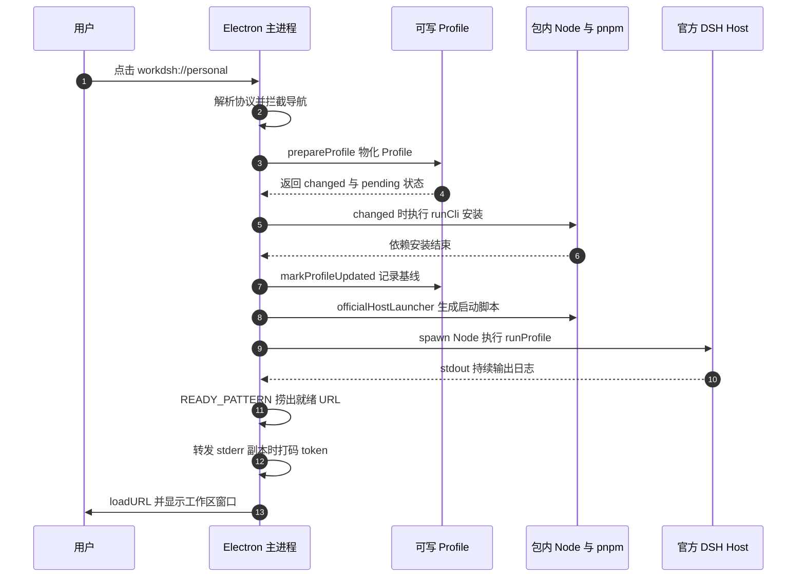
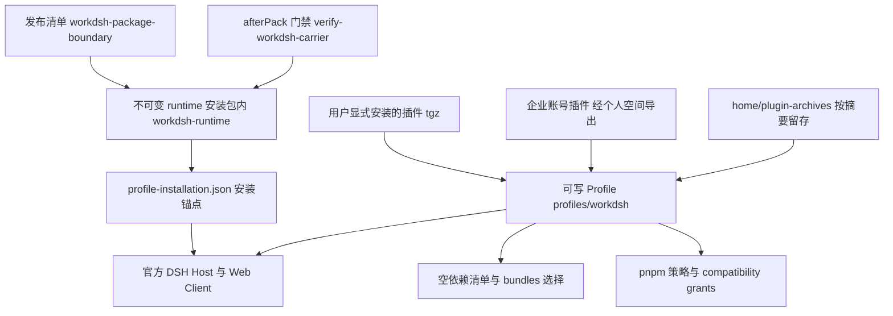

# WorkDSH Desktop 载体、运行时与 Profile 交付

WorkDSH 的桌面形态要同时满足两个互相拉扯的要求：既要把 agent 运行时（模型调用、工具执行、插件加载、Web 客户端）真正装在用户机器上跑，又要**不改上游一行代码**。最省事的做法是把 DSH 当成一个 npm 依赖塞进 Electron 的 `app.asar`，再自己写一个 Host 启动器——但这会立刻产生第二套 DSH 实例、第二套 Node、以及一个必须跟着上游演进的私有 Loader。

WorkDSH 选择了相反的边界：Electron 只做窗口、进程与入口，官方 DSH 运行时以**安装包内的不可变资源**存在，用户的改动全部落在**可写入的 Profile** 里，两者的所有权用 sha256 摘要和 `afterPack` 门禁机器化地划分。本篇拆解这条边界在代码里怎么落地，以及每一处设计付出了什么代价。基线为 `main@acbfd5a4be`，上游 pin 为 DSH `0.2.0-rc.2`。

## 载体边界：安装包里只有窗口与进程

边界的定义写得很直白：carrier 是围绕**未修改的 DSH 安装**的一层 Electron 外壳，官方安装提供 Host、完整 Web Client 与 Agent 执行；`app.asar` 里不得出现 DSH 运行时依赖，打包也不得再引入第二套 Node。

- 载体与运行时资源的责任切分。[docs/desktop-boundaries.md:3-7]()
  <!-- anchor: Desktop is one Electron carrier around an unmodified DeepSeek Harness … second Node or DSH installation to the carrier. -->
- `build.files` 白名单只放图标、`lib/workdsh-main.js`、`lib/connection-preload.cjs` 与 `package.json`，并显式排除 `node_modules/**`。[apps/desktop/package.json:91-100]()
  <!-- anchor: "files": [ … "!node_modules/**" -->
- 运行时资源走 `extraResources` 映射到 `resources/workdsh-runtime`，与 asar 完全分离。[apps/desktop/package.json:180-202]()
  <!-- anchor: "extraResources": [ … "beforePack": "./scripts/prepare-deployment-config.ts" -->

这个边界不是靠约定维持的，而是靠打包门禁：`afterPack` 钩子会列出 `app.asar` 内的全部条目，只要出现入口点、preload、含依赖的清单或任意 `node_modules/**` 就直接让打包失败。

- asar 条目与入口清单的双重校验。[apps/desktop/scripts/verify-workdsh-carrier.ts:38-41]()
  <!-- anchor: if (!entries.includes('lib/workdsh-main.js')) throw new Error('Electron carrier … throw new Error('Electron carrier contains duplicate node_modules; Harness must -->
- 资源目录里另外出现一个 `node/` 也被拒绝。[apps/desktop/scripts/verify-workdsh-carrier.ts:52-53]()
  <!-- anchor: if (existsSync(join(runtime, 'node'))) { … throw new Error('Desktop contains a duplicate Node runtime outside the official -->

**为什么不做"第二套 Host"**：把 DSH 装进 asar 有三个具体代价。其一是模块实例分裂——官方 CLI、Config Editor 与 Agent provider 必须解析到**同一份** `@deepseek-ai/dsh-scope`、`dsh-app-boot`，安装脚本为此用 `realpath` 逐个比对两条解析路径是否相等，不等就报 `Split official module instance`；两套安装必然触发它。

- 官方模块单实例的强制校验。[apps/desktop/scripts/prepare-workdsh-runtime.mjs:61-64]()
  <!-- anchor: for (const [first, second, dependency] of [ … ]) if (resolveFrom(first, dependency) !== resolveFrom(second, dependency)) throw -->

其二是版本与体积：一份 Profile 里所有 `@deepseek-ai/dsh*` 实例（含 pnpm 传递依赖里的实例）都被要求等于 pin 版本，两套树意味着两处都要跟着上游动。

- 遍历 `.pnpm` store 校验每一个已安装的 DSH 实例版本。[apps/desktop/scripts/verify-profile-release.mjs:18-22]()
  <!-- anchor: export function verifyInstalledDshVersions(profile, expectedDshVersion) { … if (existsSync(store)) for (const entry of readdirSync(store)) scopes.push(join( -->

其三是上游锚定方式：外壳不直接依赖 DSH npm 包，而是由 `upstream.json` 记录唯一版本，打包脚本读取它去准备和验证 Profile、官方主运行时与安装包，官方二进制还要过 SHA-512 校验。

- `upstream.json` 是唯一版本源，打包脚本据此校验。[docs/architecture.md:20-20]()
  <!-- anchor: `upstream.json` 记录唯一的上游提交和版本。外壳不直接依赖 DSH npm 包。打包脚本读取该版本来准备和验证 Profile、官方主运行时与安装 -->
- 版本常量从该文件读出，缺失或为空直接抛错。[apps/desktop/scripts/runtime-version.mjs:5-10]()
  <!-- anchor: const upstream = JSON.parse(readFileSync(resolve(fileURLToPath(new URL('../../.. … export const DSH_VERSION = upstream.version -->
- 官方 Desktop 发布包下载后按 `size` 与 `sha512` 双重校验，解包只取 `primary-runtime`、`cli`、`office-skills`。[apps/desktop/scripts/official-desktop-release.mjs:9-12]()
  <!-- anchor: export async function verifyArtifact(path, artifact) { … if (size !== artifact.size || digest.digest('base64') !== artifact.sha512) throw -->

## 启动链路：从伪协议入口到本机就绪 URL

启动不是"主进程自己决定干什么"，而是一条**协议驱动**的链：入口页把选择编码成 `workdsh://personal`、`workdsh://enterprise`、`workdsh://entry` 三种导航，主进程在 `will-navigate` 里拦截、解析、再决定物化 Profile 与拉起官方 Host。下面这张时序图覆盖从入口页到窗口加载的完整链路。

图里三处值得展开：入口页只负责"表达选择"、Profile 物化只在必要时触发安装、就绪信号来自官方进程自己的 stdout。先从入口页说起。

### 入口页只表达选择，不执行动作

入口页是一段内联 HTML，而不是远程页面，CSP 把 `default-src` 关到 `'none'`、只留内联样式，并把表单动作限定在 `workdsh:` 协议上——它无法发起网络请求，也无法把凭据带出去。

- 入口页的 CSP、`workdsh://personal` 链接与 `workdsh://enterprise` 表单。[apps/desktop/src/connection-entry.ts:5-8]()
  <!-- anchor: <meta http-equiv="Content-Security-Policy" content="default-src 'none'; style-sr … <main><header>W WorkDSH</header><h1>选择使用方式</h1>
官方 DSH 在本机运行。个人与企 -->
- 入口窗口以 `carrier=true` 打开，从而注入 `connection-preload.cjs`，并挂上协议解析器。[apps/desktop/src/workdsh-main.ts:333-335]()
  <!-- anchor: function showConnectionEntry(): void { … connectEntryNavigation(window!) -->
- 解析器统一 `preventDefault`，按 hostname 分派 `enterprise`、`personal`、`entry` 三条分支，并处理 `workdsh://enterprise?portal=` 携带的地址。[apps/desktop/src/workdsh-main.ts:338-362]()
  <!-- anchor: function connectEntryNavigation(entry: BrowserWindow): void { … } else if (command.hostname === 'entry') { -->
- 个人分支的顺序是：先切到加载页 → 物化 Profile → 撤掉入口态 → `startRuntime`。[apps/desktop/src/workdsh-main.ts:355-361]()
  <!-- anchor: } else if (command.hostname === 'personal') { … startRuntime(home, { mode: 'personal' }) -->

把"动作"与"界面"分开的好处是入口页可以被替换（企业登录页复用了同一份 HTML 外壳，只把 `form-action` 改成 `'none'`），代价是主进程必须自己维护协议白名单：`will-navigate` 里除了初始 origin，任何导航都被 `preventDefault`，外部 http(s) 走系统浏览器。

- 只允许同源导航，其余交给 `shell.openExternal`。[apps/desktop/src/workdsh-main.ts:145-151]()
  <!-- anchor: window.webContents.setWindowOpenHandler(({ url: target }) => { … page.webContents.on('will-navigate', (event, target) => { -->
- 加载失败时销毁新窗口、恢复旧窗口引用、报错并退回入口页。[apps/desktop/src/workdsh-main.ts:162-169]()
  <!-- anchor: void page.loadURL(url).then(() => { … dialog.showErrorBox('无法打开工作区', '请检查企业地址、网络或本地运行状态。') -->
- 企业登录 IPC 只在入口态、且发送方是当前窗口时才受理。[apps/desktop/src/workdsh-main.ts:419-419]()
  <!-- anchor: if (!entrySurface || event.sender !== window?.webContents || switching || !pendi -->

### Profile 物化先于启动，安装只在必要时发生

`prepareProfile()` 的顺序是刻意设计的：先物化 Profile 拿到 `changed`，只有确实需要时才显示"正在更新工作区插件依赖"、调用官方 `runCli` 安装、再把新的 baseline 记回状态文件；最后无论如何都会重新准备一次 host launcher，保证 `.workdsh-host.mjs` 存在且指向当前安装树。

- `prepareProfile` 的三步顺序与两处加载页文案切换。[apps/desktop/src/workdsh-main.ts:207-217]()
  <!-- anchor: async function prepareProfile(home: string): Promise<string> { … officialLauncher(source, home, bundledNodeExecutable(), join(bundledPrimaryRunti -->

### 就绪 URL 从官方进程的 stdout 里捞

`startRuntime()` 用安装包内 Node 拉起 launcher，参数是 `--no-open`（不让官方 Host 自己开浏览器），并把 stdout/stderr 都接进同一个消费者；就绪判定完全依赖一条正则。

- 拉起官方 Host 的 spawn 参数、工作目录与管道。[apps/desktop/src/workdsh-main.ts:227-237]()
  <!-- anchor: function startRuntime(home: string, connection: DesktopConnection, patches: stri … cwd: enterprise ? join(enterprise.root, 'workspace') : home, -->
- 就绪正则要求 `dsh web:` 前缀、`127.0.0.1` 地址与 `?token=` 查询参数三者齐备。[apps/desktop/src/workdsh-main.ts:24-24]()
  <!-- anchor: const READY_PATTERN = /dsh web:\s+(http:\/\/127\.0\.0\.1:\d+\/?\?token=[^\s]+)/u -->
- 输出只保留最近 16 KiB，避免长日志吃内存。[apps/desktop/src/workdsh-main.ts:246-250]()
  <!-- anchor: const consume = (chunk: Buffer): void => { … output = `${output}${text}`.slice(-16_384) -->
- 匹配成功即置 `ready`、清 `runtimeStarting`、打开窗口。[apps/desktop/src/workdsh-main.ts:251-255]()
  <!-- anchor: const match = READY_PATTERN.exec(output) … openWindow(match[1], connection) -->
- 90 秒内没有就绪信号则报错、停进程、退回入口页。[apps/desktop/src/workdsh-main.ts:273-274]()
  <!-- anchor: const readyTimeout = setTimeout(() => { if (!ready && runtime === child) { dialo … child.once('exit', () => clearTimeout(readyTimeout)) -->

**取舍**：用正则从 stdout 里捞 URL，是与官方 Host 耦合最小的一种就绪协议——不需要官方暴露端口文件、不需要固定端口、不需要 IPC 握手，而且官方本来就打印这一行。代价是**文案耦合**：如果上游把 `dsh web:` 前缀或 `?token=` 的形态改掉，carrier 不会崩，而是退化成"启动超时（90 秒）"这类模糊错误。这属于有意的软失败——错误信息里明确让用户"检查插件版本和 Profile 配置"，而不是把耦合细节暴露给终端用户。

### token 打码：保护转发副本，而不是使用中的 URL

在线程语义上，`match[1]` 里的 token 原样交给 `loadURL`；被打码的只是 carrier **转发到自己 stderr** 的那份副本。两处都做了替换：stdout 消费回调与 stderr 透传。

- stdout 副本转发前打码。[apps/desktop/src/workdsh-main.ts:248-248]()
  <!-- anchor: process.stderr.write(text.replace(/\?token=[^\s]+/gu, '?token=[redacted]')) -->
- stderr 透传同样打码。[apps/desktop/src/workdsh-main.ts:259-259]()
  <!-- anchor: child.stderr.on('data', chunk => process.stderr.write(chunk.toString().replace(/ -->

**风险与取舍**：正则是 `\?token=[^\s]+`，也就是"从 `?token=` 打到一个空白为止"。这条规则的失败方向是**过度打码**（token 后面若紧跟其他内容会被一起吞掉），而不是泄漏；但如果官方改用 URL 编码、改用别的 query 顺序、或从文件而非 stdout 暴露 token，这段打码就会静默失效。因此它的定位是"防止日志泄漏"的补丁，而不是凭据保护机制——真正的边界在于企业后端 bearer 只留在 Main 内存里，业务窗口与 DSH CLI 都拿不到。

## 可写 Profile 的物化与所有权迁移

可写 Profile 的目标目录是 `<DSH_HOME>/profiles/workdsh`，它的初始清单刻意是"空的"：依赖表为空，只有 `dsh` 配置（含 bundle 选择）从安装包复制过来。也就是说，一个全新的可写 Profile **不继承**安装包的依赖图与 lockfile，共同依赖永远由安装包的安装锚点供应。

- 成员 Profile 的默认清单：空 `dependencies`，复制 `dsh` 配置。[apps/desktop/src/local-runtime.ts:16-18]()
  <!-- anchor: function memberDefaults(release: ProfilePackage): ProfilePackage { … dependencies: {}, ...(release.dsh ? { dsh: structuredClone(release.dsh) } : {}) -->
- 物化入口：目标目录、`mode: 0o700`、符号链接拒绝与首次写入 `package.json`、`cordis.patch.yml`。[apps/desktop/src/local-runtime.ts:54-66]()
  <!-- anchor: export function materializeRuntimeProfile(source: string, home: string): { profi … if (existsSync(modules) && lstatSync(modules).isSymbolicLink()) throw new Error( -->
- 明确拒绝把整个安装包依赖树链接进来的旧共享 Profile。[apps/desktop/src/local-runtime.ts:66-66]()
  <!-- anchor: if (existsSync(modules) && lstatSync(modules).isSymbolicLink()) throw new Error( -->

这一步是所有权分离的必要前提：符号链接意味着"可写 Profile 的 `node_modules` 其实指向安装包"，那样用户装插件就会写进不可变资源。

### digest 是所有权的账本

"哪些条目是安装包拥有的"这个问题，回答方式是把安装包默认值本身算进一个 sha256 摘要，并把摘要连同当时的 base 一起写进 `.workdsh-desktop-base.json`。digest 的输入除了 base 清单，还包括 `package.json`、DSH 版本、安装包的 release marker（`.workdsh-desktop-release.json`，内含整份 release manifest）与 `pnpm-workspace.yaml`。

- `baseDigest` 的输入集合与固定盐 `installation-owned-defaults-v2`。[apps/desktop/src/local-runtime.ts:20-24]()
  <!-- anchor: function baseDigest(source: string, base: ProfilePackage, version: string): stri … .update(existsSync(workspace) ? readFileSync(workspace) : '').digest('hex') -->

**代价**：账本必须被严格记录，否则系统无法区分"用户改的"和"安装包改的"。所以当 Profile 已存在但没有版本记录时，代码不猜、不覆盖，直接抛错让用户选择独立空间——这与文档里"无法确认所有权的旧 Profile 不自动改写"完全一致。另一个代价是：安装包侧的输入（release marker、清单、DSH 版本或包管理策略）一变，digest 就跟着变并触发一次重新物化；这是刻意选择（宁可信 base 变了），而不是优化缺陷。

- 缺少 Desktop 版本记录时直接拒绝，而不是猜测覆盖。[apps/desktop/src/local-runtime.ts:74-74]()
  <!-- anchor: if (!previous) throw new Error('已有 Profile 缺少 Desktop 版本记录；请在官方插件管理中核对后使用独立空间') -->

由于当前 `memberDefaults()` 把 `dependencies` 与 `optionalDependencies` 都设为空对象，这段依赖级迁移在今天几乎是空转；真正会被迁移的是 `dsh.profile.bundles`（安装包决定的 bundle 选择）与兼容豁免清单。这是理解这段代码的关键：它现在更像**为未来默认依赖增长准备的护栏**，而不是当前升级路径的主力。

- 迁移循环：只更新**仍等于旧默认值**的依赖，用户显式改动保留；安装包新增的默认依赖才被补入。[apps/desktop/src/local-runtime.ts:73-83]()
  <!-- anchor: } else if (previous?.digest !== digest) { … else current[section]![name] = next[name]! -->

### 先写状态再安装，崩了也能续

需要安装依赖时，代码先写 `pendingInstallation: true`，把"上一次 digest 与 base"留住，等官方 `runCli` 安装成功后再由 `markProfileUpdated()` 写入新 baseline。于是中途崩溃/断电只会让下次启动把 `changed` 重新算成 `true`，再装一遍——幂等重试而不是半步状态。

- 先写 pending、成功后再收敛为正式状态。[apps/desktop/src/local-runtime.ts:108-109]()
  <!-- anchor: if (changed) writeJson(state, { digest: previous?.digest ?? digest, base: previo … else writeJson(state, { digest, base }) -->
- 成功路径回写当前安装包的 digest 与 base。[apps/desktop/src/local-runtime.ts:113-118]()
  <!-- anchor: export function markProfileUpdated(source: string, profile: string): void { … writeJson(join(profile, BASE_STATE), { digest, base }) -->
- 单元测试明确覆盖"重启后重试失败的版本策略安装直到成功"。[apps/desktop/tests/local-runtime.spec.ts:87-87]()
  <!-- anchor: it('retries a failed version-policy installation after restart until official in -->

另一处刻意区分是：**只有依赖图变化才需要安装**。bundle 选择变化会被写进清单，但不会触发 `plugin install`——因为 bundle 是配置组合，不是包依赖。

- `changed` 只在依赖段变化且已存在 `node_modules` 时才置位。[apps/desktop/src/local-runtime.ts:98-98]()
  <!-- anchor: changed ||= ['dependencies', 'optionalDependencies'].some(section => JSON.string -->

### 版本策略与兼容豁免：产品赢在运行时版本上

可写 Profile 的 `pnpm-workspace.yaml` 是"产品默认 + 用户偏好"的合并面：首次生成时照抄安装包策略并补 `autoInstallPeers=false`（共同 peer 由安装锚点供应）；此后只在 `overrides` 上合并，产品拥有的条目覆盖用户同名条目。

- 首次生成策略时关掉自动装 peer。[apps/desktop/src/local-runtime.ts:35-40]()
  <!-- anchor: if (!existsSync(current)) { … return true -->
- `overrides` 合并：官方运行时/Cordis 版本归产品，其余归用户。[apps/desktop/src/local-runtime.ts:46-50]()
  <!-- anchor: // Official runtime/Cordis versions are product-owned. Other install preferences … writeFileSync(current, dump(user), { mode: 0o600 }) -->

同类问题还有"插件的精确版本豁免"：`compatibility.json` 里允许某些精确 `name@version` 对。安装包自带的豁免只在 digest 变化时合并一次，并且**用户撤销过的不会复活**——判断依据是"上一轮安装包给过的名单"。

- 只在 digest 变化时合并一次，且用户已撤销的保持撤销。[apps/desktop/src/runtime-compatibility.ts:42-45]()
  <!-- anchor: export function syncBundledCompatibility(sourceProfile: string, targetProfile: s … if (existsSync(marker) && readFileSync(marker, 'utf8').trim() === runtimeVersion -->
- 只有"上轮安装包未授予过"的版本才会被重新加入。[apps/desktop/src/runtime-compatibility.ts:58-63]()
  <!-- anchor: for (const [key, versions] of Object.entries(bundled)) { … if (!previous.has(version)) granted.add(version) -->

### 用户显式安装的归档：按内容寻址留存

用户显式 `plugin add` 一个本地 `.tgz` 时，carrier 会在委托给安装包内 pnpm 之前，把归档按 sha256 存进 `<home>/plugin-archives/<digest>.tgz`，并把参数替换为缓存路径。这样即使用户之后删掉了下载目录，Profile 的 lockfile 仍然可重建；代价是每次 `add` 多一次整包读取与哈希。

- 只拦截本地 `.tgz` 参数，按摘要落盘并做完整性复核。[apps/desktop/src/plugin-archive-cache.ts:14-27]()
  <!-- anchor: if (args.includes('add')) { … args[i] = destination; -->
- 安装包内的 `package-cache` 只做"补齐不覆盖"的复制，避免盖掉用户自己的归档。[apps/desktop/src/local-runtime.ts:103-105]()
  <!-- anchor: const cache = join(home, 'package-cache') … if (existsSync(sourceCache)) cpSync(sourceCache, cache, { recursive: true, force -->

### 官方接口是唯一的启动方式

产物里有三个生成物，且都只是**薄包装**：`officialLauncher` 写 `.workdsh-launch.mjs` 调官方 `runCli` 并打开 `manageDesktopProfile`；`officialHostLauncher` 写 `.workdsh-host.mjs` 调官方 `runProfile`，传入 Profile 目录、只读安装锚点、patch 文件与包管理器；`cachedPackageManager` 写 `.workdsh-package-manager.mjs`，先按摘要留存本地归档再委托给安装包内 pnpm。三者都强制使用安装包内的 Node。

- 显式插件操作走官方 `runCli`，并指定包管理器。[apps/desktop/src/local-runtime.ts:144-150]()
  <!-- anchor: export function officialLauncher(source: string, home: string, executable: strin … return launcher -->
- 启动 Host 走官方 `runProfile`，附带 `profile-installation.json` 安装锚点。[apps/desktop/src/local-runtime.ts:154-162]()
  <!-- anchor: export function officialHostLauncher(source: string, home: string, executable: s … writeFileSync(launcher, `import { runProfile } from ${JSON.stringify(pathToFileU -->
- 两者都要求 `@deepseek-ai/dsh` 的 CLI / `dsh-app-boot` 与 pnpm 入口存在，否则直接抛错。[apps/desktop/src/local-runtime.ts:145-146]()
  <!-- anchor: const cli = join(source, 'node_modules', '@deepseek-ai', 'dsh', 'lib', 'bin.js') … if (!existsSync(cli) || !existsSync(packageManager)) throw new Error('安装包缺少官方 DSH 或锁定的插件安装工具') -->

这样做的好处是：Profile 解析、依赖安装、patch 分层、env 分层全部由官方实现负责，WorkDSH 不需要维护私有 Loader（文件头注释即写着 `No custom Loader.`）。代价是产品能力被官方接口的形态绑住——`loadProfileDirectory`、`loadLayeredEnv`、`reportSkippedBundles` 的函数签名一变，carrier 就必须同步改。

## 不可变运行时、可写 Profile 与显式安装的所有权边界

把上面几节合起来看，系统里有三类东西：**不可变**（安装包内 runtime 与安装锚点）、**可写**（Profile 目录）、**用户引入**（显式安装的插件归档）。它们的关系不是"层层复制"，而是"共同依赖只读解析 + 增量写在自己的目录里"。下图是这三者的依赖与所有权归属。

图里三组关系值得单独给出证据：

- 安装锚点是**同一棵树派生**的只读清单，而不是第二份安装。运行时准备阶段从唯一的 Profile 清单推导出 `profile-installation.json`，把 support 与企业包提升为 peer 暴露给官方解析器。[apps/desktop/scripts/prepare-workdsh-runtime.mjs:105-107]()
  <!-- anchor: const pkg = { name: 'workdsh-desktop-profile', private: true, type: 'module', pa … writeFileSync(join(profile, 'package.json'), JSON.stringify(pkg, null, 2) + '\n' -->
- 门禁要求锚点的 `dependencies` 与该 Profile 清单逐字相同、且不得有 `optionalDependencies`。[apps/desktop/scripts/verify-workdsh-carrier.ts:76-82]()
  <!-- anchor: const installation = JSON.parse(readFileSync(join(profile, 'profile-installation … if (installation.peerDependencies?.[name] !== version) throw new Error('Installa -->
- 企业账号插件的"显式安装"不是员工手工装包：它从**个人空间已安装**的插件出发，用安装包内 pnpm 把已安装代码重新打包成 tgz，再以 `file:` 依赖装进成员空间——复制的是代码，不是 Profile 文件或凭据。[apps/desktop/src/enterprise-plugins.ts:31-39]()
  <!-- anchor: // Pack installed code through the bundled package manager; do not copy Profile … manifest.dependencies[name]='file:./enterprise-plugin-archives/'+filename; -->
- 企业组合时显式移除个人身份 bundle，避免身份回退。[apps/desktop/src/workdsh-main.ts:387-394]()
  <!-- anchor: selected.dsh ??= {}; selected.dsh.profile ??= {}; selected.dsh.profile.bundles ? … writeFileSync(manifest, JSON.stringify(selected, null, 2) + '\n', { mode: 0o600 -->
- 个人默认组成里出现企业包会被判为失败：`verifyDefaultComposition` 扫描 dump 出来的 composition，命中即抛错。[apps/desktop/scripts/verify-profile-release.mjs:70-72]()
  <!-- anchor: export function verifyDefaultComposition(config) { … if (config.includes(name)) throw new Error('Enterprise package is active in the -->
- 企业包的兼容性在运行期也要复核：`exports['./desktop']` 必须存在，`peerDependencies['@deepseek-ai/dsh']` 必须等于当前版本。[apps/desktop/src/enterprise-plugins.ts:8-13]()
  <!-- anchor: export function installedEnterprisePlugins(profile:string,version:string):string … if(bundle&&!existsSync(join(bundleRoot,'package.json')))throw Error('企业连接包尚未完成安装 -->

**为什么所有权要切得这么细**：一旦允许"可写 Profile 通过符号链接复用整个安装依赖树"，用户装插件就会写进安装包目录，升级安装包时要么覆盖用户插件、要么让安装包不可变的前提失效。WorkDSH 的直接做法是拒绝这种历史 Profile（报"此 Profile 的依赖仍链接到安装包"），把不可变与可写彻底分开——代价是老用户必须重新初始化一个独立空间。

## 运行时与进程治理

### 安装包内的 Node 与 pnpm 是唯一执行环境

carrier 不用系统 Node，也不用 Electron 自带的 Node 模式去跑 DSH：`bundledNodeExecutable()` 与 `bundledPrimaryRuntime()` 指向 `resources/workdsh-runtime/primary-runtime`，并且都留了环境变量覆盖口——这正是开发态启动器复用的接口。

- 两个路径解析函数与 `WORKDSH_NODE_EXECUTABLE` / `WORKDSH_PRIMARY_RUNTIME` 覆盖口。[apps/desktop/src/workdsh-main.ts:55-70]()
  <!-- anchor: function bundledNodeExecutable(): string { … return join(process.resourcesPath, 'workdsh-runtime', 'primary-runtime') -->
- 子进程环境显式注入 `DSH_BUNDLED_PRIMARY_RUNTIME`，并把 `ELECTRON_RUN_AS_NODE` 清空。[apps/desktop/src/workdsh-main.ts:180-182]()
  <!-- anchor: DSH_BUNDLED_PRIMARY_RUNTIME: bundledPrimaryRuntime(), … ELECTRON_RUN_AS_NODE: undefined, -->

`ELECTRON_RUN_AS_NODE: undefined` 这一行容易被忽略，但它处理的是"同一个 Electron 二进制既当 GUI 又当 Node"带来的经典坑：如果这个变量被父进程带进子进程，官方 CLI 的判断分支可能走上 Electron 语义而非 Node 语义。显式置空是把环境恢复成"普通 Node 子进程"。

### 进程树清理：平台差异写在代码里

文件头一句话就把问题说清了：**父进程退出不等于进程树退出**。POSIX 分支用负 PID 杀整个进程组，Windows 分支用 `taskkill /T /F` 并要求它返回 0，否则报"清理未确认"而不是静默放过。

- "父进程退出不是树退出"的定位。[apps/desktop/src/owned-process.ts:1-1]()
  <!-- anchor: /** Stop only the process tree created by this carrier. A parent exit is not a t -->
- POSIX 用 `process.kill(-pid, 'SIGKILL')` 一次带走整组，忽略 `ESRCH`。[apps/desktop/src/owned-process.ts:11-14]()
  <!-- anchor: else if (process.platform !== 'win32') { … result = Promise.resolve() -->
- Windows 走 `taskkill /PID /T /F`，并把非 0 退出码上报为失败。[apps/desktop/src/owned-process.ts:17-19]()
  <!-- anchor: const task = spawn('taskkill', ['/PID', String(pid), '/T', '/F'], { windowsHide: … task.once('exit', code => code === 0 ? resolve() : reject(new Error('Windows 本机进 -->

为了让负 PID 生效，spawn 时必须让子进程成为新进程组组长——所以每次 spawn 都带 `detached: process.platform !== 'win32'`。这里的 `detached` 不是"脱离终端常驻"的意思，而是**为组杀服务**；Windows 上则改用 `windowsHide` 加 `taskkill`。

- 显式插件安装进程的 spawn 选项。[apps/desktop/src/workdsh-main.ts:190-190]()
  <!-- anchor: const child = spawn(executable, [launcher, ...args], { env: runtimeEnvironment(h -->

优雅停止另有一套时间预算：先对进程组发 `SIGTERM`，8 秒后强杀，12 秒还没确认就报"本机进程尚未停止"。注释解释了 8 秒的来历——官方 DSH 自身有一个 5 秒的关闭窗口，必须给它退出收尾的机会。同时，父进程已经 ack 了 SIGTERM 也不取消后代清理。

- 8 秒强杀 / 12 秒超时的双重计时器。[apps/desktop/src/owned-process.ts:26-32]()
  <!-- anchor: export async function stopOwnedProcess(child: ChildProcess): Promise<void> { … const timeout = setTimeout(() => { clearTimeout(force); reject(new Error('本机进程尚未 -->

### 单实例、退出与窗口生命周期

同一个 Electron 还要兼职浏览器 worker，所以"单实例锁"必须放在 worker 分支之后：带 `--workdsh-browser-worker-port=` 的进程根本不去抢锁，否则每个任务启动浏览器时都会被当成第二次启动而自杀。

- worker 分支先判定，主应用再把激活策略设回 `regular`。[apps/desktop/src/workdsh-main.ts:450-456]()
  <!-- anchor: const worker = browserWorkerRequest() … if (process.platform === 'darwin') app.setActivationPolicy('regular') -->
- 主实例拿锁，`second-instance` 只做还原与聚焦。[apps/desktop/src/workdsh-main.ts:463-469]()
  <!-- anchor: if (!app.requestSingleInstanceLock()) { … window.focus() -->

退出流程是"**先取消再退出**"：`before-quit` 先 `preventDefault`，若正在切换工作区就只记下 `quitRequested`，等切换流程收口时再 `app.quit()`；否则立刻执行 `leaveWorkspace()`（关企业 authority、取消请求、停本机进程、清窗口存储），完成后才真正退出。这样避免"退出"和"切换"两条清理路径并发操作同一批进程与文件。

- `before-quit` 的 preventDefault 与收敛逻辑。[apps/desktop/src/workdsh-main.ts:471-485]()
  <!-- anchor: app.on('before-quit', event => { … }).finally(() => { switching = false }) -->
- 非 macOS 上关掉最后一个窗口即退出，因此子进程会被连带清理。[apps/desktop/src/workdsh-main.ts:487-488]()
  <!-- anchor: app.on('window-all-closed', () => { … if (process.platform !== 'darwin' && !switching) app.quit() -->
- `activate` 只在既非切换、又非启动中、也没有安装进程、也不在退出流程时才会动作。[apps/desktop/src/workdsh-main.ts:490-497]()
  <!-- anchor: app.on('activate', () => { … app.relaunch() -->

**平台差异的取舍**：Windows/Linux 上"关窗即退"最符合直觉，用户关掉窗口就应当释放进程与端口；macOS 遵循系统窗口生命周期，应用留在 Dock 里，但没有窗口的健康 runtime 仍然持有 Profile——所以 `activate` 在无窗口时选择 `relaunch()` + `quit()`，用一次重启换取"Profile 生命周期只有一条路径"的简单性。代价是 macOS 上重新激活应用会有一次冷启动开销。

### 同一个 Electron 兼作受管浏览器 worker

浏览器能力没有打包第二个浏览器二进制，而是复用同一个 Electron：主进程解析 `--workdsh-browser-worker-port=` / `--workdsh-browser-worker-profile=`，把 `userData` 指到请求的 profile，把远程调试端口绑在 `127.0.0.1`，然后开一个 offscreen、sandbox 的隐藏窗口，就绪后向 stdout 打一行标记。

- 参数校验：端口必须落在 1024–65535，profile 必须是存在的绝对路径，否则抛错。[apps/desktop/src/workdsh-main.ts:73-79]()
  <!-- anchor: function browserWorkerRequest(): { port: number, profile: string } | undefined { … if (!Number.isInteger(port) || port < 1024 || port > 65535 || !profile || !isAbs -->
- worker 启动：`accessory` 策略、`userData` 覆盖、`offscreen` 与 `sandbox`、禁止 `window.open`。[apps/desktop/src/workdsh-main.ts:85-89]()
  <!-- anchor: function startBrowserWorker(request: { port: number, profile: string }): void { … if (process.platform === 'darwin') app.setActivationPolicy('accessory') -->
- 窗口选项：offscreen、禁用后台节流、`sandbox: true`、`nodeIntegration: false`。[apps/desktop/src/workdsh-main.ts:99-107]()
  <!-- anchor: offscreen: true, … page.webContents.setWindowOpenHandler(() => ({ action: 'deny' })) -->

激活策略是三段式的，且顺序有讲究：安装包的 `Info.plist` 里 `LSUIElement=true`（`afterPack` 会验证），保证**JavaScript 跑起来之前**不会出现 Dock 图标；worker 在 `whenReady` 之前设成 `accessory`（注释指出 ready 之后再隐藏，会让每个任务的 worker 都短暂注册成前台应用）；主应用启动时再设回 `regular`。

- macOS 必须以原生 UIElement 角色启动，否则打包失败。[apps/desktop/scripts/verify-workdsh-carrier.ts:22-26]()
  <!-- anchor: export async function afterPack(context: PackContext): Promise<void> { … if (nativeRole.status !== 0 || nativeRole.stdout.trim() !== 'true') throw new Er -->

代价是：worker 与主应用共享同一个 Electron 二进制与一套代码路径，隔离只能靠命令行参数、`userData` 覆盖与进程级激活策略，而不是靠独立进程模型；参数校验因此只发生在启动时，非法参数会直接抛错退出，属于 fail-closed。

## 发布边界是代码而不是文档

"哪些包属于这个产品"这个问题在仓库里有**唯一答案**：`workdsh-package-boundary.mjs`。它导出的五组常量（产品包、企业包、目录集成、发布包集合、目录映射）被准备脚本、校验脚本、门禁与打包脚本共同引用，任何一处加包/减包都必须改这个文件，而改了它就会立刻改变校验期望值。

- 产品包：默认个人 Profile 只选择并暴露这些。[apps/desktop/scripts/workdsh-package-boundary.mjs:3-8]()
  <!-- anchor: export const PRODUCT_PACKAGES = Object.freeze([ … 'workdsh-plugin-skills', -->
- 目录映射 `PACKAGE_DIRECTORIES` 把包名绑到仓库路径，打包时逐个核对 `pkg.name`。[apps/desktop/scripts/workdsh-package-boundary.mjs:39-42]()
  <!-- anchor: export const PACKAGE_DIRECTORIES = Object.freeze({ … 'workdsh-provider-identity-local': '../../packages/providers/identity-local', -->
- 企业包与社区目录集成（SkillHub / dshmarket）也在这个清单里带固定版本。[apps/desktop/scripts/workdsh-package-boundary.mjs:19-21]()
  <!-- anchor: export const CATALOG_PACKAGES = Object.freeze({ … dshmarket: '1.66.8', -->

### 准备链：先校验、再重建、最后自证

`prepare-workdsh-runtime.mjs` 先验证 release manifest 与归档摘要，然后从零构造 Profile 清单：产品包进 `dependencies`，内部支撑包与企业包进 `optionalDependencies`，都引用 `package-cache` 下的归档文件路径；随后用 `npx pnpm@11.7.0 install --prod --ignore-scripts` 装出单一根图，并用最多 9 轮把官方必需 peer 提升进根图；最后组装 `cordis.patch.yml` 并跑一遍 `verifyInstalled()`。

- 归档摘要校验与"清单必须先于运行时准备"的前置检查。[apps/desktop/scripts/prepare-workdsh-runtime.mjs:20-24]()
  <!-- anchor: const manifest = JSON.parse(readFileSync(manifestFile, 'utf8')) … const markerPath = join(profile, '.workdsh-desktop-release.json') -->
- 产品包与内部包的依赖段划分、`file:` 相对归档路径。[apps/desktop/scripts/prepare-workdsh-runtime.mjs:102-104]()
  <!-- anchor: const target = PRODUCT_PACKAGES.includes(item.name) ? dependencies : optionalDependencies … target[item.name] = 'file:../../package-cache/' + item.filename -->
- 用固定 pnpm 版本安装，`--ignore-scripts` 关闭安装期脚本。[apps/desktop/scripts/prepare-workdsh-runtime.mjs:110-110]()
  <!-- anchor-base64:cnVuKHByb2Nlc3MucGxhdGZvcm0gPT09ICd3aW4zMicgPyAnbnB4LmNtZCcgOiAnbnB4JywgWyctLXllcycsICdwbnBtQDExLjcuMCcsICc= -->
- lockfile 中不得出现构建机绝对路径，否则资源不可移植。[apps/desktop/scripts/prepare-workdsh-runtime.mjs:65-66]()
  <!-- anchor: const lock = readFileSync(join(profile, 'pnpm-lock.yaml'), 'utf8') … if (/file:(?:\/|[a-z]:)/iu.test(lock)) throw new Error('Runtime lock contains a -->
- marker 里放进了 layout 名称与整份 release manifest，作为后续 digest 的一部分。[apps/desktop/scripts/prepare-workdsh-runtime.mjs:23-23]()
  <!-- anchor: const marker = JSON.stringify({ harness: DSH_VERSION, layout: 'five-feature-plug -->

打补丁的来源也是清单驱动的：只有"既非产品包、又非企业包"的 release 包，其 `cordis.patch.yml` 才会被合并进 Profile 的默认 patch——也就是说产品功能的启用方式与内部基础服务的启用方式在代码里是两类东西。

### 四个校验器各自守住什么

- `verify-profile-release.mjs`：归档 sha256、每个 DSH 实例版本、默认 Profile 组成（bundle 选择 / 直接依赖 / 全部 owned 包三张清单必须与 `PRODUCT_PACKAGES`、`RELEASE_PACKAGES` 完全一致）、企业包不得出现在个人组成、release 包集合与 harness 版本一致。[apps/desktop/scripts/verify-profile-release.mjs:54-64]()
  <!-- anchor: export function verifyDefaultProfile(manifest) { … throw new Error(`Desktop ${kind} changed: expected ${expected.join(', ')}, found -->
- `verify-installation-anchor.mjs`：在临时 Home 里物化 Profile，断言**新 Profile 没有自己的依赖树**，然后真的启动官方 Host、用返回的 token 换 cookie、读取 `__DSH_BOOT__` 客户端图。[apps/desktop/scripts/verify-installation-anchor.mjs:28-29]()
  <!-- anchor: const { profile } = materializeRuntimeProfile(source, home) … if (existsSync(join(profile, 'node_modules'))) throw new Error('Fresh Profile un -->
- 同一脚本对客户端图做集合比对：owned 客户端必须恰好是产品包加 `workdsh-bundle`。[apps/desktop/scripts/verify-installation-anchor.mjs:64-69]()
  <!-- anchor: for (const client of release.officialWeb.clients.filter(row => !row.conditional) … if (JSON.stringify(owned) !== JSON.stringify([...PRODUCT_PACKAGES, 'workdsh-bund -->
- 收尾两条断言：运行期不得往可写 Profile 写 `node_modules`，且输出里不得出现 `failed to import`。[apps/desktop/scripts/verify-installation-anchor.mjs:74-75]()
  <!-- anchor: if (existsSync(join(profile, 'node_modules'))) throw new Error('Runtime wrote a … if (/failed to import/iu.test(output)) throw new Error('Official Host reported a -->
- `verify-workdsh-carrier.ts` 的五个产品 bundle 断言（选择与直接安装各查一次）。[apps/desktop/scripts/verify-workdsh-carrier.ts:88-92]()
  <!-- anchor: if (selectedWorkdsh.length !== productPackages.size || selectedWorkdsh.some(name … throw new Error(`Desktop must directly install exactly five WorkDSH product bund -->
- `verify-product-plugin-inventory.mjs` 更进一步：它**真的启动官方 plugin manager**，断言它向外暴露的 WorkDSH bundle 恰为产品包且 `enabled`、`removable === false`。[apps/desktop/scripts/verify-product-plugin-inventory.mjs:40-46]()
  <!-- anchor: if (JSON.stringify(names) !== JSON.stringify(expected)) { … throw new Error(`WorkDSH product bundle is inactive or invalid: ${bundle.name}: ${JSON.stringify(bundle)}`) -->

### 门禁链：钩子、脚本与文档漂移

打包钩子承担了最后的强制点：`beforePack` 生成部署配置，`afterPack` 执行载体校验，`afterAllArtifactBuild` 校验 Electron fuses。

- 三个 electron-builder 钩子的声明。[apps/desktop/package.json:73-77]()
  <!-- anchor: "afterPack": "./scripts/verify-workdsh-carrier.ts", … "afterAllArtifactBuild": "./scripts/verify-electron-fuses.ts", -->

仓库级门禁链由 `check` 串起来：布局与文档检查 → Desktop/DSH 对齐 → Web/DSH 对齐 → Web plan → desktop 工作区的 build/typecheck/test；发布打包则走 `release:pack` 与 `release:pack:published` 两条入口，区别只在"本地源码"还是"已发布源码"。

- `check` 串起五组检查，最后落到 desktop 工作区。[./package.json:34-34]()
  <!-- anchor: "check": "yarn check:layout && yarn check:desktop-dsh-alignment && yarn check:we -->
- 发布打包的两个来源开关。[./package.json:42-43]()
  <!-- anchor-base64:InJlbGVhc2U6cGFjayI6ICJub2RlIHNjcmlwdHMvcGFja2FnZS1kZXNrdG9wLXJlbGVhc2UubWpzIC0tc291cmNlPWxvY2FsIiwg4oCmICJyZWxlYXNlOnBhY2s6cHVibGlzaGVkIjogIm5vZGUgc2NyaXB0cy9wYWNrYWdlLWRlc2t0b3AtcmVsZWFzZS5tanMgLS1zb3VyY2U9cHVi -->
- desktop 工作区的 `check` 是 build + typecheck + test（`test` 里既有 vitest 也有 `node --test` 的脚本级测试）。[apps/desktop/package.json:33-35]()
  <!-- anchor-base64:InR5cGVjaGVjayI6ICJ0c2MgLXAgdHNjb25maWcuanNvbiAtLW5vRW1pdCAmJiB0c2MgLXAgdHNjb25maWcudGVzdHMuanNvbiAtLW5vRW0g4oCmICJjaGVjayI6ICJ5YXJuIHJ1biBidWlsZCAmJiB5YXJuIHJ1biB0eXBlY2hlY2sgJiYgeWFybiBydW4gdGVzdCIs -->

**一处真实漂移**：代码里产品包是**五个**（connectors、experts、library、projects、skills），门禁错误信息也写 "exactly five"；但仓库文档仍写"四个功能包"。

- 文档称"四个功能包"。[apps/desktop/README.md:55-55]()
  <!-- anchor: Build the four owned features, their required support packages and the enterpris -->
- 只读边界文档同样写"四个已启用的 WorkDSH 功能 bundle"。[docs/desktop-boundaries.md:75-80]()
  <!-- anchor: Profile preparation boots the actual official plugin manager. Its personal … model conversations, local tools or platform installer acceptance. -->

同类漂移还有社区目录版本：只读边界文档写 dshmarket `1.66.1`，而清单与 desktop README 都是 `1.66.8`。

- 清单里的固定版本是权威值。[apps/desktop/scripts/workdsh-package-boundary.mjs:19-21]()
  <!-- anchor: export const CATALOG_PACKAGES = Object.freeze({ … dshmarket: '1.66.8', -->

这两处恰好印证了本文的命题：**发布边界的事实源在代码与门禁里，文档只是它的投影**；投影会过期，门禁不会。

## 管理员部署配置

公司包的定制面被压到了一个字段：`enterprise.backendUrl`。打包输入是环境变量 `WORKDSH_DEPLOYMENT_CONFIG` 指向的 JSON，解析器只允许顶层 `enterprise` 键、且只允许其下的 `backendUrl`，其他键一律报错。

- 白名单式解析：多一个键就抛错，返回的地址还要过 `enterpriseConnection` 校验。[apps/desktop/src/deployment-config.ts:5-16]()
  <!-- anchor: /** Administrator-owned packaging input. Never accepts credentials or arbitrary … return { enterprise: { backendUrl: enterpriseConnection(enterprise.backendUrl).p -->
- 地址必须是 HTTPS（仅本机回环允许 HTTP），且不得携带账号、令牌或页面路径。[apps/desktop/src/connection-mode.ts:8-17]()
  <!-- anchor: export function enterpriseConnection(value: string): DesktopConnection & { mode: … return { mode: 'enterprise', portalOrigin: url.origin } -->

生成侧的第一条动作是**先删掉旧文件**：个人构建或失败的公司构建绝不能复用上一个组织生成的配置；随后才按输入（缺省为空对象）写出一份新的 `workdsh-config.json`。

- 先 `rmSync` 再写，保证不泄漏上一个包的配置。[apps/desktop/scripts/prepare-deployment-config.ts:7-19]()
  <!-- anchor: export function prepareDeploymentConfig(outputDirectory: string, inputFile?: str … writeFileSync(output, JSON.stringify(config, null, 2) + '\n', { mode: 0o600 }) -->
- 该函数被 electron-builder 的 `beforePack` 直接调用。[apps/desktop/scripts/prepare-deployment-config.ts:22-25]()
  <!-- anchor: export default function beforePack(): void { … prepareDeploymentConfig(join(desktopRoot, 'build', 'deployment'), process.env.WORKDSH_DEPLOYMENT_CONFIG) -->

运行期的优先级也写在代码里：Main 读 `resources/workdsh-config.json`，把 `managedBackend` 设为后台地址并**同时**覆盖 `enterprisePortal`；随后才考虑上一轮保存的 `enterprise-backend.json`。而 `rememberBackend()` 在 `managedBackend` 存在时直接 return——公司包不会把用户手输的地址写进偏好文件，入口页也不再提供可编辑输入。

- Main 启动时读取顺序：托管配置优先于已保存偏好。[apps/desktop/src/workdsh-main.ts:501-508]()
  <!-- anchor: void app.whenReady().then(() => { … try { enterprisePortal = enterpriseConnection(JSON.parse(readFileSync(savedBacke -->
- 托管地址存在时不写用户偏好。[apps/desktop/src/workdsh-main.ts:327-330]()
  <!-- anchor: function rememberBackend(backend: string): void { … writeFileSync(savedBackendFile(), JSON.stringify({ backend }), { mode: 0o600 }) -->
- 已进入企业会话时拒绝改后台地址。[apps/desktop/src/workdsh-main.ts:348-348]()
  <!-- anchor: if (enterprise) throw new Error('请先退出当前企业账号再修改后台地址') -->

**代价**：管理员能控制的只有一项。想加"禁用某插件""预置模型地址"这类需求，就必须同时改解析器白名单、校验脚本与门禁，而不是加一个配置键。换来的是可证明性——"打包输入不含凭据"这条结论可以由键白名单直接检查出来，而不是靠人工审计配置内容。

## 开发态启动器与终端命令

开发态不复制生产逻辑，而是用三个环境变量把"安装包资源"重定向到 `build/workdsh-runtime`，然后拉起 Electron 本体；缺资源时直接报错并提示先跑 `yarn dev`。

- 用 `WORKDSH_BUNDLED_PROFILE` / `WORKDSH_NODE_EXECUTABLE` / `WORKDSH_PRIMARY_RUNTIME` 重定向资源，并清空 `ELECTRON_RUN_AS_NODE`。[apps/desktop/scripts/start-workdsh.mjs:20-27]()
  <!-- anchor: const child = spawn(electron, [root], { … WORKDSH_PRIMARY_RUNTIME: primary, -->

可选的 `dsh` 终端命令同样不新装任何东西：准备脚本把官方 CLI 资源与 `lib/command-cli.js` 放进 `runtime/cli`，并生成一个能在符号链接下自解析的 `bin/dsh` shell 包装脚本与 `bin/dsh.cmd`，两者都 exec 安装包内的 Node。

- `bin/dsh` 与 `bin/dsh.cmd` 的生成。[apps/desktop/scripts/prepare-workdsh-command.mjs:11-21]()
  <!-- anchor: writeFileSync(join(destination, 'bin/dsh'), `#!/bin/sh … `, { mode: 0o755 }) -->
- 命令入口从 `command-context.json` 选出个人/企业空间，并要求该空间已经初始化过 launcher。[apps/desktop/src/command-cli.ts:18-27]()
  <!-- anchor: async function main(): Promise<void> { … if (!existsSync(launcher)) throw new Error('请先在 Desktop 打开此工作区，完成官方 Profile 初始化') -->
- 最终仍是执行同一个 `.workdsh-launch.mjs`，带上 `--profile workdsh` 与企业 patch。[apps/desktop/src/command-cli.ts:34-34]()
  <!-- anchor-base64:Y29uc3QgY2hpbGQgPSBzcGF3bihwcm9jZXNzLmV4ZWNQYXRoLCBbbGF1bmNoZXIsICctLXByb2ZpbGUnLCAnd29ya2RzaCcsIC4uLnBhdGM= -->

菜单里的"终端命令 dsh"对话框不自己改 shell 启动文件，而是调用安装包内官方的 `command-manager.js`；在 macOS 上遇到 `EACCES`/`EPERM` 会用 `osascript` 提权重试一次。传给它的环境还被过滤掉 `KEY`/`SECRET`/`TOKEN`/`PASSWORD` 与 `NODE_OPTIONS`/`NODE_PATH`。

- 委托官方命令管理器，而不是自己写 shell 集成。[apps/desktop/src/command-management.ts:11-14]()
  <!-- anchor: async function worker(resources: string, action: string, expected?: string, elev … const env = Object.fromEntries(Object.entries(process.env).filter(([name]) => !/ -->
- macOS 提权重试路径。[apps/desktop/src/command-management.ts:17-19]()
  <!-- anchor: if (elevated) { … stdout = (await promisify(execFile)('/usr/bin/osascript', ['-e', script, node, e -->

## 全局关联

载体这条链路的两端都指向别的章节，读完这篇最好接着看四处：

- **层列表本身怎么写**：本文只讲到"把默认组合与企业 patch 作为层列表交给运行时"，`insert`、`disabled` 与 `!!js` 条件这些补丁语义，以及插件包的 `bundle`/`client` 声明，见 [`plugin-architecture.md`](plugin-architecture.md)。
- **企业 patch 从哪来**：企业登录产出的凭据、回环授权桥与成员 profile 的组建过程，见 [`enterprise-identity.md`](enterprise-identity.md)。
- **可写空间里到底存了什么**：Profile 只管装配，业务数据落在自有域表，表结构与归属键见 [`data-model.md`](data-model.md)。
- **发布门禁守的是哪条边界**：清单与门禁共同定义"什么能进基础安装器"，其结论又与产品包数量、企业插件交付路线互相印证，见 [`plugin-architecture.md`](plugin-architecture.md) 与 [`enterprise-identity.md`](enterprise-identity.md)。

## 边界与不足

**源码检查不等于图形与平台验收。** 本文所有结论都来自源码与脚本阅读；仓库自己也明确把"真窗口、真模型对话、本机工具、平台安装验收"排除在 headless 检查之外，单元测试用的是 mocked Electron 生命周期。

- 门禁不替代真实窗口/模型/本机工具/安装验收。[docs/desktop-boundaries.md:75-80]()
  <!-- anchor: Profile preparation boots the actual official plugin manager. Its personal … model conversations, local tools or platform installer acceptance. -->
- `check` 是 headless 门禁；单元测试不构成真实窗口与打包运行时验收。[apps/desktop/README.md:51-51]()
  <!-- anchor: `corepack yarn check` is the full headless gate. `corepack yarn workspace dsh-pl -->

**预发布版本需要明确的产品选择。** 目标版本是 `DSH 0.2.0-rc.2`，属于预发布；文档明确"稳定版仍是默认策略，预发布需要产品决策"，平台安装与图形验收也和 headless 检查分开。

- 预发布策略与验收分离。[docs/desktop-boundaries.md:16-21]()
  <!-- anchor: The product target and Desktop pin are **DSH 0.2.0-rc.2**, selected explicitly … and graphical acceptance are separate from headless checks. -->
- Desktop pin 与共享产品目标同为 `0.2.0-rc.2`。[apps/desktop/README.md:57-57]()
  <!-- anchor: The Desktop pin and shared product target are **DSH 0.2.0-rc.2**, selected expli -->

**macOS 安装包存在签名状态差异，需要看发行说明。** 仓库里 unsigned smoke 与 signed release 是两条独立脚本路径：一条产出未签名的 DMG 冒烟产物，另一条要求签名与公证凭据；对外 alpha 安装包的说明写的是"macOS DMG 为未签名预览"。

- 未签名冒烟打包入口。[apps/desktop/scripts/package-mac.ts:1-1]()
  <!-- anchor: /** Build an unsigned macOS DMG smoke artifact on a native macOS host. */ -->
- 需要凭据的签名 + 公证入口。[apps/desktop/scripts/release-mac.ts:1-1]()
  <!-- anchor: /** Build a signed and notarized macOS DMG from validated release credentials. * -->
- 对外 alpha 包自述为未签名预览。[apps/web/README.md:20-20]()
  <!-- anchor: These Alpha installers bundle WorkDSH v0.1.0-alpha.14 and the official Harness 0 -->

**改 pin 不等于已安装应用升级。** 更新源码 pin 只改变后续构建的目标；已安装应用的版本、已物化的 Profile 版本各自独立，需要分别核对。

- pin 变化与已安装版本必须分别核对。[docs/DESKTOP-PERSONAL-ENTERPRISE.md:61-61]()
  <!-- anchor: 产品目标版本与用户已安装应用的实际版本须分别核对；更新源码 pin 不等于已安装应用升级。不同平台的安装、图形窗口、本机工具和退出行为需要分别验收，不能以一个平 -->

**Profile 目录不是安全沙箱。** 所有权分离解决的是升级与覆盖问题，不是隔离问题：独立目录不提供操作系统级沙箱，企业数据隔离依赖后端、组织、成员三元组派生出的目录划分，以及 Main 独占的 bearer。

- 成员空间的目录派生与"不是账号/授权边界"的定位。[docs/desktop-boundaries.md:82-90]()
  <!-- anchor: Each writable personal or member Profile owns its configuration, selected … rewritten. -->

**几个需要持续复核的具体点：**

- 就绪信号与 token 打码都建立在对官方 stdout 文本格式的正则假设上（`dsh web:` + `?token=`）；上游改文案时不会报错，只会退化为 90 秒超时或漏打码。
- `memberDefaults()` 目前把 `dependencies`/`optionalDependencies` 设为空，因此 digest 迁移里的"依赖所有权"分支近乎空转；一旦未来把默认依赖写进 base，这段逻辑才会真正承担风险。
- 载体 `extraResources` 的过滤器里保留了 `node/**` 白名单项，而 `afterPack` 又明确拒绝 `workdsh-runtime/node` 存在——真正的强制点在门禁而非清单，阅读打包配置时容易误判。
- 文档漂移实测存在（功能包"四"与代码"五"、dshmarket `1.66.1` 与 `1.66.8`）；以清单与门禁为准，文档需随 release 一并复核。
- 浏览器 worker 与主应用共用同一 Electron 二进制，隔离依赖参数校验与 `userData` 覆盖；参数只在启动时校验一次，且 worker 不参与单实例锁。
