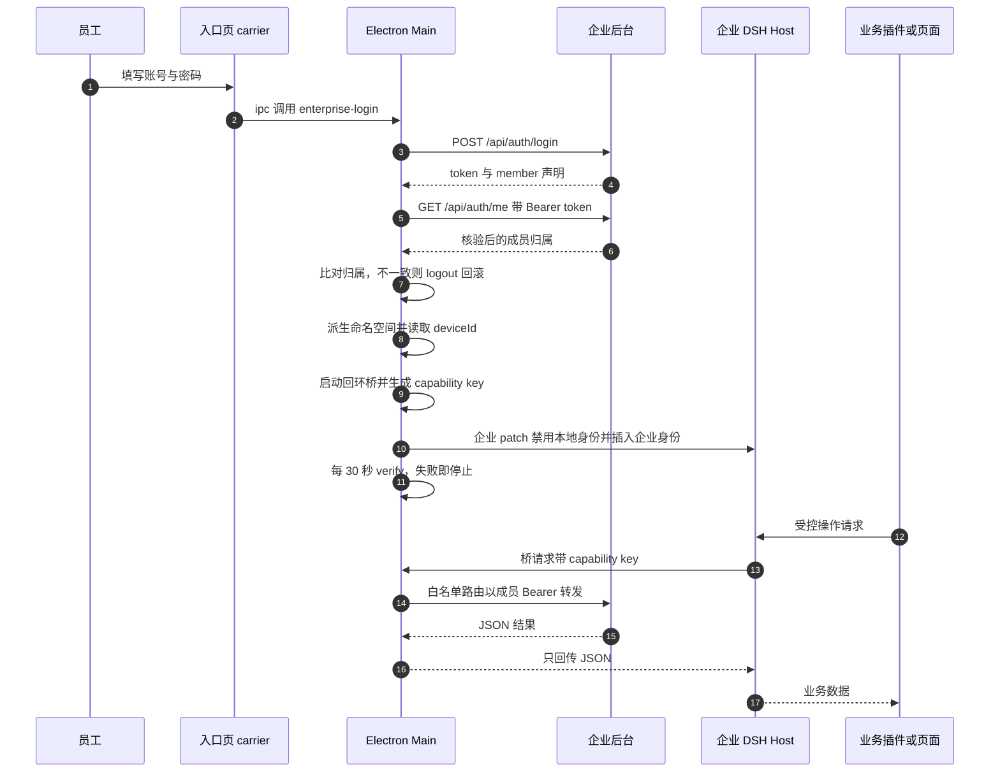
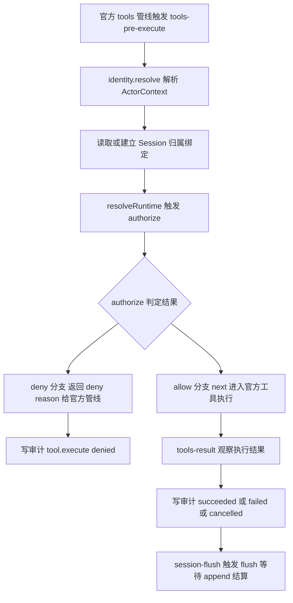

# WorkDSH 企业身份、授权与凭据边界

本篇只盯一件事：在一个**把 Agent 和工具都放在用户本机执行**的产品里，企业身份、成员凭据、授权判定和审计记录各自被放在哪一层，边界又是怎么被代码强制住的。基线是 `main`@`acbfd5a4be`，官方 DSH 钉在 `0.2.0-rc.2`；企业侧另有独立后台仓库 `workdsh-admin`，不在本仓库，本篇不做任何引用。

结论先行：WorkDSH 没有把"企业模式"做成散落在业务代码里的 `if (enterprise)`，而是把它压成三样可审计的产物 —— 一份 **profile patch**（在组装期换掉身份提供方）、一个**只监听回环的回环桥**（把后台 bearer 留在 Electron Main，只让 Host 代理受控操作）、以及一组**挂在官方管线上的授权钩子**（先授权再 `next()`，被拒返回 deny reason 并落审计）。这三样东西共同把"成员凭据不出 Main"和"未绑定归属的会话不被接管"变成了结构性事实，而不是纪律要求。

## 身份提供方是 profile 组合出来的，不是业务代码里的分支

`workdshIdentity` 是 Cordis 上的一个服务名，谁提供它由 profile 组合决定，不由调用方决定。

个人侧：`workdsh-plugin-access` 用一份 patch 把访问控制、会话桥、工具桥三个服务插入默认 Profile；身份则由 identity-local 自己的 patch 插入，并带上一组写死的本地个人配置。

- 默认 Profile 里插入的三个访问控制服务：[packages/plugins/access/cordis.patch.yml:1-9]()
  <!-- anchor: - insert: … autoBindPersonalSessions: true -->
- 本地身份提供方的插入点与默认配置，`principalId` 直接写死为 `local-user`：[packages/providers/identity-local/cordis.patch.yml:1-6]()
  <!-- anchor: - insert: … organizationId: local-personal -->

两个实现占用的是同一个服务名 `workdshIdentity`，这是"可替换"能够成立的唯一前提：

- 个人实现把自己注册成 `workdshIdentity`：[packages/providers/identity-local/src/index.ts:147-151]()
  <!-- anchor: constructor(ctx: Context, config: Config) { … this.id = this.provider.id; -->
- 企业 Desktop 实现同样注册成 `workdshIdentity`，并顺手把 `workdshEnterprise` 作为子服务挂上：[packages/providers/identity-enterprise/src/desktop.ts:22-25]()
  <!-- anchor: constructor(ctx: Context, config: EnterpriseDesktopConfig) { … ctx.plugin(EnterpriseTransport, this); -->

契约层只声明"身份能做什么"，并且明确写死了证据的语义 —— 客户端传来的任何东西都不能用来选定身份，只能用来做关联：

- `IdentityService` 只有 `profile` / `membership` 两个读取口，注释原文是 "It never accepts client-selected identity."：[packages/contracts/src/governance.ts:135-139]()
  <!-- anchor: export interface IdentityService<Evidence = IdentityResolutionContext | undefine … membership(organizationId: string, principalId: string): Membership | undefined; -->

企业切换发生在两处，互相冗余：

- Main 写出一份企业 patch：先 `disabled: true` 掉 `workdsh-identity-local`，再 `insert` 企业账号客户端与企业 Desktop 身份，最后覆盖会话桥/工具桥的自动绑定开关：[apps/desktop/src/local-runtime.ts:166-171]()
  <!-- anchor: export function desktopEnterprisePatch(home: string, authority: Authority, actor … writeFileSync(patch, `- id: workdsh-identity-local\n  disabled: true\n- insert:\ -->
- 同时 Main 还把 `workdsh-provider-identity-local` 从 Profile 的 `bundles` 列表里摘掉，注释直说是"在组合期禁用个人身份，而不是允许身份回退"：[apps/desktop/src/workdsh-main.ts:389-391]()
  <!-- anchor: // Disable personal identity at composition, rather than allow an identity fallb … for (const name of pluginNames) { -->

**为什么用 provider 替换而不是 `if (enterprise)`。** 三个理由：其一，身份解析是后续所有授权、审计、会话归属判定的**输入**，必须有一个唯一且确定的来源；如果写成条件分支，运行期就存在"两个身份源同时在场"或"一个都没注册"的窗口，而 fail-closed 的前提恰恰是"没有身份就是错误"。其二，DSH 的 Profile 组合是官方机制，替换 provider 不需要 fork 官方 Loader —— 这个文件头一句就写明了 "No custom Loader"：

- 文件头自述：[apps/desktop/src/local-runtime.ts:1-1]()
  <!-- anchor: /** Writable Profile/configuration over the official installation anchor. No cus … /** Writable Profile/configuration over the official installation anchor. No cus -->其三，企业版与个人版的全部差异被压缩成**一份可 diff 的 patch 文本**，评审时看这一份文件就够。

**代价。** 组合期是唯一能发现身份配置冲突的时机，冲突只能以启动失败的形式暴露：identity-local 在初始化时会核对持久化身份与配置是否一致，不一致直接抛出 `identity-local/config-conflict`。

- 持久化身份与配置不一致即拒绝启动：[packages/providers/identity-local/src/index.ts:183-188]()
  <!-- anchor: || state.principalId !== this.configured.principalId … 'Host identity configuration conflicts with the persisted local profile.', -->

也就是说，一旦持久化档案与配置漂移，用户看到的是"起不来"，而不是"降级成本地身份继续跑" —— 这是刻意的 fail-closed 取舍，代价是没有可用性兜底。

另外要如实说清"可替换"的现状：目录里确实还有一个 SSO 提供方 `identity-oidc`，但它目前只是规划骨架，因此**不要**把"支持三种身份源"当成既成事实。

- 提供方目录自述：identity-oidc、library-team、runtime-isolated 仍为规划骨架：[packages/providers/README.md:11-11]()
  <!-- anchor: identity-local、identity-enterprise 和 browser-session 已有开发实现；identity-oidc、librar … identity-local、identity-enterprise 和 browser-session 已有开发实现；identity-oidc、librar -->

## 成员凭据只留在 Electron Main

企业登录的凭据边界由 `EnterpriseLogin` 这一个类负责，它的设计目标是"不透明成员令牌永不进入渲染进程或 CLI"。

- 令牌是 ECMAScript 私有字段 `#token`，构造器私有，只能经 `login()` 创建：[apps/desktop/src/enterprise-auth.ts:26-30]()
  <!-- anchor: export class EnterpriseLogin { … #fetch: typeof fetch -->
- 后台返回的令牌先过格式闸：32–256 位的 URL-safe 不透明串，否则整次登录作废：[apps/desktop/src/enterprise-auth.ts:45-45]()
  <!-- anchor: if (!data || typeof data.token !== 'string' || !/^[A-Za-z0-9_-]{32,256}$/u.test( … if (!data || typeof data.token !== 'string' || !/^[A-Za-z0-9_-]{32,256}$/u.test( -->

**登录成功不等于可以进企业空间。** 拿到令牌后必须再打一次 `/api/auth/me` 做二次核验，而且要比对**登录响应里的 member 声明**与**核验响应的真实成员**在 `id` 和 `organizationId` 上完全一致 —— 这一条防的是"登录接口返回的声明被中间环节篡改/串台"这类归属错配：

- 二次核验与归属一致性比对：[apps/desktop/src/enterprise-auth.ts:47-52]()
  <!-- anchor: const verified = await request(`${backend}/api/auth/me`, { headers: { Authorizat … if (!admitted || admitted.id !== actor.id || admitted.organizationId !== actor.o -->

**核验失败必须回滚后台会话。** 登录接口已经真实创建了后台会话，本地却拒绝准入；如果就这么丢掉令牌，后台会残留一个无人持有的有效会话。代码的处理是主动 `POST /api/auth/logout` 撤销，并且撤销本身失败时要在错误信息里明确写"后台登录撤销尚未确认"，不允许含糊过去：

- 回滚撤销与"撤销尚未确认"的显式报错：[apps/desktop/src/enterprise-auth.ts:54-62]()
  <!-- anchor: } catch (error) { … throw error -->

退出路径同样遵循"先断本地再撤远端、撤不掉要说清"的顺序：先关回环桥、再删本机认证文件、最后请求后台撤销，撤销失败则弹窗告知本机已退出但远端未确认：

- 退出顺序与远端撤销未确认的提示：[apps/desktop/src/workdsh-main.ts:295-299]()
  <!-- anchor: if (session) { … if (page && !page.isDestroyed()) { -->

入口页拿不到令牌，它只能发起一次受约束的 IPC 调用；IPC 还额外要求调用方就是当前入口窗口、处于入口态、且没有既有企业会话：

- IPC 处理器的来源与状态双重校验：[apps/desktop/src/workdsh-main.ts:418-419]()
  <!-- anchor: ipcMain.handle('workdsh:enterprise-login', async (event, input: unknown) => { … if (!entrySurface || event.sender !== window?.webContents || switching || !pendi -->

文档口径与实现一致：登录 bearer 只由 Main 持有，业务窗口不获得 carrier preload、Node integration 或后台登录凭据：

- [docs/DESKTOP-PERSONAL-ENTERPRISE.md:57-57]()
  <!-- anchor: Electron 负责入口、登录、本机进程和窗口；官方 Host、设置、侧栏、右侧面板与 Agent 流程来自同一官方运行包。登录 bearer 只由 Main … Electron 负责入口、登录、本机进程和窗口；官方 Host、设置、侧栏、右侧面板与 Agent 流程来自同一官方运行包。登录 bearer 只由 Main -->

**为什么必须这么划。** 渲染进程里跑的是完整的 DSH Web Client 和一堆第三方插件页面；令牌一旦下发，就会进入 DevTools、内存快照、前端日志和崩溃转储，凭据边界事实上失守。**代价**是页面再也不能"直接 fetch 后台"：每个企业能力都必须在 Host 侧显式注册成一个受控路由，页面只能调这些路由。

- Host 侧注册受控路由的写法（注册即声明 path、method 与请求体策略）：[packages/providers/identity-enterprise/src/desktop.ts:28-29]()
  <!-- anchor: const register = (path: string, methods: Array<'GET' | 'POST'>, fetch: (request: … ctx.effect(() => ctx.connection.fetch.register({ path, methods, requestBody: 'buffered', fetch }), `workdsh.enterprise-desktop.${path}`); -->
- 其中 `/api/auth/me` 这个受控路由的失败语义就是"撤销本地身份并 401"，不泄露上游细节：[packages/providers/identity-enterprise/src/desktop.ts:32-37]()
  <!-- anchor: register('/api/auth/me', ['GET'], async request => { … } catch { this.identity?.revoke(); return denied(); } -->

## 回环桥：bearer 留在 Main，Host 侧只做受控代理

这是全篇最核心的一段。Electron Main 在企业登录后启动一个**只监听 127.0.0.1 随机端口**的 HTTP 桥，Host 侧的插件通过它访问后台。桥不转发任意请求，它只认一小组预先写死的操作。

**第一层：能力密钥 + 来源约束 + 关闭窗口。**

- 密钥是 32 字节随机十六进制，比较用 `timingSafeEqual` 且长度不等直接拒；`closing` 标志在退出时先拒一切请求；带 `Origin` 的浏览器请求一律 403：[apps/desktop/src/enterprise-auth.ts:99-110]()
  <!-- anchor: /** A capability-protected loopback bridge with a closed set of member-authorize … if (req.headers.origin) { reject(403, 'Browser requests are not admitted'); retu -->

拒绝带 `Origin` 的请求这条非常关键：浏览器发起的跨源请求一定带 `Origin`，而 Host 进程内的 Node `fetch` 不带。于是**同一个回环端口天然只对服务端代码开放**，网页永远拿不到这条通道，也就没有"XSS 之后顺手读后台"的路径。

**第二层：白名单路由正则，其余 404。**

- 路由只有四类：auth（`/auth/me`、`/api/auth/me`，GET 且无查询串）、`/visible-sessions/ingest`（GET/POST/DELETE）、协作（两条精确正则覆盖 contract/colleagues/inbox/sent/notifications/materials/handoffs）、以及扩展接口 `^/api/extensions/<plugin>/<operation>$`；不匹配即 404 "Unknown Desktop operation"：[apps/desktop/src/enterprise-auth.ts:112-121]()
  <!-- anchor: if (url.pathname === '/auth/logout' && req.method === 'POST' && !url.search) { … if (!auth && !ingest && !collaboration && !extension) { reject(404, 'Unknown Des -->

注意 `/auth/logout` 是独立分支：它先置 `closing = true`、取消在途请求，再回答 `{"local":true}`，然后在响应结束后延迟触发登出回调 —— 也就是"**先停止接受新请求，再谈清理**"。

**第三层：请求体上限与内容类型。**

- 协作与扩展接口转发：必须 `application/json`、边读边计数、超过 8 MiB 直接 413，且解析 JSON 失败即 502；上游非 2xx 时只回一个粗略错误，不回传上游正文：[apps/desktop/src/enterprise-auth.ts:135-146]()
  <!-- anchor: if(req.method==='POST') { … return; -->
- 正文同步通道更严：POST 上限 2 MiB，且强校验请求体里的 `deviceId` 与本次会话的 deviceId 一致（403 Device mismatch）；GET 只允许恰好一个 `sessionId`、长度 ≤256、不接受任何其它查询键：[apps/desktop/src/enterprise-auth.ts:152-165]()
  <!-- anchor: if (url.search || !req.headers['content-type']?.startsWith('application/json'))  … target += `?${new URLSearchParams({ deviceId, sessionId: session })}` -->

**第四层：超时与生命周期。**

- `requestTimeout` 15s、`headersTimeout` 10s，端口由内核分配（`listen(0, '127.0.0.1')`），返回的 `close()` 会置 `closing`、取消在途请求并 `closeAllConnections()`：[apps/desktop/src/enterprise-auth.ts:175-179]()
  <!-- anchor: server.requestTimeout = 15_000; server.headersTimeout = 10_000 … return { url: `http://127.0.0.1:${address.port}`, key, close: async () => { clos -->

**Host 侧拿到的是能力密钥，不是成员令牌。** Main 把 `{authorityUrl, authorityKey, backendUrl, principalId, organizationId, deviceId}` 写进 0600 的 `enterprise-auth.json`；Host 侧读它时必须过受保护文件检查（非符号链接、非普通文件拒绝、POSIX 下权限位不得对 group/other 开放、读前读后 inode/大小/权限三重比对）：

- 受保护文件读取：[packages/providers/identity-enterprise/src/protected-file.ts:8-23]()
  <!-- anchor: export async function readProtectedFile(path: string, maximumBytes: number): Pro … } finally { await file.close(); } -->
- 读出的绑定还要逐字段核对，并归一化 URL（必须是字面量回环 origin：`http:` + `127.0.0.1` + 有端口 + 路径为 `/`）；绑定一旦变化即报 "authority changed; sign in again"：[packages/providers/identity-enterprise/src/desktop-authority.ts:47-58]()
  <!-- anchor: private async credentials(): Promise<Readonly<AuthorityFile>> { … return this.binding ??= normalized; -->
- 每次请求之后都重读一次绑定文件（登出除外），把"Main 换了密钥"变成当次请求即失败：[packages/providers/identity-enterprise/src/desktop-authority.ts:70-70]()
  <!-- anchor: if (path !== '/auth/logout') await this.credentials(); … if (path !== '/auth/logout') await this.credentials(); -->

**响应也做白名单。** `account()` 不把后台的多余字段带回 Client，而是逐字段重建一个冻结 DTO；任何一项（id、organizationId、deviceId、backendUrl、角色、`mustChangePassword === false`、displayName、email、organizationName）不匹配就当作认证过期：

- 白名单式重建与"成员已变或认证过期"：[packages/providers/identity-enterprise/src/desktop-authority.ts:82-91]()
  <!-- anchor: async account(signal?: AbortSignal): Promise<DesktopAccount> { … role: value.role!, mustChangePassword: false, displayName: value.displayName, em -->

**撒权即停。** Main 每 30 秒重新 `verify()`，并把"企业插件是否还在"一起复查；任一失败就弹窗并退回入口，销毁本机企业运行：

- 30 秒轮询与失败退场：[apps/desktop/src/workdsh-main.ts:404-414]()
  <!-- anchor: verifyTimer = setInterval(() => { … }, 30_000) -->

企业 Host 侧的身份实现同样在每次 `resolve()` 时重新核验；一旦核验抛错或成员归属/角色变化，就**自毁**（`revoke()`），此后所有调用直接失败：

- 每次解析都重验，失败即撤销自身：[packages/providers/identity-enterprise/src/member-identity.ts:13-18]()
  <!-- anchor: static async admit(verify: (signal?: AbortSignal) => Promise<VerifiedMember>, si … return new EnterpriseMemberIdentity(Object.freeze({ ...member }), verify); -->

协作能力走的也是同一条通道，拿到的同样是**能力密钥**而不是成员令牌；协作者身份变化时抛"authority changed"：

- 协作插件从 Host 身份取 bridge binding，而不是从配置取 bearer：[packages/providers/identity-enterprise/src/desktop-authority.ts:116-119]()
  <!-- anchor: async collaborationBinding(signal?: AbortSignal): Promise<{url:string;authorizat … return {url:binding.authorityUrl,authorization:`Bearer ${binding.authorityKey}`} -->

正文同步这条最"脏"的路径还多一层自净：上传前把文本里的 capability key 替换成 `[credential redacted]`，并把密钥格式、私有钥 PEM、JWT、`Bearer` 串一并脱敏：

- 正文投影的脱敏函数：[packages/providers/identity-enterprise/src/desktop-body-sync.ts:19-23]()
  <!-- anchor: export function redactVisibleText(text: string): string { … .replace(/\bBearer\s+[A-Za-z0-9._~-]{16,}/gi, 'Bearer [credential redacted]'); -->
- 投影后再用能力密钥做一次替换，双保险：[packages/providers/identity-enterprise/src/desktop-body-sync.ts:118-118]()
  <!-- anchor: const entries = visibleEntries(inspected.events, this.state.namespace, id).map(e … const entries = visibleEntries(inspected.events, this.state.namespace, id).map(e -->

### 登录到桥转发的完整链路

下图把"用户登录 → 后台签发 → Main 持有并核验 → 组建企业 profile → 启动企业 DSH → 桥请求带成员凭据转发"串成一条线。留意两件事：令牌归 Main（`#token`），Host 侧拿到的只是能力密钥；以及认证在**发请求时**和**每 30 秒**各被重验一次。

这张图的落点在于：**桥把"谁在调用"从"页面自称"换成了"持有 capability key 的 Host 进程"**，而"以谁的身份调用"由 Main 独占地决定。页面即使被完全控制，能做的也只是调用 Host 已注册的受控路由，而受控路由背后仍是白名单。

**取舍与替代方案。** 替代方案有两个，都被放弃：(a) 把 bearer 直接交给渲染进程 —— 实现最省事，但凭据会散落到 Web 层的每一处，且与"企业插件是第三方可安装代码"的事实冲突；(b) 让每个企业插件自己拿 bearer —— 那就要给每个插件发令牌，"插件可安装、可卸载"与"凭据长期有效"直接打架。现有方案的**代价**是：新增一个企业能力要改两处（Host 注册路由 + Main 白名单），而且白名单是**手写正则**，任何一处写宽（例如 extension 正则允许结尾短横线）都会扩大暴露面。

## 会话归属与工具入口拦截

身份解决"你是谁"，归属解决"这个会话归谁"，工具桥解决"这次调用允不允许"。三者都是 fail-closed：拿不到明确允许就拒。

**判定顺序写死在 `authorize()` 里**：跨组织直接拒；成员记录缺失或 `state !== 'active'` 直接拒；是资源所有者本人则放行；否则只有存在包含该 action 的显式 grant 才放行：

- 四段判定与 `access/cross-organization`、`access/inactive-membership`、`access/not-granted` 三个稳定错误码：[packages/plugins/access/src/index.ts:227-237]()
  <!-- anchor: if (request.actor.organizationId !== request.owner.organizationId) { … : this.deny('access/not-granted', membership.revision, grants); -->

注意这里**没有任何基于角色的旁路**：即使 actor 是企业管理员，只要不是资源所有者本身、又没有显式 grant，一样是 deny。管理员的读权限由后台侧设计承担，不在本机授权器里开洞。

**授权结果带一个可对账的指纹。** `authorizationRevision` 是对"成员修订号 + 按 grant id 排序后的 (id, revision) 列表"取 sha256，因此任何 grant 增删改都会换值：

- 指纹构造：[packages/plugins/access/src/index.ts:96-105]()
  <!-- anchor: function authorizationRevision(membershipRevision: string | undefined, grants: r … return hash.digest('hex'); -->

**grant 的写入是 CAS。** `expectedRevision` 与当前记录不符即 `access/revision-conflict`，且必须先对同一资源通过 `manage` 授权、且 grant 的主体必须是活跃成员：

- 写 grant 前的 CAS 与主体活跃性检查：[packages/plugins/access/src/index.ts:264-267]()
  <!-- anchor: const grants = this.requireGrants(); … throw new GovernanceContractError('access/revision-conflict', 'Grant revision do -->

**未绑定归属的既有 Session 不允许被接管。** 带 `sessionId` 创建会话时，如果该 Session 在本机已存在、却查不到可信归属，就直接拒绝并落 `access/unbound-session-adoption` 审计 —— 这一条堵的是"用旧会话 ID 重新 claim 一份别人/上个身份留下的历史"：

- 既有但无主的 Session 一律拒绝接管：[packages/plugins/access/src/index.ts:413-425]()
  <!-- anchor: if (request.sessionId !== undefined && !this.ctx.workdshAccess.sessionOwner(Stri … 'An existing Session without a trusted owner binding cannot be adopted.', -->

**列表按归属过滤。** 企业模式下，会话列表结果在返回前再过滤一次，只保留 `organizationId` 与 `ownerPrincipalId` 都等于当前 actor 的项；解析前后各比一次身份，不一致就当作不存在（`ApiSessionNotFound`）：

- 企业模式的列表过滤：[packages/plugins/access/src/index.ts:479-481]()
  <!-- anchor: return { items: result.items.filter(item => { … return owner?.organizationId === actor.organizationId && owner.ownerPrincipalId  -->

**Actor 上下文本身也要过闸。** 所有授权入口先跑 `assertActorContext` / `assertResourceOwner`，字段必须非空、≤256、且不含控制字符；`scope === 'project'` 必须带 `projectId`，非 project 又给了 `projectId` 同样报错：

- 上下文与资源所有者的结构校验：[packages/plugins/access/src/governance.ts:28-39]()
  <!-- anchor: export function assertActorContext(value: unknown): asserts value is ActorContex … if (actor.delegatedByPrincipalId !== undefined) required(actor.delegatedByPrinci -->

**工具入口拦截挂在官方管线上，不是自建执行器。** `ToolAccessBridge` 订阅官方的 `tools/pre-execute` 拿决策权、订阅 `tools/result` 观察结果、订阅 `session/flush` 做审计收尾：

- 三个订阅点与销毁时 flush：[packages/plugins/access/src/index.ts:569-575]()
  <!-- anchor: ctx.on('tools/pre-execute', async (exec, next) => this.authorizeTool(exec, next) … ctx.effect(() => async () => this.flush(), 'workdshToolAccess.flush'); -->

`authorizeTool` 的顺序是：解析 actor → 若 Session 无归属，先问"这个 profile 是否被允许自动绑定"（企业 Desktop 下 `autoBindFixedMemberSessions` 为真，且还要求 profile 里的成员与 actor 在 `principalId` 与 `organizationId` 上完全一致，注释明确写了"仅供固定的单成员 Host，绝不用于共享多用户运行时"）→ `resolveRuntime` 里再走一次 authorize → 全过才写内存态并 `next()`；任何一步抛错都转成 `{kind:'deny', reason}` 并落审计：

- 先授权再 next，被拒返回 deny reason 而不是抛异常给工具：[packages/plugins/access/src/index.ts:583-609]()
  <!-- anchor: private async authorizeTool(exec: ToolExecution, next: () => Promise<PreToolDeci … return next(); -->

`SessionAccessBridge` 这条路上还有一道更严的闸：只有身份实现 id 属于 `workdsh-enterprise-process` / `workdsh-enterprise-desktop`、profile 是团队空间、且成员与组织都与 actor 一致时，才允许采纳一个无归属的原生 Session；否则该 Session 在 `inspect` / `list` 里一律当作不存在：

- 采纳无归属 Session 的四项前提：[packages/plugins/access/src/index.ts:486-490]()
  <!-- anchor: if (!this.config.autoBindFixedMemberSessions || 
  <!-- anchor: private observeResult(exec: Readonly<ToolExecution>, result: Readonly<ToolExecut … this.resultAuditTail = this.resultAuditTail.then(append, append); -->

### Agent 工具调用前的授权链

下图是上面这套顺序的骨架。注意"deny"不是异常而是**决策**：它带着稳定的 code 回到官方管线，同时产生一条审计记录；只有全部通过才进入真实执行。

落点：整条链上**唯一**放行条件就是 `authorize()` 返回 `allow`；没有"默认允许""管理员例外""超时放行"这些旁路。跨组织、非活跃成员、未绑定归属、以及 `bindSession` 的归属冲突，全都只会走到 deny 分支 —— 也就是"拒绝"本身也是可对账的事件。审计队列则在 `session/flush` 与工具桥的销毁路径上被显式 flush：

[packages/plugins/access/src/index.ts:569-575]()
<!-- anchor: ctx.on('tools/pre-execute', async (exec, next) => this.authorizeTool(exec, next) … ctx.effect(() => async () => this.flush(), 'workdshToolAccess.flush'); -->

代价是每 30 秒一次的后台核验和每次工具调用的身份解析都变成硬依赖 —— 后台不可达时，企业会话里的工具调用会被一律 deny，而不是降级成本地可信。

## 审计：按记录落域的日志 + 明确的 flush 时机

审计事件有独立的 schema 和独立存储域，不是往业务库里塞行文本：

- `AuditEvent` 的持久化 schema：`occurredAt` 必须是 ISO 时间，`outcome` 五值枚举，`references` 只能是 `string -> string`：[packages/plugins/audit/src/index.ts:9-21]()
  <!-- anchor: const auditEventSchema: z.ZodType<AuditEvent> = z.object({ … references: z.record(z.string(), z.string()).optional(), -->
- 存储域 `workdsh_audit`，`layout: 'per-record'`，表名 `events`：[packages/plugins/audit/src/index.ts:24-28]()
  <!-- anchor: export const auditDomainSpec = defineDomain({ … tables: { events: domainTable<string, AuditEvent>(auditEventSchema) }, -->

**审计里不允许出现敏感键。** 键名命中 `credential|password|prompt|secret|token` 直接抛 `audit/sensitive-reference`；键长 >128 或值长 >1024 抛 `audit/invalid-reference`：

- 敏感引用闸门：[packages/plugins/audit/src/index.ts:37-49]()
  <!-- anchor: const sensitiveReference = /(credential|password|prompt|secret|token)/i; … throw new GovernanceContractError('audit/invalid-reference', `Audit reference '$ -->

**append 是排队的，flush 是等待队列结算。** `append` 用 `appendTail` 串行化并拒绝重复 id；`flush()` 只是 `await this.appendTail`：

- flush 的语义就是"等待此前所有 append 结算"：[packages/plugins/audit/src/index.ts:88-89]()
  <!-- anchor: async flush(): Promise<void> { … await this.appendTail; -->

**flush 的触发时机在业务侧显式声明。** 工具桥在 `session/flush` 事件和自身销毁时调用 `workdshAudit.flush()`，从而把"会话落一次盘"与"审计队列清空"对齐：

- 工具桥的 flush 实现：[packages/plugins/access/src/index.ts:578-580]()
  <!-- anchor: async flush(): Promise<void> { … await this.ctx.workdshAudit.flush(); -->

值得如实标注的是：`flush()` **不等于** fsync，也不构成不可篡改性 —— 它只保证"已经被接受的 append 都写进了 `storageDomain`"，真正的落盘语义归官方存储域。而审计数据就存在企业空间自己的 DSH_HOME 下（见下文的空间隔离），本地用户对它有文件级处置权。

## 企业业务插件的复用接口 `workdshEnterprise`

企业身份包除了提供身份，还对外暴露一个服务，让**独立交付的企业业务插件**复用当前成员登录，而不用各自处理登录态。

- 契约只有两个方法，并且把"扩展命名空间固定"写成硬正则：`^[a-z][a-z0-9-]{0,63}$`，路径固定拼 `/api/extensions/<plugin>/<operation>`：[packages/contracts/src/enterprise.ts:14-17]()
  <!-- anchor: export function enterpriseExtensionPath(plugin: string, operation: string): stri … return `/api/extensions/${plugin}/${operation}`; -->
- 实现把它注册成 Cordis 服务 `workdshEnterprise`，生命周期绑定在已安装的企业身份上：[packages/providers/identity-enterprise/src/desktop.ts:89-92]()
  <!-- anchor: class EnterpriseTransport extends Service implements EnterpriseService { … request<T = unknown>(input: EnterpriseRequest): Promise<T> { return this.owner.e -->

### 文档声明与代码的逐项核对

| `docs/ENTERPRISE-PLUGIN-AUTH.md` 的声明 | 代码位置 | 是否一致 |
| --- | --- | --- |
| 服务不返回后台 Token、本机桥接密钥或账号密码 | [packages/providers/identity-enterprise/src/desktop.ts:89-92]() <!-- anchor: class EnterpriseTransport extends Service implements EnterpriseService { … request<T = unknown>(input: EnterpriseRequest): Promise<T> { return this.owner.e --> | 一致：`EnterpriseService` 只有 `identity` / `request`，没有凭据读出 |
| 第一版只接受 GET、POST，GET 不携带 body | [packages/providers/identity-enterprise/src/desktop-authority.ts:106-114]() <!-- anchor: async extension<T = unknown>(input: EnterpriseRequest): Promise<T> { … return value as T; --> | 一致：`!['GET','POST'].includes(method)` 且 GET 带 body 直接抛 |
| 不允许任意 URL、查询字符串或嵌套路径 | [apps/desktop/src/enterprise-auth.ts:112-121]() <!-- anchor: if (url.pathname === '/auth/logout' && req.method === 'POST' && !url.search) { … if (!auth && !ingest && !collaboration && !extension) { reject(404, 'Unknown Des --> | 一致：`!url.search` + 精确两段正则，路径由 Host 侧内联拼接 |
| 标识符为小写字母开头，长度 1–64 | [packages/contracts/src/enterprise.ts:14-17]() <!-- anchor: export function enterpriseExtensionPath(plugin: string, operation: string): stri … return `/api/extensions/${plugin}/${operation}`; --> | 基本一致，但正则 `^[a-z][a-z0-9-]{0,63}$` **允许结尾短横线**，文档未提这一点 |
| 请求体上限 8 MiB，超时 10 秒，无自动重试 | [apps/desktop/src/enterprise-auth.ts:135-146]() <!-- anchor: if(req.method==='POST') { … return; --> | 一致：8 MiB 计数 + 413，`AbortSignal.timeout(10_000)`，无重试循环 |
| `plugin` 是路由标识，不是可信插件身份 | [docs/ENTERPRISE-PLUGIN-AUTH.md:41-41]() <!-- anchor: `plugin` 是路由标识，不是可信的插件身份，也不授予权限。所有已安装 Host 插件可调用这个服务，后台必须依当前成员校验权限，不能凭插件名称、客户端传来 … `plugin` 是路由标识，不是可信的插件身份，也不授予权限。所有已安装 Host 插件可调用这个服务，后台必须依当前成员校验权限，不能凭插件名称、客户端传来 --> | 代码确实不做任何基于 `plugin` 名的授权；但这也意味着**所有约束都压给后台**，本机侧不提供第二道闸 |
| 页面不得直连后台，须经 Host 受控接口 | [docs/ENTERPRISE-PLUGIN-AUTH.md:45-45]() <!-- anchor: 业务页面通过自己的 `connection.fetch` 受控接口调用 Host 业务服务，再由业务服务调用 `workdshEnterprise`。不要把 T … 业务页面通过自己的 `connection.fetch` 受控接口调用 Host 业务服务，再由业务服务调用 `workdshEnterprise`。不要把 T --> | 一致：回环桥拒绝带 `Origin` 的请求，页面只能走 Host 已注册路由 |

三处值得单独点出：

- 扩展路径的构造逻辑**存在三份**（契约里的 `enterpriseExtensionPath`、Desktop 授权层的正则、Main 回环桥的路由正则）。其中契约里那个 helper 在整个仓库里**没有任何调用方**，属于"有契约、无消费者"的死代码，正则一旦只改一处就会漂移。
- `plugin` 名不可信这一点，代码侧的体现是"只用它拼路径、只用它做格式校验"，这既是正确的最小权限姿态，也把**全部业务鉴权责任推给后台**：本机侧无法阻止一个已安装插件去调用它本无权调用的业务操作。
- 在仓库范围内，`workdshEnterprise` 只有实现、没有本地消费者；文档示例里的 `company-reports` 属于仓外插件。因此这个接口的"兼容性"目前由文档与版本号声明，而不是由仓内集成测试保证。

**补充：`workdsh-contracts` 不是已发布公共 SDK。** 包本身是 `private`，文档也明确要求不要假设公共 registry 上有它：

- [packages/contracts/package.json:4-4]()
  <!-- anchor: "private": true, … "private": true, -->
- [docs/ENTERPRISE-PLUGIN-AUTH.md:33-33]()
  <!-- anchor: `workdsh-contracts` 当前是仓库内的私有包，并非已发布 npm SDK。仓库内使用 workspace 依赖；独立项目可构建并打包该包，再使用 … `workdsh-contracts` 当前是仓库内的私有包，并非已发布 npm SDK。仓库内使用 workspace 依赖；独立项目可构建并打包该包，再使用 -->

## 本机空间隔离：数据归属边界，不是沙箱

企业空间不是一个目录，而是一条由**后台来源 + 组织 + 成员**派生出来的命名空间。

- 命名空间是三者 JSON 序列化后的 sha256：[apps/desktop/src/connection-mode.ts:27-28]()
  <!-- anchor: export function enterpriseNamespace(origin: string, organizationId: string, prin … return createHash('sha256').update(JSON.stringify([enterpriseConnection(origin). -->
- 空间根为 `userData/enterprise/<namespace>`，权限 0700；`device.json` 里存一个 UUID 格式的 deviceId，格式非法即报"企业本机设备记录无效"；同时预建 home/dsh/agents/workspace/tmp/appdata/localappdata 七个子目录：[apps/desktop/src/local-runtime.ts:121-130]()
  <!-- anchor: export function enterpriseSpace(userData: string, backend: string, actor: Enterp … return { root, home: join(root, 'dsh'), deviceId } -->
- 后台地址在入口就被规范化：必须 HTTPS（仅 `localhost`/`127.0.0.1`/`[::1]` 允许 HTTP），且不接受用户名、密码、查询串、fragment 或非根路径：[apps/desktop/src/connection-mode.ts:8-17]()
  <!-- anchor: export function enterpriseConnection(value: string): DesktopConnection & { mode: … return { mode: 'enterprise', portalOrigin: url.origin } -->

**子进程环境是白名单重建的，不是继承的。**

- `enterpriseEnvironment()` 只透传 `SystemRoot/WINDIR/ComSpec/PATHEXT/LANG/LC_ALL/TZ/DISPLAY/WAYLAND_DISPLAY`，PATH 前置自带 Node 目录，并把 `HOME/USERPROFILE/DSH_HOME/DSH_AGENTS_HOME/TMPDIR/TMP/TEMP/APPDATA/LOCALAPPDATA` 全部重写到企业空间内：[apps/desktop/src/local-runtime.ts:133-141]()
  <!-- anchor: export function enterpriseEnvironment(root: string, executable: string, parent:  … return result -->
- 浏览器窗口同时开 `contextIsolation`、`sandbox`，并关掉 `nodeIntegration`；企业形态还挂独立 `partition`，与会话分区互不可见：[apps/desktop/src/workdsh-main.ts:130-135]()
  <!-- anchor: webPreferences: { … ...(connectionPartition(connection) === undefined ? {} : { partition: connection -->

**这是取舍，不只是保护。** 环境白名单意味着**父进程里任何未列入白名单的变量都不会进入企业 DSH**：好处是父进程的模型 Key、代理密码不会被顺手带进企业空间，坏处是任何依赖环境变量注入的配置在企业模式下都会"莫名失效"，必须改走 Profile 配置或官方设置页。

**文档自己也说清了它不是沙箱。** 这一点必须原文标出，避免读者误读隔离强度：

- Profile 是配置组合，不是账号或授权边界；按来源/组织/成员分开的目录**不提供操作系统级沙箱**：[docs/desktop-boundaries.md:92-94]()
  <!-- anchor: A Profile is configuration composition, not a user account or authorization … and member. Separate directories do not provide an operating-system sandbox. -->
- 中文口径同义："目录分离是数据归属边界，不能代替操作系统安全沙箱"：[docs/DESKTOP-PERSONAL-ENTERPRISE.md:43-43]()
  <!-- anchor: 企业账号与个人空间分开。企业空间按后台来源、组织和成员划分，分别保存 Home、Profile、凭据、工作目录、会话和窗口存储。重新登录原账号恢复原空间；切换到 … 企业账号与个人空间分开。企业空间按后台来源、组织和成员划分，分别保存 Home、Profile、凭据、工作目录、会话和窗口存储。重新登录原账号恢复原空间；切换到 -->

换句话说：在企业 Desktop 形态下，企业代码与个人代码是**同一个 OS 用户**下的两个 Node 进程；隔离保证的是"数据不混、凭据不串"，不保证"恶意插件拿不到企业文件"。真正的隔离边界由"企业插件本身也是可信本机代码"这一前提兜底。

## 文档与实现的不一致：企业账号插件到底随不随包

这是本篇最需要如实写出来的地方。**README、打包边界脚本、校验脚本、运行时自检和实现本身是一致的；两份文档把这件事写反了。**

文档侧的"随包携带"口径：

- `docs/desktop-boundaries.md` 声称企业账号插件"additionally carried by the immutable runtime"，且"employees do not install an account tgz"：[docs/desktop-boundaries.md:25-31]()
  <!-- anchor: The built-in owned feature plugins are **experts, library, skills and … business applications remain external plugins requiring explicit installation. -->
- `docs/DESKTOP-PERSONAL-ENTERPRISE.md` 声称"企业账号插件已随包提供，仅企业模式启用，**无需选择或安装 tgz 文件**"：[docs/DESKTOP-PERSONAL-ENTERPRISE.md:37-38]()
  <!-- anchor: 1. 在入口选择企业模式，使用公司提供的账号登录固定后台。 … 2. 登录成功后进入本机官方客户端。企业账号插件已随包提供，仅企业模式启用，无需选择或安装 tgz 文件。 -->
- 同一文件的第 45 行再次重申"企业账号插件由安装包供应，随 Desktop 版本更新"：[docs/DESKTOP-PERSONAL-ENTERPRISE.md:45-45]()
  <!-- anchor: 企业账号插件由安装包供应，随 Desktop 版本更新；个人默认组合不启用它。协作、通知和其他业务应用仍是按需安装的独立插件。 … 企业账号插件由安装包供应，随 Desktop 版本更新；个人默认组合不启用它。协作、通知和其他业务应用仍是按需安装的独立插件。 -->

实现侧的真相（四层证据，方向完全相反）：

- 打包边界清单把三个企业包单列并写死注释：**"External enterprise packages: installed explicitly, never included in the base installer."**：[apps/desktop/scripts/workdsh-package-boundary.mjs:11-15]()
  <!-- anchor: // External enterprise packages: installed explicitly, never included in the bas … 'workdsh-enterprise-connection', -->
- 打包校验脚本把"基础安装器预装企业插件"当**硬失败**：只要基础安装树里出现任一企业包，直接抛 "Base installer must not preinstall enterprise plugins"：[apps/desktop/scripts/verify-product-plugin-inventory.mjs:17-18]()
  <!-- anchor: for (const name of ENTERPRISE_PACKAGES) { … if(existsSync(join(source,'node_modules',name,'package.json'))||installation.dep -->
- 运行时自检要求的必备基础设施只有 `workdsh-installation-probe`、`workdsh-identity-local`、`workdsh-access`、`workdsh-audit` —— 企业身份**不在其中**：[apps/desktop/scripts/prepare-workdsh-runtime.mjs:75-76]()
  <!-- anchor: for (const id of ['workdsh-installation-probe', 'workdsh-identity-local', 'workd … if (!config.stdout.includes('id: ' + id)) throw new Error('Missing required infr -->
- 仓库级自述也写了反话："企业身份、协作和通知显式外置，**不进入个人或 Desktop 默认包**"：[profiles/README.md:13-13]()
  <!-- anchor: 企业身份、协作和通知显式外置，不进入个人或Desktop默认包。共同功能复用包、服务和页面；企业运行只在 Desktop 本机；workdsh-admin 负责 … 企业身份、协作和通知显式外置，不进入个人或Desktop默认包。共同功能复用包、服务和页面；企业运行只在 Desktop 本机；workdsh-admin 负责 -->

而 README（中英一致）给出的路径是"先在个人空间装 tgz"：

- [README.md:138-139]()
  <!-- anchor: 1. Download `workdsh-enterprise-connection-0.1.0-alpha.2.tgz` from this release  … 2. In personal mode, open Plugins → Add plugin, enter the full tgz path, install -->

**实际实现是一次"从个人 profile 到企业 profile 的二次打包"。** Main 并不会从安装包里取企业插件，而是：

- 先从**个人 profile** 里检查企业插件是否已安装且兼容（名称、`exports['./desktop']`、`peerDependencies['@deepseek-ai/dsh']` 必须等于当前 DSH 版本），个人 profile 里没有就直接报错：**"请先在个人空间的插件管理中安装企业账号插件，再进行企业登录"**：[apps/desktop/src/enterprise-plugins.ts:25-27]()
  <!-- anchor: export async function composeInstalledEnterprisePlugins(source:string,target:str … if(!names.includes(enterprisePluginNames[0]))throw Error('请先在个人空间的插件管理中安装企业账号插件， -->
- 兼容性闸门的具体三项：[apps/desktop/src/enterprise-plugins.ts:19-21]()
  <!-- anchor: const pkg=JSON.parse(readFileSync(path,'utf8')); … names.push(name); -->

也就是说，企业 profile 里的插件**来源是员工自己在个人空间安装的那一份**：`pnpm pack` 出 tgz → 写进企业 profile 的 `file:` 依赖 → 再 `pnpm install --prod --force`。

**进入企业模式之前还有一道前置检查**，它检查的同样是**个人 profile**：

- 企业入口在个人 profile 里找不到兼容插件时，直接弹"请先安装兼容的企业账号插件"并拒绝继续：[apps/desktop/src/workdsh-main.ts:154-154]()
  <!-- anchor: if (!enterprisePluginAvailable()) { dialog.showErrorBox('企业插件不可用', '请先安装兼容的企业账号插件。'); return } … if (!enterprisePluginAvailable()) { dialog.showErrorBox('企业插件不可用', '请先安装兼容的企业账号插件。'); return } -->
- 该检查只看个人 profile 的已安装清单：[apps/desktop/src/workdsh-main.ts:373-375]()
  <!-- anchor: function enterprisePluginAvailable():boolean { … catch{return false} -->

**结论与影响，如实写：**

1. `docs/desktop-boundaries.md`、`docs/DESKTOP-PERSONAL-ENTERPRISE.md` 的"随安装包不可变携带、员工不需要安装 tgz"与实现相反，而且与仓库自己的**硬门禁**相反 —— 不是"文档承诺了、实现漏做了"，而是"实现明确禁止这样做，文档却写成已经这样做了"。
2. 因此真实的安全/运维形态是：**企业插件的代码来源是个人空间**。个人 profile 里那份 tgz 装了什么，企业 profile 就用什么；Main 只校验包名、`./desktop` 导出和 DSH peer 版本，**不校验 hash 或发布来源**。这一点由 `verify-product-plugin-inventory.mjs` 的下游设计（企业包不进安装器）自然推出，但两份文档都没有说明。
3. 企业 Profile 的插件集合由 Main 在启动时改写：先从 `bundles` 里删掉 `workdsh-provider-identity-local`，再把企业插件名逐个补进去。这条与"随包携带"的直觉也不同：它是**每台机器按员工本机安装情况动态拼出来的**。

   [apps/desktop/src/workdsh-main.ts:389-391]()
   <!-- anchor: // Disable personal identity at composition, rather than allow an identity fallb … for (const name of pluginNames) { -->

4. 30 秒轮询会复查企业插件是否还在：卸载即停止企业运行。这是实现自洽的一环，但也说明"企业插件的存在性"被当作了运行前提，而不是随包固定资产。

   [apps/desktop/src/workdsh-main.ts:404-414]()
   <!-- anchor: verifyTimer = setInterval(() => { … }, 30_000) -->

## 全局关联

- **授权链的另一半在数据侧**：会话归属与资源授权最终落在域表的归属键上，`organizationId` + `principalId` 如何派生一切，见 [`data-model.md`](data-model.md)。
- **企业 patch 由谁叠上去**：本文讲身份与凭据，把 patch 写进可写空间、以及在启动时组成层列表，见 [`desktop-runtime.md`](desktop-runtime.md)。
- **插件面的接入方式**：企业业务插件复用的受限扩展通道属于插件接入面，其声明与四类出口见 [`plugin-architecture.md`](plugin-architecture.md)。
- **被授权的工具是谁注册的**：工具入口拦截之所以能一处覆盖全部路径，前提是工具都注册在同一条官方管道上，见 [`capability-assets.md`](capability-assets.md)。

## 边界与不足

按"文档自述优先"的原则，把这篇解读不能替你担保的部分集中列清。

- **正文同步不是不可绕过的终端审计。** 文档自述：客户端上报不能被当作不可绕过的完整审计，且正文同步依赖客户端提交。

  [apps/web/docs/ENTERPRISE-REQUIREMENTS.md:13-13]()
  <!-- anchor: 9. 正文同步的内容、访问范围、归属、重试、撤权和在途取消分别声明。客户端上报不能被当作不可绕过的完整审计。代码、无密钥测试、真实模型、GUI、安装升级与平台实 … 9. 正文同步的内容、访问范围、归属、重试、撤权和在途取消分别声明。客户端上报不能被当作不可绕过的完整审计。代码、无密钥测试、真实模型、GUI、安装升级与平台实 -->

  本机侧确实只投影"已提交的 user/assistant 文本"，思考、工具轨迹、文件不在范围内；但这就意味着**审计覆盖率取决于客户端是否提交**，绕过客户端即绕过审计。

  [packages/providers/identity-enterprise/src/desktop-body-sync.ts:19-23]()
  <!-- anchor: export function redactVisibleText(text: string): string { … .replace(/\bBearer\s+[A-Za-z0-9._~-]{16,}/gi, 'Bearer [credential redacted]'); -->

- **目录隔离不是操作系统沙箱。** 企业代码与个人代码在同一 OS 用户下运行，隔离只保证数据不混合，不阻止同用户进程互读文件。

  [docs/desktop-boundaries.md:92-94]()
  <!-- anchor: A Profile is configuration composition, not a user account or authorization … and member. Separate directories do not provide an operating-system sandbox. -->

  [docs/DESKTOP-PERSONAL-ENTERPRISE.md:43-43]()
  <!-- anchor: 企业账号与个人空间分开。企业空间按后台来源、组织和成员划分，分别保存 Home、Profile、凭据、工作目录、会话和窗口存储。重新登录原账号恢复原空间；切换到 … 企业账号与个人空间分开。企业空间按后台来源、组织和成员划分，分别保存 Home、Profile、凭据、工作目录、会话和窗口存储。重新登录原账号恢复原空间；切换到 -->

- **审计 flush 不等于持久化屏障。** `flush()` 只等待已接受的 append 结算，落盘语义归官方 `storageDomain`；审计数据存在企业空间的 DSH_HOME 内，本地用户可对其做文件级处置。另外 `snapshot()` 是把整表读进内存再排序，没有任何分页/裁剪，长期运行的审计量增长需要另行评估。

  [packages/plugins/audit/src/index.ts:88-89]()
  <!-- anchor: async flush(): Promise<void> { … await this.appendTail; -->

- **`workdsh-contracts` 不是已发布公共 SDK。** 包为 `private`，文档要求自行打包 tgz 作为类型依赖；仓外的企业业务插件因此处在"依赖一个私有包 + 与具体 Desktop/DSH 版本耦合"的位置。

  [packages/contracts/package.json:4-4]()
  <!-- anchor: "private": true, … "private": true, -->

  [docs/ENTERPRISE-PLUGIN-AUTH.md:33-33]()
  <!-- anchor: `workdsh-contracts` 当前是仓库内的私有包，并非已发布 npm SDK。仓库内使用 workspace 依赖；独立项目可构建并打包该包，再使用 … `workdsh-contracts` 当前是仓库内的私有包，并非已发布 npm SDK。仓库内使用 workspace 依赖；独立项目可构建并打包该包，再使用 -->

- **企业与个人的插件安装路径不一致，且文档口径矛盾。** 上一节已展开：个人空间安装 tgz → 企业 profile 二次打包，而两份文档声称随包携带。

  [apps/desktop/src/enterprise-plugins.ts:25-27]()
  <!-- anchor: export async function composeInstalledEnterprisePlugins(source:string,target:str … if(!names.includes(enterprisePluginNames[0]))throw Error('请先在个人空间的插件管理中安装企业账号插件， -->

- **`authorizationRevision` 只被记录，未被用于条件校验。** 它进入 runtime binding 并写进审计，但仓库内没有**任何**对它做比对的地方。它目前是审计对账指纹，不是"授权快照失效即拒绝"的强制机制；真正的强校验靠 grant 的 CAS 和每次调用重跑 `resolveRuntime`。

  [packages/plugins/access/src/index.ts:96-105]()
  <!-- anchor: function authorizationRevision(membershipRevision: string | undefined, grants: r … return hash.digest('hex'); -->

  [packages/plugins/access/src/index.ts:634-648]()
  <!-- anchor: await this.ctx.workdshAudit.append({ … ...(authorizationRevision ? { authorizationRevision } : {}), -->

  [packages/plugins/access/src/index.ts:264-267]()
  <!-- anchor: const grants = this.requireGrants(); … throw new GovernanceContractError('access/revision-conflict', 'Grant revision do -->

- **扩展接口的约束在本机侧只有一层。** 回环桥与授权层都只用正则校验 `plugin` / `operation` 格式，**不以插件名做授权**。因此一旦后台把某个 `/api/extensions/...` 路由实现成"信任调用方"的语义，本机侧不会救场。

  [docs/ENTERPRISE-PLUGIN-AUTH.md:41-41]()
  <!-- anchor: `plugin` 是路由标识，不是可信的插件身份，也不授予权限。所有已安装 Host 插件可调用这个服务，后台必须依当前成员校验权限，不能凭插件名称、客户端传来 … `plugin` 是路由标识，不是可信的插件身份，也不授予权限。所有已安装 Host 插件可调用这个服务，后台必须依当前成员校验权限，不能凭插件名称、客户端传来 -->

- **表达同一约束的三份正则存在漂移风险。** 契约层的 `enterpriseExtensionPath` 无调用方，Desktop 授权层内联重建路径，Main 回环桥再有第三份路由正则。

  [packages/contracts/src/enterprise.ts:14-17]()
  <!-- anchor: export function enterpriseExtensionPath(plugin: string, operation: string): stri … return `/api/extensions/${plugin}/${operation}`; -->

  [packages/providers/identity-enterprise/src/desktop-authority.ts:106-114]()
  <!-- anchor: async extension<T = unknown>(input: EnterpriseRequest): Promise<T> { … return value as T; -->

  [apps/desktop/src/enterprise-auth.ts:112-121]()
  <!-- anchor: if (url.pathname === '/auth/logout' && req.method === 'POST' && !url.search) { … if (!auth && !ingest && !collaboration && !extension) { reject(404, 'Unknown Des -->

- **身份"可替换"目前只有两个真实实现。** `identity-oidc` 仍是规划骨架；"provider 化"是接口能力，不等于已有企业 SSO 落地。

  [packages/providers/README.md:11-11]()
  <!-- anchor: identity-local、identity-enterprise 和 browser-session 已有开发实现；identity-oidc、librar … identity-local、identity-enterprise 和 browser-session 已有开发实现；identity-oidc、librar -->

- **本机凭据的持有者是 Main 与 Host，不是"仅 Main"。** 成员 bearer 确实不出 Main，但**能力密钥**经 0600 文件交给同用户下的 Host 进程。这换来的是"不把 bearer 下发到渲染进程"，而不是"凭据只存在于一个进程"。

  [packages/providers/identity-enterprise/src/desktop-authority.ts:47-58]()
  <!-- anchor: private async credentials(): Promise<Readonly<AuthorityFile>> { … return this.binding ??= normalized; -->

- **环境变量白名单是一把双刃剑。** 父进程的环境不再透传，既挡住了顺带泄露，也可能挡掉依赖 env 的正常配置。

  [apps/desktop/src/local-runtime.ts:133-141]()
  <!-- anchor: export function enterpriseEnvironment(root: string, executable: string, parent:  … return result -->

把这些不足放在一起看，WorkDSH 这套企业边界的定位是清楚的：它解决的是**"本机执行 + 第三方插件 + 企业账号"三者叠加时凭据与归属失控**的问题，用的是"组装期决定身份、Main 独占凭据、白名单代理、逐次授权"四招。它没有、也不声称解决"本机用户本身就是攻击者"这一层 —— 那一层需要 OS 级隔离或服务端执行，而按文档的口径，企业 Agent 执行恰恰是刻意留在本机的。
