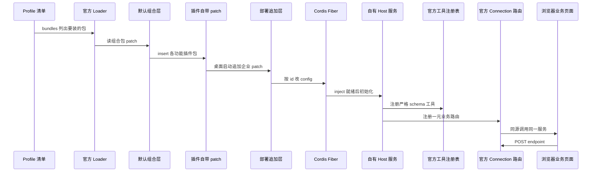
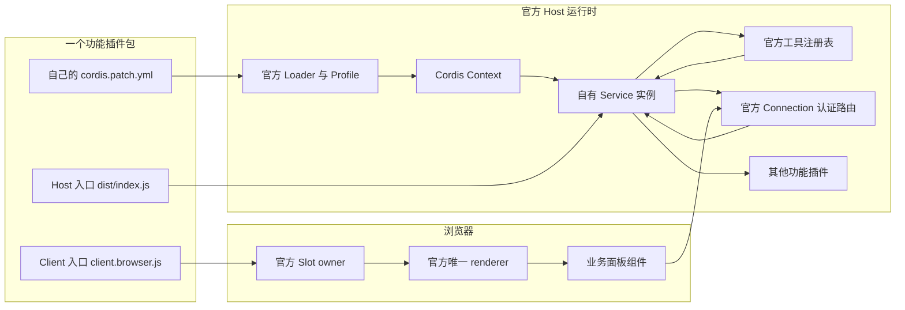

# WorkDSH 插件架构与扩展面

## 定位：不改上游，把业务能力做成官方插件

WorkDSH 是构建在 DeepSeek Harness（DSH）之上的工作台产品，它的工程纪律可以浓缩成一句：**不自建 Host，也不 fork 运行时**。官方 DSH 继续拥有 Host、Client renderer、Conversation、Workspace、Session、Loader、模型设置、插件管理、Skill runtime 与 Agent loop；WorkDSH 只把自己那部分业务（专家、技能、资料库、项目、连接器、Office）做成符合官方 Loader 约定的插件包，经 Profile 组合进同一套运行时。

[apps/web/AGENTS.md:9-10]()
<!-- anchor: - Use official Loader/Profile/Cordis, Session/Agent loop, preset registry, Skill … - Feature packages own business objects, revisions, authorization and presentati -->

这条约束的直接代价是：**产品形态被上游的扩展面定义**。WorkDSH 不能随手改一个 Host 内部的钩子，只能使用官方公开的 exports、Slot、Remote 与 Resource；上游不发新的扩展点，产品就做不出对应能力。它换来的收益同样明确：官方 Loader、Session/Agent loop、模型路由、Skill parser、MCP 传输、Storage 与 Conversation UI 全部零维护继承，WorkDSH 只需对业务领域负责。

替代方案是把 DSH 拉成内部 fork，或在旁边写一个平行 Host。前者会让每次上游发版都变成一次合并战争，且个人/企业两条交付线要各自跟版；后者等于重做 Session 与 Agent loop，与"官方是唯一执行事实来源"直接冲突。WorkDSH 明确否掉了这两条路——`packages/plugins/<domain>` 与 `packages/providers/<name>` 是唯一允许新增实现的目录，父目录只做分类，不承载加载入口。

[apps/web/AGENTS.md:26-27]()
<!-- anchor: - Plugins live at `packages/plugins/<domain>` and providers at `packages/provide … - Use official declared Slots and their owner props. Keep native Session/Workspa -->

于是"WorkDSH 插件架构"实际上回答两个问题：一个插件包要声明什么，才能被官方 Loader 在 Host 侧装起来、被官方 Client 在浏览器侧挂上去；以及它内部要用什么机制，才能既与别的插件协作、又能在卸载时干净消失。

## 一个插件包的两侧接入点

一个 WorkDSH 功能插件包的 `package.json` 里，真正决定它"如何被接入"的只有两处声明：`dsh.bundle.patch` 指向自己的 `cordis.patch.yml`，`dsh.client` 描述浏览器侧要注入哪些官方模块。其余字段都是常规 npm 元数据。

[packages/plugins/skills/package.json:65-67]()
<!-- anchor: "dsh": { … "patch": "./cordis.patch.yml" -->

[packages/plugins/skills/package.json:69-83]()
<!-- anchor: "client": { … "@deepseek-ai/dsh-client-ui-primitives" -->

### dsh.bundle.patch：Host 侧的装配入口

`dsh.bundle.patch` 是一个相对包根的路径。它让这个包从"一个 npm 包"变成"一个 Loader 可识别的 bundle"：官方在安装/组合这个包时，会读取它声明的 patch 文件，把里面的 `insert` 行合进 Profile 的插件图。桌面侧的上游副本里能看到这个契约的强制程度——拿不到合法且落在包目录内的 `dsh.bundle.patch`，安装直接抛错，而不是静默跳过。

[apps/web/scripts/desktop/patches/upstream/apps/desktop/src/project-manager.ts:322-334]()
<!-- anchor: const dsh = manifest.dsh … throw new Error(`desktop project: ${requestedName}@${manifest.version} declares an invalid bundle patch`) -->

选择"每个包自带 patch、由 Profile 逐层合并"，而不是"在一个中心清单里写死所有插件"，原因是**插件要能被独立安装、独立卸载、独立发版**。中心清单意味着新增一个插件必须改组合包并重新发版组合包；自带 patch 则可以让 `workdsh-plugin-skills` 以独立 tgz 装进任意 Profile，且不牵连 `workdsh-bundle`。这条能力被验收脚本显式保护：安装技能包后，`--dump-config` 里 `workdsh-skills` 必须恰好出现一次，且**不得**出现 `workdsh-bundle`。

[apps/web/scripts/probe-skills-package.mjs:98-104]()
<!-- anchor-base64:Y29uc3QgY29uZmlnID0gYXdhaXQgY2xpKCctLXByb2ZpbGUnLCAnc2tpbGxzJywgJy0tZHVtcC1jb25maWcnKTsg4oCmIGFzc2VydC5vayhpbnN0YWxsZWQuZHNoLmJ1bmRsZSAmJiBpbnN0YWxsZWQuZHNoLmNsaWVudCk7 -->

### dsh.client：浏览器侧的模块注入清单

`dsh.client.platform` 目前只出现 `web` 一种取值，它把包登记进官方 ClientModules registry；`inject` 则是一串**官方包名**，声明"我的浏览器 bundle 在运行时需要这些官方模块提供的能力"。注意这里写的是包名而不是服务名——Host 侧的 `inject` 用服务名（`storageDomain`、`tools`），浏览器侧的 `inject` 用包名（`@deepseek-ai/dsh-client-ui-slots`），两侧是两套不同的依赖解析器。

[apps/web/docs/HARNESS-OFFICIAL-DEVELOPMENT.md:16-16]()
<!-- anchor: Cordis 与官方 Harness 运行依赖通过 `peerDependencies` 声明兼容边界，开发依赖精确锁定。Client bundle 的 dsh.client.inject 记录所需官方模块；必需服务写入 inject，可选服务按操作解析，配置顺序不表示依赖。跨插件只用公开类型和服务，不导入内部组件或数据表。 -->

官方合成脚本还额外要求：只有**精确包行**才能对外宣称 `dsh.client`，子路径被 Loader 当作 Host-only provider 挂载；并且宣称了 `dsh.client` 就必须有公开的 `./client` export，否则直接报错。这就是为什么每个插件的 `exports` 都要显式分出 `.`（Host）与 `./client`（浏览器 bundle）两个入口——它们指向的是同一份源码的两个编译产物：`dist/index.js` 走 Node/宿主侧，`dist/client.browser.js` 走浏览器侧。

[apps/web/scripts/official-web-clients.mjs:84-89]()
<!-- anchor: // advertise dsh.client to the official ClientModules registry. … if(!manifest.exports?.['./client'])throw Error('Official client has no public client export: ' -->

[packages/plugins/skills/package.json:11-13]()
<!-- anchor: "./client": { … "default": "./dist/client.browser.js" -->

浏览器产物不是普通 ESM，它被 esbuild 打成 CJS，并包在官方注册门面 `window.__ModuleLoader__.load(...)` 里；`react` 与官方 `dsh-client-ui-primitives` 被列为 `external`，保证浏览器里只有官方注入的那一份 React 实例，插件不引入第二份。

[apps/web/scripts/build-skills.mjs:11-16]()
<!-- anchor: // Use the official registration facade; React remains the renderer's shared ins … return module.exports; -->

### peerDependencies 精确钉版本的意义与代价

所有官方依赖都写成**精确版本**（`0.2.0-rc.2`），Cordis 钉 `4.0.4`，不写 `^`。理由是这些包共享的是**运行时单例语义**：官方 Client 只有一个 renderer、一个 React、一份 Cordis Context。如果允许范围版本，pnpm 可能解析出两份 `@deepseek-ai/dsh-client-ui-primitives`，Slot 注册与渲染就会跨实例失配；在 rc 阶段，不同 patch 版本的 Slot props 类型也可能静默漂移。

[packages/plugins/skills/package.json:30-36]()
<!-- anchor: "peerDependencies": { … "@deepseek-ai/dsh-client-ui-primitives": "0.2.0-rc.2" -->

代价是**升级耦合**：上游把 `0.2.0-rc.2` 换成 `0.2.0-rc.3`，所有插件的 `peerDependencies`、`devDependencies` 与 `dsh.client.inject` 清单都要同步改一遍，否则要么装不上、要么浏览器侧模块解析失败。这不是可以靠 `^` 规避的成本——它只是把"升级时会报错"换成"升级后运行时行为不一致"，后者更贵。为此仓库专门维护了一份从官方 base/Web 包导出的完整客户端清单，把官方 `dsh.client` 元数据与 `!!js` 条件原样保留，用于比对而不是重写。

[profiles/shared/official-web-clients.json:2-12]()
<!-- anchor: "schemaVersion": 2, … "file": "cordis.patch.yml", -->

### 三个包的差异：同一份骨架，三档接入面

把几个插件并排看，差异全在"要不要 Client 面、注入多少官方模块"：

| 包 | `dsh.bundle.patch` | `dsh.client` | peer 依赖数 | 特征 |
| --- | --- | --- | --- | --- |
| `workdsh-plugin-access` | 有 | **没有** | 5 | 纯 Host 治理插件，无浏览器产物 |
| `workdsh-plugin-office` | 有 | 有（8 个 inject） | 6 | 有界面的重客户端插件，但 peer 面很窄 |
| `workdsh-plugin-skills` | 有 | 有（11 个 inject，`immediately: true`） | 6 | Host/Client 双面，且要求立即加载 |
| `workdsh-plugin-library` | 有 | 有（12 个 inject） | 19 | 双面且横跨 Conversation、Sidebar、System Prompt |
| `workdsh-bundle` | 有 | 有（10 个 inject） | **1**（只有 cordis） | 组合包，官方依赖全在 devDependencies |

`access` 的 `dsh` 字段里只有 `bundle.patch`，没有 `client`，因此它永远不会被登记成浏览器模块。

[packages/plugins/access/package.json:29-31]()
<!-- anchor: "dsh": { … "patch": "./cordis.patch.yml" -->

`office` 的 `dsh.client.inject` 只列它真正要用的官方渲染面（右栏、文档预览、输入触发器、chat 等），并且它的 `exports` 连 `types` 条件都省略，只留 `default`。

[packages/plugins/office/package.json:36-46]()
<!-- anchor: "client": { … "@deepseek-ai/dsh-client-ui-input-trigger" -->

而 `library` 的 peer 依赖有 19 条，包含 `dsh-agent`、`dsh-storage-domain`、`dsh-system-prompt`、`dsh-client-ui-input-trigger`——它同时占用 Conversation 输入、右栏、系统提示词三段官方面，因此兼容边界最宽，也最容易被上游发版波及。**peer 依赖条数在 WorkDSH 里是一个可读的"与上游耦合度"指标**。

## patch 分层组合：同一份插件代码，两种身份

WorkDSH 几乎所有"个人 vs 企业"的差异都不落在业务代码里，而落在 patch 的层叠顺序上。运行时的层叠是：**默认组合层 → 各插件自带 patch → 启动时追加的部署层**。桌面侧把这件事写得很直白：基础 patch 取自安装包目录，追加层按调用方传入的顺序拼在后面。

[apps/desktop/src/workdsh-main.ts:227-234]()
<!-- anchor: function startRuntime(home: string, connection: DesktopConnection, patches: stri … const launcher = officialHostLauncher(bundledProfileDirectory(), home, executabl -->

### 默认组合层与 !!js 条件

`packages/bundle/cordis.patch.yml` 是默认组合层。它不仅 insert 官方能力（computer-use、browser-use、auto-review），还承担**按运行环境切换实现**的职责：用 `!!js` 表达式读 `DSH_ELECTRON_EXECUTABLE`，有 Electron 就禁用 Playwright MCP、启用走 Electron 的自有 browser-session provider，没有就反过来。

[packages/bundle/cordis.patch.yml:10-19]()
<!-- anchor: - id: browser-use-playwright-mcp … disabled: !!js "!process.env.DSH_ELECTRON_EXECUTABLE" -->

把"桌面用 Electron、Web 用 Playwright MCP"做成 patch 里的条件表达式，而不是两套代码分支，好处是**同一份插件代码在两种载体上跑，只有组合不同**。代价是组合结果不再是静态可读的——同一份 patch 在不同环境变量下产生不同的插件图，所以仓库用语义级（保留 `!!js` 标签）比对来防止"引号包起来的表达式"冒充等价。

[apps/web/scripts/official-web-clients.mjs:17-26]()
<!-- anchor: // toJSON() alone loses !!js; a quoted expression without the tag must never … return semantic(document.contents); -->

### 插件自带 patch 只做 insert

功能插件自带的 `cordis.patch.yml` 绝大多数只有一行 `insert`：把自己的包名登记进插件图，id 前缀统一用 `workdsh-`。

[packages/plugins/skills/cordis.patch.yml:1-3]()
<!-- anchor: - insert: … name: workdsh-plugin-skills -->

一个包可以注册多个入口。`access` 就是典型：它同时挂载 Host 服务、Session 准入桥和工具准入桥三个 Fiber，第三个还带 `config`——**patch 是插件的配置面**，`autoBindPersonalSessions` 这类策略由组合层给，不由代码写死。

[packages/plugins/access/cordis.patch.yml:1-9]()
<!-- anchor: - insert: … autoBindPersonalSessions: true -->

更激进的是 `experts`：它先按 id **禁用**官方四个 subagent 工具，再插入官方 agent-team 三件套和自己的 manager，从而把"专家团队执行"整体换成官方 Agent Teams。

[packages/plugins/experts/cordis.patch.yml:1-19]()
<!-- anchor: # Official Team composition (DSH 0.1.6). The official service owns execution. … - id: workdsh-experts -->

这说明 patch 不是"只能加"，而是对插件图的**声明式改写**：能 insert、能按 id 改 config、能按 id disabled。这也正是"不改上游"能成立的技术前提——所有裁剪都发生在组合层，仓库里没有一行官方源码被改。

### disabled 作为显式退役开关

`activity` 插件的 patch 只有一条被 `disabled: true` 关掉的 insert，注释直接写明"Native Conversation owns work-process presentation"，即这块能力已被官方收敛，WorkDSH 保留包与入口但不再激活。

[packages/plugins/activity/cordis.patch.yml:1-4]()
<!-- anchor: # Native Conversation owns work-process presentation in DSH 0.1.7. … name: workdsh-plugin-activity -->

用 `disabled` 而不是删包，是为了保留可回滚点与独立的包版本线；代价是插件图里长期存在不激活的条目，需要靠注释说明原因，否则后人会误以为是遗漏。

### 桌面企业 patch：启动时生成的第三层

桌面在启动企业工作区时**即时生成**一份 patch 文件写到用户目录，内容包含三类操作：按 id 禁用个人身份 provider；insert 企业账号 client、desktop 身份与（可选）协作插件，并带上 `config`；按 id 改 `access` 与 `workspace-controller` 的 config（关掉个人 Session 自动绑定、打开固定成员绑定、把 workspace 目录指到企业空间）。

[apps/desktop/src/local-runtime.ts:166-171]()
<!-- anchor: export function desktopEnterprisePatch(home: string, authority: Authority, actor … writeFileSync(patch, `- id: workdsh-identity-local\n  disabled: true\n- insert:\ -->

企业激活时还同步改了 Profile 的 bundle 选择：**把个人身份 provider 从 bundles 里移除**，再把企业插件名推进去，然后才把这份 patch 作为追加层传给运行时。

[apps/desktop/src/workdsh-main.ts:386-394]()
<!-- anchor: const selected = JSON.parse(readFileSync(manifest, 'utf8')) as { dsh?: { profile … writeFileSync(manifest, JSON.stringify(selected, null, 2) + '\n', { mode: 0o600 -->

于是"同一份插件代码、不同 patch 层 → 个人/企业两种组合"这件事就闭环了：`packages/plugins/*` 里的业务服务、工具、Remote、页面一行不改；差异全部由 **身份 provider 的取舍 + access 绑定策略的 config + 组合层追加** 三件事表达。个人用 `workdsh-provider-identity-local` 加 `autoBindPersonalSessions: true`；企业换成 enterprise provider、`autoBindPersonalSessions: false` + `autoBindFixedMemberSessions: true`。

选择这条路的根本原因，是产品文档明确写的：**Profile 是插件/配置选择，不是账号，也不是安全边界**。把个人/企业差异做成账号目录隔离或代码分支，会诱导实现者把"组合不同"误当成"权限不同"；做成 patch 层则强迫每个真正敏感的判断回到服务端授权。

[profiles/README.md:7-11]()
<!-- anchor: | package.json与pnpm-lock.yaml | 精确官方版本族和工程依赖 | … | enterprise/README.md | 单ECS按账号进程的实施与验收边界 | -->

### 从 Profile 到"页面与工具可用"的时序

下图把"Profile 声明 → patch 分层 → Fiber 组装 → 服务注册 → 页面与工具可用"串成一条链。要点是：**patch 决定"装不装、怎么配"，Fiber 决定"什么时候起、怎么撤"，服务注册决定"谁能被谁注入"**——三者职责不重叠。

这条链有个容易忽略的落点：**页面与工具必须落到同一个服务实例上**。`Conn` 收到请求后调用的 manager，和 `Tools` 背后调用的 manager，是同一个 Fiber 里的同一个对象；`Page` 本身不持有业务状态，它只是这条链末端的渲染器。

## Host 侧扩展面：Cordis Service 与 Fiber 生命周期

### Service 子类 + static inject

WorkDSH 的每个领域能力都是一个 `Service` 子类，服务名作为 `super(ctx, 'xxx')` 的第一个参数注入宿主 Context，依赖用静态 `inject` 声明。`AccessManager` 是这套写法的样板。

[packages/plugins/access/src/index.ts:108-124]()
<!-- anchor: export class AccessManager extends Service implements AccessService, RuntimeBind … this.sessionOwners = runtimeDomain.table('sessions'); -->

依赖是**在加载前解析**的。官方 Loader 在调用插件入口的 `apply` 之前，先保证 `inject` 列出的服务全部就绪；未就绪就是 PENDING，永不就绪就是 FAILED，这两种状态是可诊断的，而不是在业务代码里到处 `if (!service) throw`。`ConnectorManager` 一次注入六个服务，其中 `workdshSessionAccess` 是另一个插件（access）提供的自有服务——**插件的扩展点同时也是插件的消费点**。

[packages/plugins/connectors/src/manager.ts:35-36]()
<!-- anchor: export class ConnectorManager extends Service implements ConnectorManagementService … static inject = ['storageDomain', 'tools', 'mcpResources', 'agents', 'credential -->

多服务依赖会因为"服务之间互相需要"而出现顺序死结。WorkDSH 的解法是把入口拆成父子两层：`apply` 只声明**必须**的服务并注册 manager，随后用 `ctx.plugin({...})` 起一个子插件，子插件的 `inject` 里额外加上刚注册的自有服务，在它里面才做 Remote/工具注册。`library` 就是这样把 `workdshLibrary` 拉进第二个子插件的 inject 列表。

[packages/plugins/library/src/index.ts:17-22]()
<!-- anchor: export const name = 'workdsh-plugin-library'; … await ctx.plugin({ name: 'workdsh-library-integration', inject: [...inject, 'wor -->

`projects` 把同一手法用到三段：manager、Remote/上下文注入、交付物归属各占一个子插件，各自只声明自己需要的服务。

[packages/plugins/projects/src/index.ts:12-22]()
<!-- anchor: export async function apply(ctx:Context,options:ProjectOptions={}){ … apply(attribution:Context){registerDeliverableAttribution(attribution);}, -->

选择子 Fiber 而不是"一个插件里全做完、靠可选链兜住未就绪服务"，代价是要多写几行 plugin 声明；收益是**每个子 Fiber 的依赖都是显式且可诊断的**，并且卸载粒度与依赖粒度一致。

值得单独指出的是入口 `inject` 与 manager `inject` 的重复。`experts` 的入口注释把原因写清了：入口是 Loader 识别的单位，它必须声明**子模块消费**的服务，否则子 Fiber 会被判 PENDING。

[packages/plugins/experts/src/index.ts:31-35]()
<!-- anchor: /** Every service `apply` and `ExpertsManager` require, resolved before load. */ … 'connection', 'tools', 'skills', 'agents', 'agentTeams', 'sessionQuery', 'fs', -->

### declare module：把自有服务挂到 Context 类型上

服务注册只解决运行时可见性，TypeScript 侧还需要一次声明合并，`ctx.workdshExperts` 之类的访问才会类型安全。每个插件在自己的入口或 manager 文件里 `declare module '@deepseek-ai/cordis'`，把自有服务名扩进 `Context` 接口。

[packages/plugins/access/src/index.ts:70-76]()
<!-- anchor: declare module '@deepseek-ai/cordis' { … workdshToolAccess: ToolAccessBridge; -->

[packages/plugins/experts/src/services/experts-manager.ts:87-94]()
<!-- anchor: declare module '@deepseek-ai/cordis' { … workdshExperts: ExpertsManager; -->

`experts` 的声明里出现了 `workdshSkills: SkillManagementService`——它写的是**契约里的接口类型**，不是 `skills` 插件的 `SkillManager` 类。这是契约层存在的直接动机。

[packages/plugins/experts/src/services/experts-manager.ts:202-205]()
<!-- anchor: export class ExpertsManager extends Service implements ExpertsService { … 'workdshIdentity', 'workdshAccess', 'workdshAudit', 'workdshSessionAccess', 'wor -->

### ctx.effect：可撤销 + 等待清理

资源不直接 `new` 完就丢，而是把 disposer 交给 `this.ctx.effect(...)`。`access` 打开两个 storage domain 后，各自挂一个 effect 关闭它们。

[packages/plugins/access/src/index.ts:118-125]()
<!-- anchor: async [Service.init](): Promise<void> { … this.sessionOwners = runtimeDomain.table('sessions'); -->

`experts` 除了关 domain，还用 effect 做**临时目录清理**（`rm` 递归删除 staging 根），这在卸载路径上是必须的——否则插件消失后磁盘上留下无人认领的上传暂存。

[packages/plugins/experts/src/services/experts-manager.ts:239-252]()
<!-- anchor: async [Service.init](): Promise<void> { … this.ctx.effect(() => () => { void rm(this.stagingRoot, { recursive: true, force -->

最苛刻的是需要**先中止、再清空、最后等待**的场景。`skills` 的 Remote 注册把三件事写进同一个异步 disposer：abort lifetime、调用全部 unregister、`allSettled` 等所有 in-flight 请求收尾——注释明说"一个被移除的功能不得在 dispose 完成后仍有上传或管理写入在执行"。

[packages/plugins/skills/src/services/connection-api.ts:139-160]()
<!-- anchor: /** Register the management API inside Connection's authenticated `/api` carrier … }, 'workdsh.skills.fetch'); -->

`access` 的工具准入桥用同样的模式在卸载时 flush 队列。

[packages/plugins/access/src/index.ts:554-575]()
<!-- anchor: export class ToolAccessBridge extends Service { … ctx.effect(() => async () => this.flush(), 'workdshToolAccess.flush'); -->

### 为什么生命周期要交给 Fiber，而不是自己管

替代方案是插件自己维护一个 `disposables[]`，在 `apply` 返回的清理函数里遍历。这在小插件里可行，但在 WorkDSH 的场景会立刻失效：一个插件注册的东西可能横跨 Host 服务、Connection 路由、工具、Slot 贡献、timer、子进程、storage domain，而且**注册发生在子 Fiber 里、父 Fiber 里、甚至 `ctx.inject` 的回调里**。自管数组意味着任何一次提前 return 或异常都会漏掉后续清理。

Fiber 把这件事变成结构性保证：任何从 Context 派生的注册都归属当前 Fiber，父 Fiber 撤销时子树整体撤销，返回 promise 的 disposer 会被等待。产品文档把它写成硬规则——所有服务、Remote、订阅、timer、watcher、连接、子进程与临时资源由 Cordis Fiber 拥有，且**不得跨 Fiber 缓存 Session scope、service handle 或 AbortSignal**。

[apps/web/docs/HARNESS-OFFICIAL-DEVELOPMENT.md:18-18]()
<!-- anchor: service、Remote、registry、监听、timer、watcher、连接、子进程与临时资源属于当前 Fiber。返回 disposer 的注册用 `ctx.effect` 管理，事件用 ctx.on；顺序清理在同一异步 disposer 中等待。不得跨 Fiber 缓存 Session scope、service handle 或 AbortSignal。 -->

这条规则的最强表述在架构文档里，它同时把 UI 所有权一并纳入同一句话。

[apps/web/docs/ARCHITECTURE.md:29-29]()
<!-- anchor: 所有服务、Remote、订阅、timer、watcher、连接、子进程和临时资源由 Cordis Fiber 拥有，可撤销并等待清理。官方 Slot owner 拥有界面位置，React 组件仅接收公开 props 和所需 callback，不持有 Cordis ctx 或凭据。验收采用 [有限场景](ACCEPTANCE.md)，源码与无密钥检查不能替代真实模型、浏览器或 Desktop packaged-runtime/GUI 验收。 -->

## 四类对外出口

一个 WorkDSH 功能插件向下游开放能力时，只会用到四类出口。它们的区别不是"技术选型"，而是**消费者不同、信任边界不同**：

- **Host 服务**：给别的插件用，进程内、强类型、可注入依赖；
- **Agent 工具**：给模型用，schema 严格、走官方工具流水线、与页面共用同一个业务服务；
- **Remote**：给浏览器用，官方 Connection 上的一元业务协议，同源鉴权后进入 Host；
- **Client 页面**：给人用，注册到官方 Slot，只收公开 props。

下面这张图是本节的总览：左侧是插件包的两个编译产物，中间是官方 Host 侧的三条出口载体，右侧是浏览器侧的唯一渲染路径。注意"Agent 工具"和"浏览器页面"最终都指向同一个业务服务实例。

### Host 服务：跨插件协作的唯一合法通道

别的插件要消费 WorkDSH 的能力，只能通过 `ctx.workdshXxx` 这个公开服务句柄，不能 import 对方的内部类、更不能读对方的存储表。`experts` 需要"为某个 Session 建会话"，它没有把准入逻辑抄一遍，而是只声明一个最小的 `SessionAccess` 接口（由 access 插件提供）；`connectors` 同样只在 `inject` 里列上 `workdshSessionAccess`。

[packages/plugins/experts/src/services/experts-manager.ts:82-84]()
<!-- anchor: /** The minimal Session-ingress surface experts consumes (owned by the access pl … create(request: SessionCreateRequest, signal?: AbortSignal): Promise<SessionCrea -->

这条约束把"跨插件耦合"从**代码级**降成**接口级**：access 内部换实现、换表结构，experts 不受影响；但反过来，接口一旦要加字段，改动会同时波及实现方与所有消费方。

### Agent 工具：严格 schema + 同一个业务服务

工具用官方 `defineTool` 注册，参数与输出都是显式 schema，输出再配一个 `render` 决定回填给模型或界面的文本。关键点是 `execute` 里调用的 `ctx.workdshLibrary` 与 Remote 里调用的**是同一个服务**。

[packages/plugins/library/src/tools/library-tools.ts:1-11]()
<!-- anchor: import type { Context } from '@deepseek-ai/cordis'; … ctx.tools.register(defineTool({ -->

对"不可逆操作"这类高风险动作，工具 schema 里直接要求一个 `user_confirmed` 布尔，并在 `execute` 开头就拒绝未确认的调用；同时用 `expected_revision` 做乐观并发，让"模型以为的版本"与"真实版本"不一致时失败而不是覆盖。

[packages/plugins/library/src/tools/library-tools.ts:74-77]()
<!-- anchor: description: '把待审草稿发布为不可变新修订。只有用户已明确确认发布时，user_confirmed 才能为 true。', … async execute(args, exec) { if (!args.user_confirmed) throw new Error('library/u -->

这里的设计权衡值得展开：**为什么不让模型自由发挥**（比如让模型自己判断用户是否确认）？因为模型的自述无法作为授权依据——契约文档把这条写成 ActorContext 的硬约束：主体身份必须由 Host 身份提供方解析，不能接收客户端或模型自报身份。

[packages/contracts/README.md:10-10]()
<!-- anchor: - 边界：无 UI/数据库实现；无万能 CRUD 服务；ActorContext 必须由 Host 身份提供方解析，不能接收客户端或模型自报身份。 -->

架构文档把"页面与工具调用同一个业务服务"提升成架构原则，理由是**避免出现第二套执行事实**：如果页面走一套写路径、工具走另一套，两者对修订号、授权、审计的记录就会分叉，之后再也无法回答"这次改动是谁做的"。

[apps/web/docs/ARCHITECTURE.md:27-27]()
<!-- anchor: 领域服务拥有业务对象；原生 Session 事件拥有执行事实。项目引用资料库正文，专家引用 Skill 修订，活动投影原生运行状态；不生成第二套正文、技能注册表或任务执行状态。持久对象、npm 版本、schema、发布修订与执行绑定分别标识。 -->

### Remote：浏览器到 Host 的一元业务协议

Remote 的实现方式是向官方 Connection 注册一条 fetch 路由：给路径、方法、请求体模式（`buffered` 或 `streaming`），返回一个 unregister 函数，并立刻用 `ctx.effect` 把它纳入 Fiber。

[packages/plugins/library/src/remote/connection-api.ts:9-13]()
<!-- anchor: export function registerLibraryConnection(ctx: Context): void { … fetch: async request => { -->

`projects` 的 Remote 里能看到协议的实际形状：请求体是 `{endpoint, payload}`，主机侧是一串 if 分支逐一校验 payload 字段并转发给 `ctx.workdshProjects`；身份不是客户端传的，而是从 `ctx.workdshIdentity.profile()` 现取，组装成 `ActorContext` 后才进服务。

[packages/plugins/projects/src/remote/connection-api.ts:8-12]()
<!-- anchor: export const projectManagementPath='/api/workdsh-projects'; … export function registerProjectConnection(ctx:Context,workspaceRoot?:string){const connection=(ctx as Context&{connection:HostConnectionHandle}).connection;const unregister=connection.fetch.register({path:projectManagementPath,methods:['POST'],requestBody:'buffered',fetch:async request=>{try{const body=record(await request.json()),endpoint=body?.endpoint,p=record(body?.payload)??{},a=actor(ctx),m=ctx.workdshProjects; -->

错误处理也是协议的一部分：领域错误码统一以 `library/`、`projects/` 前缀开头，Remote 只把**已知代码**映射成用户可读中文，未知一律降级成 `*/internal`。这防止内部异常细节（路径、SQL、堆栈）泄漏到浏览器。

[packages/plugins/skills/src/services/connection-api.ts:16-19]()
<!-- anchor: function publicFailure(error: unknown): ConnectionRpcResult<never> { … const code = error instanceof Error && error.message.startsWith('skill/') ? error.message : 'skill/internal'; -->

选择"在官方 Connection 上注册一元 fetch 路由"而不是自建 HTTP 服务或 WebSocket 协议，原因是**鉴权、CORS、Cookie、中止传播、生命周期都能复用官方实现**；代价是要接受官方 Connection 的适配器限制（例如流式路由与 JSON 路由要分别处理边界、大小与清理）。当同一能力同时要暴露给浏览器和模型时，WorkDSH 宁愿写两份薄的适配层（一个 Remote、一组 tool），也不写一个"通用协议"再让两边都去适配它——因为通用协议最终会长成一个私有框架。

### Client 页面：官方 Slot + 公开 props

浏览器侧插件入口导出的 `apply(ctx)` 拿到的是 **Client Context**，它做两件事：声明自己需要哪些官方模块/服务，然后往官方 Slot 里注册组件。

[packages/plugins/skills/src/client.tsx:21-26]()
<!-- anchor: export const name = 'workdsh-skills-client'; … ctx.effect(() => () => lifetime.abort(), 'workdsh.skills.client'); -->

`office` 的 Client 入口展示了另一种形态：它注入 `documentPreviews`、`sidebarRightTabs`、`inputTriggers` 等服务，往官方预览注册表登记自己能渲染的格式，再注册右栏 tab；组件本身仍是官方 renderer 挂载的普通 React 组件。

[packages/plugins/office/src/client.tsx:42-52]()
<!-- anchor: export const inject = [ … ctx.inject(["workdshLibraryPreview"], scope => scope.effect(() => scope.workdshL -->

"React 只收公开 props"这件事在代码里的具体表现，是组件需要的**能力**由入口通过 `inject` 面显式传入，而组件自己不接触 ctx。`SkillsPanel` 的 props 类型由官方 Slot 的 `PropsRuntime` 与本地 `InjectFace` 组合而成，注册时把 `management`、`startSkillTask`、`openCapability` 等回调一次性交出。

[packages/plugins/skills/src/client.tsx:94-95]()
<!-- anchor: const hasCapability = (key: string): boolean => ctx.slots.entriesOfSlot('main').some(entry => entry.options.key === key); … ctx.slots.inject('main', () => ctx.slots.register({ name: 'main', key: 'workdsh-skills', inject: () => ({ toggleNavigation: () => ctx.layout.toggleSidebar(), management, startSkillTask, startSkillTrial, openCapability, hasCapability }) }, SkillsPanel)); -->

产品文档把这条约束说得比代码更绝对：组件 props 只能来自公开 Slot 类型；owner 已知的状态走 props，私有 callback 走 entry inject，共享视图走 Slot store；**React 组件不接收 Cordis ctx、Remote service、凭据或领域服务**。

[apps/web/docs/HARNESS-OFFICIAL-DEVELOPMENT.md:14-18]()
<!-- anchor: Client 通过 `ctx.slots.inject` 等待 owner 声明，owner 卸载时撤销贡献。组件 props 来自公开 Slot 类型；own … service、Remote、registry、监听、timer、watcher、连接、子进程与临时资源属于当前 Fiber。返回 disposer 的注册用 -->

代价是"想加一个交互就得先找到合适的官方 Slot"。WorkDSH 明确不复制 Workspace、Session 列表、Conversation、Composer、模型设置、插件管理或执行状态，所以当官方没有对应 Slot 时，能做的只有等待上游或收窄需求——这是"不 fork"这条原则在 UI 层的直接账单。

## 契约层与展示层：为什么必须独立成包

`workdsh-contracts` 是一个**几乎只有类型**的包：`src/index.ts` 就是六行 re-export，没有运行时实现。它按领域分子路径导出服务接口、DTO 与引用类型。

[packages/contracts/src/index.ts:1-6]()
<!-- anchor: export * from './governance.js'; … export * from './enterprise.js'; -->

把契约独立出来的动机，在它的 README 里写得最直接：Skill Host、页面和其他插件共享**同一个类型源**，不横向导入功能内部实现。

[packages/contracts/README.md:5-5]()
<!-- anchor: 新增 `workdsh-contracts/skills`：`SkillManagementService`（`contractVersion: 1`）、现有本地管理 DTO 和 `SkillDependencyInspector`。Skill Host、页面和其他插件共享这一类型源，不横向导入功能内部实现。此子路径仅定义受信本地 Host 契约，不增加 Cordis/React/数据库依赖；业务不可变 SkillRevision、专家执行快照和企业授权仍待相应模块实现。 -->

这个包还承载了**信任边界的词汇表**：`ActorContext` 里的 `resolvedBy` 字段专门记录"是哪个身份提供方在受信的 Host 边界上确立了这个上下文"，`RuntimeIsolation` 则把执行隔离等级（`local-trusted` / `process` / `container` / `unavailable`）显式化，避免把"本机可信"当成"没有隔离"。

[packages/contracts/src/governance.ts:10-18]()
<!-- anchor: export interface ActorContext { … readonly delegatedByPrincipalId?: string; -->

一个细节能反证"契约只为类型服务"：`./office` 子路径**只有 `types` 条件，没有 `default`**——它存在的意义就是让 Host 与 Client 共用一套 DTO 类型，而不产生任何可被 import 的运行时模块。

[packages/contracts/package.json:23-24]()
<!-- anchor: "./office": { … "types": "./dist/office.d.ts" -->

`workdsh-ui` 是同一思路在展示层的对应物：它是"纯展示组件包"，不创建 React root，不持有 Cordis Context、Remote、Host、账号、数据库或执行状态，领域插件只传标题、正文、动作与关闭回调。

[packages/ui/README.md:5-5]()
<!-- anchor: 当前提供 LogoMark、Icon、IconButton、NavItem、NavGroup、主题令牌、导航样式和公共 Modal。公开 `src/index.ts` 只导出 API；TSX 组件、设计令牌和 CSS 字符串分别位于 `components/` 与 `styles/`。共享包不创建 React root，不持有 Cordis Context、Remote、Host、账号、数据库或执行状态。领域插件只传入标题、正文、动作和关闭回调。 -->

而且它**故意不声明 dsh 加载入口**，随组合包一起被引用，自己不作为可安装插件出现。

[packages/ui/README.md:11-11]()
<!-- anchor: 本版本通过 bundle 组合，子包不独立声明 dsh 加载入口。共享包只负责展示和可访问性交互，不承载技能安装、权限、团队对象或其他领域事实。 -->

对比替代方案：如果契约留在各功能插件的 `src/shared.ts` 里，消费方就得 `import` 插件的内部路径。一旦插件重构目录，所有消费方一起断；而且类型检查会顺着 import 链把整个实现（包括 storage、Node 内置模块）拉进浏览器 bundle。契约独立成包后，"能不能被浏览器引用"变成由 `exports` 显式回答的问题，而不是由打包器误打误撞决定。

## 组合包 workdsh-bundle：只做组合

`workdsh-bundle` 的职责边界被写死在一行里：组合各功能插件、预构建可安装 tgz；**不实现 Agent loop 或私有启动器**。

[packages/bundle/README.md:9-10]()
<!-- anchor: - 职责：组合各功能插件，预构建 tgz 可安装。 … - 边界：不实现 Agent loop 或私有启动器。 -->

它连 `packages/bundle/src/index.ts` 这个 Host 入口文件都没有——`exports` 的 `.` 直接指向 `dist/probe.js`，即"安装/生命周期探针"：打印 `[workdsh:probe] activated`、注册一段系统提示词、订阅浏览器视图，然后在 dispose 时打印 `[workdsh:probe] disposed`。

[packages/bundle/src/probe.ts:9-11]()
<!-- anchor: /** Product diagnostics only. Feature packages are installed as separate Profile layers. */ … export const inject = ['connection', 'tools', 'agents', 'attachments', 'systemPr -->

这条"打印激活与清理标记"的约定有实际用途：它让"包装上了"与"插件真的起来了"成为两个可区分的观测点。`inject` 只有五项，说明组合包自己不承载领域能力。

Client 侧同理：`./client` 出口只做一行转发，真正的实现是 `src/client/harness/client.ts`，它注册品牌、导航位置、覆盖层、社区市场入口和诊断面板，并把工作台子插件通过 `ctx.plugin(workbench)` 挂成正式子 Fiber。

[packages/bundle/src/client/index.ts:1-1]()
<!-- anchor: export { apply, inject, name } from './harness/client.js'; -->

[packages/bundle/src/client/harness/client.ts:27-28]()
<!-- anchor: export const name = 'workdsh-client'; … export const inject = ['slots', 'layout', 'remote', 'remote.pluginInventory', 's -->

诊断面板的设计也体现"不造假"：它调用真实的 `pluginInventory` Remote，把 `workdsh-` 前缀的模块名与 Fiber 阶段列出来，并且只有在 URL 显式带 `diagnostics=1` 时才注册。

[packages/bundle/src/client/harness/client.ts:111-123]()
<!-- anchor: ctx.slots.inject('main', () => { … }, DiagnosticsPanel) : () => {}; -->

值得注意的是组合包的 `peerDependencies` 只有 Cordis 一条——所有官方包都放在 `devDependencies` 里。这是刻意的：组合包不直接 import 官方模块，它只是在 patch 里按包名 insert，因此对官方版本没有编译期承诺，兼容性由被 insert 的那些包自己承担。

[packages/bundle/package.json:54-55]()
<!-- anchor: "peerDependencies": { … "@deepseek-ai/cordis": "4.0.4" -->

## 全局关联：这套架构其实在守一条边界

把上面所有细节连起来，会发现 WorkDSH 的插件架构只有一个核心命题：**守住"官方拥有执行、WorkDSH 拥有领域"这条边界，并让越界在编译期或加载期就暴露**。

- `dsh.bundle.patch` 与 `dsh.client` 是把"进入官方运行时"这件事写成**声明**，而不是写成"在官方代码里插一段"；于是越界的第一道闸门是安装/合成期的校验（缺 patch 抛错、缺 `./client` 抛错、重复客户端抛错）。
- `peerDependencies` 精确钉版本与 `profiles/shared/official-web-clients.json` 的完整客户端清单，是把"上游在变"这件事变成**可核对的差异**，而不是靠运行时崩溃去发现。
- patch 分层把"个人/企业"变成**配置组合**，从而让真正的差异（身份、存储、执行、同步）只允许落在显式的 adapter 边界（`packages/providers/<name>`）上。
- Cordis Service + `static inject` 把跨插件协作变成**接口级依赖**，Fiber 把资源所有权变成**结构性保证**，`ctx.effect` 把"卸载干净"变成可执行要求而非口号。
- 契约包与展示包把"能共用什么"提炼成**只含类型 / 只含展示**的两种极端，于是任何想塞状态或凭据的改动都会显得格格不入。
- 组合包被限制成"只做组合、只做诊断"，它连 Host 入口文件都不存在；这从物理上阻止了它演变成第二个产品内核。

代价是显而易见的：产品能力受限于上游公开面，升级要同步改一批精确版本，Slot 不够用时只能等或收窄需求，而且每次新增能力都要先回答"这属于官方还是属于我们"。这些代价换来的是一份可维护的契约——上游发版时，需要改的是一组声明，而不是一堆被改过的官方源码。

## 边界与不足

**与官方版本的强耦合是结构性的，不是可优化项。** 所有插件把 `@deepseek-ai/dsh-*` 钉在 `0.2.0-rc.2`、Cordis 钉 `4.0.4`，而这是 **rc** 版本；上游一次 rc 迭代就可能改动 Slot props、Remote 适配器签名或 `dsh.client` 元数据形状。仓库用导出清单做核对，但核对只能发现差异，不能消除同步改造成本。

**`dsh.client.inject` 的清单与实际用到的能力之间没有自动一致性检查。** 我读到的证据是人工维护的近似：`skills` 与 `experts` 的 inject 清单高度相似但不完全相同，`bundle` 的 inject 里含 `remote.pluginInventory` 这类子路径服务名。是否有脚本在构建期反向校验"声明了但没用/用了但没声明"，我在本次解读范围内没有找到——这一点不确定。

**Web 与 Desktop 是两条交付线，成熟度不同。** Web 侧有独立的 pnpm workspace、完整的合成脚本与浏览器验收探针；Desktop 侧依赖打包后的 `profile-installation.json`、`profile-boot.js` 与 `dsh-app-boot`，而且 `packages/bundle/README.md` 自己就写着"内置 0.1.2-rc.1 的旧桌面入口缺失尚未修复"、"当前验证 Harness 0.1.6-alpha.2 Web"、组合包"完整产品组合尚未实现"。`profiles/README.md` 也明确 Desktop 运行版本与打包门禁未完成，且"不以源码目标或 Web 证据代替"。因此本文描述的 patch 分层与企业叠加逻辑，其证据来自源码与脚本，不等价于 Desktop 打包运行已验收。

**企业叠加层的正确性依赖生成时机与清理路径。** `desktopEnterprisePatch` 是把 YAML 字符串直接拼进临时文件写入用户目录的；身份参数经 `JSON.stringify` 插入，`collaboration` 分支用模板拼接决定是否多一段 insert。企业环境变量是白名单式重建的（只挑 `SystemRoot`、`PATH`、`HOME`、`TMPDIR` 等）——这套做法把"本机企业空间与个人空间隔离"落在目录与环境变量上，但隔离强度的验收不在源码可判定范围内。

**仓库里存在大量占位目录。** `packages/plugins/*/src/{domain,harness,remote,services,storage,tools}`、`packages/contracts/src/.gitkeep`、`packages/ui/src/components/.gitkeep`、`packages/bundle/tests/.gitkeep` 等仍是 `.gitkeep`，说明"每个功能插件四类出口齐全"目前是**目标形态**而非现状。仓库规则要求这些计划中的脚手架不得带可加载入口或假响应，因此它们是目录约定，不是已实现能力。例如 `skills` 的真实 Remote 实现在 `src/services/connection-api.ts`，而 `src/remote/` 目录本身是空的。

**部分插件并非独立可分发。** `workdsh-bundle` 的 README 说明 workbench 仍随展示产物编译、尚无独立安装制品，并明确"本轮不宣称所有规划模块均可独立分发"；`packages/plugins/office`、`access`、`contracts` 等包的 `private: true` 也表明它们不走公开 npm 发布路径。

**"页面与工具同一个业务服务"在代码层面是约定，不是强制。** 它靠 `ctx.workdshXxx` 服务句柄与代码评审维持：Remote 与 tool 各自从 ctx 取同一个服务名，但没有任何类型或运行时机制阻止作者在 tool 里另起一条写路径。验收矩阵（`apps/web/docs/ACCEPTANCE.md`）才是这条约定的实际兜底。
