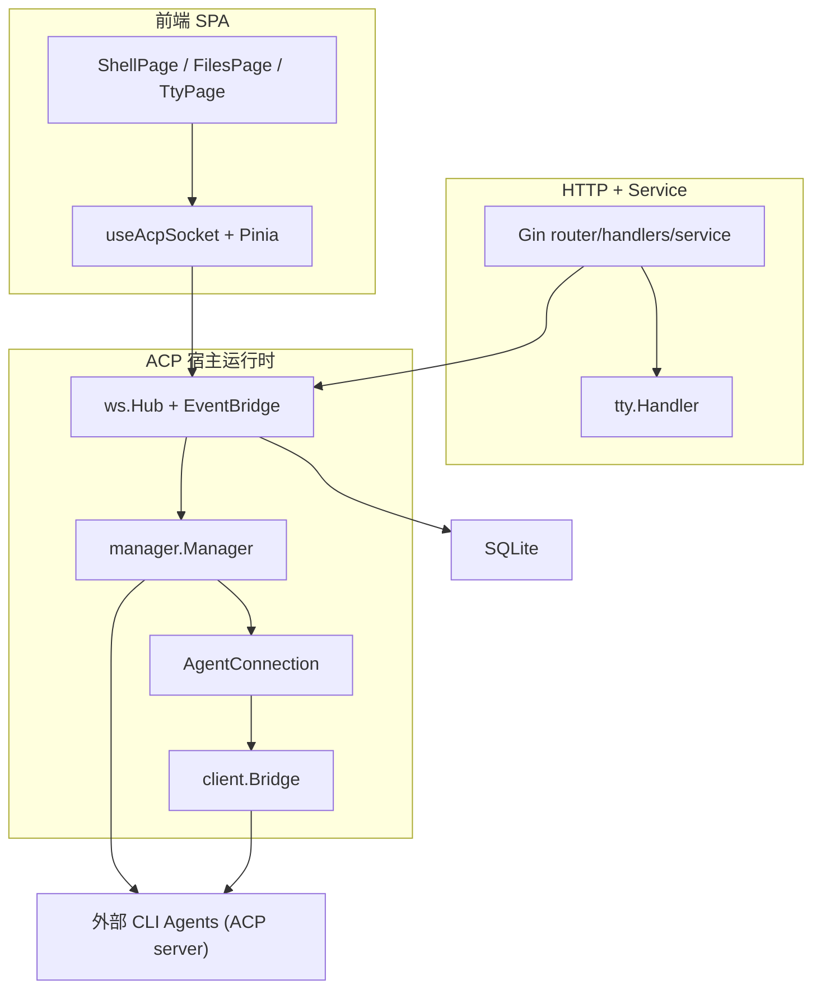

# zacp 基于 ACP 的多 Agent Web 网关

> 本解读按 **ai-agent 类规格** 产出（zacp 是 ACP 宿主接入 / 多 Agent 网关，agent 本体不在此仓库；记忆、主循环、Skill、MCP 等要素在 CLI Agent 侧，本文标注不适用）。本地源码为 `helloxz/zacp`，对齐 tag `v0.9.0`（2026-08）。变更历史快照见 [`CHANGE.md`](CHANGE.md)。

## 根因

zacp 要解决的根本问题是：**大量能力强大的 AI 编码 Agent 只以 CLI 形态存在，被困在终端里**——没有可视化界面、多个 Agent 难以并排使用、工具执行前的权限确认不可见、历史会话不易翻阅。zacp 站在 **ACP（Agent Client Protocol）标准之上做一个宿主聚合网关**：把"本地拉起 agent 进程 + 管理其会话生命周期 + 流式事件 + 权限回传 + 持久化"全部收进一个 Go 单二进制，再交给浏览器。

它不是 agent 本体，而是**宿主（host/client）**：zacp 作为 ACP Client 逐个拉起 CLI Agent（Codex / Reasonix / Grok / Omp / Qoder / Pi 等），用户通过浏览器与它们对话——这正是 ACP 协议设计里 host 那一侧的全部工作。

## 概览

zacp 是本地优先（Local-first）的 ACP 多 Agent Web 网关：安装单个二进制后访问 `http://127.0.0.1:8680/`，即可在浏览器里与多个 CLI Agent 会话，支持流式输出、工具权限人工确认、多 Agent 并行、会话持久化与 Web 终端。README 自述「基于 ACP（Agent Client Protocol）协议的多 Agent Web 网关，让原本不具备 Web 前端的 CLI Agent 也能在浏览器中使用」。

**核心能力清单**：

| 能力 | 说明 |
|------|------|
| 多 Agent 接入 | 内置 Codex / Reasonix / Grok / Omp / Qoder / Pi 等 catalog，配置即用；支持手动添加任意 ACP stdio agent |
| 浏览器 Web UI | Vue3 会话式聊天：思考过程、工具调用卡片、执行计划流式展示 |
| WebSocket 实时通信 | 事件流按 ACP session 路由，双向（prompt / cancel / 权限回传 / resync） |
| 权限人工确认 | agent 请求执行操作时推送 Web UI，由用户选择 allow/deny |
| 多 Agent 并行 | 全局 `promptGate` 三槽 FIFO：最多 3 个 prompt 同时进入 ACP，其余排队可撤销 |
| 会话空闲回收 | 超过 `idle_timeout`（默认 30 分钟）无活跃自动停止 agent 释放内存，下次自动恢复 |
| 智能体热管理 | 设置页启用/禁用/新增/删除 agent，热更新配置无需重启 |
| 会话消息持久化 | SQLite（WAL + 纯 Go 驱动，无 CGO）持久化 workspace/session/message |
| 单二进制交付 | 前端与默认配置 go:embed 进一个可执行文件，跨 6 平台 |
| 可选登录保护 | 单用户账号 + 验证码 + 内存 token，设置页热生效 |
| 周边工具面板 | 文件浏览/编辑/上传、Git 状态/提交/推送、Web TTY、深色主题、PWA |
| 一键安装更新 | macOS / Linux / Windows 的 install / update 脚本 |

**技术栈一览**：

| 层 | 技术 | 说明 |
|----|------|------|
| 后端语言 | Go（module `github.com/helloxz/zacp`，go 1.25） | 分层单体，代码集中在 `backend/internal` |
| HTTP | Gin v1.12 | REST + 中间件（CORS / gzip / auth） |
| WebSocket | `github.com/coder/websocket` | 会话主通道（`internal/ws`），不引入 Socket.IO |
| ACP | `github.com/coder/acp-go-sdk` | 官方 Go SDK，Client 侧连接 / 会话 / 权限 / 文件接口 |
| 数据库 | SQLite + GORM + `glebarez/sqlite`（无 CGO） | WAL 模式，自管版本化迁移（v1–v6） |
| 配置 | TOML + Viper | 运行时 `~/.zacp/config.toml`；行级编辑写回保注释 |
| 前端 | Vue3 + Naive UI + Tailwind CSS（Bun） | SPA，`frontend/src`，embed 进单二进制 |
| 终端 | xterm.js（前端） + `aymanbagabas/go-pty`（后端） | Web TTY 子系统 |
| 部署 | Docker（full/lite）+ compose + shell 脚本 | 多平台构建/打包/安装/更新 |

## 架构总览

zacp 的分层是一条"浏览器 → HTTP 壳 → ACP 宿主运行时"的职责链：




**模块职责映射**（`backend/internal`）：

```
cmd/server/          进程入口：组装依赖、预启动首个 agent、优雅关闭
api/                 router / handlers / middleware（CORS、gzip、认证）
acp/
  client/            Bridge：实现 acp.Client（事件归一化、文件读写、权限转发）
  manager/           Manager + AgentConnection：Agent 进程与 ACP 会话生命周期、并发门闩、空闲回收
  providers/         各 agent 启动参数适配、内置目录、zlite 渠道
config/              Viper + TOML 强类型 Config；agents/auth 行级写回
auth/                单用户认证：登录/验证码/token store/IP 限流
store/               SQLite 打开 + WAL + 版本化迁移 v1-v6 + 仓储
model/               GORM 模型 + DTO
service/             workspace/session/file/git/tool/tty 业务编排
tty/                 Web TTY：PTY 会话 + 有序出站队列 + 四个 I/O 循环
ws/                  Hub（订阅/广播）+ Handler + EventBridge + 协议消息定义
web/                 前端静态资源 go:embed + 自动开浏览器
pkg/eventstore/      events 瘦身 / tool_details 拆分（落库格式单一来源）
```

**推荐阅读顺序**：先 [`acp-runtime.md`](acp-runtime.md) 理解 Agent 进程与会话生命周期（宿主运行时心脏），再 [`realtime-bridge.md`](realtime-bridge.md) 看事件如何在 Agent 与浏览器间往返，[`data-model.md`](data-model.md) 看持久化与消息瘦身设计，[`web-tty.md`](web-tty.md) 与 [`deployment.md`](deployment.md) 是独立的 Web 终端与交付专题。

## 核心链路：一次浏览器对话的全旅程

```
Browser ──WS prompt──▶ ws.Hub/Handler ──▶ EventBridge.handlePrompt
                                              │ 落库 user msg / 草稿转正 / 生成标题
                                              ▼
                                        Manager.Prompt ──全局 promptGate 三槽 FIFO──▶ acquireAgent
                                              │ 槽位拿到后：注册事件回调 + 广播 turn.started
                                              ▼
                                        AgentConnection.Prompt ──▶ acp-go-sdk ──▶ agent 子进程(ACP stdio)
                                              ▼ 流式返回：agent_message/thought/tool_call/plan
                                        client.Bridge.SessionUpdate ──▶ EventBridge.handleEvent
                                              ▼ 落库 assistant(events 瘦身) + 广播 event/turn.done
                                        ws.Handler.BroadcastToSession ──▶ Browser 渲染
```

详细时序（含排队、权限往返、断线续流、会话恢复）见 [`realtime-bridge.md`](realtime-bridge.md)；进程拉起与会话生命周期见 [`acp-runtime.md`](acp-runtime.md)。

## 子文档索引

- [`acp-runtime.md`](acp-runtime.md) — ACP 宿主运行时：Agent 进程与 ACP 会话生命周期、promptGate 三槽并发、空闲回收、会话恢复重建
- [`realtime-bridge.md`](realtime-bridge.md) — 实时链路：WebSocket Hub 订阅集合语义、EventBridge 事件归一化落库广播、权限 60s→5min 往返、resync 续流与订阅 rebind
- [`data-model.md`](data-model.md) — 数据模型：workspaces/sessions/messages schema、WAL/纯 Go 驱动选型、v1–v6 迁移演进、events 瘦身 + tool_details 拆分读写路径
- [`web-tty.md`](web-tty.md) — Web TTY：PTY 会话状态机、binary/text 双通道协议、字节级背压出站队列、32 终端上限
- [`deployment.md`](deployment.md) — 交付形态：单二进制 go:embed、多平台打包、Docker、一键安装/更新、认证

## 核心模块导读

| 模块 | 定位 | 深度阅读 |
|------|------|----------|
| **acp/manager** | 多 Agent 进程 + ACP 会话生命周期；三槽并发门闩；空闲回收 reaper | [`acp-runtime.md`](acp-runtime.md) |
| **acp/client.Bridge** | 实现 `acp.Client`：把 session/update 归一化成简化 Event、权限/文件透传 | [`acp-runtime.md`](acp-runtime.md) |
| **acp/providers** | 各 Agent 启动命令/参数差异收敛 + 内置目录 + 配置文件路径白名单 | [`acp-runtime.md`](acp-runtime.md) |
| **ws.Hub / ws.Handler** | WS 连接生命周期、订阅集合语义、广播按会话匹配 | [`realtime-bridge.md`](realtime-bridge.md) |
| **ws.EventBridge** | 事件落库 + 广播 + 权限往返 + WS 帧到达顺序票 | [`realtime-bridge.md`](realtime-bridge.md) |
| **store / pkg/eventstore** | SQLite 迁移 v1–v6；events 瘦身/tool_details 拆分 | [`data-model.md`](data-model.md) |
| **tty** | 临时 PTY Web 终端子系统（独立于 ACP Hub） | [`web-tty.md`](web-tty.md) |
| **web / scripts / docker** | 前端 embed、构建打包、发布形态 | [`deployment.md`](deployment.md) |

## 设计亮点

- **全局 `promptGate` 三槽 FIFO 可撤销门闩**：把"多 Agent 并行任务（最多 3 个）"做成宿主侧资源调度而非 UI 限制；排队中的 prompt 可被 Cancel 撤销而不占槽位——`acquireWithAdmission` 用 admission 回调保证 FIFO 语义不被前置落库耗时反转（[backend/internal/acp/manager/manager.go:249-307]()  <!-- anchor: // acquireWithAdmission 在请求已经登记为 FIFO 队列成员后调用 admitted。 … for g.active < g.capacity && len(g.queue) > 0 { -->）。

- **ACP session 失效自动恢复（unknown-session → load → recreate）**：agent 重启后 DB 里的 session id 在 agent 侧已丢失，zacp 用错误文本 + uuid 共现判定失效，先尝试 `session/load` 保上下文，失败才重建；重建后迁移 WS 订阅并回放用户 config（[backend/internal/acp/manager/manager.go:728-740]()  <!-- anchor: // IsUnknownSessionErr 判断 ACP 错误是否为「agent 侧会话不存在/已失效」。 … // 误判代价可控：至多触发一次 session/load（失败则重建）重试；对支持 load 的 -->）——详见 [`acp-runtime.md`](acp-runtime.md)。

- **WebSocket 订阅集合语义 + 单连接多会话**：取代早期"单绑定覆盖"，广播按 ACP session id 匹配，进行中会话的事件不因切 tab 丢失（[backend/internal/ws/hub.go:276-314]()  <!-- anchor: // SubscribeSession 订阅会话：本连接将收到该会话的事件/turn.done/权限等广播。 … return c.subscribed[sessionID] -->）——详见 [`realtime-bridge.md`](realtime-bridge.md)。

- **事件落库"瘦身 + 工具详情拆分"双列**：把每次 `tool_call_update` 全量快照改成每工具最终一份 `tool_details`，历史消息列表体积约降 90%，且由 v6 迁移一次性回填旧数据（[backend/pkg/eventstore/eventstore.go:117-152]()  <!-- anchor: // SplitToolDetails 拆分事件列表： … return slim, details --> + [backend/internal/store/migrate_v6.go:15-75]()  <!-- anchor: // migrateV6 messages 表新增 tool_details 列（工具调用详情），并把历史 events 中的 … return nil -->）——详见 [`data-model.md`](data-model.md)。

- **字节级背压出站队列**：Web TTY 以字节数而非条数限流 PTY 输出，防高速输出无界增长，同时不静默丢帧（[backend/internal/tty/flow.go:21-65]()  <!-- anchor: // outboundQueue 按字节数而不是 item 数量限制缓冲，避免高速 PTY 输出无界增长。 … q.bytes += len(copyData) -->）——详见 [`web-tty.md`](web-tty.md)。

## 不足与风险

- **零测试**：仓库 `backend/` 无任何 `*_test.go`，核心并发（promptGate、空闲回收摘除竞态、订阅 rebind）全部靠代码注释中的严谨推理与人工回归，缺少自动保护（见 [`acp-runtime.md`](acp-runtime.md) 的风险小节）。
- **单用户本地模型**：认证仅单账号，`auto_approve` 一旦打开即全局放行；多用户 / 多人共享部署不在设计内。
- **权限"允许一次"粒度偏粗**：ACP 权限选项原样透传，前端只能逐次确认，没有按工具记忆"本次会话信任"的中间档。
- **provider 适配是脆点**：不同 agent 的 ACP 启动参数、错误文本措辞、是否支持 `session/load` 差异很大，靠 catalog 手工校准 + 正则匹配错误文本兜底，新增 agent 仍可能踩坑（[backend/internal/acp/providers/catalog.go:19-37]()  <!-- anchor: // 各 agent 的 ACP 启动参数并不统一，已按实际 CLI 校准： … {ID: "pi-acp", Name: "Pi", Command: "pi-acp", Args: []string{}}, -->）。

- **agent 文件写入无沙箱**：`client.Bridge.WriteTextFile` 直接按 agent 给的绝对路径写磁盘，只有路径必须绝对这一道校验——权限确认是唯一防线（[backend/internal/acp/client/client.go:370-384]()  <!-- anchor: // WriteTextFile implements acp.Client. … return acp.WriteTextFileResponse{}, nil -->）。

## 总结

zacp 回答的问题是"怎样让只活在终端的 CLI Agent 获得现代 Web 使用体验"。它选择站在 ACP 标准之上做**宿主侧聚合**：以 Go 单二进制拉起并管理多个 agent 进程，把进程调度（三槽并发 + 空闲回收）、会话生命周期（创建/恢复/重建 + config 回放）、事件路由（按 ACP session id 隔离）、权限往返（Web 端人工确认）做成一套可被 REST/WebSocket 稳定调用的宿主运行时，再配一个 Vue3 SPA 与若干工程化交付手段（embed、PWA、Docker、安装脚本）。回扣根因：**zacp 不做智能体，它做的是"智能体们的入口"**——用 ACP 这一个开放协议，把桌面级 CLI Agent 的能力搬进浏览器，同时让进程与内存始终处于"用得着才起来、闲着就回收"的可控状态。其多 Agent 并发的门闩模型、会话自动恢复、"DB 为权威 + agent 文件快照对账"的配置一致性策略，是可迁移到任何宿主类 Agent 工具的工程范式。

## 项目规模

| 指标 | 数据 |
|------|------|
| 后端 Go | 68 文件 / 约 1.5 万行（核心 `manager.go` 1590 行、`bridge.go` 573 行） |
| 前端 src | 约 1.6 万行 TS/Vue（`session.ts` 单 store 1841 行） |
| SQLite 迁移 | v1–v6 自管版本化 |
| 协议 | AGPL-3.0 |
| 仓库 | [github.com/helloxz/zacp](https://github.com/helloxz/zacp) |
| 数据目录 | `~/.zacp/`（config.toml + data/zacp.db） |
