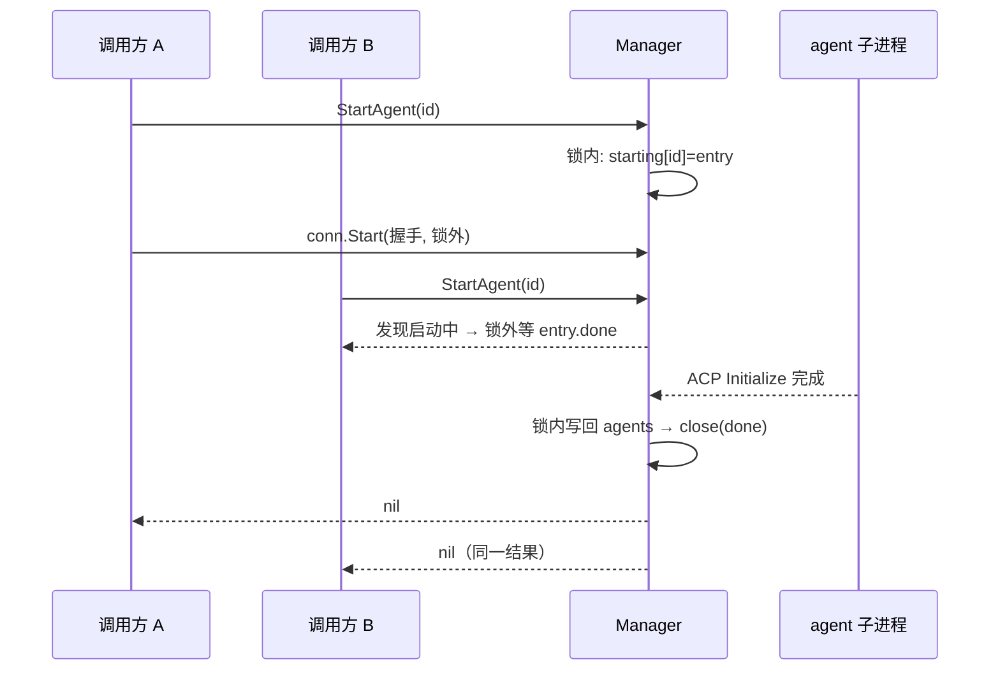
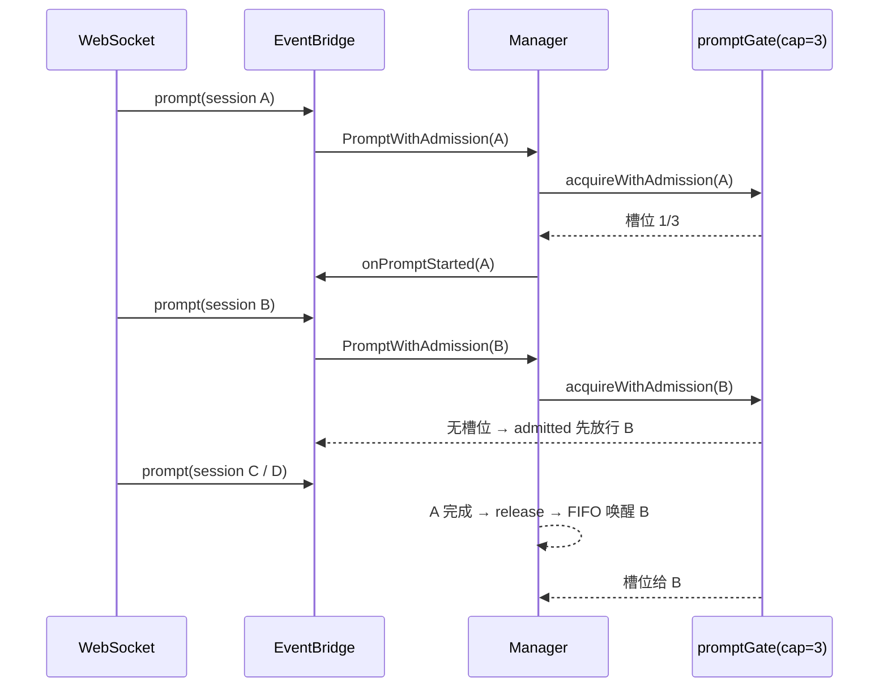
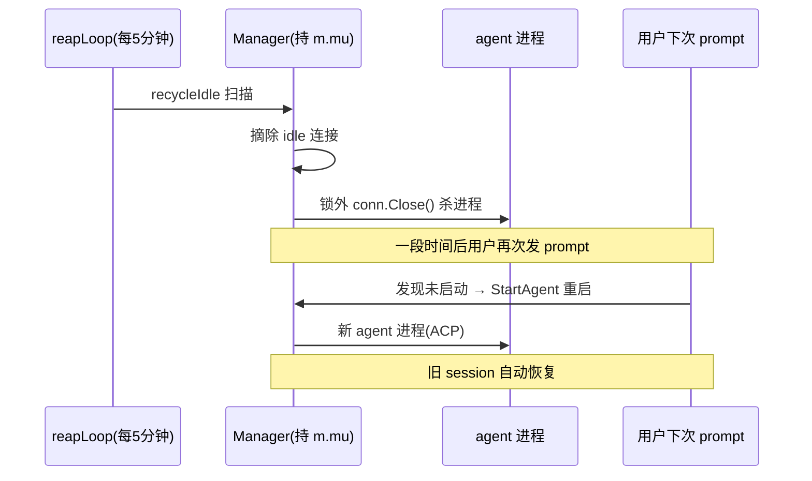

# ACP 宿主运行时：Agent 进程与会话生命周期

> 对应代码集中在 `backend/internal/acp/`（`manager`、`client`、`providers`）。读完本文应能回答：zacp 怎样做到"多 Agent 并行任务（最多 3 个）+ 会话空闲回收 + 重启后自动恢复"而不泄漏进程、不丢事件。

## 职责边界：Manager 管进程，Bridge 管协议

zacp 的 ACP 宿主侧被切成三层，职责分离的关键是**进程/会话管理（manager）与协议/事件（client.Bridge）互不耦合**：

| 层 | 文件 | 职责 |
|----|------|------|
| Manager | `acp/manager/manager.go` | 多 Agent 进程生命周期、全局并发门闩、空闲回收、session 恢复编排 |
| AgentConnection | 同文件（`manager.go` 后半） | 单个 agent 进程的 ACP 连接 + 进程内多 session 索引 |
| Bridge | `acp/client/client.go` | 实现 `acp.Client` 接口：接收 session/update、按会话缓存事件、转发权限/文件/终端 |
| providers | `acp/providers/` | 各 Agent 的启动命令/参数适配 + 内置目录 |

入口在 `cmd/server/main.go`：创建 Provider Registry → Manager → 预启动第一个 agent，其余 agent 按需启动（[backend/cmd/server/main.go:164-195]()  <!-- anchor: // 创建 Provider Registry … log.Info("other agents start on demand", "idleRecycle", "disabled") -->）。

Provider（`providers.go`）是一个纯数据封装：把配置里的 `command`/`args` 解析成可执行信息，处理 reasonix 的 `REASONIX_BIN` 环境变量回退。**关键决策是"适配集中在 providers，协议层保持通用"**：各 agent 的 CLI 差异（`--acp` / `acp` / `-acp` / `agent stdio`）被 catalog 手工校准后折叠成统一的 `Command + Args`，`manager` 和 `client` 完全不感知具体 agent（[backend/internal/acp/providers/providers.go:15-55]()  <!-- anchor: type Provider struct { … }, nil -->、[backend/internal/acp/providers/catalog.go:19-37]()  <!-- anchor: // 各 agent 的 ACP 启动参数并不统一，已按实际 CLI 校准： … {ID: "pi-acp", Name: "Pi", Command: "pi-acp", Args: []string{}}, -->）。

## Agent 进程：一个 agent 一条命，一个连接多会话

Manager 的顶层结构是一条朴素但不含糊的不变量：**每个 agent ID 至多一个存活进程（`AgentConnection`），每个连接可承载多个 ACP session**（[backend/internal/acp/manager/manager.go:30-65]()  <!-- anchor: // Manager 管理多个 agent 连接和 session。 … reaperDone chan struct{} -->）。

### 启动去重：握手在锁外跑

`StartAgent` 解决了两个并发问题：**同一 agent 的重复启动** 与 **慢握手占用全局锁导致的界面卡顿**。

- 锁内只做短路径：查注册、查已启动、在 `starting` map 占位（[backend/internal/acp/manager/manager.go:337-367]()  <!-- anchor: func (m *Manager) StartAgent(ctx context.Context, agentID string) error { … // 创建连接并注入 prompt 开始及 Agent 强杀回调（锁内完成）。全局槽位 -->）。
- 真实握手（进程拉起 + ACP Initialize）在锁外执行，慢握手不阻塞其它 agent 的 `GetAgentStatus`/`CreateSession` 读操作（[backend/internal/acp/manager/manager.go:383-385]()  <!-- anchor: // 第二步（锁外）：执行握手。失败时 conn.Start 内部会 kill 子进程防僵尸。 … cancel() // 释放 startCtx 资源（幂等；Close/StopAgent 的 cancel 已含在内） -->）。
- 后到者等待先行者的 `entry.done`，拿到同一结果；各自的 ctx 可独立超时（[backend/internal/acp/manager/manager.go:355-361]()  <!-- anchor: if entry, exists := m.starting[agentID]; exists { … return ctx.Err() -->）。
- Close/StopAgent 通过 `cancelStartingLocked` 取消握手，但**只取消不删 entry**——删除与 close(done) 由发起者负责，保证等待者一定能等到结果而不永久阻塞（[backend/internal/acp/manager/manager.go:425-428]()  <!-- anchor: func (m *Manager) cancelStartingLocked(agentID string) { … entry.cancel() -->）。



一个隐蔽的竞态由 `startEntry.stopped` 兜底：握手恰好完成于 StopAgent/Close 的取消生效之前时，回填分支发现 `entry.stopped` 为真就回收刚启动的进程，而不是写回 `agents`——否则会出现"StopAgent 已返回成功但进程仍在跑"（[backend/internal/acp/manager/manager.go:319-326]()  <!-- anchor: type startEntry struct { … stopped bool --> + [backend/internal/acp/manager/manager.go:392-399]()  <!-- anchor: } else if m.closed || entry.stopped { … m.agents[agentID] = conn -->）。

### 握手细节：能力声明是踩坑后的取舍

`AgentConnection.Start`（[backend/internal/acp/manager/manager.go:1122-1210]()  <!-- anchor: // Start 启动 agent 进程并初始化 ACP。 … return nil -->）用 `exec.CommandContext` 拉起进程，stdin/stdout 接 ACP，stderr 走一个按行拆分的 `logWriter` 转发到 slog（[backend/internal/acp/manager/manager.go:1563-1589]()  <!-- anchor: // logWriter 将 agent stderr 输出转发到 slog。 … return len(p), nil -->）。Initialize 的能力声明值得注意：

```go
ClientCapabilities: acp.ClientCapabilities{
    Fs: acp.FileSystemCapabilities{ReadTextFile: true, WriteTextFile: true},
    // 注意：不要声明 Terminal 能力 —— terminal 尚未真正实现（CreateTerminal 等
    // 目前是 stub）。声明后 omp（pi-coding-agent）的 bash 工具会走 ACP 远程终端
    // 协议，拿不到输出与 exit code，导致 "missing exit status" 并崩溃退出。
    Terminal: false,
},
```

这是一个"**少声明反而更可靠**"的取舍：`client.Bridge` 里的 Terminal 接口全是 stub（[backend/internal/acp/client/client.go:418-440]()  <!-- anchor: // CreateTerminal implements acp.Client (stub for demo). … return acp.WaitForTerminalExitResponse{}, nil -->），因此显式向 agent 隐瞒 Terminal 能力，逼使 agent 的 bash 工具退回它自己本地的 shell 执行；等终端真正实现后再开启，避免半成品能力让对端崩溃。

进程退出由后台 goroutine 的 `cmd.Wait` 感知：置 `started=false`、清空内存 session 索引——之后对该 agent 的 session 操作统一走"unknown-session 自动恢复"路径（[backend/internal/acp/manager/manager.go:1192-1207]()  <!-- anchor: go func() { … c.mu.Unlock() -->）。

## 会话生命周期：从 session/new 到 load/recreate

### 创建与隐式草稿

REST `POST /sessions` 由 `SessionService.CreateSession` 编排（[backend/internal/service/service.go:205-281]()  <!-- anchor: func (s *SessionService) CreateSession(ctx context.Context, workspaceID uint, ag … }, nil -->）：解析工作区（缺省回退默认）→ 若 agent 未启动则 `StartAgent`（带 30s 超时保护，防配置错误让界面永久 loading）→ `mgr.CreateSession` 调 ACP `session/new` → 把返回的 configOptions 序列化落库 → 建 DB 记录。

**隐式草稿**：前端新建会话时并不立即 commit——先以 `is_draft=true` 建一个草稿 session（不进侧栏），用户发出首条 prompt 时才"转正"（[backend/internal/service/service.go:200-203]()  <!-- anchor: // 不进侧栏列表；用户发出首条 prompt 时由 HandlePrompt 转正（isDraft=false）。 … // 返回 CreateSessionResult，携带 session 与 agent 下发的 configOptions， -->、[backend/internal/model/models.go:41-44]()  <!-- anchor: // IsDraft 草稿标记：隐式 session/new 探测创建的会话为 true，不进侧栏列表； … IsDraft bool `gorm:"index;default:false" json:"isDraft"` -->）。草稿在切 tab 或启动时被清理（`PurgeSoftDeletedDrafts`，[backend/cmd/server/main.go:156-161]()  <!-- anchor: // 启动清理：物理删除历史软删的空草稿会话（隐式 /new 探测产生的临时会话， … log.Info("purged soft-deleted draft sessions", "count", purged) -->）。

### 并行与槽位门闩：全局 3 并发是怎么做到的

"多 Agent 并行任务（最多 3 个）"是 README 的卖点，实现上是宿主级资源上限而非 UI 限制：

- `promptGate` 是一个**全局（跨所有 Agent）**、容量 3、可取消的有界 FIFO（[backend/internal/acp/manager/manager.go:214-220]()  <!-- anchor: // promptGate 是可取消的有界 FIFO 执行门闩。 … queue    []*promptWaiter -->）。
- 每个 prompt 先登记进 `prompts` map（防同一 session 串联两轮：`ErrPromptInProgress`，[backend/internal/acp/manager/manager.go:192-194]()  <!-- anchor: // ErrPromptInProgress 表示同一 ACP session 已有一轮 prompt 在执行或排队。 … var ErrPromptInProgress = errors.New("prompt already in progress") -->），再 `acquireWithAdmission` 排队等槽位（[backend/internal/acp/manager/manager.go:245-296]()  <!-- anchor: func (g *promptGate) acquire(ctx context.Context) (func(), error) { … return nil, ctx.Err() -->）。
- **admission 回调**解决一个真实时序问题：WebSocket 端是帧到达顺序，但 handler 在拿到请求后还有一段"落库用户消息"的前置耗时，若等落库完再进 FIFO，后到的帧可能先取得槽位（FIFO 反转）。`acquireWithAdmission` 在请求**登记为队列成员后**立即回调 `admitted`（由 EventBridge 用来释放下一帧的顺序票），槽位分配仍是先来先得（[backend/internal/acp/manager/manager.go:249-269]()  <!-- anchor: // acquireWithAdmission 在请求已经登记为 FIFO 队列成员后调用 admitted。 … admitted() --> + [backend/internal/ws/bridge.go:30-33]()  <!-- anchor: // promptOrderTail 让 WS 按收到帧的顺序进入 Manager 全局 FIFO；前置落库耗时 … promptOrderTail chan struct{} --> + [backend/internal/ws/bridge.go:60-71]()  <!-- anchor: func (b *EventBridge) newPromptOrderTicket() (<-chan struct{}, func()) { … return wait, release -->）。



Cancel 语义区分"排队中"与"执行中"：排队中撤销 FIFO 等待（agent 未收到任何内容，广播 `turn.done(cancelled)` 复位前端排队态）；执行中发 ACP cancel（[backend/internal/acp/manager/manager.go:924-960]()  <!-- anchor: func (m *Manager) Cancel(ctx context.Context, agentID, sessionID string) error { … entry.cancel() -->）。

### 取消兜底：进程级强杀是最后手段

ACP cancel 是尽力而为的通知，卡死的工具调用可能不响应。`AgentConnection.Cancel` 发出 cancel 后在后台等该 session 的完成信号，**20 秒未确认就强杀整个 agent 进程**（[backend/internal/acp/manager/manager.go:1375-1427]()  <!-- anchor: func (c *AgentConnection) Cancel(ctx context.Context, sessionID acp.SessionId) e … c.log.Error("force kill agent failed", "agent", c.provider.ID, "err", err) -->）：

- 强杀前先回调 `onAgentForceKilled` → `Manager.cancelQueuedPrompts` 撤销该 agent 还在全局 FIFO 中排队的 prompt，防止它们拿到槽位后往死连接上发（[backend/internal/acp/manager/manager.go:954-960]()  <!-- anchor: func (m *Manager) cancelQueuedPrompts(agentID string) { … entry.cancel() -->）。
- `forceCancelled` 标记让随后的 `conn.Prompt` 连接错误被识别为"已取消"而非向已点停止的用户弹错（[backend/internal/acp/manager/manager.go:1352-1359]()  <!-- anchor: // 强制 kill 兜底触发时，进程死亡使 conn.Prompt 返回连接错误； … return nil, fmt.Errorf("%w: session %s", ErrPromptCancelled, sessionID) -->）。
- 杀进程后由 `cmd.Wait` goroutine 自动清理状态，下次使用按需重启；进程内其它 session 走 RecoverSession 自动恢复。

### 空闲回收：把"长期驻留 agent"变成"随用随起"

多 Agent 网关的典型痛点是每个 agent 进程都吃内存。zacp 用 `reapLoop` 每 5 分钟扫描一次，回收超时未活跃的 agent（[backend/internal/acp/manager/manager.go:505-555]()  <!-- anchor: func (m *Manager) reapLoop(stop <-chan struct{}, done chan<- struct{}) { … m.log.Info("recycled idle agent", "agent", v.id, "idleTimeout", m.idleTimeout.St -->）：

- **摘除与杀进程分离**：先在 `m.mu` 持锁下把候选从 map "原子摘除"（`started=false` 并从 `agents` 删除），锁外再真正 kill。摘除后新的 prompt 只能按需重启新进程，绝不会拿到即将被杀死的连接——消除了"prompt 进行中被回收"的竞态窗口（[backend/internal/acp/manager/manager.go:528-545]()  <!-- anchor: // 第一步：在 m.mu 持锁下「原子摘除」候选（从 map 移除并标记未启动）。 … m.mu.Unlock() -->）。
- 活跃判定 = `started && activePrompts==0 && now-lastUsed > idleTimeout`。`activePrompts` 在 `acquireAgent`/`releaseAgent` 里与摘除同锁维护（[backend/internal/acp/manager/manager.go:829-865]()  <!-- anchor: func (m *Manager) acquireAgent(ctx context.Context, agentID string) (*AgentConne … conn.mu.Unlock() -->），保证计数与摘除互斥。



代价是重启延迟（拉起 agent + Initialize 握手），换来"默认 30 分钟闲置即回收"的内存控制——这是面向个人开发者本机场景的合理取舍：省内存优先于毫秒级首字延迟。回收不丢数据：DB 中的 session/message 持久化，agent 侧会话文件由恢复逻辑重新 load。

## 会话失效自动恢复：unknown-session → load → recreate

agent 进程重启后，DB 里记录的 `acp_session_id` 在 agent 内存中已不存在。zacp 在 prompt/config 两条路径上统一做了**失效判定 + 自动恢复 + 前端无感**。

### 失效判定：错误文本 + session id 共现

`IsUnknownSessionErr`（[backend/internal/acp/manager/manager.go:744-769]()  <!-- anchor: func IsUnknownSessionErr(err error) bool { … return false -->）不是白名单逐条匹配各家错误，而是要求**错误文本同时含 "session" 与一个 uuid 状 id**，再从一组语义词（`unknown` / `not found` / `unsupported` / `not exist` / `no such` 等）命中其一：

- 加 id 共现是为了排除误伤文本：`"unsupported session config option: foo"`（参数错误，会话正常）与 `"write /workspace/session.json: no such file or directory"`（文件路径）都被挡在门外。
- `"invalid"` 故意不纳入——语义过宽，误判会触发重建、静默丢失上下文。

```go
for _, word := range []string{
    "unknown",
    "not found",
    "unsupported",
    ...
```

误判代价可控（至多一次无害的 load + 重试），漏判代价是报错给用户——作者选择了宁可多试一次也不误伤的取向。

### 恢复编排：优先保上下文

`RecoverSession`（[backend/internal/acp/manager/manager.go:781-822]()  <!-- anchor: func (m *Manager) RecoverSession(ctx context.Context, agentID, oldAcpID, cwd, st … return string(newID), true, nil -->）的两级策略：

1. **优先 `session/load`**：对支持持久化会话的 agent（omp/reasonix 等），`cwd` 必须与创建时一致（agent 按 cwd 定位磁盘会话文件），load 成功后原样恢复对话上下文，id 不变。
2. **load 失败才 `session/new` 重建**：上下文丢失，但会话可继续使用，返回 `rebuilt=true` 让上层更新 DB 的 session id。

**load 期间要"静音"**：agent 在 load 时会把磁盘会话文件里的历史上下文回放成 `session/update`（agent_message_chunk），若不拦截，前端会把历史消息追加到当前 turn 的占位消息上（表现为"用户发送后立即显示上一轮 AI 消息"）。`LoadSession` 用 `bridge.SetMuted` 先对该 session 静音，历史内容已由 DB 持久化故无损失（[backend/internal/acp/manager/manager.go:1256-1262]()  <!-- anchor: // 会话恢复（session/load）期间，agent 会把磁盘会话文件里的历史上下文回放成 … defer c.bridge.SetMuted(string(sessionID), false) -->、[backend/internal/acp/client/client.go:62-66]()  <!-- anchor: // mutedSessions 会话级静音集合：session/load 恢复期间 agent 会把磁盘会话文件 … mutedSessions map[string]bool --> + [backend/internal/acp/client/client.go:177-195]()  <!-- anchor: // SetMuted 设置/解除指定 ACP session 的事件静音（见 mutedSessions 字段注释）。 … return -->）。

### config 对账：DB 为权威，agent 文件快照可自愈

重建后的会话 agent 侧配置回到默认值，而 DB 里存着用户最后的选择。zacp 不盲目全量回放，而是分两种场景：

- **load 成功**：`reconcileAfterLoad` 比较 load 返回的配置与 DB 存档，**只回放 currentValue 不一致的项**（正常会话零操作；文件若是历史重建产物/损坏快照则一次性自愈，agent 会把新值写回会话文件）（[backend/internal/acp/manager/manager.go:654-706]()  <!-- anchor: // reconcileAfterLoad 在 session/load 成功后核对配置：load 恢复的是「会话文件快照」， … return diff -->）。
- **load 失败重建**：`ReplaySessionConfigOptions` 按 DB 存档全量逐项 set（select 用 currentValue、boolean 用布尔值），单项失败只 Warn 不阻断（[backend/internal/acp/manager/manager.go:606-648]()  <!-- anchor: // ReplaySessionConfigOptions 在 ACP 会话重建后回放用户配置（model/mode/thinking 等）。 … "agent", agentID, "sessionId", sessionID, "configId", opt.ID, "value", v, "err", -->）。

深层原因是 agent 侧的会话文件快照可能与 DB 存档脱节（如某次重建时文件里是默认模型、DB 里是用户选的模型）——zacp 明确"**DB 是权威**"，用对账 + 回放让两端收敛。

## 运行时收尾：Close 的顺序保证

`Manager.Close`（[backend/internal/acp/manager/manager.go:997-1040]()  <!-- anchor: func (m *Manager) Close() error { … return nil -->）先发 reaper 停止信号**再**持锁——因为回收器可能正阻塞在 `m.mu` 上，若持锁等待 `reaperDone` 会死锁。随后取消所有进行中启动并收集 `done`，关闭各连接，释放锁后等回收器与启动 goroutine 全部收尾，保证 Close 返回后无残留连接与子进程。

优雅关闭由 `cmd/server/main.go` 编排：收到 SIGINT/SIGTERM 后 `ttyManager.CloseAll → wsHandler.CloseAll → mgr.Close`，5 秒兜底强制退出（[backend/cmd/server/main.go:250-269]()  <!-- anchor: // Graceful shutdown on signal. … os.Exit(1) -->）。

## 设计哲学与权衡

| 设计决策 | 权衡 |
|----------|------|
| 全局 3 槽而非每 agent 限流 | 跨 agent 并发也计入同一上限，避免多开时内存失控；代价是不同 agent 的任务会互相排队 |
| 慢握手放锁外 + admission 回调 | 保住了读者响应性与 WebSocket FIFO 语义；实现复杂度显著上升 |
| "原子摘除再杀进程"的空闲回收 | 消除"拿半死连接"竞态，代价是短暂出现新旧进程并存（stdio 无端口冲突） |
| 失效判定用"错误文本 + id 共现"而非厂商白名单 | 覆盖未来新增 agent 的措辞变体，代价是正则启发式可能误判（作者评估误判代价可控） |
| 会话静音 + DB 为权威的 config 对账 | 前端无历史串台、配置两端收敛；代价是恢复路径比"直接报错"复杂得多 |

**不适用标注**：zacp 是 ACP 宿主而非 agent 本体——主 Agent 循环、记忆机制、Skill 体系、MCP 接入都在 CLI Agent 侧实现，本文不再展开（ai-agent 类型规格中这些要素对本仓库不适用）。

## 风险与待改进

- **零单元测试**：上述并发不变量（promptGate 取消竞态、`starting.stopped` 回填、reaper 摘除窗口）全部依赖代码注释推理与人工回归，`*_test.go` 为零。`cancelConfirmTimeout`/`promptGate` 都留了便于测试的注入点，但未落地测试是最大工程质量缺口。
- **多进程写同一 DB 不受支持**：设计假设单用户单进程；Docker 多副本部署会破坏 SQLite 单写假设（见 [`deployment.md`](deployment.md) 运维要点）。
- **provider 目录手工校准**：各家 ACP 参数/错误措辞差异靠 catalog 维护，新 agent 接入仍需人工适配（[backend/internal/acp/providers/catalog.go:19-37]()  <!-- anchor: // 各 agent 的 ACP 启动参数并不统一，已按实际 CLI 校准： … {ID: "pi-acp", Name: "Pi", Command: "pi-acp", Args: []string{}}, -->）。

## 可借鉴设计

1. **"进程按需拉起 + 空闲回收"的宿主资源模型**：把 CLI 工具当可回收资源管理，配摘除/杀进程两阶段避免竞态——任何聚合多个常驻 CLI 的网关都适用。
2. **可取消的有界 FIFO 门闩 + admission 回调**：既限流又保到达顺序，是"队列化异步任务"的通用范式。
3. **DB 为权威 + load 对账 + 回放自愈**：处理"两份状态（DB 存档 vs agent 文件快照）可能脱节"的通用策略。
