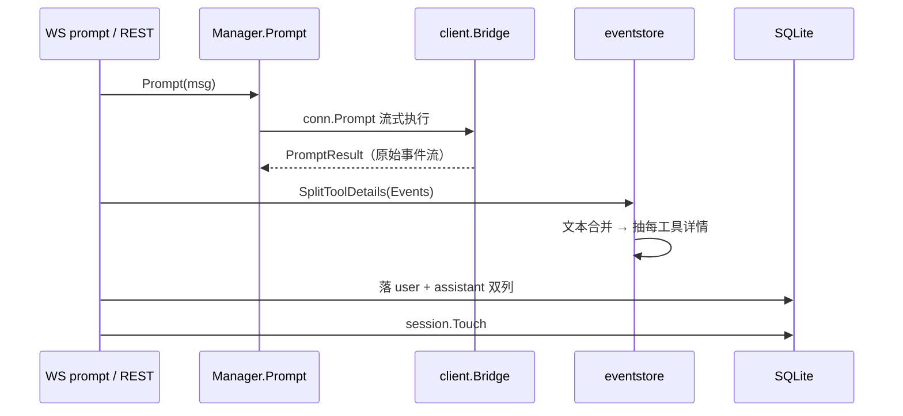
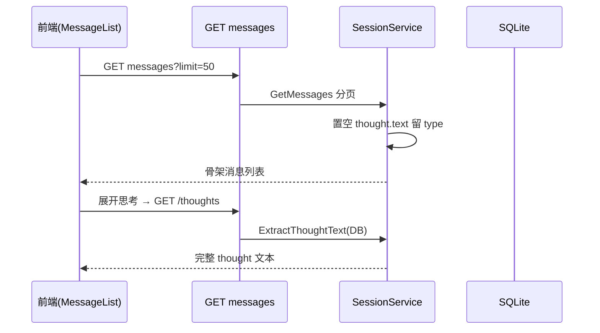

# 数据模型：SQLite 会话存储与迁移演进

> 对应代码集中在 `backend/internal/model`（GORM 模型）、`backend/internal/store`（打开/迁移/仓储）、`backend/pkg/eventstore`（落库格式）。本文按数据模型五要素组织：实体关系 → 存储选型 → 核心表 → 演进策略 → 读写路径。

## 实体关系总览

zacp 只持久化四种东西：工作目录（用户选择的项目路径）、会话（绑定 workspace + agent）、消息（属于会话）、迁移版本记录。实体关系简单到用一张 ER 图即可穷尽：

```mermaid
erDiagram
    WORKSPACES ||--o{ SESSIONS : "包含"
    SESSIONS ||--o{ MESSAGES : "包含"
    SESSIONS ||--o| SCHEMA_MIGRATIONS : "无(仅迁移记录)"

    WORKSPACES {
        uint id PK
        string path "绝对路径 uniqueIndex"
        string name "可选显示名"
        bool is_default "default_cwd 对应的工作区"
        bool archived "归档隐藏,不物理删"
        time last_used "最近使用"
        gorm.DeletedAt deleted_at "软删"
    }
    SESSIONS {
        uint id PK
        uint workspace_id FK
        string agent_id "agent 配置 ID(文本,无表)"
        string acp_session_id "ACP 协议层 session id"
        string title
        string status "active/closed/error"
        bool is_draft "草稿标记"
        text config_options "ConfigOptionDTO JSON"
        text available_commands "AvailableCommandDTO JSON"
        gorm.DeletedAt deleted_at "软删"
    }
    MESSAGES {
        uint id PK
        uint session_id FK
        string role "user/assistant/system"
        text content "消息文本"
        text events "瘦身事件 JSON(无 input/output)"
        text tool_details "toolId→{input,output} JSON"
        time created_at
    }
    SCHEMA_MIGRATIONS {
        int version PK
        time applied_at
    }
```

**实体间没有跨越**：Message 只属于一个 Session，Session 只属于一个 Workspace 并绑定一个 Agent（agent 是配置文本 id，无表）。这是典型的"单用户本地工具"数据模型——不建模用户、不建模 Agent 实体、不建模权限，因为设计假设就是单机单用户（见 [`README.md`](README.md) 不足小节）。

## 存储选型与理由

**为什么 SQLite 而不是 PG/MySQL/嵌入式 KV？** 取舍围绕部署形态展开：

1. **单二进制、零外部依赖**：zacp 的卖点是"一个可执行文件即下即用"，为此数据库必须可嵌入。前端 embed 已把体积做成一个文件，若再依赖外部 DB 服务就破坏了本地优先的定位。
2. **纯 Go 驱动（`glebarez/sqlite` → `modernc.org/sqlite`），禁 CGO**：`mattn/go-sqlite3` 需要 CGO，交叉编译（6 平台打包）会变成噩梦且破坏"单二进制可移植"承诺。AGENTS.md 明令禁止默认依赖 CGO 驱动（`AGENTS.md` 数据库约定节）。
3. **WAL + busy_timeout + foreign_keys 显式 PRAGMA**（[backend/internal/store/store.go:67-79]()  <!-- anchor: // 显式设置 PRAGMA 参数（更可靠） … return nil, fmt.Errorf("set PRAGMA %s: %w", p.name, err) -->）：

```go
pragmas := []struct{ name, value string }{
    {"journal_mode", "WAL"},
    {"busy_timeout", "5000"},
    {"foreign_keys", "ON"},
}
```

   WAL 让读不阻塞写、写不阻塞读，正适合"agent 流式写消息 + 前端列表读"并发；`busy_timeout=5000` 降低锁等待立刻失败的概率；`foreign_keys=ON` 保持引用完整性。启动后还**验证 WAL 确实生效**，失败即拒绝启动（[backend/internal/store/store.go:83-89]()  <!-- anchor: // 验证 WAL 是否启用 … return nil, fmt.Errorf("WAL mode not enabled, got: %s", journalMode) -->）——防止某环境不支持 WAL 时静默退化。

不选文档型/键值库的代价：schema 演进需要迁移系统、JSON 字段（`config_options`/`events`/`tool_details`）绕过了关系模型的强类型。对这类"结构核心 + 灵活负载"的数据，作者选择**关系表管主结构 + TEXT 列存 JSON 管可变负载**——这是 SQLite 单文件约束下务实且成熟的组合。

## 核心表设计

### workspaces（工作目录）

负责把"用户选择的项目绝对路径"收敛成可引用实体，避免会话表里存裸路径导致改名/重复。

| 字段 | 类型 | 约束/说明 |
|------|------|-----------|
| id | uint | 主键 |
| path | string | **绝对路径、唯一索引、非空** |
| name | string | 可选显示名 |
| is_default | bool | 索引；`session.default_cwd` 对应的工作区 |
| archived | bool | 索引；归档=侧栏隐藏，数据与下属 Session 保留；同 path 再添加可解除归档 |
| last_used | time | 索引；最近使用时间 |
| created_at / updated_at | time | GORM 自动维护 |
| deleted_at | gorm.DeletedAt | 软删（见 Schema 演进） |

关键决策：**归档用 `archived` 字段而非物理删除**（[backend/internal/model/models.go:11-27]()  <!-- anchor: // Workspace 工作目录（用户选择的项目路径）。 … Sessions []Session `gorm:"foreignKey:WorkspaceID" json:"sessions,omitempty"` --> 的注释），同 path 再添加即解除归档。删除则走软删（`DeletedAt`）——删除 workspace 会级联清会话/消息，但仓库层保留"含软删查询 + 恢复"的能力（[backend/internal/store/repository.go:37-61]()  <!-- anchor: func (r *WorkspaceRepository) GetByPath(path string) (*model.Workspace, error) { … Update("deleted_at", nil).Error --> 的 `GetByPathIncludingDeleted`/`Restore`），是"删除可反悔"的保守策略。

### sessions（会话）

会话是 UI 的最小单位，其字段几乎全是"为了把 DB 状态与 ACP 运行时状态对上号"而设计的：

| 字段 | 类型 | 约束/说明 |
|------|------|-----------|
| id | uint | 主键 |
| workspace_id | uint | 索引、非空、FK→workspaces |
| agent_id | string | 索引、非空；agent 配置 ID（文本，无 FK） |
| acp_session_id | string | **ACP 协议层 session id**（agent 侧） |
| title | string | 会话标题 |
| status | string | active/closed/error；索引 |
| is_draft | bool | 索引；隐式 session/new 探测创建的草稿 |
| config_options | text | ConfigOptionDTO 数组 JSON（模型/思考强度/mode） |
| available_commands | text | agent 通告的 / 命令 JSON |
| deleted_at | gorm.DeletedAt | 软删 |

`acp_session_id` 是运行时映射的关键：WS prompt 消息里带的是它（不是 DB id），EventBridge 靠 `GetByACPSessionID` 反查 DB 会话（[backend/internal/store/repository.go:193-203]()  <!-- anchor: // GetByACPSessionID 根据 ACP 协议层 session ID 获取会话（WS prompt 落库路由用）。 … return &session, nil -->）。草稿与会话恢复的语义见 [`acp-runtime.md`](acp-runtime.md)。

`config_options` 落库不是为了展示，而是为了**重建后回放**：ACP 会话重建时 agent 侧配置回默认，DB 存档作为"权威"逐项 set 回去（[backend/internal/service/service.go:246-252]()  <!-- anchor: // 序列化配置项 JSON（会话级持久化，前端经 /config-options 端点读取） … configJSON = string(data) --> 创建时序列化 + manager 回放，见 [`acp-runtime.md`](acp-runtime.md) 对账小节）。

### messages（消息）

消息表是"瘦身设计"的主战场，先看结构再看设计动机：

| 字段 | 类型 | 约束/说明 |
|------|------|-----------|
| id | uint | 主键 |
| session_id | uint | 索引、非空、FK→sessions |
| role | string | user/assistant/system |
| content | string | 消息文本 |
| events | text | **瘦身事件 JSON**：tool_call 系列已剥离 input/output |
| tool_details | text | **toolId → {input, output}**，每工具最终一份 |
| created_at | time | 创建时间 |

设计动机是**历史消息列表体积失控问题**：agent 流式输出会产生大量 `tool_call_update` 事件，每个都带全量 input/output 快照。若原样落库，一次重工具调用可能写几十 KB 冗余 JSON。v6 的解法是"**每工具只留最终一份详情**，事件流瘦身为纯时间线"（见下节迁移）。

## Schema 演进策略

### 自管版本化迁移（v1–v6）

迁移由 `store.go` 的 `runMigrations` 承担，**不用 GORM AutoMigrate 当生产唯一策略**，而是自管 `schema_migrations` 表 + 递增迁移函数（AGENTS.md 数据库约定即如此要求）：

```go
migrations := []struct{ Version int; Name string; Func func(*gorm.DB) error }{
    {Version: 1, Name: "create_initial_tables", Func: migrateV1},
    {Version: 2, Name: "workspace_archived_and_default", Func: migrateV2},
    {Version: 3, Name: "session_config_options", Func: migrateV3},
    {Version: 4, Name: "session_is_draft", Func: migrateV4},
    {Version: 5, Name: "session_available_commands", Func: migrateV5},
    {Version: 6, Name: "messages_tool_details", Func: migrateV6},
}
```

- 每次迁移**在事务中执行**，成功后写 `schema_migrations` 版本行；任一迁移失败整体回滚并**拒绝启动**（[backend/internal/store/store.go:167-184]()  <!-- anchor: for _, m := range migrations { … return fmt.Errorf("migration v%d (%s): %w", m.Version, m.Name, err) -->）——避免半新半旧 schema。
- v2–v5 本质是加列：直接 `AutoMigrate(&model.X{})`（对新表加列是纯元数据操作，秒级不重写表）。真正的数据迁移只有 v6。
- **演进模式总结**：加列走 AutoMigrate、数据重构（v6 的 events 改写）走显式迁移函数 + 校验，两者都收口在版本化框架里——既避免 AutoMigrate 全部兜底时"老库 schema 与代码漂移不可控"，又避免为加列写繁琐 DDL。

### v6：历史消息瘦身 ~90% 的一次性回填

v6（`migrate_v6.go`）是一次教科书式的数据迁移，值得拆解其容错设计：

1. **加列**：`AutoMigrate(&model.Message{})` 加 `tool_details` 列（元数据操作，秒级）。
2. **回填**：逐行读出 `events != ''` 的消息 → `json.Unmarshal` → `eventstore.SplitToolDetails` 拆成瘦身 events + details → 双列 `Updates` 改写。**单行 JSON 损坏跳过并告警，不阻塞启动**（前端对无详情卡片有"纯标题行"兜底）。
3. **校验**：`verifyToolDetailsBackfill` 回填后抽查——`tool_details` 非空行数必须等于回填成功行数；抽样前 3 行确认 events 里 tool_call 系列已无 input/output（[backend/internal/store/migrate_v6.go:83-131]()  <!-- anchor: func verifyToolDetailsBackfill(db *gorm.DB, backfilled int) error { … return nil -->）。
4. **失败语义**：结构类/回填失败返回错误 → 外层事务整体回滚并拒绝启动 → 下次启动自动重试，不会半新半旧。

回填逻辑与运行时的 `SplitToolDetails` **共用同一实现**（`pkg/eventstore`），保证历史数据与新建数据格式单一来源（[backend/pkg/eventstore/eventstore.go:1-5]()  <!-- anchor: // Package eventstore 提供消息事件列表的落库序列化、文本事件合并与工具详情拆分， … package eventstore --> 注释）——这是迁移与运行时共用代码的范例，避免了"迁移里的格式"和"运行时的格式"分叉。

### 软删 + 草稿清理的组合拳

- Session/Workspace 用 GORM `DeletedAt` 软删；删除 ACP 会话时同步 `DeleteSession`/`CloseSession` 协议层清理（[backend/internal/service/service.go:339-456]()  <!-- anchor: func (s *SessionService) DeleteSession(id uint) error { … go s.cleanupAgentSessionProtocol(session) --> 区间）。
- 草稿会话（is_draft）软删后无恢复入口，启动时 `PurgeSoftDeletedDrafts` 物理清除，避免膨胀（[backend/cmd/server/main.go:156-161]()  <!-- anchor: // 启动清理：物理删除历史软删的空草稿会话（隐式 /new 探测产生的临时会话， … log.Info("purged soft-deleted draft sessions", "count", purged) -->、[backend/internal/store/repository.go:254-254]()  <!-- anchor: func (r *SessionRepository) PurgeSoftDeletedDrafts() (int64, error) { … func (r *SessionRepository) PurgeSoftDeletedDrafts() (int64, error) { --> 起的 `PurgeSoftDeletedDrafts`）。
- 删除会话后按 `CountByAgent` 决策是否停进程：该 agent 已无任何会话才停，避免误伤仍在使用中的其它会话（[backend/internal/store/repository.go:124-130]()  <!-- anchor: // CountByAgent 统计指定 agent 的未删除会话数（gorm 默认排除软删行）。 … return count, err -->）。

## 读写路径

### 写：两条落库路径，同一格式函数

WS（主路径）与 REST（同步兼容）都能发消息，落库格式必须一致——`pkg/eventstore` 被两者共用：



- WS 路径在 `ws/bridge.go` `handlePrompt`：落用户消息 → 草稿转正 → 生成标题 → Prompt → 落助手消息（[backend/internal/ws/bridge.go:453-528]()  <!-- anchor: // 落库用户消息（即使 agent 调用失败也保留） … return nil -->）。
- REST 路径在 `service.go` `SendMessage`：同样先落 user → Prompt → `SplitToolDetails` → 落 assistant（[backend/internal/service/service.go:473-521]()  <!-- anchor: userMsg := &model.Message{ … return assistantMsg, nil -->）。REST 路径也内置 unknown-session 自动恢复（[backend/internal/service/service.go:486-498]()  <!-- anchor: if manager.IsUnknownSessionErr(err) { … return nil, fmt.Errorf("failed to send to agent: %w", err) -->）。
- `eventstore.SplitToolDetails` 内部还做**相邻纯文本事件合并**（`compactTextEvents`），把流式切碎的 thought/message 小块合并以减少 JSON 元数据，且用 `strings.Builder` 避免 O(n²) 拼接（[backend/pkg/eventstore/eventstore.go:44-93]()  <!-- anchor: // compactTextEvents 合并同一消息中相邻的纯文本事件。 … return compacted -->）。

### 读：列表瘦身 + 思考过程按需加载

读路径针对"历史消息可能很长"做两级瘦身：

1. **事件字段瘦身**：`events` 列本身已是瘦身版（v6 迁移过 + 新数据拆分写入），列表接口不返巨大 JSON。
2. **思考过程 text 置空**：`GetMessages` 返回前 `stripThoughtText` 把 `agent_thought` 的 text 置空但保留 type（前端仍能判断"存在思考过程"并显示折叠面板），内容在展开时才经 `GET /sessions/:id/messages/:messageId/thoughts` 按需加载（[backend/internal/service/service.go:524-551]()  <!-- anchor: // GetMessages 获取会话消息（分页从最新消息端计算，返回窗口内升序结果）。 … return messages, nil --> + `GetMessageThoughts`）。`ContainsThought` 用子串预筛跳过无思考的消息，避免无谓 JSON 解析（[backend/pkg/eventstore/eventstore.go:179-183]()  <!-- anchor: // ContainsThought 廉价预筛：事件 JSON 中是否存在 agent_thought 事件。 … return strings.Contains(eventsJSON, `"type":"agent_thought"`) -->）。

读侧核心是**按需加载哲学**：列表只给骨架（title/status/纯文本/瘦身 events），大负载（thought 全文、工具详情）展开时才取。这解释了一个看似矛盾的点——**DB 里存的是完整 thought 文本**（`ExtractThoughtText` 从 DB 原始 events 恢复），只是列表接口临时置空。



## 风险与待改进

- **JSON 列无 schema 校验**：`events`/`tool_details`/`config_options` 都是 TEXT，格式正确性靠代码纪律与 v6 迁移的抽查校验，缺运行期约束；版本字段升级时旧 JSON 与结构体不兼容只能靠迁移。
- **单写者假设**：WAL 允许多读一写，但设计明确"避免多个 zacp 进程同时写同一 db 文件"。Docker 多副本/负载均衡部署会踩坑（见 [`deployment.md`](deployment.md) 运维要点）。
- **软删数据可能积累**：workspace/session 软删行与 WAL 附属文件需定期 checkpoint，README 的运维提示对热备份口径已说明（备份应走 SQLite backup API 或先 checkpoint，不能只拷 `.db`）。

## 可借鉴设计

1. **运行时与迁移共用格式函数**（`pkg/eventstore` 被 WS/REST/v6 三处共用）：保证"迁移里写的格式"与"运行时的格式"永不分叉。
2. **"结构核心 + JSON 负载"的混合表设计**：稳定字段建列（索引/约束），可变 schema（configOptions、可用命令、事件流）进 TEXT——SQLite 单文件下同时拿到查询能力与演进灵活性。
3. **列表瘦身 + 按需加载的三段式**（落库去冗余 → 列表置空 → 详情按需取）：DB 存完整、接口给骨架、大负载懒加载，三者各自权衡读取路径的响应体。
4. **数据迁移自带校验 + 回滚语义**：v6 的"回填后抽查 + 失败整体回滚拒绝启动"，让迁移可自证成功而非祈祷。
