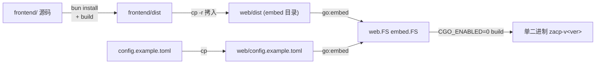

# 交付形态：单二进制 embed、Docker 与一键安装

> 对应代码：`backend/internal/web`（embed）、`scripts/`、根目录 `Dockerfile`/`docker/{full,lite}`、`compose.yaml`、`install.sh`/`install.ps1`/`update.sh`/`update.ps1`。本文讲 zacp 怎样把"Go 后端 + Vue3 前端 + 默认配置"收敛成一套易分发的产物，以及部署时要注意什么。

## 单二进制：前端是怎么"焊"进去的

zacp 的核心分发承诺是"一个可执行文件即下即用"。这靠三步：bun 编译前端 → 拷入后端 embed 目录 → `go:embed` 打进二进制。

`web` 包用 `//go:embed` 同时嵌前端产物与配置示例（[backend/internal/web/web.go:20-31]()  <!-- anchor: "io/fs" … func StaticEnabled() bool { -->）。两个工程约束值得注意：

1. **必须拷入而非直接 embed 原目录**：`go:embed` 只能引用源码包所在目录内的文件，而 `frontend/dist` 在 backend 之外——所以 `build.sh` 负责把产物拷进 `backend/internal/web/dist`（[backend/internal/web/web.go:7-11]()  <!-- anchor: //	└── config.example.toml # 配置示例（backend/configs/config.example.toml 的拷贝） … // 因此由 build.sh 把产物拷进本包再编译。 --> 的包注释 + `build.sh` 第 3 步）。
2. **`dist` 以 `.gitkeep` 占位入库**：未执行 `build.sh`（纯 `go build` / 开发模式）也能编译；此时 `StaticEnabled()` 返回 false，后端不注册静态路由，前端由 vite dev server 独立承担（[backend/internal/web/web.go:36-39]()  <!-- anchor: // StaticFS 返回 dist 子文件系统；未嵌入前端产物时返回 nil。 … if err != nil { --> + [backend/internal/api/router/router.go:161-194]()  <!-- anchor: // 嵌入前端产物时注册静态资源 + SPA fallback（未运行 scripts/build.sh 时跳过， … c.Data(http.StatusOK, "text/html; charset=utf-8", idx) --> 的 SPA fallback 分支）。

**版本号单一来源**：`frontend/package.json` 的 `version` 字段 → `-ldflags` 注入 `internal/version` 包 → 同时驱动二进制包名、`--version` 输出、`GET /api/v1/version`（`build.sh` 头部注释）。避免了后端硬编码版本与前端版本漂移。

**无 CGO 是硬前提**：`CGO_ENABLED=0 go build -trimpath` 保证单二进制可移植、可交叉编译 6 平台（`build.sh` 第 4 步）。这与数据库驱动选型（纯 Go SQLite）一脉相承——`glebarez/sqlite` 无 CGO 是 AGENTS.md 数据库约定里的明令（见 [`data-model.md`](data-model.md) 存储选型）。

## SPA fallback 与静态服务的边界

router 对未命中路径做了精细化处理（[backend/internal/api/router/router.go:163-194]()  <!-- anchor: if web.StaticEnabled() { … c.Data(http.StatusOK, "text/html; charset=utf-8", idx) -->）：

- **API 路径未命中返回 JSON 404**，不能回 HTML——前端依赖统一错误结构解析（[backend/internal/api/router/router.go:171-175]()  <!-- anchor: if p == "api" || strings.HasPrefix(p, "api/") { … return -->）。
- 静态资源（`assets/*`、favicon）存在则直接提供，不走 SPA fallback（[backend/internal/api/router/router.go:178-182]()  <!-- anchor: // 静态资源（assets/*、favicon 等）存在则直接提供，不走 SPA fallback … return -->）。
- 其余路径回 `index.html` 由 vue-router 解析——history 路由刷新 `/settings` 深链时仍能正确渲染（[backend/internal/api/router/router.go:185-194]()  <!-- anchor: // SPA fallback：前端为 history 路由，所有未匹配页面路径一律回 index.html， … c.Data(http.StatusOK, "text/html; charset=utf-8", idx) -->）。

这是单页应用 + 内嵌静态服务的标准组合，但对"聊天流式"场景多一层：gzip 中间件用 `GzipIf` 只对静态资源路径压缩（`middleware/gzip.go` 的 `StaticAssetPath`），避免对 WS/流式响应引入缓冲延迟。

## 多平台发布与 UPX 策略

`pack.sh` 是发布打包脚本：多平台矩阵编译 → Linux 平台 UPX 最高压缩 → 组装 zip/tar.gz。产物格式按平台分道（Linux 用 `.tar.gz`——tar 是所有发行版基础工具，unzip 常未预装；macOS/Windows 保持 zip）。

**UPX 策略是踩过官方支持状态的坑后的固化**（`pack.sh` 头部注释）：

| 平台 | 策略 | 原因 |
|------|------|------|
| linux/amd64、linux/arm64 | `upx --best`（约 -73%~-75%） | UPX 官方支持 |
| darwin/* | 不压 | UPX 4.2.0 起因 macOS 13+ 兼容性问题官方禁用，至今（5.x）未恢复 |
| windows/* | 不压 | 按约定规避杀软误报；UPX 也不支持 windows/arm64 |

发布包**仅含二进制**：README 与 `config.example.toml` 不随包分发——后者已由 `go:embed` 打进二进制，首次启动自动生成 `~/.zacp/config.toml`。这进一步说明 embed 不只是为了"单文件"，而是让运行路径彻底免去"手动放配置文件"。

## Docker 双镜像：lite 与 full

Docker 场景与单二进制本地安装的差异在**容器里还要能跑 agent 的 shell 工具**，因此 `docker/` 提供两个镜像（各自独立 Dockerfile + 安装脚本）：

| 镜像 | 基础 | 内容 | 用途 |
|------|------|------|------|
| `lite` | debian:12-slim | 安装最新 release 的 zacp + zlite | 精简自托管 |
| `full` | node:slim | lite + node/npm/python3 + `@wecom/cli` + OfficeCLI 等开发工具链 | agent 需要跑 node/python 代码时的完整环境 |

两者都从 **GitHub Releases 拉取 release 包**（`install-bins.sh`），而非 Dockerfile 内 `go build`——镜像构建只依赖网络拉包，快且无需 Go 工具链。架构用 buildx 的 `TARGETARCH` 注入选择 release 包。

**关键环境约束**：容器默认 `HOME=/root`，而 zacp 按 `$HOME` 找状态目录——Dockerfile 显式 `ENV HOME=/app/data` 并把 `/app/data` 设为 VOLUME，使 config.toml 与数据库落在挂载卷内（`docker/lite/Dockerfile` 注释）。`compose.yaml` 挂载 `./data:/app/data` + `./data/work:/app/data/work` 做持久化并映射 8680。

**运维要点**：
- 单写者假设：SQLite WAL 允许多读一写，但设计明确避免多个 zacp 进程写同一 DB（见 [`data-model.md`](data-model.md)）。**不要横向扩容跑多副本指向同一卷**。
- 生产用 `GIN_MODE=release` 或 `server.mode = "release"`（release 下日志安静：不打印 gin 访问日志、slog 仅 warn+）。
- 远程访问必须开登录认证（见下节），否则内网任意设备可直达。

## 一键安装 / 更新脚本

根目录四个脚本覆盖三平台：

- `install.sh` / `install.ps1`：自动检测 OS（uname Darwin/Linux）+ CPU 架构（amd64/arm64，支持 `--arch` 覆盖如 Rosetta 跑 amd64），从 GitHub Releases 解析 latest 或 `-v` 指定版本。
- **升级友好目录布局**：`<cmd-dir>/zacp` 是指向当前版本的软链，真实二进制放 `~/.zacp/bin/zacp-<version>`（版本化保留便于回滚，更旧的剪除）——为将来的 `zacp update` 铺路（`install.sh` 头部注释）。
- 安装器**不生成配置**：`~/.zacp/config.toml` 由 zacp 首次启动自行创建（`backend/internal/config/init.go`）——单二进制 + 自生成配置，用户拿到就能跑。

Linux 平台依赖镜像源场景可用 `--base-url https://ghproxy.net/https://github.com` 走加速（`install.sh` 参数说明）。

## 登录认证与安全

默认免登录（本机/内网单用户），远程访问需开启。认证体系是**单用户账号 + 验证码 + 内存 token**，热生效不重启：

- **启用状态由 `config.toml` 的 `[auth].password_hash` 是否为空决定**（为空 = 关闭，老用户零影响）；设置页改用户名/密码写回同一文件即热生效（[backend/internal/config/config.go:60-69]()  <!-- anchor: // AuthConfig 单用户账号认证配置。 … PasswordHash string `mapstructure:"password_hash"` --> 的 AuthConfig 注释 + [backend/cmd/server/main.go:120-126]()  <!-- anchor: // 启用状态由 config.toml [auth].password_hash 是否为空决定（缺省=关闭，老用户零影响）； … log.Info("auth disabled (no password set in config)") -->）。
- 密码哈希格式 `sha256$<hex>`（`sha256("zacp"+密码)`，[backend/internal/auth/password.go:23-30]()  <!-- anchor: func HashPassword(password string) string { … func VerifyPassword(hash, password string) bool { -->）。
- REST 用 `Authorization: Bearer` 主 token（[backend/internal/api/middleware/auth.go:35-35]()  <!-- anchor: func RequireMain(svc *auth.Service) gin.HandlerFunc { … func RequireMain(svc *auth.Service) gin.HandlerFunc { --> 的 `RequireMain`）；WS 因浏览器无法设自定义 header 改用 `Sec-WebSocket-Protocol: zacp-auth.<token>` 子协议（见 [`realtime-bridge.md`](realtime-bridge.md) 连接生命周期节）。
- 文件直链 `` 场景用**资源 token**（[backend/internal/api/middleware/auth.go:55-55]()  <!-- anchor: func FileRaw(svc *auth.Service) gin.HandlerFunc { … func FileRaw(svc *auth.Service) gin.HandlerFunc { --> 的 `FileRaw` 双模式校验：主 token 或 `?token=` 资源 token）。
- 登录安全含验证码 + 失败限流（`auth/service.go` 的 `GenerateCaptcha`/`IsBlocked`/`RecordFailure` 与 attempts cleanup loop）。

运维注意：token 全在**内存**（`auth/token.go` 的 `TokenStore`），重启即失效、需重新登录——本地单用户可接受，但意味着容器重启后所有已登录浏览器要重新认证。

## 设计哲学与权衡

| 决策 | 权衡 |
|------|------|
| 前端 embed + 零配置首启 | 单一产物、免配置；代价是每次改前端都要整包重建，无法热更新 UI |
| release 包走 GitHub Releases + 脚本安装 | 安装脚本薄、Docker 免构建；代价是依赖 GitHub 可达性与 API 限流（脚本已留 BASE_URL/镜像源与 GH_TOKEN 逃生口） |
| Docker 从 release 拉包而非镜像内编译 | 镜像构建快、无需 Go 工具链；代价是镜像与源码 tag 需一致才可复现 |
| 内存 token 一次性 | 简单安全（无持久化密钥）；代价是重启全登出 |
| HOME=/app/data 显式重定向 | 容器数据落卷；代价是容器内 PATH/local-bin 等需手工补齐（脚本已处理） |

## 风险与待改进

- **无自动更新 daemon**：update.sh/update.ps1 需手动/定时跑，单二进制无法自我替换（README 标注"需先停止正在运行的 zacp 进程"）。
- **Docker 单写者局限未显式文档化**：compose 只起单容器没暴露问题，但把卷挂到多副本即踩 SQLite 锁；README 对"支持 Docker 部署"的说明未提及横向限制。
- **认证是单用户**：无多账号/角色/审计，企业多人共享同一实例只能靠单一共享账号。

## 可借鉴设计

1. **go:embed 前先拷入 embed 目录 + .gitkeep 占位**：解决"embed 只能引用包内文件 + 未构建时也能编译"两个约束的最小模式。
2. **版本号单一来源（前端 package.json → -ldflags → 全链路）**：一个手动维护点，杜绝多处版本漂移。
3. **升级友好的软链 + 版本化二进制布局**：`cmd/zacp → ~/.zacp/bin/zacp-<version>`，天然支持回滚，是最轻的自更新基建。
4. **UPX 策略按平台硬编码注释固化**：把"为什么 linux 压、mac/windows 不压"的理由写进脚本，防止后人随手改动踩官方兼容性坑。
