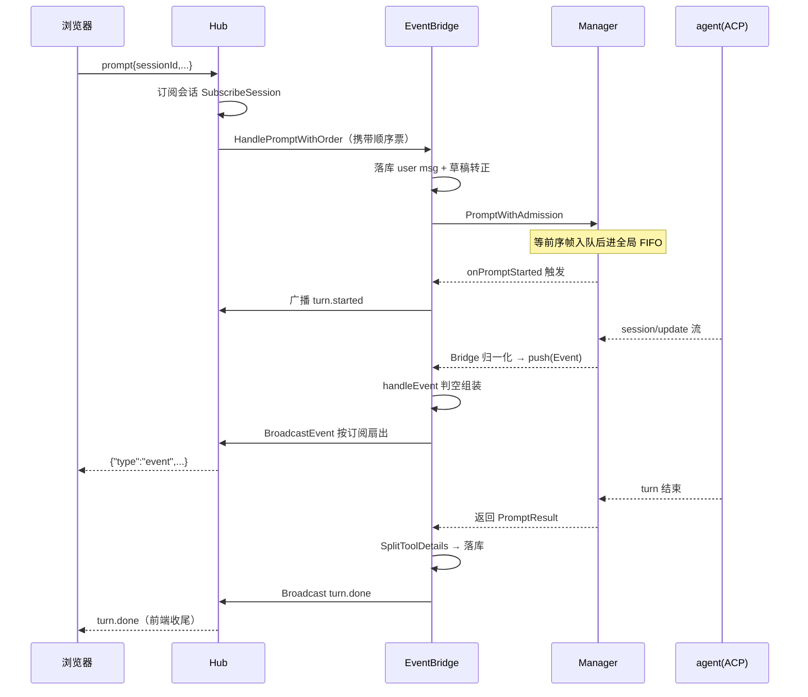
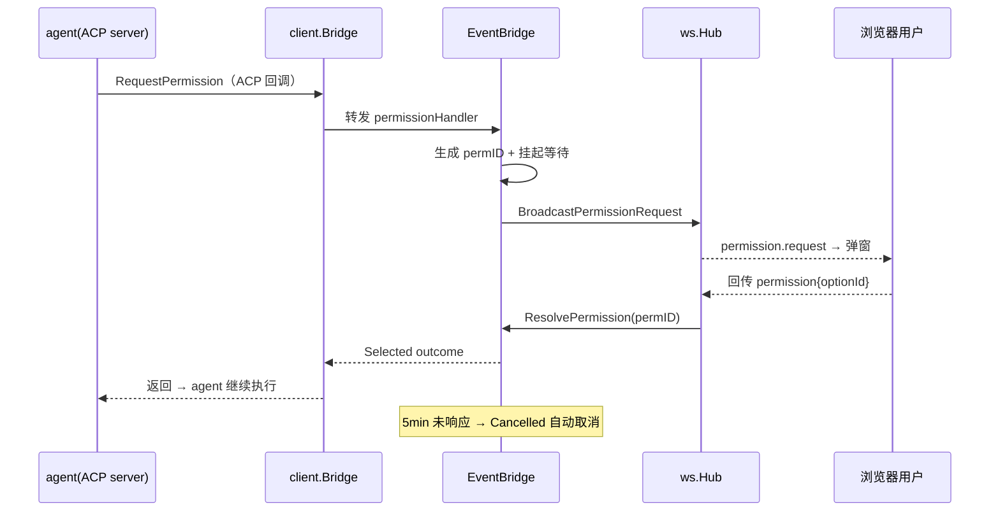

# 实时链路：WebSocket Hub 与事件桥

> 对应代码集中在 `backend/internal/ws/`（`hub.go`、`handler.go`、`bridge.go`、`protocol.go`）。本文沿一条消息从浏览器发出到渲染回浏览器的往返，拆解 zacp 的实时设计。

## 分层：Hub 管连接，EventBridge 管业务

`ws` 包拆成四个职责互不越界的部分：

| 文件 | 职责 |
|------|------|
| `protocol.go` | 前后端约定的消息类型枚举与 JSON 结构（单一契约源） |
| `hub.go` | 连接注册/注销、`Client` 的读写泵、按订阅集合广播 |
| `handler.go` | WS 升级握手、会话级广播的组装与路由、CloseAll |
| `bridge.go` | **EventBridge**：事件落库 + 广播、权限往返、prompt 顺序票、会话恢复后 rebind |

关键分层决策是 **Hub 不做任何业务判断**：它只负责"把一段 bytes 送给订阅了某 session 的所有连接"，至于这段 bytes 是什么语义（event / turn.done / permission.request）由上层组装。

## 订阅集合语义：一个连接跟踪多个会话

早期设计的"单绑定覆盖"（一条 WS 绑定一个当前 session）在"多 Agent 并行 + 排队"场景下会丢事件：切到会话 B 后，执行中的 A 的广播就收不到了。现版改为**订阅是集合**（[backend/internal/ws/hub.go:276-291]()  <!-- anchor: // SubscribeSession 订阅会话：本连接将收到该会话的事件/turn.done/权限等广播。 … c.agentID = agentID -->）：

```go
func (c *Client) SubscribeSession(sessionID, agentID string) {
    ...
    if c.subscribed == nil {
        c.subscribed = make(map[string]bool)
    }
    c.subscribed[sessionID] = true
    c.sessionID = sessionID
    ...
}
```

- `Client` 的 `subscribed map[string]bool` 记录该连接关注的所有会话，广播按 `IsSubscribed` 匹配（[backend/internal/ws/hub.go:311-314]()  <!-- anchor: func (c *Client) IsSubscribed(sessionID string) bool { … return c.subscribed[sessionID] -->）。
- 无绑定连接（`GET /api/v1/ws`）通过消息里的 `sessionId/agentId` **动态订阅**；`prompt`/`cancel`/`resync` 消息都会先 `SubscribeSession` 再处理（[backend/internal/ws/hub.go:193-200]()  <!-- anchor: switch msg.Type { … c.SubscribeSession(msg.SessionID, msg.AgentID) -->）。
- 订阅保留到连接关闭才清空：会话结束后无新广播，残留无害，实现最简单。

这样设计后，`BroadcastToSession` 就成了纯粹的按会话扇出（[backend/internal/ws/handler.go:105-125]()  <!-- anchor: // BroadcastToSession 向指定会话的所有连接广播消息（按订阅集合匹配： … h.log.Warn("send buffer full, dropping message", "sessionID", sessionID) -->）。一个优化值得注意：**一次 `json.Marshal`，N 个订阅者复用结果字节、各拷贝一份再入队**——既省 N-1 次 Marshal，又避免多 goroutine 共享底层数组的写竞态。

## 消息协议：事件按 ACP session 路由

`protocol.go` 定义全部消息类型。设计上所有**服务端广播都携带 `sessionId`**，前端按会话路由复位状态——这样 A 会话出错不会误伤排队中的 B（[backend/internal/ws/hub.go:206-213]()  <!-- anchor: c.hub.log.Error("handle prompt error", "error", err) … Message:   err.Error(), --> 的错误广播注释）。消息类型分为：

- 客户端 → 服务端：`prompt`、`cancel`、`permission`、`ping`、`resync`（刷新/重连后查询会话执行状态）
- 服务端 → 客户端：`session.ready`、`event`、`turn.started`、`turn.done`、`permission.request`、`configOptions`、`slashCommands`、`sessionInfo`、`session.recovered`、`session.resynced`、`error`、`pong`

`turn.started` 与 `resync`/`resynced` 是后期演进出的关键补丁，见下文"断线续流"。

## 一次 prompt 的完整往返



### prompt 的到达顺序票：防止 FIFO 反转

WebSocket 端是多帧并发进入（每帧一个 goroutine）。若两帧先后到达但各自的前置耗时不同（如都要落库用户消息），后帧可能先完成前置、先进入 Manager 的全局 FIFO——顺序被反转。EventBridge 用一条**串联的 `chan struct{}` 链**保证按帧到达顺序入队（[backend/internal/ws/bridge.go:30-33]()  <!-- anchor: // promptOrderTail 让 WS 按收到帧的顺序进入 Manager 全局 FIFO；前置落库耗时 … promptOrderTail chan struct{} --> + [backend/internal/ws/bridge.go:60-71]()  <!-- anchor: func (b *EventBridge) newPromptOrderTicket() (<-chan struct{}, func()) { … return wait, release -->）：

- `newPromptOrderTicket` 把 `promptOrderTail` 串成链：每帧拿到"前序的 wait" 与 "自己的 release"，处理完前置后等前序 release（[backend/internal/ws/bridge.go:437-486]()  <!-- anchor: func (b *EventBridge) handlePrompt(ctx context.Context, sessionID, agentID, mess … result, err := b.manager.PromptWithAdmission(ctx, agentID, sessionID, message, r --> 中 `if wait != nil` 等待段）。
- 顺序票的 release 同时充当 Manager 的 admission 回调——入队登记成功即放行下一帧。

这解决的是个真实工程问题：**"先来先得"必须由请求到达时点决定，而非处理完成时点**。

## 事件归一化：ACP 语义 → 前端可渲染事件

ACP 的 `session/update` 有多种细分结构（agent message chunk、thought chunk、tool call、tool call update、plan、config options 等）。`client.Bridge.SessionUpdate`（[backend/internal/acp/client/client.go:277-367]()  <!-- anchor: func (b *Bridge) SessionUpdate(ctx context.Context, params acp.SessionNotificati … return nil -->）把它们归一化成统一的简化 `Event`，关键取舍：

- **text 流是"逐块"不是"整段"**：`agent_message_chunk` / `agent_thought_chunk` 各自 push 成独立 `agent_message`/`agent_thought` 事件，前端追加渲染，天然支持流式打字机效果（[backend/internal/acp/client/client.go:282-288]()  <!-- anchor: case u.AgentMessageChunk != nil: … b.push(Event{Type: "agent_thought", Text: u.AgentThoughtChunk.Content.Text.Text, -->）。
- **plan 是整体替换语义**：ACP 每次 plan 通知携带完整条目列表，zacp 原样转成独立 `plan` 事件，前端直接覆盖展示（[backend/internal/acp/client/client.go:324-335]()  <!-- anchor: case u.Plan != nil: … b.push(Event{Type: "plan", Plan: plan, SessionID: sid}) -->）。
- **configOptions / availableCommands / sessionInfo 走独立 handler，不混入消息事件流**——它们需要落库 + 实时刷新 UI，若当普通事件处理会被消息列表消费逻辑吞掉（[backend/internal/acp/client/client.go:336-362]()  <!-- anchor: case u.ConfigOptionUpdate != nil: … fn(string(params.SessionId), *u.SessionInfoUpdate) -->）。
- **tool_call / tool_call_update 直接透传 input/output**，但在**落库路径**才做瘦身拆分（见 [`data-model.md`](data-model.md)）——实时广播带完整入参让用户看到工具在做什么，历史存储则去冗余。这也解释了为何实时与落库是两条独立的序列化路径：`handleEvent` 实时广播用带 input/output 的 wsEvent，`handlePrompt` 落库用 `SplitToolDetails` 的瘦身结果（[backend/internal/ws/bridge.go:300-323]()  <!-- anchor: // handleEvent 处理 ACP 事件并广播到 WebSocket … b.handler.BroadcastEvent(sessionID, wsEvent) --> vs [backend/internal/ws/bridge.go:509-518]()  <!-- anchor: // 落库助手回复：events 拆分为「瘦身事件 + 工具详情」两列落库， … CreatedAt:   time.Now(), -->）。

事件都携带**事件自身的 ACP session id**，多个并行会话的事件按 id 路由、绝不互相覆盖（[backend/internal/acp/client/client.go:36-40]()  <!-- anchor: RawKind string `json:"rawKind,omitempty"` … SessionID string `json:"sessionId,omitempty"` -->）。这是整个多会话并发的基石。

### session 级事件缓冲与软上限

`Bridge` 为每个 session 维护事件缓存（供 prompt 结束后的 `PromptResult.Events` 落库使用），并设置软上限防异常洪峰 OOM：超过 5000 条裁剪头部保尾部 4000 条（[backend/internal/acp/client/client.go:53-54]()  <!-- anchor: const maxEventsPerSession = 5000 … const keepEventsPerSession = 4000 --> + [backend/internal/acp/client/client.go:197-219]()  <!-- anchor: events := b.eventsBySession[e.SessionID] … b.eventsBySession[e.SessionID] = events -->）。`ResetSession` 在每次 prompt 开始/结束时清空该 session 缓存，保证一轮只落一轮的事件（[backend/internal/acp/client/client.go:141-144]()  <!-- anchor: func (b *Bridge) ResetSession(sessionID string) { … delete(b.eventsBySession, sessionID) -->、[backend/internal/acp/manager/manager.go:1332-1333]()  <!-- anchor: c.bridge.ResetSession(string(sessionID)) … defer c.bridge.ResetSession(string(sessionID)) -->）。

## 权限往返：工具操作由人在浏览器确认

这是 README 强调的核心体验之一：agent 想读写文件/执行命令时，请求被推到 Web UI 由用户选择。完整链路由三层协作：



关键设计点：

- **权限请求自身携带 ACP sessionId**，因此多个 session 可独立挂起、互不阻塞，不依赖"每个 agent 只有当前一个会话"的旧前提（[backend/internal/ws/bridge.go:35-37]()  <!-- anchor: // pendingPermissions 等待前端回传的权限请求（permissionID → 响应通道）。 … pendingPermissions sync.Map -->）。
- **pendingPermissions 是 `sync.Map`**（permissionID → 带缓冲的响应 channel），天然并发安全，且 channel 缓冲为 1 保证 Resolve 永不阻塞（[backend/internal/ws/bridge.go:329-332]()  <!-- anchor: func (b *EventBridge) HandlePermissionRequest(agentID string, req acp.RequestPer … b.pendingPermissions.Store(permissionID, ch) --> + [backend/internal/ws/bridge.go:384-400]()  <!-- anchor: func (b *EventBridge) ResolvePermission(permissionID, optionID string) { … default: -->）。
- 选项枚举从 SDK 类型**显式挑字段**转成前端友好结构（toolCallId/title/status/rawInput + optionId/name/kind），避免 SDK 类型序列化字段不稳定（[backend/internal/ws/bridge.go:335-354]()  <!-- anchor: // 转成前端友好结构（SDK 类型直接序列化字段不稳定，显式挑字段） … "kind":     string(o.Kind), -->）。
- 超时用 `time.NewTimer` 而非 `time.After`，避免超时前已响应时 timer 仍常驻 5 分钟直至触发（[backend/internal/ws/bridge.go:361-378]()  <!-- anchor: // 使用 NewTimer 替代 time.After，避免超时前已响应仍常驻 5 分钟 Timer 直至触发 … }, nil -->）。超时返回 `Cancelled` outcome。
- **auto_approve 模式直通**：`client.Bridge.RequestPermission` 在 `autoApprove=true` 时直接选第一个 allow 选项返回，不经前端（[backend/internal/acp/client/client.go:248-267]()  <!-- anchor: if autoApprove { … }, nil -->）。

**安全注意**：权限请求广播给所有订阅该 session 的连接（多标签页都会收到），任一连接回传即生效——无"发起者"校验。这是单用户场景的取舍。

## 断线续流：刷新页面不丢正在执行的任务

"对话中途刷新页面后支持续流"（CHANGE.md 20260819）是会话体验关键。断线后 agent 仍在后台执行，重连的前端需要知道"哪些会话还在跑、跑到哪了"，设计靠 `resync`/`resynced` 协议补丁实现：

- 前端 WS 重连成功 + sessions 非空时，对近期活跃会话发 `resync`（前端 `session.ts` `rescanRunningSessions`）。
- 服务端 `resync` 只订阅、**不发 prompt**（重发会触发 `ErrPromptInProgress`），查询 `HasPromptInProgress` 后回 `session.resynced{running:true/false}`（[backend/internal/ws/hub.go:238-253]()  <!-- anchor: case MsgTypeResync: … Running:   running, -->）。
- `running=true` 时前端恢复 streaming、继续收后续事件；`running=false` 时前端按 DB 全量收尾（消息已落库完整）。

这依赖后端**正在执行的 prompt 状态是持久可查询的**——`Manager.prompts` map + `promptMu`（[backend/internal/acp/manager/manager.go:44-46]()  <!-- anchor: promptGate promptGate … prompts    map[promptKey]*promptEntry --> + [backend/internal/acp/manager/manager.go:235-241]()  <!-- anchor: // HasPromptInProgress 报告指定 agent+ACP session 是否正处于 prompt 执行/排队中。 … return exists -->）。

## 会话恢复后订阅迁移：rebind

ACP session 因 agent 重启失效时（见 [`acp-runtime.md`](acp-runtime.md)），重建会得到**新的 ACP session id**，而前端连接订阅的还是旧 id——若不迁移，广播按新 id 匹配不到订阅者，前端"一直 loading"。EventBridge 恢复成功后调用 `handler.RebindSession(oldID, newID)`：

- 遍历所有连接，把对 oldID 的订阅迁移到 newID，并给被迁移的连接发 `session.recovered`（带新旧 id），前端据此更新本地 id→DB 映射（[backend/internal/ws/handler.go:131-148]()  <!-- anchor: // RebindSession 在 ACP 会话恢复/重建后迁移订阅：旧 session id 失效、 … NewSessionID: newID, -->）。
- `Client.RebindSubscription` 同步校正"最近订阅"指针（[backend/internal/ws/hub.go:295-306]()  <!-- anchor: // RebindSubscription 把本连接对 oldID 的订阅迁移到 newID（ACP 会话恢复/重建后调用）。 … c.sessionID = newID -->）。
- 迁移必须在重试 prompt 之前完成——随后的事件广播都走新 id，只有迁移后的连接能收到（[backend/internal/ws/bridge.go:558-566]()  <!-- anchor: if rebuilt { … b.log.Info("rebound ws subscriptions", "old", oldAcpID, "new", newID) -->）。

REST 路径的会话重建（`SetConfigOption` 触发）同样走 `OnSessionRebuilt` 钩子迁移订阅（[backend/cmd/server/main.go:219-222]()  <!-- anchor: // REST 路径（SendMessage/SetConfigOption）重建 ACP 会话后，同样迁移 WS 订阅 … wsHandler.RebindSession(oldID, newID) -->）——保证两条恢复路径前端行为一致。

## 连接生命周期与认证

WS 升级在 [backend/internal/ws/handler.go:32-60]()  <!-- anchor: func (h *Handler) ServeHTTP(w http.ResponseWriter, r *http.Request, bridge *Even … h.log.Info("websocket connection established", "remote", r.RemoteAddr) -->：先 `AuthSubprotocol` 校验（见下），再 `websocket.Accept`。**不能用 `r.Context()` 作为连接生命周期**——HTTP handler 返回后 request context 会被取消，导致读写协程立即退出；必须用独立 `context.Background()`，连接生命周期由 conn 关闭驱动（[backend/internal/ws/handler.go:53-58]()  <!-- anchor: // 注意：不能用 r.Context() 作为连接生命周期——HTTP handler 返回后 request context … go client.ReadPump(ctx) -->）。

客户端连接关闭语义分类清晰：`hub.go` 的 `ReadPump` 区分对端主动关闭帧（1000/1001/1005 视为有序）与网络中断/异常关闭（记错误日志定位），`WritePump` 30s ping 保活 + 写失败即断开（[backend/internal/ws/hub.go:94-166]()  <!-- anchor: // ReadPump 从 WebSocket 读取消息 … return -->）。

WS 认证走 **`Sec-WebSocket-Protocol` 子协议**而非 header/query：浏览器 WebSocket 无法设置自定义 header，而 token 放 `?token=` 会进访问日志；子协议只在握手时发送、不回显到 URL，是折中方案（[backend/internal/ws/auth.go:10-15]()  <!-- anchor: // wsAuthProtocolPrefix WebSocket 子协议前缀，登录 token 经它携带： … const wsAuthProtocolPrefix = "zacp-auth." --> + [backend/internal/ws/auth.go:29-41]()  <!-- anchor: func AuthSubprotocol(r *http.Request, authSvc *auth.Service) (string, bool) { … return proto, true -->）。

## 前端消费侧

前端 `useAcpSocket.ts` 是后端协议的镜像客户端：应用级单例，token 走 `zacp-auth.` 子协议，30s 应用层 ping，指数退避重连（1s→30s 封顶），连续 3 次握手失败视为 token 失效触发重认证。消息类型与 `protocol.go` 逐条对齐（前端 `types/ws.ts`）。

渲染层 `session.ts`（1841 行 Pinia store）做会话态隔离：`statusBySession` / `streamBlocksBySession` / `activeToolCards` 均按 session 分桶；占位消息在 `turn.done` 后转正为 DB 版本（`finalizeStream → refreshAfterTurn`）。思考过程默认折叠，展开时经 `/thoughts` 接口按需加载（后端 `GetMessageThoughts` 从 events 中提取）。

## 设计哲学与权衡

- **Hub 无业务、Bridge 无连接**：把"字节搬运"与"业务语义"拆开，事件桥可以独立演进（加 resync/recovered 类型只改协议层与桥）。
- **广播按会话匹配而非按连接全发**：多会话并排时各会话事件不串台，这是"多 Agent 并行"体验的通信层保证。
- **实时与落库用两套序列化**：实时带全量 input/output（用户看得见工具在干嘛），落库瘦身（列表不撑爆）——两条路径共享同一 `Event` 源但各取所需。
- **resync/rebind 双补丁**：分别解决"重连续流"与"会话重建后续订"，都是"执行状态不在前端而在后端"这一架构事实的自然结果。

## 风险与待改进

- **广播无背压分级**：`Send` 缓冲满时直接丢消息（[backend/internal/ws/hub.go:180-183]()  <!-- anchor: select { … c.hub.log.Warn("send buffer full, dropping message") -->），对实时聊天够用，但高吞吐场景（长输出 + 慢消费者）会丢帧且只记 Warn。
- **权限广播全订阅者可达**：多标签页任一可回传权限，无发起者校验——单用户可接受，多用户会是安全问题。
- **消息类型靠字符串约定**：前后端契约用 `type` 字符串 + 手写结构，无 schema 生成或类型校验，演进靠两端手动同步（与 `docs/API.md` 一并维护）。

## 可借鉴设计

1. **订阅集合语义替代单绑定**：让一个长连接稳定跟踪多个并发任务的广播归属，避免"切页丢事件"。
2. **帧到达顺序票（admission 回调）**：分布式排队系统中"先来先得按到达时刻而非完成时刻"的经典解法。
3. **协议补丁式演进（resync/rebind/续流）**：为刷新与崩溃场景预留可查询的执行状态，前端即可"无感续命"。
4. **显式挑字段的前后端 DTO**：不直接序列化 SDK 类型，隔离不稳定字段面。
