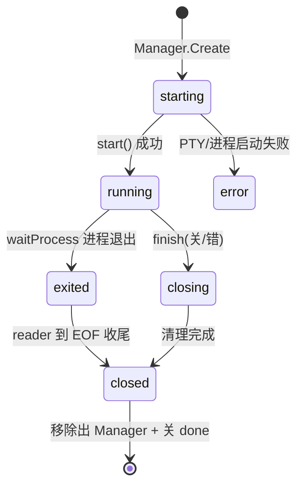
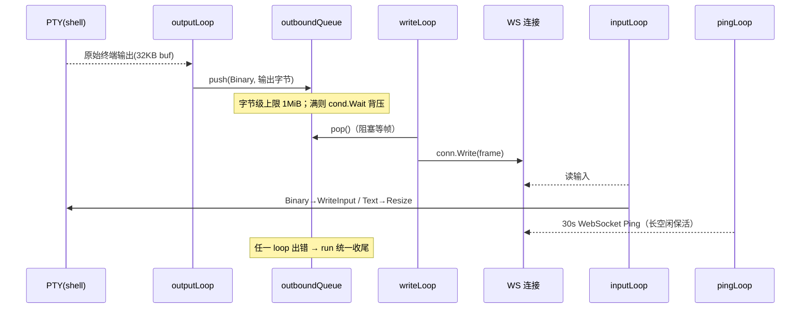

# Web TTY：浏览器里的临时 PTY 终端

> 对应代码集中在 `backend/internal/tty/`（handler / session / manager / flow / protocol）+ 前端 `src/pages/TtyPage.vue`、`src/composables/useTtySocket.ts`、`src/components/tty/`。功能入口：`/tty?workspaceId={id}` 在项目目录下启动临时 shell。

## 为什么需要一条独立的终端通道

zacp 的核心是 ACP 会话，但用户经常需要"直接在项目目录敲命令"。做法上是给每个 workspace 起一个**独立的临时 PTY**——**不进 ACP Hub**。`tty.Handler` 的注释点明了动机：避免聊天消息队列丢弃终端输出（[backend/internal/tty/handler.go:24-30]()  <!-- anchor: // Handler 将一个浏览器 WebSocket 连接绑定到一个临时 PTY Session。 … authSvc *auth.Service -->）。

这条通道与 ACP 会话通道的差异本质：

| 维度 | ACP 会话 WS | TTY WS |
|------|-------------|--------|
| 内容 | 结构化的 JSON 事件（text/tool/plan） | 终端原始字节流 + 少量控制帧 |
| 方向 | 主要是服务端事件下行 | **双向对称**：输入字节上行、输出字节下行 |
| 流量 | 受控（token/事件） | **可能高速突发**（`ls -R`、日志 tail） |
| 生命周期 | 持久化、可恢复、绑定 DB session | **临时性**：连接断即终止，输出不落库 |

因此它复用 ACP 的子协议认证（`Sec-WebSocket-Protocol: zacp-auth.<token>`）但数据协议与生命周期完全独立（[backend/internal/api/router/router.go:62-64]()  <!-- anchor: // TTY 通道使用与 ACP 相同的 WebSocket 子协议认证，但数据协议和生命周期完全独立。 … ttyHandler.ServeHTTP(c.Writer, c.Request) -->）。

## 会话模型与状态机

每个 WS 连接绑定一个 `Session`，其生命周期用六态状态机管理（[backend/internal/tty/session.go:16-25]()  <!-- anchor: // SessionState 表示临时 TTY 的生命周期状态。 … SessionError    SessionState = "error" -->）：

关键不变量：

- **`closeOnce` 收敛所有关闭路径**：连接断开、页面离开、进程退出、服务 shutdown 全走 `finish`（[backend/internal/tty/session.go:236-267]()  <!-- anchor: // 关闭操作幂等；连接断开、页面离开、进程退出和服务 shutdown 都走这里。 … close(s.done) -->），用 `sync.Once` 保证只清理一次——先 cancel context、杀进程（平台差异化 `terminateProcess`）、关 PTY、从 Manager 移除、最后 `close(done)` 通知所有等待者。
- **进程先退、reader 后排空**：`finalizeExit` 在 PTY reader 读到最终 EOF 后才关 master，避免关闭 PTY 时丢失 shell 的最后输出（[backend/internal/tty/session.go:178-184]()  <!-- anchor: // finalizeExit 在 PTY reader 读到最终 EOF 后关闭 master。 … s.finish(SessionExited, err, false) -->）。这是很多 Web 终端实现的通病——进程已退但清屏/提示没发完就掐断。
- 幂等：`Close` 可被多路径重复调用而无副作用。

## 进程管理：workspace 即 cwd

安全模型的关键约束在 `TTYService`：**终端只能使用已登记 `Workspace.Path` 作为 cwd，不能接受前端传入任意路径或命令**（[backend/internal/service/tty.go:25-28]()  <!-- anchor: // TTYService 为临时终端解析工作区和默认 shell。 … workspaceRepo *store.WorkspaceRepository -->）。且每次请求都要**重新校验路径仍存在且是目录**（`ResolveWorkspace`，[backend/internal/service/tty.go:36-58]()  <!-- anchor: // ResolveWorkspace 查询并重新校验 TTY 使用的工作区路径。 … return workspace, nil -->）——工作区可能在登记后被删除或变成文件，不能只依赖建库时的校验。

默认 shell 解析带固定 fallback：优先 `$SHELL`（Windows 用 `COMSPEC`），失败落 `/bin/sh`（Windows `cmd.exe`）（[backend/internal/service/tty.go:61-79]()  <!-- anchor: // Shell 返回当前平台的默认 shell 路径和参数。 … return "", nil, fmt.Errorf("%w: default=%q fallback=%q", ErrTTYShellUnavailable, -->）。`cmd.Dir = workspaceDir`，Windows 不强行注入 TERM，其它平台无 TERM 时补 `TERM=xterm-256color`（[backend/internal/tty/session.go:123-125]()  <!-- anchor: cmd := ptmx.CommandContext(s.ctx, s.shellPath, s.shellArgs...) … cmd.Env = terminalEnv() --> + [backend/internal/tty/session.go:142-152]()  <!-- anchor: func terminalEnv() []string { … return append(env, "TERM=xterm-256color") -->）。

进程级上限：`Manager` 以 `max`（main 注入 32）约束并发终端数，超限返回 429（[backend/internal/tty/manager.go:44-62]()  <!-- anchor: func (m *Manager) Create(ctx context.Context, workspace *model.Workspace, shellP … return session, nil -->、[backend/internal/tty/handler.go:82-89]()  <!-- anchor: session, err := h.manager.Create(context.Background(), workspace, shellPath, she … return -->）。前端页面级再叠一个 6 Tab 上限（`useTtyManager.ts`）——两层防呆：一个用户浏览器开太多，或多人/多标签页同时使用，都不至于耗尽进程。

## 帧协议：binary 传数据，text 传控制

帧类型设计是"终端流"与"控制信令"的天然分工（[backend/internal/tty/protocol.go:24-36]()  <!-- anchor: // ClientControlMessage 是客户端到服务端的 Text 控制帧。 … Message    string `json:"message,omitempty"` -->）：

- **Binary 帧** = 原始 PTY 字节。上行：用户输入、粘贴、鼠标报告直接写入 PTY；下行：PTY 输出原样发给 xterm.js。
- **Text 帧** = JSON 控制消息。上行只有一种业务帧 `resize`（cols/rows）；下行有 `ready`（携带 terminalId）、`exit`（携带退出码）、`error`（错误码 + 消息）。

限制都在服务端做防御性校验（[backend/internal/tty/protocol.go:9-12]()  <!-- anchor: const ( … maxPTYRows         = 500 -->）：单个输入帧 ≤1 MiB、cols ∈ [1,1000]、rows ∈ [1,500]，超界返回带明确错误码的 Text 帧。`decodeClientControl` 把"未知 type / resize 越界"精确映射成 `ErrUnknownMessage` / `ErrInvalidResize`（[backend/internal/tty/protocol.go:43-61]()  <!-- anchor: func decodeClientControl(data []byte) (ClientControlMessage, error) { … return nil -->），handler 用 `ttyErrorCode` 转成前端可读的错误码（[backend/internal/tty/handler.go:321-343]()  <!-- anchor: func ttyErrorCode(err error) string { … return "terminal connection failed" -->）。

服务端保活用 **WebSocket Ping 帧**而非业务层 ping/pong——终端是长空闲场景（用户盯着 shell 不敲命令），TCP/WS 层心跳比业务心跳更省且语义正确。

## 四路 I/O 循环与字节级背压

TTY 最重要的工程挑战是**高速输出下的流控**。handler 起四条 goroutine（[backend/internal/tty/handler.go:148-153]()  <!-- anchor: loopErrors := make(chan error, 4) … go h.pingLoop(ctx, conn, loopErrors) -->），由一条有序出站队列（`outboundQueue`）串起来：

**`outboundQueue` 是按字节数而非条数限流**（[backend/internal/tty/flow.go:11-27]()  <!-- anchor: const maxOutputQueueBytes = 1 << 20 … closed bool -->）：PTY 输出帧大小不一，按条数限制会让单个 1MB 帧打满缓冲，按字节数限制才能真正防无界增长。核心是一个 `sync.Cond` 实现的生产者-消费者队列：

- `push` 在 `bytes + len(data) > maxOutputQueueBytes`（1 MiB）时 `cond.Wait()` 阻塞——这就是背压：PTY 输出快于 WS 发送时，输出循环停在那里等，**绝不静默丢帧**（[backend/internal/tty/flow.go:36-67]()  <!-- anchor: func (q *outboundQueue) push(ctx context.Context, messageType websocket.MessageT … return nil -->）。
- 通过 `context.AfterFunc` 把 ctx 取消与 cond.Broadcast 绑定，保证连接关闭时阻塞中的 push/pop 能被唤醒退出、不泄漏 goroutine（[backend/internal/tty/flow.go:44-49]()  <!-- anchor: wake := context.AfterFunc(ctx, func() { … defer wake() -->）。
- `pop` 从队首取帧、清引用防 GC 泄漏（[backend/internal/tty/flow.go:70-99]()  <!-- anchor: func (q *outboundQueue) pop(ctx context.Context) (outboundMessage, bool, error)  … return message, true, nil -->）。

对比 ACP Hub 的 `Send`（缓冲满即丢消息），TTY 选的是**宁可阻塞也不丢**——终端输出丢了用户会直接看到命令结果残缺，而聊天事件丢了只是临时少一段流。

## handler 的收尾编排

`run`（[backend/internal/tty/handler.go:127-189]()  <!-- anchor: func (h *Handler) run(conn *websocket.Conn, session *Session) { … _ = conn.Close(websocket.StatusNormalClosure, "terminal closed") -->）是四条循环与 Session 状态机之间的胶水：

- **`ready` 帧先入队再启动 reader**：保证 shell 首帧输出不会排在 ready 前面（[backend/internal/tty/handler.go:132-145]()  <!-- anchor: // ready 先入队，再启动 reader，保证 shell 首帧不会排在 ready 前面。 … return -->）。
- 用一个容量 4 的 `loopErrors` 通道收集任何一条循环的致命错误；`run` 主 select 等待"session 结束"或"任一循环出错"，随后统一 `session.Close` + 关队列 + 等 writer 排空 + 关连接（[backend/internal/tty/handler.go:155-189]()  <!-- anchor: select { … _ = conn.Close(websocket.StatusNormalClosure, "terminal closed") -->）。
- `sendLoopError` 用非阻塞发送，四条循环可能同时报错，多余的丢弃即可——已经有一个错误要收尾了。
- 退出时若 Session 是 `exited` 态则补发一条携带真实退出码的 `exit` 帧（[backend/internal/tty/handler.go:156-163]()  <!-- anchor: case <-session.Done(): … writeCancel() -->），前端据此显示退出状态。

## 设计哲学与权衡

- **独立通道而不复用 ACP Hub**：终端输出不容丢弃，故不能用"缓冲满丢消息"的聊天队列；代价是双份 WS 基建（两条认证路径、两套协议）。
- **临时性即安全边界**：TTY 输出不落库、连接断即杀进程，天然不留敏感操作痕迹；代价是不能断线续接（关了就要重开）。
- **"宁可阻塞不丢帧"**：字节级背压把压力传导回 PTY 读侧，而非在前端通道丢数据——对终端这种"完整性 > 实时性"的场景是正确取向。
- **进程上限双层设防**：进程 32 + 页面 6，防呆但不牺牲单人正常多开。

## 风险与待改进

- **单连接单终端**：每条 WS 绑一个 Session，无"多 Tab 共享同一条 shell"的复用（`useTtyManager` 的前端 6 Tab 是 6 条独立连接）；需要协作看同一终端的场景不支持。
- **PTY 缩放风暴**：xterm.js 的 FitAddon + ResizeObserver 在窗口拖拽时可能高频发 resize，`validateResize` 挡住越界但未做节流（由 `useTtySocket` 的发送频次天然限制）。
- **无输出染色/日志**：终端输出不进 slog，排障只能靠 WebSocket 层日志。

## 可借鉴设计

1. **字节级背压出站队列**：`sync.Cond` + `context.AfterFunc` 的组合，是"不丢数据的有界队列"的通用实现。
2. **六态状态机 + `closeOnce` 单点收敛**：所有关闭路径（断连/退出/shutdown）都归一到一个幂等 finish，杜绝资源泄漏。
3. **"进程先退、读后排空再关 master"**：保住 shell 最后的输出，是 Web 终端体验的细节分水岭。
4. **服务端强制 cwd = 已登记 workspace + 每请求重新 stat**：把"命令可以随便跑但只能在你选的项目目录里跑"的安全边界做进架构。
