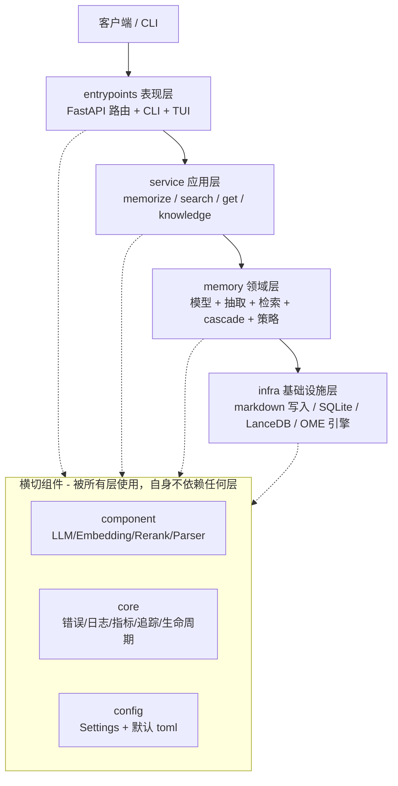
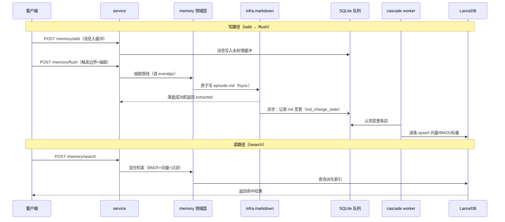

# 系统架构

## 整体形态

EverOS 是一个**单进程**应用：一个 HTTP 服务同时承载 API、后台索引同步（cascade）与离线记忆引擎（OME）。代码按 DDD 分层组织，层与层之间是**严格单向依赖**，由 CI 里的 `import-linter` 强制。理解它的关键，是先看这四层各自负责什么、不能碰什么。

下图是运行时的整体拼图：入口层接收请求，应用层编排用例，领域层承载业务核心，基础设施层负责落盘；三组横切组件（component/core/config）被所有层使用但自身不依赖任何层。

看这张图要抓住两点：依赖箭头**只向下**（`entrypoints → service → memory → infra`）；横切组件是"大家都能用、但它不认识大家"的公共设施，因此不参与分层约束。

## 分层与职责

| 层 | 目录 | 负责什么 | 不负责什么 |
|------|------|----------|-----------|
| 表现层 | `src/everos/entrypoints/` | HTTP 路由、CLI 命令、TUI 演示；把异常翻译成 HTTP 响应 | 不包含业务规则 |
| 应用层 | `src/everos/service/` | 编排用例：memorize（写入）、search、get、knowledge；把领域能力串成一次请求 | 不直接读写存储细节 |
| 领域层 | `src/everos/memory/` | 业务核心：记忆模型、抽取管线、检索融合、cascade 逻辑、OME 策略、reflection | 不认识具体存储后端 |
| 基础设施层 | `src/everos/infra/` | 存储适配器：Markdown 读写、SQLite 表/仓储、LanceDB/Milvus 索引、OME 引擎实现 | 不做业务判断 |

横切的三组（`component/`、`core/`、`config/`）不参与这条链：`component` 是可注入的模型能力提供者（LLM、Embedding、Rerank、Parser、Tokenizer），`core` 是运行时基座（异常体系、可观测性、生命周期、请求上下文），`config` 是配置数据（Settings 模式与默认 `toml`）。

## 模块地图

| 模块 | 职责 | 关键概念 |
|------|------|----------|
| `memory/extract/` | 标准化接入 + 抽取管线 | ingest（消息规范化）、pipeline（调用 everalgo 抽取、双轨拆分、写 store） |
| `memory/cascade/` | 监听 Markdown 变化并同步到派生索引 | watcher（watchdog）、scanner、worker、registry（kind → handler） |
| `memory/search/` | 检索编排与融合 | adapter（方法→管线）、hierarchy（堆扩展）、skill_hybrid、agentic |
| `memory/strategies/` | OME 业务策略，一策略一文件 | extract_atomic_facts / extract_user_profile / reflect_episodes … |
| `memory/reflection/` | 离线记忆合并 | Select → Merge → Re-extract → Deprecate 流水线 |
| `infra/ome/` | 离线记忆引擎运行时 | engine（调度器）、triggers（Immediate/Cron/Idle）、stores |
| `infra/persistence/` | 三件套适配器 | markdown（writers/readers/mds）、sqlite（tables/repos）、lancedb/milvus、index（router） |
| `core/observability/` | 可观测性三件套 | metrics（Prometheus）、logging（structlog + trace_id）、tracing（OpenTelemetry） |

## 一次请求的主链路

下图把"写入"与"读取"两条主链路并排放在一起，重点看 **同步边界停在哪里**：写路径在 Markdown 落盘后立刻返回，之后的索引与派生记忆全部异步；读路径直接查派生索引。

该看什么：写入返回时"记忆已经安全"，但"是否可搜"取决于 cascade 是否已经把这条 Markdown 同步进索引——这就是为什么写路径与读路径之间隔着一层异步队列，也是"写强一致、读最终一致"的架构根源（详见 [storage-and-consistency.md](storage-and-consistency.md)）。

## 进程内的后台组件

EverOS 里没有独立守护进程，cascade 与 OME 都挂在 FastAPI 的生命周期（lifespan）上，随 server 启停。启动时按 `order` 依次拉起一批 `LifespanProvider`，关闭时逆序回收。下表列出与主链路直接相关的几个：

| Provider | 启动时做什么 | 关闭时 |
|------|------|------|
| LLMLifespanProvider | 预先构造 LLM 客户端；缺凭证则启动失败（LLM 是硬性前提） | 释放 |
| SqliteLifespanProvider | 打开系统库、建表 | 关闭连接 |
| LanceDBLifespanProvider | 打开派生索引连接 | 关闭 |
| CascadeLifespanProvider | 启动 watcher + worker 后台任务 | 停止任务 |
| OmeLifespanProvider | 启动 OME 引擎与调度器 | 停止引擎 |

## 关键设计取舍

| 选了什么 | 没选什么 | 代价 |
|------|------|------|
| Markdown 单一真源 + 派生索引可重建 | 把向量库/关系库当真源 | 每次检索要经过异步同步，存在读延迟 |
| 严格单向分层 + import-linter 强制 | 图方便跨层直连 | 增加一层转发（entrypoints 必须绕道 service），但边界清晰、可测 |
| 算法（everalgo）与编排（EverOS）物理分离 | 把抽取算法内嵌进主仓 | 需要维护一个外部包依赖；但算法可被多种产品复用 |
| 单进程内跑 cascade + OME | 独立守护进程 / 消息队列 | 进程重启时的恢复靠 SQLite 队列与 LSN（见 storage 页） |

> 依据：`docs/architecture.md:5-62`、`docs/architecture.md:132-236`、`src/everos/entrypoints/api/app.py:1-50`、`src/everos/core/lifespan/factory.py:1-40`、`src/everos/memory/cascade/worker.py:1-45`、`src/everos/memory/search/adapter.py:1-45`
