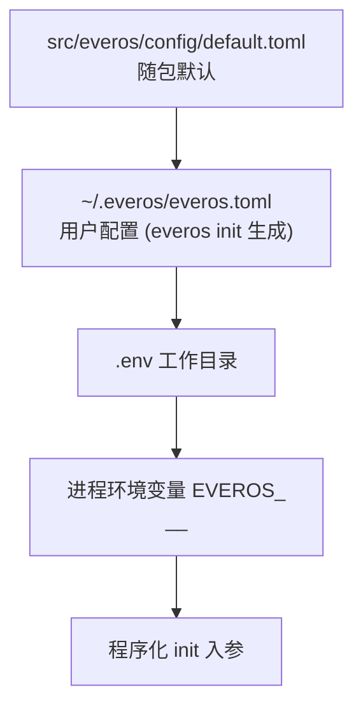

# 部署与运维

## 这张页要回答什么

"我要把它跑起来，最少需要什么、怎么配、怎么确认它活着、出问题先看哪"。EverOS 是单进程自托管服务，部署门槛很低——但有一个硬前提：**必须有 LLM**。

## 最小可跑：三步

| 步骤 | 命令 | 说明 |
|------|------|------|
| 1. 安装 | `uv pip install everos`（或 `pip install everos`） | Python 3.12+ |
| 2. 体验（可选） | `everos demo` | 内置交互 demo，**无需 API Key**，能完整体验存→取链路 |
| 3. 初始化 | `everos init` | 在记忆根生成 `everos.toml` + `ome.toml` |
| 4. 填 key | 编辑 `~/.everos/everos.toml` 的 `[llm].api_key` | LLM 是硬性前提，缺了服务起不来 |
| 5. 启动 | `everos server start` | 默认监听 127.0.0.1 的 8000 端口 |

起来之后 `curl http://127.0.0.1:8000/health` 看到 `"status":"ok"` 即成功。

## 能力分层：LLM 必需，其余可选

EverOS 的能力依赖是**分级**的，这决定了"什么配了就能用什么"：

| 能力 | 是否硬性 | 缺了会怎样 |
|------|----------|-----------|
| LLM | **必需**（Tier-1） | 服务启动即失败（lifespan 预先构造客户端，缺凭证直接抛错） |
| Embedding | 可选 | vector / hybrid / agentic、reflection、skill 抽取、knowledge 被禁用 |
| Rerank | 可选 | 依赖重排的方法/路径不可用 |
| Multimodal / Parser | 可选 | 多模态上传被禁用 |

所以"只有一个 OpenRouter key 就够了"是成立的：此时 `capabilities.llm=true`，embedding / rerank 为 `false`，`keyword` 关键词检索仍可用，其他方法会明确报"能力未配置"。

## 配置优先级与来源

配置最终汇入一个 Settings 对象，来源由低到高叠加，**后者覆盖前者**：

| 来源 | 形态 | 说明 |
|------|------|------|
| 包内默认 | `config/default.toml` | 所有字段的出厂值 |
| 用户配置 | `~/.everos/everos.toml` | `everos init` 生成；只需填要覆盖的字段 |
| `.env` | 工作目录 `.env` | 便于本地开发 |
| 环境变量 | `EVEROS_<SECTION>__<KEY>`（双下划线表示嵌套） | 容器/CI 常用 |
| 程序入参 | 代码里 `init` 传参 | 最高优先 |

配置文件路径本身可用 `EVEROS_CONFIG_FILE` 指向任意位置；文件缺失时**静默跳过**（不报错）。

## 关键配置项

`config.example.toml` 是官方给的填法示例。几个最常动的段：

| 段 | 关键字段 | 作用 |
|------|----------|------|
| `[llm]` | `model`、`api_key`、`base_url` | 抽取用的 OpenAI 协议 chat 端点（必需） |
| `[embedding]` | `model`、`api_key`、`base_url`、`batch_size`、`max_concurrent` | 向量化（可选） |
| `[rerank]` | `model`、`api_key`、`base_url` | 重排（可选） |
| `[memory]` | `root`、`timezone` | 记忆根与展示时区 |
| `[index]` | `backend` | 派生索引后端：`lancedb`（默认）或 `milvus` |
| `[milvus]` | `uri`、`token`、`db_name` | 当 `index.backend=milvus` 时需要 |

`ome.toml` 是另一份独立文件，专管 OME 策略开关与定时，热加载（详见 [write-path.md](write-path.md)）。

## CLI 与 API 的分工

CLI 是给**运维/脚本**的，HTTP API 是给**客户端**的：

| 职责 | 走 API | 走 CLI |
|------|--------|--------|
| 热路径业务（`/add` `/flush` `/search` `/get`） | ✅ | —（仅 HTTP） |
| 生成配置 | — | `everos init` |
| 查看生效配置 | — | `everos config show` |
| 跑服务 | — | `everos server start` |
| 索引运维（drain/看/修 cascade 队列） | — | `everos cascade {status,sync,fix}` |
| 健康探针 | `GET /health` | — |
| 指标抓取 | `GET /metrics` | — |

`everos server start` 支持 `--host` / `--port` / `--root` / `--reload` / `--log-level`，也可用环境变量（如 `EVEROS_API__HOST`、`EVEROS_API__PORT`、`EVEROS_ROOT`）。

## 健康与可观测

`GET /health` 是两段式语义，这一点很重要：

- **liveness**：只要进程活着，`status` 就是 `"ok"`——不是 `cascade` 退化就重启（重启治不了坏的 md 文件或磁盘膨胀）。
- **readiness**：`cascade.healthy=false` 且带 `reasons`，**只在投影管线本身卡住时**出现（drain 失败、optimize 卡死、版本清理停滞）。要告警就盯 `cascade.healthy`。

`failed_permanent`（等 `cascade fix` 的文件）是数据质量积压，只作为信息性计数，不翻转 `healthy`。此外 `/metrics` 暴露 Prometheus 指标；三件套可观测能力（metrics / structlog 日志带 trace_id / OpenTelemetry tracing）在全链路生效。

## 运维要点

| 症状 | 先看什么 / 怎么做 |
|------|------------------|
| 写完搜不到 | 正常（读最终一致）；稍等或在无 server 时 `everos cascade sync` |
| 索引坏了 | `everos cascade rebuild`（别裸删 `.index/lancedb`，会导致重建为空） |
| 队列有失败行 | `everos cascade fix`，看哪些 retryable |
| 索引漂移 | `everos cascade rebuild` 全量重建 |
| 服务起不来 | 先查 LLM key——LLM 是启动硬前提 |

## 边界与限制

- **生产 vs 开发差异**：EverOS 定位单机/小团队，不提供集群、多租户、云同步；"生产"与"开发"的差别主要在于是否配齐 embedding/rerank、是否开启 reflection、以及资源/磁盘规划，而非部署拓扑。
- **索引后端可换但有前提**：`milvus` 后端需要额外安装 `everos[milvus]` 并配置 Milvus 服务；默认的 `lancedb` 是嵌入式零依赖。
- **单写者**：运行中的 server 是唯一索引写入者，多实例共用一个记忆根会冲突。

> 依据：`README.md:107-186`、`config.example.toml:1-60`、`docs/cli.md:80-120`、`src/everos/entrypoints/cli/commands/init_cmd.py:1-30`、`src/everos/entrypoints/cli/commands/server.py:47-76`、`src/everos/entrypoints/api/routes/health.py:144-200`、`src/everos/component/capabilities.py:1-60`
