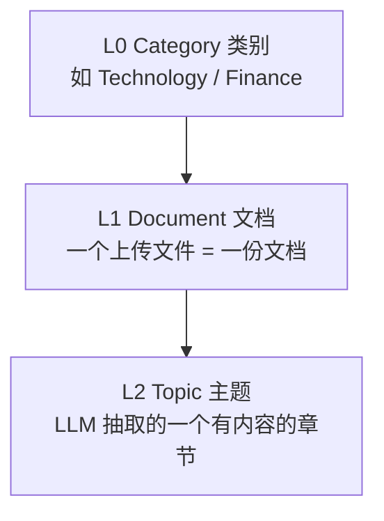
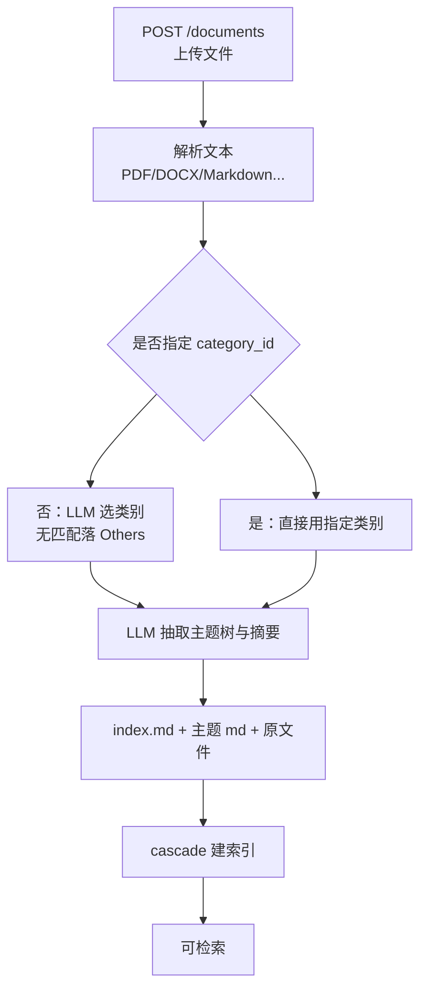
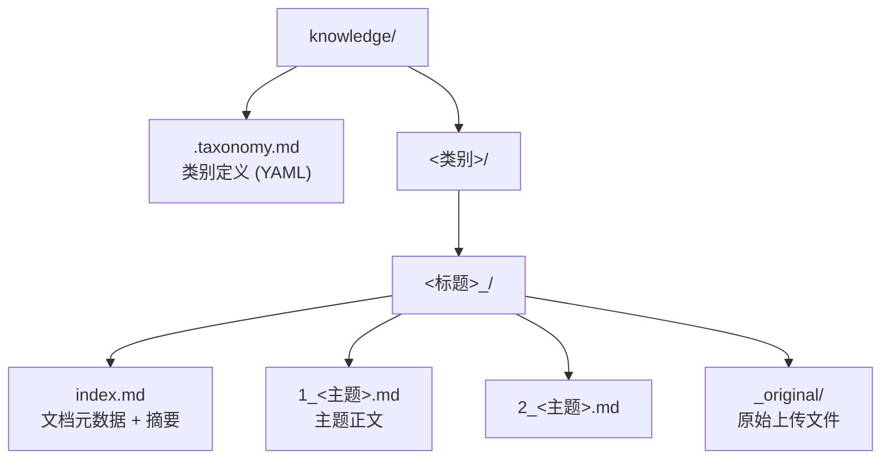

# 知识库

## 这张页要回答什么

EverOS 除了"对话记忆"，还能把**文档**变成可检索的知识库。这页讲清：一份 PDF 上传后经历了什么、知识被组织成什么形状、存在哪、以及怎么用接口管理它。知识库面向"我要把一堆文件变成可搜的主题库"，与用户/Agent 记忆是并行的能力。

## 三层结构

知识库把内容组织成从粗到细的三层，每一层对应一种 API 粒度：

| 层级 | 含义 | 对应接口 | 返回什么 |
|------|------|----------|----------|
| L0 类别 |  taxonomy 桶 | `GET /categories` | `category_id`、描述、文档数 |
| L1 文档 | 一次上传 | `GET /documents` / `GET /documents/{id}` | 元数据、摘要、原始文件路径、主题列表 |
| L2 主题 | LLM 抽取的章节 | `GET /topics/{id}` | 正文、标签、树位置 |

这样设计的好处：检索可以停在主题级（精确、细），管理可以停在文档级（一次上传一个整体），导航可以停在类别级（俯瞰）。三者都可独立增删改查。

## 从上传到主题树

上传是异步的抽取过程：文档进来 → 解析出文本 → LLM 抽取主题树与摘要 → 写入 Markdown → cascade 建索引。下图是这条链路：

该看什么：类别既可以由 LLM 从 taxonomy 里自动选（无匹配兜底到 `Others`），也可以在请求里显式给 `category_id` 跳过分类。主题树和摘要都是 LLM 抽的，因此知识库需要 LLM 能力。

## 存储布局

每份文档是一个**自包含目录**，Markdown 是唯一真源，SQLite 与派生索引都是可重建的派生。

| 存储 | 放什么 | 角色 |
|------|--------|------|
| Markdown | 文档元数据、摘要、主题正文、原始文件 | 单一真源，可读可编辑 |
| SQLite | 文档行、主题行（含正文）、变更队列 | 结构化查询、分页、计数聚合 |
| 派生索引 | 主题向量、BM25、标量字段 | 检索（可从 Markdown 全量重建） |

即便 SQLite 与派生索引损坏，只要 Markdown 还在，就能通过 cascade 守护重建索引。`_original/` 目录保存原始二进制文件，带下划线前缀遵循 Jekyll/Eleventy 约定——cascade 会跳过这类非内容目录。

## 分类（taxonomy）

类别定义在知识根目录的 `.taxonomy.md`，默认自带 20 个类别（Technology、Science、Medical、Finance、Legal 等，另有 `Others` 兜底）。这个文件**热加载**：每次上传和列类别请求都从磁盘重读，改完立即生效，无需重启。可以直接编辑它来增删改类别。

## 接口一览

所有知识库接口在 `/api/v2/knowledge` 下，响应统一 `{request_id, data}` 信封。

| 方法与路径 | 作用 | 关键点 |
|------|------|--------|
| `POST /documents` | 上传文档 | multipart；字段 `file`、`title`、可选 `category_id` |
| `PUT /documents/{id}` | 整体替换 | 原文件一并替换；抽取失败则从备份回滚旧文档 |
| `PATCH /documents/{id}` | 改元数据 | 改 `category_id` 会移动整个目录 |
| `DELETE /documents/{id}` | 删除 | 连 `_original/` 一起删 |
| `GET /documents` | 列表 | 分页、可按类别过滤、可按时间/标题排序 |
| `GET /documents/{id}` | 详情 | 含摘要、原始文件路径、主题列表 |
| `GET /topics/{id}` | 主题详情 | 正文、标签、树位置 |
| `GET /categories` | 类别列表 | 含每个类别的文档数 |
| `POST /knowledge/...`（检索） | 主题检索 | 支持 hybrid 等方法 |

几个"坑"值得提前知道：`PUT` 是**原子**的——抽取失败会自动回滚，不会留下半替换的文档；`DELETE` 在"没有主题被删"时返回 204，否则 200 并回报删除的主题数；`PATCH` 改类别是**移动目录**而非改字段。

## 边界与限制

- **需要 LLM**：主题树与摘要都靠 LLM 抽取；没有 LLM 时无法建知识库。
- **知识是全局共享的**：挂在 `<app>/<project>/knowledge/` 下，不与某个 user/agent 绑定。
- **索引仍是最终一致**：上传成功不等于立刻可搜，要看 cascade 是否已索引完。
- **taxonomy 只有默认 20 类 + Others**：超出范围的领域会被归到 `Others`，除非自定义 `.taxonomy.md`。

> 依据：`docs/knowledge.md:1-180`、`docs/knowledge.md:181-359`、`src/everos/entrypoints/api/routes/knowledge.py:546-743`、`src/everos/infra/persistence/markdown/mds/knowledge_document.py`
