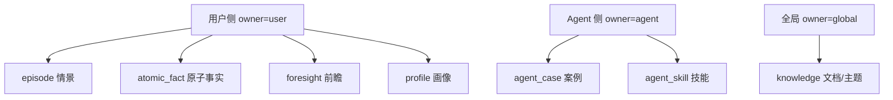
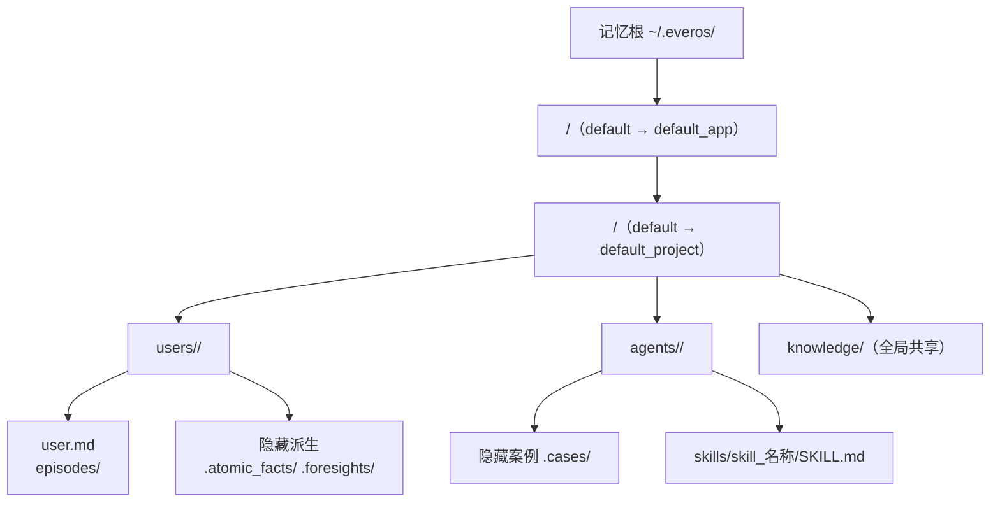

# 记忆模型

## 这张页要回答什么

读者读到这里通常有两个问题：**记忆到底分几种**（我要检索时会命中什么），以及**它们各自存在哪、由谁产生**。本页先给全貌，再讲三种统一的落盘策略，最后讲双轨与作用域这两条切分维度。

## 记忆全貌

EverOS 里"记忆"不是单一概念，而是**八类业务记忆**，按归属分三组：用户侧、Agent 侧、全局知识。它们共用同一套存储栈，但各有自己的目录与格式。

看这张图抓住三点：**用户侧四类**是"关于这个人"的记忆（经历了什么、有哪些确定事实、对未来有什么预判、整体画像）；**Agent 侧两类**是"这个 Agent 学会怎么做"的记忆；**全局两类**属于知识库，与具体用户/Agent 解耦。

## 八类记忆一览

| 类别 | 归属 | 存放位置 | 落盘方式 | 由谁产生 |
|------|------|----------|----------|----------|
| **episode** 情景 | user | `episodes/episode-<日期>.md` | 按天追加 | 抽取时同步产生 |
| **atomic_fact** 原子事实 | user | `.atomic_facts/atomic_fact-<日期>.md`（隐藏） | 按天追加 | OME 异步 |
| **foresight** 前瞻 | user | `.foresights/foresight-<日期>.md`（隐藏） | 按天追加 | OME 异步 |
| **profile** 画像 | user | `user.md` | 单文件重写 | OME 异步 |
| **agent_case** 案例 | agent | `.cases/agent_case-<日期>.md`（隐藏） | 按天追加 | OME 异步 |
| **agent_skill** 技能 | agent | `skills/skill_<名称>/SKILL.md` | 技能命名目录 | OME（聚类） |
| **knowledge_document** 文档 | global | `knowledge/<类别>/<标题目录>/index.md` | 知识树 | 知识库服务 |
| **knowledge_topic** 主题 | global | `knowledge/<类别>/<标题目录>/<N>_<slug>.md` | 知识树 | 知识库服务 |

几个容易忽略的细节：隐藏目录（`.atomic_facts` / `.foresights` / `.cases`）用点前缀表示"框架派生、非用户手写"；`profile` 是唯一的单文件形态（一个用户一份 `user.md`，整篇重写）；`agent_skill` 是唯一带子目录的结构（技能可以有正文 + 可选的 `references/`、`scripts/`）。知识库两类独立成页，详见 [knowledge.md](knowledge.md)。

## 三种落盘策略

八类记忆虽多，落盘却只有三种模式。理解这三种，就理解了"为什么同一类记忆会这样组织文件"。

| 策略 | 形态 | 为什么这样选 | 用于 |
|------|------|------|------|
| **按天追加**（daily-log） | `<前缀>-<YYYY-MM-DD>.md`，一个记忆条目追加进当天文件 | 把成千上万个"一条一个文件"压成"一天一个文件"，避免文件爆炸又保留时间序 | episode / atomic_fact / foresight / agent_case |
| **单文件重写** | 固定文件名，原地覆盖 | 面向一份持续演化的文档（画像），每次都是最新全量 | profile（`user.md`） |
| **技能命名目录** | 一个技能一个目录 | 技能是更重的单元（正文 + 可选引用/脚本），不适合塞进单文件 | agent_skill |

> 单文件写入器技术上还支持 `agent.md` / `soul.md` / `tools.md` / `behaviors.md` 这几种文件名，但当前没有已发布的 OME 策略会产出它们——今天实际只有 `user.md` 被写。

## 双轨：用户侧与 Agent 侧

EverOS 把"记忆"一刀切成两条互不干扰的轨道，这是它区别于多数记忆库的一个结构性决定：

- **用户轨**（user-track）：关于对话里的人。`episode` 是叙事性的"这段对话发生了什么"，`atomic_fact` 是从中抽出的单句确定性事实，`foresight` 是向前看的预判，`profile` 是聚合后的整体画像。
- **Agent 轨**（agent-track）：关于 Agent 自己。`agent_case` 记录一次可复用的任务轨迹（任务意图、做法、质量分、关键洞察），`agent_skill` 把多个相关案例聚类成一个有名字的技能。

两条轨在检索时也是硬分区的：按 `owner_type=user` 只查用户轨，`owner_type=agent` 只查 Agent 轨（见 [search-and-get.md](search-and-get.md)）。这样"用户的偏好"和"Agent 的做事方法"不会互相污染。

## 作用域：`app_id` / `project_id`

在用户/Agent 之上还有一层作用域：**记忆先按 `<app_id>/<project_id>` 分区**，再进入用户可见目录。所以不同的 `(app, project)` 空间既不共享目录，检索时也不会交叉。保留 id `"default"` 在磁盘上物化为 `default_app` / `default_project`，让默认空间与用户自命名的空间在视觉上可区分。

下图展示记忆在磁盘上的归属层级，从作用域到具体文件：

该看什么：`users/` 与 `agents/` 是用户可见的源数据，`knowledge/` 是跨用户共享的全局区；点前缀目录是框架派生内容。完整的目录树（含 `.index/`、`.tmp/`、`ome.toml`）见 [storage-and-consistency.md](storage-and-consistency.md)。

## 领域模型的字段骨架

实现层面，八类业务记忆在 `memory/models.py` 里被建模成 Pydantic 模型。它们的共同套路是：**保留 `everalgo` 抽取出的语义字段，再补上 EverOS 的工程上下文**（`owner_id`、`session_id`、`parent_id`）。例如：

| 模型 | 核心语义字段（来自算法） | 补的工程字段 |
|------|------|------|
| Episode | `episode`（叙事）、`timestamp` | `owner_id`、`session_id`、`sender_ids`、`parent_id`（源 memcell id） |
| AtomicFact | `fact`（单句事实）、`timestamp` | `owner_id`、`session_id`、`parent_id`（源 episode） |
| Foresight | `foresight`、`evidence`、时间窗口 | `session_id`、`parent_id` |
| AgentCase | `task_intent`、`approach`、`quality_score`、`key_insight` | `owner_id`（agent_id）、`session_id`、`parent_id` |

`parent_id` 是这套模型的连接键：它把派生记忆指回其来源（fact→episode→memcell），这也是"一条事实能追溯到哪段对话"的基础。

## 边界与限制

- **单文件写入器的其他文件名尚未有产出策略**：`agent.md` / `soul.md` 等留了能力，但当前不写。
- **隐藏目录不代表不可读**：点前缀只是"框架派生"的约定，用户仍可直接编辑这些文件（cascade 会感知并重建索引）。
- **知识库两类是全局的**：它们不挂在某个 user/agent 下，属于共享区。

> 依据：`docs/how-memory-works.md:149-177`、`docs/how-memory-works.md:41-101`、`docs/architecture.md:195-215`、`src/everos/memory/models.py:94-340`
