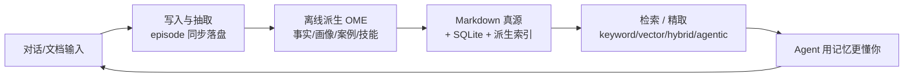

# 项目概览

## 一句话定位

EverOS 是一套 **Markdown 为源、本地优先的 AI Agent 长期记忆运行时**——把对话与轨迹变成磁盘上可读可改的 `.md` 文件，再用本地索引支撑检索与离线演化。

## 解决什么问题

现在的 Agent 大多"没有长期记忆"或"记忆被困在别人的服务里"。常见的两种做法各有代价：

- **不存或用会话上下文硬撑**：换一个会话、换一台设备，Agent 就重新变回陌生人。
- **用它人的托管记忆服务**（向量库、图库、SaaS 记忆 API）：数据在别人的数据库里，用户看不见、改不动、带不走；换供应商等于记忆清零；小团队还要额外运维一套服务栈。

EverOS 想解决的核心痛点是**记忆的所有权与可见性**：记忆应该是用户磁盘上一堆能 `cat`、`vim`、`grep`、`git commit` 的文本文件。删掉派生索引不会丢记忆——因为索引能从 Markdown 重建；反过来删掉 Markdown 才是真的删了记忆。这种"物理可见"是它区别于托管方案的根本。

## 给谁用 / 典型场景

| 角色 / 场景 | 它怎么用 EverOS |
|------|------|
| 个人开发者的编码助手 | 让 Claude Code / Cursor 等记下跨会话的项目上下文与偏好 |
| AI 应用开发者 | 在应用里通过 HTTP API 给用户挂一套可自托管的记忆后端 |
| 小团队的内部 Agent | 单机部署，团队成员各自持有一份可备份、可迁移的记忆目录 |
| 研究 / 试用 | 跑 `everos demo`，无需 API Key 就能体验"存进去 → 取出来"的完整链路 |
| 知识沉淀 | 把文档上传成三层知识库，按主题做语义检索 |

## 一句话串起核心链路

下图把"一条消息进来、一条记忆出去"的核心闭环压成一张图，先建立"它到底怎么运转"的直觉，细节留给各主题页：

该看什么：这是一个闭环——记忆被写入、被演化、被检索、再反过来改善下一次交互。链条上的每一环在后续页里都有专页展开。

## 核心能力一览

| 能力 | 说明 | 典型场景 |
|------|------|------|
| Markdown 单一真源 | 记忆就是 `.md` 文件，含 YAML frontmatter，可编辑、可 diff、可版本化 | 用户想手动修一条记忆 |
| 双轨记忆 | 用户侧（episode / profile）与 Agent 侧（case / skill）是两套一等公民 | 同时记"用户是谁"和"这个 Agent 学会怎么做" |
| 混合检索 | BM25 关键词 + 向量语义 + 标量过滤，四种方法可选 | 按语义还是按精确词找 |
| 离线演化（OME） | 抽取后异步派生事实、前瞻、画像、案例、技能，并能合并碎片记忆 | 让记忆从"流水"变成"结论" |
| 知识库 | 文档→LLM 主题树，三层（类别/文档/主题）CRUD 与检索 | 把 PDF 变成可搜的知识 |
| 本地三件套 | Markdown + SQLite + 派生索引，零外部服务 | 笔记本上直接跑 |
| CLI + HTTP API | `everos` 命令 + `/api/v2` REST 接口 | 运维与集成 |

它放弃的东西同样清晰：不做多租户 SaaS、不做端到端云同步、不做分布式。"轻量、单机、小团队"是它的定位，也是它取舍的依据。

## 技术栈

| 组件 | 用途 | 选型理由 |
|------|------|------|
| Markdown + YAML frontmatter | 记忆真源 | 人可读、可编辑、Git 友好；删除索引不丢数据 |
| SQLite（`aiosqlite`） | 系统状态、审计、cascade 队列、OME 引擎状态 | 单文件、免安装、够用；作为"派生状态"可重建 |
| LanceDB（Arrow） | 向量 ANN + BM25 全文 + 标量列 | 嵌入式，一次查询内即可完成向量/全文/过滤三类操作，无需外部向量服务 |
| `everalgo`（独立 PyPI 包集） | 记忆抽取算法 | 算法无状态、无 I/O，可被多种产品形态复用；EverOS 只负责编排与存储 |
| FastAPI + Starlette | HTTP 服务 | 异步、生命周期钩子便于把 cascade/OME 挂在进程内 |
| APScheduler | OME 的 cron / idle 调度 | 成熟的进程内调度器，jobstore 落 SQLite |
| `watchdog` | 文件系统监听 | 跨平台（macOS FSEvents / Linux inotify），支撑"改 md 即自动索引" |

## 与同类项目的差异

| 项目 | 定位 | 与 EverOS 的差异 |
|------|------|------|
| mem0 | API 优先的记忆服务 | mem0 主要把记忆存进向量库；EverOS 存进 Markdown 文件 |
| Letta | Agent OS（Core/Recall/Archival） | Letta 用 Postgres；EverOS 用 Markdown 文件系统 |
| MemOS | 多分类记忆，偏企业 | MemOS 面向企业；EverOS 面向单机 / 小团队 |
| memsearch | Markdown 优先的搜索引擎 | 最接近 EverOS；EverOS 不止搜索，还做记忆抽取与演化 |

> 上述对比取自项目自述（`docs/overview.md` 的 Comparable projects 表），是对各项目定位的高层概括，不代表逐特性的能力评测。

## 现状与边界

- **单机小团队定位**：多租户、云同步、分布式是 v1 之外的目标。
- **只做记忆的抽取与存储编排**：抽取算法在 `everalgo` 里，EverOS 自身不绑定某一家 LLM 或向量服务，需要用户自备模型能力（LLM 是硬性前提，embedding / rerank 可选）。
- **派生索引可丢可重建**：这既是优点（抗损坏）也意味着索引不是可独立备份的"数据"，真正要保护的是 Markdown 目录。
- 详见首页 [README.md](README.md) 的"现状与边界"与各主题页的边界小节。

> 依据：`README.md:37-86`、`docs/overview.md:3-89`、`pyproject.toml`、`docs/how-memory-works.md:24-40`
