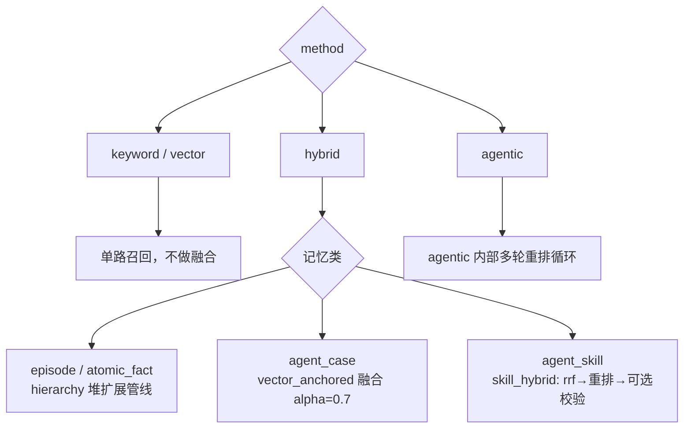

# 检索与精确取回

## 这张页要回答什么

记忆存进去之后怎么取出来。EverOS 提供两个入口：`POST /memory/search`（按相关性找，多种方法）与 `POST /memory/get`（按条件精确取回，不做排名）。本页讲清四种检索方法的差别、hybrid 在不同记忆类上并不相同、以及分区和过滤这些"边界"。

## 两套入口的分工

| 入口 | 语义 | 返回 | 适合 |
|------|------|------|------|
| `POST /memory/search` | 按查询相关性排序 | 带 `score` 的命中列表（episode / profile / case / skill） | 自然语言问"我记得……" |
| `POST /memory/get` | 按 owner + 类型 + 过滤条件精确取回 | 全量条目（分页、可排序） | 已知要哪类记忆，要列表/导出 |

两者都**只读**，都不写存储。检索读派生索引（LanceDB），取回也读派生索引。

## 硬分区：user 与 agent

无论 search 还是 get，都必须且只能指定 `user_id` 或 `agent_id` 之一（两者互斥，否则报错）。这直接决定能查到哪个轨的记忆：

| owner_type | search 命中 | get 命中 |
|------|-----------|----------|
| `user` | episode（+ profile 当 `include_profile=true`） | episode / profile |
| `agent` | agent_case + agent_skill | agent_case / agent_skill |

再加上 `app_id` / `project_id` 两个作用域字段（默认 `"default"`），检索被钉在**单个 `(app, project, owner)` 空间**内，绝不跨空间命中。

## 四种检索方法

`method` 是一个四值枚举，从轻到重：

| 方法 | 做什么 | 是否需要 embedding | 需要 LLM rerank |
|------|--------|------|------|
| `keyword` | 纯 BM25 全文 | 否 | 否 |
| `vector` | 纯向量 ANN | 是 | 否 |
| `hybrid`（默认） | BM25 + 向量融合 | 是 | 默认否（可选） |
| `agentic` | 带内部重排循环的智能检索 | 是 | 是 |

几个实用点：`keyword` 是**唯一在零配置下就能用**的方法——不需要 embedding、不需要 rerank，所以刚装好、只有一个 LLM key 时，"关键词搜索"是默认可用路径。选了需要 embedding 的方法却没配 embedding，会得到明确的"能力未配置"错误而不是静默降级。

## hybrid 在不同记忆类上并不相同

这是本页最容易误解的一点：`hybrid` 不是一个统一算法，而是**按记忆类分流到三条不同管线**。下图展示方法如何映射到管线：



- **episode / atomic_fact** 走 `hierarchy`：RRF 排序扩展 → LR 校准的全局 top-N 竞争 → 事实驱逐。它内建"事实驱逐"，因此 **hybrid 的 `enable_llm_rerank` 在 episode 路径上被忽略**。
- **agent_case** 走 `vector_anchored`：以向量为锚的融合（alpha=0.7）。
- **agent_skill** 走 `skill_hybrid`：先 RRF，再 cross-encoder 重排，可选校验。

`agentic` 则有自己的内部 cross-encoder 重排循环，`enable_llm_rerank` 在那里同样不起作用。

## 融合与可调参数

检索请求里几个关键参数决定"召回多少、门槛多高"：

| 参数 | 默认 | 作用 |
|------|------|------|
| `top_k` | `-1`（不限/取默认） | 返回条数，合法范围 `-1` 或 `1..100` |
| `radius` | `None` | 召回时的原始 cosine 下限 |
| `min_score` | `None` | 融合后的相关性下限，**仅 episode hybrid 路径生效** |
| `include_profile` | `false` | 用户搜索时是否附带 profile |
| `enable_llm_rerank` | `false` | 仅对 agent_case / agent_skill 融合生效 |
| `filters` | `None` | 过滤 DSL（见下） |

注意 `radius` 和 `min_score` 是两道不同的门：`radius` 在召回阶段卡原始 cosine，`min_score` 在融合后卡 `[0,1]` 校准分。

## 过滤 DSL

`filters` 是一棵过滤树（`FilterNode`），可组合标量条件。检索与取回共用同一套列白名单，所以你在 search 里能用的字段，在 get 里同样能用。常见的过滤维度包括时间、`sender_ids`、会话等（具体字段以 API 文档为准）。

## `/get` 精确取回

`get` 的用法是"已经知道要哪类记忆，把它按条件整批取出来"，不做相关性排名：

```json
{
  "user_id": "alice",
  "memory_type": "episode",
  "app_id": "default",
  "project_id": "default",
  "limit": 20
}
```

它按 `(owner_type, memory_type)` 分区路由：`user+episode → episodes`、`user+profile → profiles`（至多一条）、`agent+agent_case → agent_cases`、`agent+agent_skill → agent_skills`。分页与内存内排序在派生索引的仓储层完成。

## 边界与限制

- **读是最终一致**：检索/取回读的是派生索引，可能滞后于最新写入（cascade 处理时间）。刚清 flush 完立刻查可能查不到，需要重试。
- **没有 grep 兜底**：若索引不可用，没有"直接扫 Markdown"的降级搜索路径，正确做法是从 Markdown 重建索引。
- **atomic_facts 只在特定路径填充**：搜索返回的 episode 里，`atomic_facts` 字段只在 episode 的 hybrid 管线运行时才被填充；其他方法留空（因为脱离查询相关性无法给事实打分）。
- **能力依赖显式失败**：所需 embedding/rerank/LLM 未配置时，方法会明确报错，不静默降级。

> 依据：`src/everos/memory/search/dto.py:85-220`、`src/everos/memory/search/adapter.py:1-45`、`src/everos/memory/search/manager.py:1-45`、`src/everos/memory/get/manager.py:1-40`、`docs/api.md:501-528`、`docs/how-memory-works.md:255-288`
