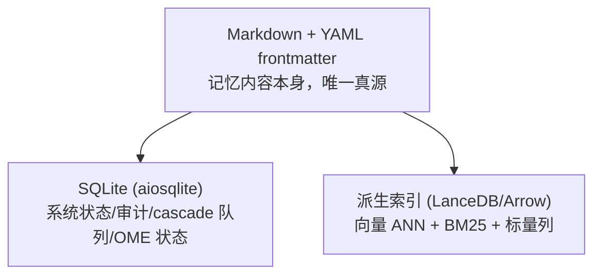
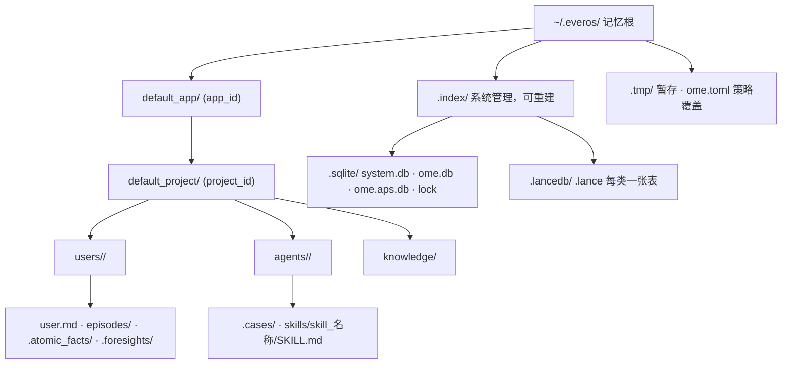
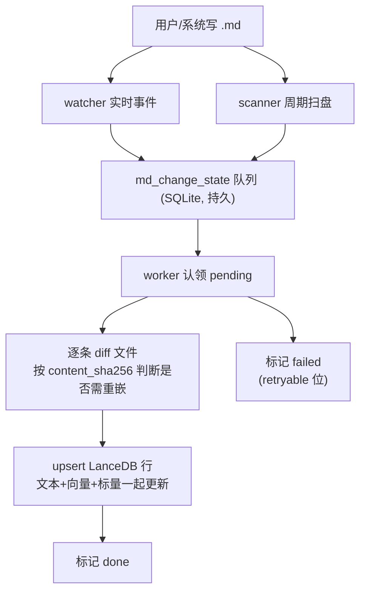

# 存储与一致性

## 这张页要回答什么

"记忆到底落在哪、坏了好不好修、为什么写完马上搜不到"。这页讲三件套的分工、磁盘布局、把 Markdown 变更搬进索引的 cascade 守护，以及由此决定的一致性保证。

## 三件套：各自只做最擅长的事

EverOS 的存储由三块组成，**Markdown 是唯一真源，另外两块都是可从它重建的派生数据**。

| 层 | 由什么承载 | 存什么 | 可重建 |
|------|------|------|--------|
| Markdown | `.md` 文件 | 记忆内容本身（可移植、可编辑的唯一资产） | —（它就是真源） |
| SQLite | `.index/sqlite/*.db` | 系统状态、审计日志、cascade 队列、边界缓冲、OME 引擎状态 | 从 Markdown |
| LanceDB | `.index/lancedb/*.lance` | 向量 + BM25 + 标量列，用于检索 | 从 Markdown |

由此得到一条铁律：**删掉整个 `.index/` 目录不会丢任何记忆**——它能从 `.md` 树重建。反过来，删掉 `.md` 才是真的删了记忆。这也是为什么"没有单独的导出功能"：Markdown 本身就是导出。

## 磁盘目录布局

记忆根默认 `~/.everos/`（`EVEROS_ROOT` 或 `--root` 可改）。下图给出完整树形，注意源数据区（`users/` / `agents/` / `knowledge/`）与系统区（`.index/` / `.tmp/`）的分离：

几个要点：`<app>/<project>` 嵌套**总是存在**（默认作用域物化为 `default_app/default_project`）；系统区全部在 `.index/` 下并可重建；`system.db` 里有一张 `md_change_state` 表充当 cascade 队列，**没有** `.cascade.log` / `.manifest.json` 这类散落文件。

## cascade 守护：把 md 变更搬进索引

cascade 是"让索引追上 Markdown"的子系统，**在服务进程内**运行（随 lifespan 启动的协程），不是独立 OS 守护进程。它由三部分组成，缺一不可：

| 组件 | 作用 |
|------|------|
| watcher | 用 `watchdog` 监听文件系统（macOS FSEvents / Linux inotify），实时捕获 `.md` 创建/修改 |
| scanner | 每 `scan_interval`（默认 30s）扫一遍整棵记忆根，补上 watcher 漏掉的（停机期间新建、`cp` 或外部编辑器搬移、WSL2/网络挂载事件不传播） |
| worker | 认领队列里 `pending` 的行，按 LSN 顺序逐条 diff、重嵌入、upsert 到 LanceDB |

下图是变更从 Markdown 到索引的完整流转：

该看什么：变更先落进**持久队列**再处理，所以即使同步中途崩溃，重启后也能重放（LSN 水位保证顺序）。`content_sha256` 决定"这一条要不要重新嵌入"——只有变了的内容才重算，这是"改一个条目只重索引这一个条目"的基础。失败的行带 `retryable` 标记，可通过 CLI 分诊。

## 一致性模型

两条路径，两种保证：

| 路径 | 保证 | 细节 |
|------|------|------|
| 写（`/add` `flush`） | **强一致** | episode `.md` 在调用返回 `extracted` 前已落盘（fsync），绝不阻塞在 LanceDB |
| 读（`/search` `get`） | **最终一致** | 读 LanceDB，它滞后 md 一个 cascade 处理时延——通常亚秒级，负载下可能十几秒 |

所以"flush 完立刻 search 可能查不到"是设计使然，而不是 bug。Markdown 无论如何是持久的；索引滞后不会丢数据。需要读到自己刚写的内容时，用退避重试。

## 完整性锚点

一致性靠几个不变量撑住：

- frontmatter 里的 `id` / `entry_id` 是不可变的连接键；
- `content_sha256` 决定是否需要重嵌入；
- LSN 水位（存于 `system.db`）给重建定序；
- 持久化的 `md_change_state` 队列是可重放的审计轨迹。

## 索引的操作手段

因为索引可重建，运维的核心是"必要时重建它"。常用命令（详见 [deployment.md](deployment.md)）：

| 命令 | 何时用 |
|------|--------|
| `everos cascade status` | 看队列/LSN 摘要 |
| `everos cascade sync` | 立刻把 md 变更灌进 LanceDB（无 server 时手动补） |
| `everos cascade fix` | 列出失败行、重试可重试的 |
| `everos cascade rebuild` | 从 Markdown 全量重建索引（漂移/损坏恢复） |

一个关键陷阱：**裸 `rm -rf .index/lancedb` 不够**。cascade 队列仍把那些文件标为 `done`，扫描器会跳过它们，索引重建出来是空的。要重建必须用 `everos cascade rebuild`，它会正确处理队列状态。

## 边界与限制

- **无 grep 兜底**：索引不可用时没有"直接扫 Markdown"的降级搜索，正确做法是重建索引。
- **单进程写索引**：运行中的 server 是唯一的索引写入者；`cascade sync` 用于没有 server 在跑时的场景。
- **改 md 是支持的**：直接编辑 Markdown 文件是被完全支持的用法，watcher 会感知并只重索引改动的条目。
- **scanner 是补丁而非主路**：实时性靠 watcher，scanner 是兜底（默认 30s 一轮）。

> 依据：`docs/how-memory-works.md:24-101`、`docs/how-memory-works.md:179-197`、`docs/how-memory-works.md:255-313`、`src/everos/memory/cascade/scanner.py:1-35`、`src/everos/infra/persistence/sqlite/tables/md_change_state.py:1-50`、`src/everos/core/persistence/memory_root.py:135-253`
