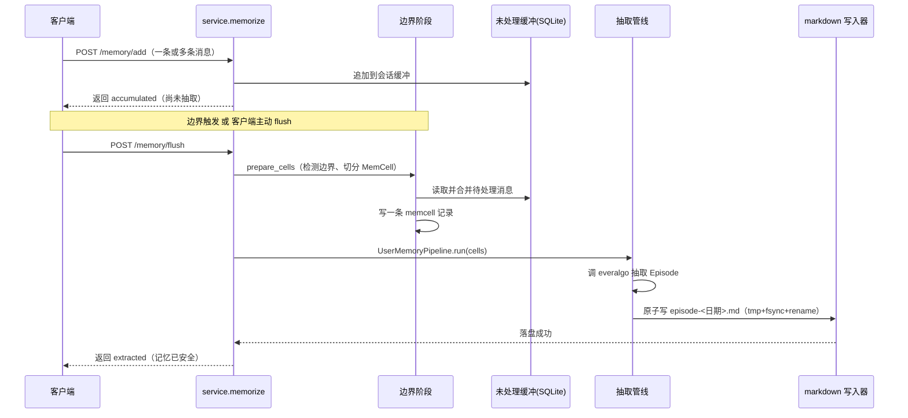
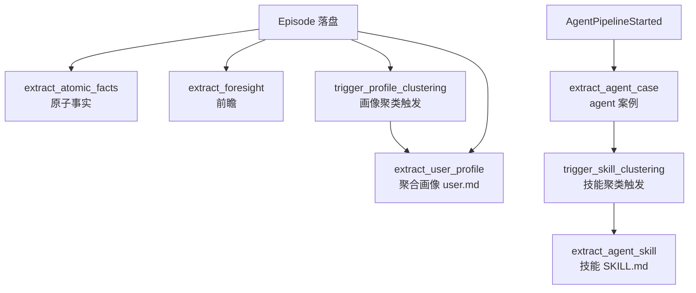
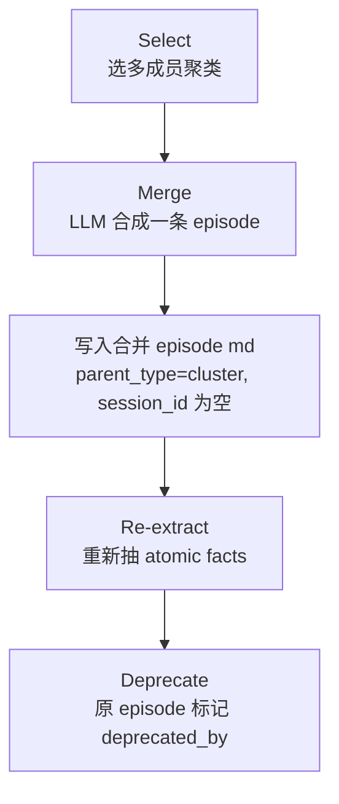

# 写入路径与离线演化

## 这张页要回答什么

从"用户发来一条消息"到"它能被搜到、甚至变成一条结论性的画像"，中间发生了什么。重点在一条分界线上：**episode 是同步写的，其余大多数记忆是异步派生的**——这个分界线决定了客户端该在什么时候期待什么结果。

## 从消息到 episode：同步段

写入的入口是 `POST /memory/add`（累积消息）与 `POST /memory/flush`（强制触发抽取）。消息先不直接变成记忆，而是按 `(session_id, app_id, project_id)` 攒进一个**未处理缓冲**；当边界检测器认为"这一段对话说完了"，或者客户端主动 flush，就触发一次 LLM 抽取。

下图是同步段的时序：从 add 累积到 flush 抽出 episode 并落盘，落盘成功即返回。



该看什么：`/flush` 返回 `extracted` 时，episode 的 Markdown **已经在磁盘上**（原子写，先写临时文件、fsync、再 rename），这是"写强一致"的含义。此时响应即可返回，不等待索引或派生记忆。

## 两种模式：chat 与 agent

边界与抽取的行为取决于 `settings.memorize.mode`：

| 模式 | 边界检测器 | 消息取舍 | 跑哪些管线 |
|------|-----------|----------|-----------|
| `chat` | `everalgo.boundary.detect_boundaries` | 丢弃工具调用行、丢弃带 tool_calls 的 assistant 消息 | 只跑用户管线 |
| `agent` | `everalgo.agent_memory.AgentBoundaryDetector` | 保留工具调用等全部会话项 | 用户管线 + Agent 管线（并行） |

一个进程内只能选一种模式：模式在启动时确定，切换需要重启服务（缓冲轨道是单通道的）。`agent` 模式才会产生 Agent 轨记忆（case/skill）。

## 从 episode 到派生记忆：异步段（OME）

episode 落盘之后，**离线记忆引擎（OME，Offline Memory Engine）** 接管。OME 是一个进程内的事件驱动策略引擎：抽取过程发出事件，注册在某事件上的策略被触发，各自异步产出自己的记忆并再次落盘。这样请求路径不被派生计算拖慢。

下图是 OME 的事件驱动链路——注意策略之间靠"事件"级联：一个策略产出的记忆会再发出事件，触发下游策略。



该看什么：几乎所有派生记忆都由 `Immediate` 触发器驱动（收到某类事件就立刻跑），而不是轮询。唯一的例外是 reflection，它跑在 cron 上（见下文）。这解释了"为什么 `/flush` 刚返回时 atomic facts / profile 往往还查不到"——它们在 OME 的异步分支里，通常几秒后才出现。

## OME 策略清单

| 策略 | 触发事件 | 产出 | 说明 |
|------|----------|------|------|
| `extract_atomic_facts` | `EpisodeExtracted` | atomic_fact | 从 episode 叙事抽出单句事实 |
| `extract_foresight` | `UserPipelineStarted` | foresight | 抽取前瞻性判断 |
| `extract_user_profile` | `ProfileClusterUpdated` / `EpisodeExtracted` | profile（`user.md`） | 聚合出整体画像 |
| `extract_agent_case` | `AgentPipelineStarted` | agent_case | 记录可复用任务轨迹（太单薄会跳过） |
| `extract_agent_skill` | `SkillClusterUpdated` | agent_skill | 把相关案例聚成命名技能 |
| `trigger_profile_clustering` | `EpisodeExtracted` | （发 `ProfileClusterUpdated`） | 触发画像聚类 |
| `trigger_skill_clustering` | `AgentCaseExtracted` | （发 `SkillClusterUpdated`） | 触发技能聚类 |
| `reflect_episodes` | cron `0 2 * * 1`（默认关） | 合并后的 episode | 离线记忆合并 |

每个策略是一个带 `@offline_strategy` 装饰器的异步函数，声明自己的 `name` / `trigger` / `emits`。触发器有三种：`Immediate`（收到指定事件即跑）、`Cron`（cron 表达式）、`Idle`（空闲时跑）。

## Reflection：离线记忆合并

Reflection 是 OME 里最"重"的策略，也是 EverOS 让记忆"从流水变结论"的关键。它把同一聚类里多条碎片化的 episode **合并成一段连贯叙事**，而不是让它们各自散落。

它分四步：**Select（选出含多个成员的聚类）→ Merge（调 LLM 合并成一条高质量 episode）→ Re-extract（对合并结果重新抽 atomic facts）→ Deprecate（把原始 episode 标记为已弃用）**。

下图是 Reflection 的四步流水线：



几点边界：reflection 默认**关闭**，跑在 cron 上（默认每周一 02:00）；合并后的 episode 用 `parent_type=cluster` 且没有 `session_id`；原始条目通过 frontmatter 的 `deprecated_by` 标记弃用，而不是物理删除。

## 配置方式：`ome.toml`

OME 的行为可以**不改代码**地调整：记忆根目录下的 `ome.toml` 会被热加载（约 2 秒内生效）。可以逐策略开关、设置定时。例如关掉两个策略、打开 reflection：

```toml
[strategies.extract_foresight]
enabled = false

[strategies.extract_user_profile]
enabled = false

[strategies.reflect_episodes]
enabled = true
```

## 边界与限制

- **同步只保证 episode**：`/flush` 的 `extracted` 只承诺 episode 在盘上；其余派生记忆要在 OME 跑完后才有，客户端若需立刻使用应轮询/重试。
- **agent 案例有质量门槛**：`extract_agent_case` 只在轨迹足够"实质"时落盘，单薄的轨迹会被有意跳过。
- **reflection 需要开启且耗 LLM**：它是一个较重的合并过程，默认不跑来避免无谓开销。
- **模式不可运行时切换**：chat/agent 二选一，切换需重启进程。

> 依据：`src/everos/service/memorize.py:1-30`、`src/everos/service/_boundary.py:1-30`、`src/everos/memory/extract/pipeline/user_memory.py:1-20`、`src/everos/memory/strategies/extract_atomic_facts.py:1-45`、`src/everos/memory/reflection/orchestrator.py:1-20`、`src/everos/infra/ome/triggers.py:1-40`、`docs/how-memory-works.md:103-253`
