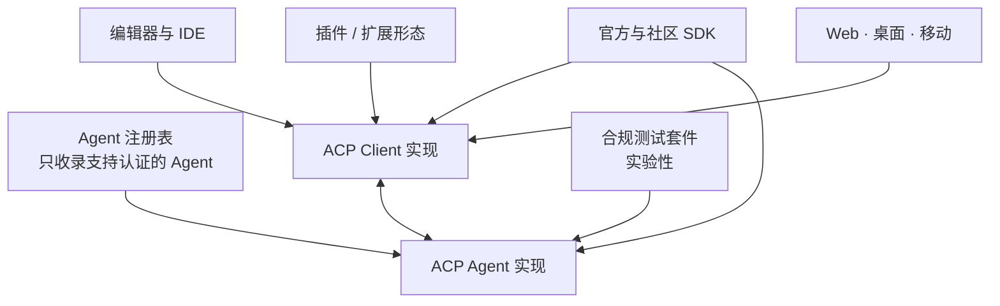

# 生态与接入

协议的价值由实现它的东西决定。这页回答三个实操问题：**现在都有谁在用、我可以拿什么去实现、我该从哪条路接入。**

SDK 与注册表分别降低了两侧的实现成本和分发成本：SDK 让「照着 Schema 写类型」这件事不必重复，注册表让用户能在客户端里发现并安装 Agent。

## Client 侧：形态比想象中宽

仓库维护的客户端清单按形态分为八类，本基线共列出 128 条。它们的分布本身就说明了协议的适用面：

| 形态 | 条数 | 代表 |
|------|------|------|
| 桌面与 Web | 56 | JetBrains 系 IDE、网页版 IDE、独立客户端 |
| 消息与协作平台 | 17 | 把 Agent 接进聊天/协作工具的桥接 |
| 编辑器与 IDE | 14 | Neovim 系插件、Obsidian 插件、VS Code 扩展 |
| 移动端 | 11 | 手机上的 Agent 界面 |
| 框架 | 9 | 供二次开发的应用框架 |
| 连接器 | 9 | 把 ACP 接到其它协议或运行时 |
| CLI 与 TUI | 9 | 终端/全屏终端界面 |
| 笔记本与数据工具 | 3 | 数据科学与 Notebook 环境 |

值得注意的是「插件形态」占比很高：编辑器不一定要原生实现 ACP，一个插件就能把协议能力带进已有生态——这是协议能被快速采纳的重要原因。

## Agent 侧：桥接与原生实现并存

本基线的 Agent 清单列出 41 条，实现方式分两类：

| 实现方式 | 例子 | 说明 |
|---------|------|------|
| 原生实现 | Goose、OpenCode、Qwen Code、Kimi CLI、Mistral Vibe、Junie、Cline、Factory Droid | Agent 自身就说 ACP |
| 适配器桥接 | Claude Agent（Zed 的 SDK 适配器）、Codex CLI（官方 codex-acp 适配器）、Pi（社区适配器） | 已有 CLI 或 SDK 外挂一层 ACP 服务端 |

桥接这一类值得单独理解：它意味着**一个已有的编码 Agent 不必重写，就能进入整个 ACP 客户端生态**。想接入自己的 Agent 时，这通常也是成本最低的起点。

## SDK：官方五套 + 社区多语言

官方 SDK 覆盖五种语言，各自提供双方的连接封装与可运行示例：

| 语言 | 包 / 仓库 | 特点 |
|------|----------|------|
| Rust | crates.io 上的 `agent-client-protocol` | 运行时 crate，提供 `Agent` / `Client` trait 与 `agent.rs`、`client.rs` 示例；协议类型来自本仓库 |
| TypeScript | npm 包 `@agentclientprotocol/sdk` | 提供 `agent()` / `client()` 流式 API；旧的 `AgentSideConnection` 系类已废弃但保留 |
| Python | PyPI 包 `agent-client-protocol` | Pydantic 模型 + 异步基类 + JSON-RPC 管道，镜像官方 Schema |
| Java | `agentclientprotocol/java-sdk` | Java 模型 + JSON-RPC 管道 + 分侧连接助手，含 Spring AI 集成 |
| Kotlin | `agentclientprotocol/kotlin-sdk` | 双方实现；当前支持 JVM，其它目标进行中 |

社区库覆盖另外 12 类语言/环境，包括 Go、C++、.NET、Swift、Dart、Elixir、Crystal、Emacs Lisp、Vala、React 与 TypeScript 之外的一套 TypeScript 实现。官方文档明确把社区库与官方库分列——选型时需要自行评估维护状态。

## 注册表：让 Agent 可被发现

ACP Registry 是一份**人工策划**的 Agent 清单，只收录支持认证的 Agent，托管在独立的 registry 仓库，并以 CDN 上的 `registry.json` 作为数据源。

文档站里的注册表页面不是手写的：一个 Python 脚本从 CDN 拉取 `registry.json`，套用模板 `_registry_agents.mdx` 生成 `registry.mdx`（含每个 Agent 的图标、版本与仓库链接），CI 在定时任务里跑这个脚本，若生成结果与仓库中的版本不一致，就自动开 PR 并开启自动合并。这是「数据在别处、文档跟着数据走」的一个干净范例。

## 合规测试：TCK

官方提供一套测试兼容工具包（TCK），把被测 Agent 作为 stdio 子进程启动，驱动它走完初始化、会话生命周期、prompt 回合、取消、错误处理与传输卫生等路径，并报告每条要求是通过、失败、不适用，还是根本没被覆盖。

它的边界写得和功能一样清楚：TCK 是**实验性**的，不覆盖完整协议，要求项、可选项与报告格式都可能变化；官方特别声明通过一次并不代表官方合规认定。因此它适合当自查工具，不适合当合规证书。

## 三条接入路径

| 你的目标是 | 起点 | 需要做的最小工作 |
|-----------|------|----------------|
| 写一个 Agent | 任一官方 SDK 的 agent 示例 | 实现 `initialize`、`session/new`、`session/prompt`、`session/cancel`、`session/update`，声明能力，处理授权与取消语义 |
| 写一个 Client | 任一官方 SDK 的 client 示例 | 启动 Agent 子进程、实现 `session/update` 与 `session/request_permission` 的处理与呈现、按能力决定是否提供文件与终端 |
| 做 SDK / 代码生成 | 本仓库的 JSON Schema 产物 | 从 Release 资产或 `schema/` 目录取 Schema 与 `meta.json`，按协议版本生成类型；注意区分稳定与 unstable、v1 与 v2 |

三条路有一个共同前提：**版本与能力协商必须做对**。忽略 `protocolVersion` 拿到就用、或假设对端一定支持某能力，是接入阶段最常见的两类错误。

> 依据：`docs/get-started/agents.mdx:1-48`、`docs/get-started/clients.mdx:1-182`、`docs/libraries/rust.mdx:1-36`、`docs/libraries/typescript.mdx:1-42`、`docs/libraries/python.mdx:1-25`、`docs/libraries/java.mdx:1-10`、`docs/libraries/kotlin.mdx:1-27`、`docs/libraries/community.mdx:1-62`、`docs/libraries/testing.mdx:1-25`、`docs/get-started/registry.mdx:10-30`、`scripts/generate_registry_docs.py:1-40`、`.github/workflows/sync-registry.yml`
