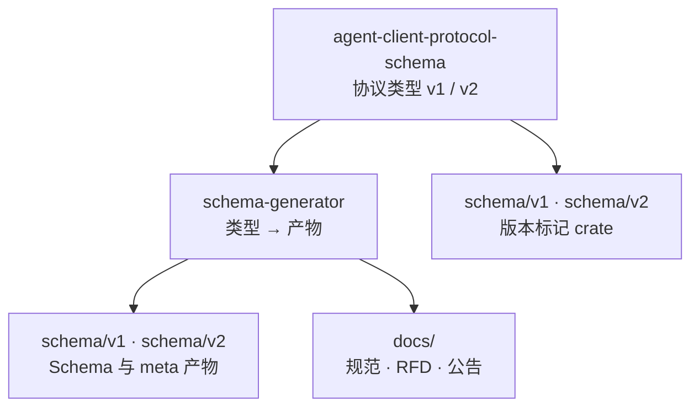
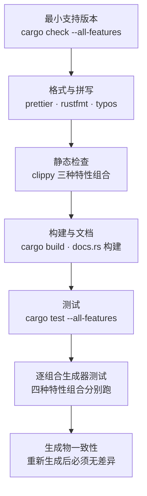

# 仓库与工程体系

前面几页讲的是协议；这页讲**装协议的这个仓库怎么运转**。它只有四个 Cargo 成员和一份 MDX 文档树，却把「改协议」这件事变成了一条有门禁的流水线。

## 仓库结构

| 路径 | 角色 | 职责 |
|------|------|------|
| `agent-client-protocol-schema/` | 唯一事实源 | v1 与 v2 的全部 wire 类型、JSON-RPC 信封、宽容反序列化工具箱、版本常量 |
| `schema-generator/` | 生成器 | 把类型投影成 JSON Schema、方法元数据与文档页；内部含文档生成子模块 |
| `schema/v1/`、`schema/v2/` | 产物 + 版本标记 | JSON Schema 与 `meta.json` 产物，以及仅为打 tag 而存在的 marker crate |
| `docs/` | 规范与文档站 | Mintlify 站点：v1/v2 协议正文、RFD、公告、库与生态页 |
| `scripts/` | 辅助脚本 | 拼写检查与注册表文档生成 |
| `.github/workflows/` | 门禁与发布 | CI、依赖审计、Schema 资产上传、release-plz、注册表同步 |

模块关系如下——注意 `schema/*` 既是产物也是被 workspace 管理的成员，这是为了让 Schema 有独立的版本号与 tag：

## 日常命令

改动都在 npm 脚本后面，Rust 与 Node 两侧的命令被包装成同一套入口：

| 命令 | 作用 |
|------|------|
| `npm run generate` | 依次生成四套 Schema/元数据/文档页，然后统一格式化 |
| `npm run check` | 本地完整自查：三档 clippy + 格式检查 + 拼写 + 全特性测试 |
| `npm run format` / `format:check` | 用 Prettier 与 rustfmt 统一格式 |
| `npm run spellcheck` | 跑仓库的拼写检查脚本 |
| `npm run generate:registry` | 从 CDN 拉取注册表数据生成文档页 |
| `npm run docs` | 本地起 Mintlify 预览文档站 |

改一个协议方法时，仓库的贡献约定给出了固定顺序：先在类型里补齐请求/响应结构与方法名常量，把变体加进聚合枚举，再更新生成器里的分侧文档函数，然后跑生成与检查，最后补文档与示例。顺序本身在传达一条规则——**类型先行，产物与文档跟上**，而不是反过来。

## 质量门禁

CI 不是单一的质量关卡，而是一串面向不同失效模式的检查：

各道门禁拦的是不同的东西：

| 检查 | 拦什么 |
|------|--------|
| 最小支持 Rust 版本 | 无意中用了新语法，抬高了下游的编译器门槛（当前声明为 1.88.0） |
| 格式与拼写 | 风格漂移与错别字 |
| 三档 clippy | 既查默认特性，也查「关闭默认特性 + 开启 unstable 与 v2」这类组合，以及全特性；workspace 级别开启了 pedantic |
| 构建 docs.rs | 文档在新版本下能否正常生成 |
| 全特性测试 | 类型与序列化行为回归 |
| 逐组合生成器测试 | 每个发布出去的 Schema 都有对应测试，而不是只测 `--all-features` 选中的那一个 |
| 生成物一致性 | 跑一遍生成后 `git diff` 必须为空——防止「改了类型但忘记提交产物」 |
| cargo-deny | 依赖许可、来源与已知漏洞 |

最后一条尤其关键：它是「产物入库」策略能成立的前提。仓库提交生成物是为了让消费者可审计、可 diff，而 CI 的再生成比对保证提交的产物不会与类型脱节。

## 文档站

文档站是 Mintlify 站点，内容全部是 MDX，导航集中在 `docs/docs.json`，分为五个顶层页签：Protocol（Get Started / v1 / v1 草案 / v2 / v2 草案 / Libraries）、RFDs（按生命周期分组）、Community、Publications 与 Updates。开发时用 `npm run docs` 在本地预览，部署则跟随 `main` 的更新自动发生。

两个细节体现了文档站也在被工程化：

- **生成的 Schema 参考页也在文档树里**：四页 `schema.mdx` 由生成器写出，与协议正文并列，因此文档里的字段说明不会和类型脱节。
- **注册表页面由数据生成**：定时任务拉取 CDN 数据、生成页面，有变化就自动开 PR 并开启自动合并，避免人工维护清单。

## 发布与依赖

发布完全交给 release-plz，配置里区分了三种包的角色：Rust crate 走正常的 crate 发布流程并在 changelog 中记录；两个 Schema marker crate 只打 tag、不上传 crates.io（`git_only = true`）；生成器本身不发布也不参与 release。依赖安全由 cargo-deny 单独一条工作流负责，与 CI 解耦，便于按更低的频率或独立权限运行。

> 依据：`Cargo.toml:1-32`、`package.json:17-30`、`AGENTS.md:3-39`、`.github/workflows/ci.yml`、`.github/workflows/deny.yml`、`.github/workflows/publish-schema.yml`、`.release-plz.toml:1-32`、`docs/README.md:1-32`、`docs/docs.json:1-60`、`agent-client-protocol-schema/Cargo.toml:1-22`
