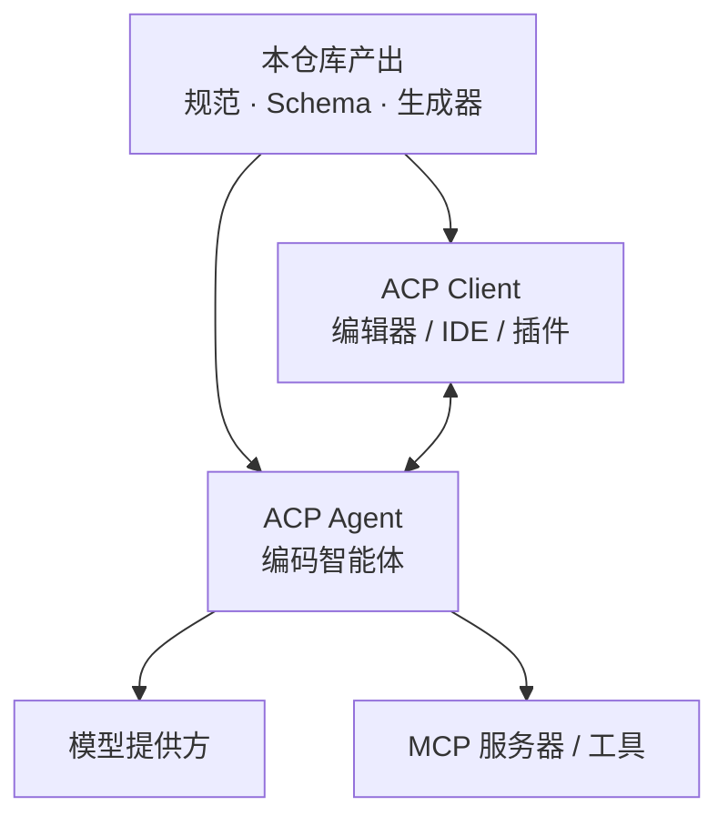

# 项目概览

## 一句话定位

ACP 是一份**编辑器与编码 Agent 之间的标准接口规范**：用 JSON-RPC 2.0 定义双方可以互相调用的方法与通知，让编辑器不必为每个 Agent 写适配器，Agent 也不必为每个编辑器重复实现一遍交互逻辑。官方把这件事类比为 LSP 对语言服务的标准化。

## 解决什么问题

编码 Agent（Claude Code、Codex、Gemini CLI、OpenCode 等）数量快速增长，但每个 Agent 与编辑器之间的交互方式都是私有的。这造成三个具体后果：每新增一对「编辑器 × Agent」就要写一份集成；一个 Agent 往往只能在少数编辑器里用；开发者选择一个 Agent 时，实际上是在接受它当时支持的那几个界面。

协议把这件事反过来做：只要双方都实现 ACP，编辑器接入一次就获得整个 Agent 生态，Agent 实现一次就能被所有 ACP 编辑器复用。协议本身只规定**语义上有意义的交互部分**——会话怎么建立、消息怎么流式回传、工具调用怎么汇报、需要用户授权时怎么问——界面长什么样、模型怎么选、工具怎么实现，全部留给两侧各自决定。

## 给谁用

| 角色 | 典型场景 | 在协议中的身份 |
|------|---------|---------------|
| 编辑器 / IDE 开发者 | 让自家编辑器支持多家编码 Agent，而不必逐个集成 | Client |
| 编码 Agent 开发者 | 让 Agent 进入 Zed、JetBrains、Neovim、Obsidian 等已有 ACP 界面 | Agent |
| Agent 平台 / 基础设施团队 | 把 Agent 跑在远端或容器里，通过统一接口暴露给编辑器 | Agent（远程形态仍在演进） |
| SDK / 工具作者 | 基于 JSON Schema 生成各语言类型与客户端，做代码生成与合规测试 | 消费本仓库产物 |

## 核心能力一览

| 能力 | 说明 |
|------|------|
| 双向 JSON-RPC 消息模型 | Agent 可以反向请求编辑器：读文件、跑终端、要授权，而不是被动等调用 |
| 初始化协商 | `initialize` 一次性交换协议版本、双方能力与认证方式 |
| 多会话抽象 | 一个连接可并发多个独立会话，会话可列出、恢复、关闭、删除 |
| 流式回合 | 用 `session/update` 通知持续回传消息增量、思考过程、执行计划与工具调用 |
| 工具调用全生命周期 | 从发起到状态更新、权限申请、diff 与终端输出的展示 |
| 用户授权 | 敏感操作前向用户要同意，支持「仅此一次 / 总是允许 / 拒绝」四类选项 |
| 结构化追问 | 表单与 URL 两种 elicitation 模式，用于向用户收集非敏感或带外信息 |
| MCP 衔接 | 会话建立时把编辑器配置的 MCP 服务器转交给 Agent，让 Agent 直连工具服务 |
| 内容模型复用 MCP | 文本、图片、音频、资源与资源链接沿用 MCP 的 `ContentBlock`，工具输出可零转换转发 |
| 扩展机制 | `_meta` 字段、`_` 前缀的自定义方法、自定义能力声明，三层都不需要改协议 |
| 诚实降级 | 未在 `initialize` 中声明的能力一律视为不支持，新功能默认关闭，避免老实现被新字段坑到 |

## 本仓库在生态中的位置

需要先建立的认知：**这个仓库是协议的「立法机构」，不是运行时**。它产出的是一份规范、一套由 Rust 类型生成的 JSON Schema、以及围绕它们的文档与治理流程。能把协议跑起来的东西在别处。

图中 `S` 对两侧都只有「约束」关系：编辑器与 Agent 分别按同一份 JSON Schema 生成或校验自己的类型，真正的通信只发生在 `C` 与 `A` 之间。Agent 再去连接模型与 MCP 工具——这部分不属于 ACP 的职责，协议只负责把编辑器的 MCP 配置转交给 Agent。

## 技术栈一览

| 层面 | 选型 | 说明 |
|------|------|------|
| 消息格式 | JSON-RPC 2.0 | 请求/响应 + 通知；ACP 只补语义，不改信封 |
| 默认传输 | stdio（换行分隔的 JSON） | 编辑器把 Agent 作为子进程启动 |
| 协议定义语言 | Rust（edition 2024） | 类型即规范，编译器与测试参与校验 |
| 序列化与 Schema | `serde` / `serde_with` / `schemars` | 一份类型同时产出 wire 行为与 JSON Schema |
| 生成器 | 独立 `schema-generator` crate | 用 schemars 的 draft 2020-12 设置生成产物 |
| Schema 产物 | 4 个 `.json` + 4 个 `meta.json` + 4 个文档页 | v1/v2 × 稳定/unstable 四套组合各自独立 |
| 文档站 | Mintlify（MDX） | `docs/` 下按 v1、v2、RFD、公告分区 |
| 构建与发布 | Cargo workspace + npm 脚本 + release-plz | 协议版本与 Schema 版本各有各的 tag |
| 质量门禁 | clippy（含 pedantic）、typos、cargo-deny、生成物一致性 | 生成产物被提交，CI 重新生成后比对，有差异即失败 |

## 与同类规范的差异

| 维度 | ACP | MCP | LSP |
|------|-----|-----|-----|
| 连接的两端 | 编辑器（Client）⇄ 编码 Agent | 宿主 ⇄ 工具/资源服务器 | 编辑器 ⇄ 语言服务 |
| 消息方向 | 双向对等：两侧都能发起请求 | 以宿主调用服务端为主 | 双向，偏编辑器发起 |
| 一等抽象 | 会话（可并发、可恢复、可关闭） | 工具、资源、提示 | 文档与工作区 |
| 用户交互 | 内建授权请求与结构化追问 | 交给宿主自行处理 | 无 |
| 与相邻规范的关系 | 把编辑器配置的 MCP 服务器转交给 Agent | Agent 侧的工具标准 | 无直接关系 |

ACP 与 MCP 是**互补而非竞争**：MCP 解决 Agent 与工具之间的问题，ACP 解决编辑器与 Agent 之间的问题，两者在会话建立时衔接——编辑器把自己的 MCP 服务器配置通过 `session/new` 交给 Agent，Agent 直连这些服务器，无需编辑器代转。

## 现状与边界

- **v1 是稳定线，v2 是草案**：v2 需要显式启用编译特性，官方要求实现方在同一份代码里同时支持 v1 与 v2，按协商结果选择线缆形态。
- **远程形态未完成**：协议正文只定义 stdio，Streamable HTTP 与 WebSocket 由独立 RFD 承载，官方文档明说远程 Agent 的完整支持仍在进行中。
- **本仓库没有可运行实现**：需要能跑的示例或 SDK 时，要去 `agentclientprotocol` 组织下的其它仓库。
- **演进方式代价**：新功能默认关闭、能力缺省即不支持，这保证了老实现永不被新字段破坏，但代价是每个功能都要在两端各写一次「声明—检查」的样板逻辑。

> 依据：`README.md:1-52`、`docs/get-started/introduction.mdx:8-39`、`docs/get-started/architecture.mdx:8-34`、`docs/protocol/v1/overview.mdx:8-244`、`docs/protocol/v1/content.mdx:14-30`、`docs/protocol/v1/transports.mdx:17-52`、`package.json:17-30`、`agent-client-protocol-schema/Cargo.toml:1-48`
