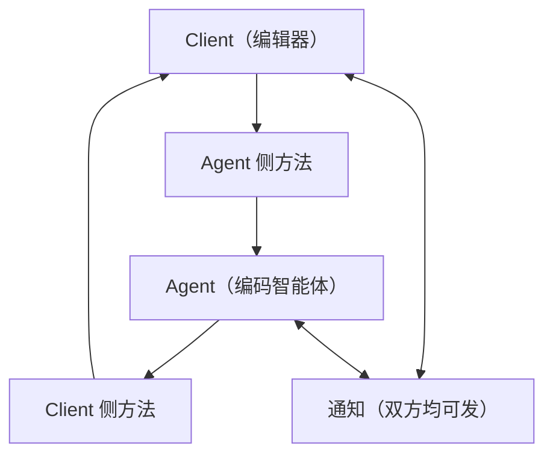

# 协议模型

这页回答「协议长什么样」：谁是 Client、谁是 Agent，双方各自必须实现什么、可以额外实现什么，以及在没有中央注册表的情况下，两边怎么知道对方会什么。

## 两个角色，两种职责

协议只有两个角色，且**双方都能主动发起请求**——这是它和常见「客户端调服务端」模型最大的区别。

| 角色 | 通常是谁 | 负责的事 |
|------|---------|---------|
| Client | 编辑器、IDE、编辑器插件、其它 Agent 界面 | 界面呈现、用户交互、文件访问、终端执行、授权决策、把 MCP 服务器配置转交给 Agent |
| Agent | 编码智能体进程 | 与模型交互、决定并执行工具调用、维护会话上下文、把过程与结果流式汇报给 Client |

Agent 通常作为 Client 的子进程启动（stdio 传输），但协议本身不假设进程关系：只要两端能交换 UTF-8 的 JSON-RPC 消息，用什么通道由实现决定。

## 消息方向

读法：上两条边是 Client 调用 Agent 的方法（初始化、会话、提示词等），中间两条边是 Agent 反向调用 Client 的方法（授权、文件、终端、追问），最下面一对是**通知**——没有响应，只用于单向汇报，例如 Agent 持续推送 `session/update`、Client 中途发 `session/cancel`。

## 信封与约定

ACP 不重新发明传输格式，只在 JSON-RPC 2.0 之上定义方法与语义。

| 消息类型 | 特征 | 语义 |
|---------|------|------|
| 方法（Request） | 带 `id` 与 `method`，期望 `result` 或 `error` | 请求—响应配对 |
| 通知（Notification） | 带 `method`，不带 `id` | 单向事件，永不回应 |
| 批量（Batch） | 一行消息是数组 | v2 明确要求遵循 JSON-RPC 批处理语义；生命周期敏感的方法不应入批 |

补充约定，实现时必须遵守：

| 约定 | 内容 |
|------|------|
| 字段命名 | ACP 定义的属性名用 `camelCase`；判别字段（discriminator）的取值用 `snake_case` |
| 路径 | 协议中所有文件路径必须是绝对路径 |
| 行号 | 从 1 开始 |
| 错误 | 沿用 JSON-RPC 错误对象；通知不产生任何错误响应 |
| 扩展命名 | 自定义方法以 `_` 开头；自定义数据放在 `_meta` |

## 双方的方法清单

v1 稳定线的方法集合可以从生成产物 `schema/v1/meta.json` 直接读出——这份元数据由 Rust 里的方法名常量生成，是「协议里到底有哪些方法」的权威答案。

| 方向 | 方法 | 必需性 | 作用 |
|------|------|--------|------|
| Client → Agent | `initialize` | 必需 | 协商协议版本、交换能力与认证方式 |
| Client → Agent | `authenticate` | 必需（Agent 要求认证时使用） | 按 Agent 公布的方式登录 |
| Client → Agent | `session/new` | 必需 | 建立新会话，给出工作目录与 MCP 服务器 |
| Client → Agent | `session/prompt` | 必需 | 发送用户消息，开启一个回合 |
| Client → Agent | `session/cancel` | 必需（通知） | 取消当前回合 |
| Client → Agent | `session/load` | 可选（`loadSession`） | 恢复会话并回放历史 |
| Client → Agent | `session/resume` | 可选（`sessionCapabilities.resume`） | 恢复会话但不回放 |
| Client → Agent | `session/list` | 可选（`sessionCapabilities.list`） | 列出已知会话 |
| Client → Agent | `session/close` | 可选（`sessionCapabilities.close`） | 结束活跃会话并释放资源 |
| Client → Agent | `session/delete` | 可选（`sessionCapabilities.delete`） | 从会话历史中删除 |
| Client → Agent | `session/set_mode` | 可选 | 切换 Agent 运行模式（已被配置项取代，未来移除） |
| Client → Agent | `session/set_config_option` | 可选 | 修改会话级配置项（模型、模式、思考等级等） |
| Client → Agent | `logout` | 可选（`agentCapabilities.auth.logout`） | 退出已登录状态 |
| Agent → Client | `session/request_permission` | 必需 | 请求用户对某次操作授权 |
| Agent → Client | `session/update` | 必需（通知） | 汇报消息增量、工具调用、计划、配置变化等 |
| Agent → Client | `fs/read_text_file`、`fs/write_text_file` | 可选（`fs.*`） | 读写 Client 环境中的文件 |
| Agent → Client | `terminal/create`、`output`、`release`、`wait_for_exit`、`kill` | 可选（`terminal`） | 在 Client 环境执行并管理命令 |
| Agent → Client | `elicitation/create` | 可选（`elicitation` 各模式） | 向用户索取结构化信息 |
| Agent → Client | `elicitation/complete` | 可选（通知） | 汇报带外 URL 交互完成 |
| 任一方向 | `$/cancel_request` | 可选 | 取消某个进行中的请求 |

除上表之外，仓库里还有若干**特性门控下的实验方法**，编译时开启对应 feature 才会出现在产物中：`providers/list`、`providers/set`、`providers/disable`（模型提供方配置）、`nes/*` 与 `document/*`（下一步编辑建议）、`mcp/message`（把 MCP 流量走 ACP 通道）、`session/fork`（会话分叉）。

## 能力协商：缺省即不支持

协议版本只管破坏性变更，新功能一律通过 `capabilities` 加入。规则只有一条，但影响全局：

> **所有在 `initialize` 里没有出现的能力，都必须当作不支持。**

这条规则把兼容性责任从"发送方小心"转移到"接收方先问"。它带来两个直接结果：老实现永远不会因为收到不认识的字段而崩溃；新实现想让对方用自己的新功能，就必须先把能力声明出来，让对方主动检查。

| 侧 | 能力分组 | 例子 |
|----|---------|------|
| Client | `fs` | `readTextFile`、`writeTextFile` |
| Client | `terminal` | 是否允许 Agent 在编辑器环境执行命令 |
| Client | `elicitation` | `form`、`url` 两种模式各自是否支持 |
| Client | `session.*` | `configOptions.boolean`、`compaction`、`notices` |
| Agent | `loadSession` | 是否支持 `session/load` |
| Agent | `promptCapabilities` | 提示词里是否接受图片、音频、嵌入资源 |
| Agent | `mcpCapabilities` | 是否能连 HTTP 或 SSE 的 MCP 服务器 |
| Agent | `sessionCapabilities` | `list`、`resume`、`close`、`delete`、`additionalDirectories` |
| Agent | `auth` | 认证相关扩展，如 `logout` |

v2 把同一套模型整理得更规整：两侧字段统一改名为 `capabilities` 与 `info`（后者由可选变必需），所有支持标记从布尔值改成对象（出现 `{}` 即支持，缺省或 `null` 即不支持），会话相关能力统一收到 `capabilities.session` 之下，并取消 `loadSession`、`list`、`resume`、`close` 这些零散标记——只要声明了 `capabilities.session`，就意味着承诺实现 `session/new`、`session/list`、`session/resume`、`session/close`、`session/prompt`、`session/cancel`、`session/update` 这一整套。

## 不修改协议就能扩展

协议留了三个层次的口子，且都不需要版本号变更：

| 机制 | 用法 | 约束 |
|------|------|------|
| `_meta` 字段 | 在支持它的对象上挂任意 `{key: value}` 元数据 | 不得在规范类型根部新增自定义字段；根级的 `traceparent`、`tracestate`、`baggage` 保留给 W3C 追踪上下文 |
| 扩展方法 | 方法名以 `_` 开头，遵循 JSON-RPC 语义（带 `id` 是请求，不带是通知） | 不得占用不以 `_` 开头的名字 |
| 自定义能力 | 初始化时在 `_meta` 中声明自己支持哪个扩展 | 对方不认就退化为不支持，不影响基础功能 |

v2 额外把「未知取值」也纳入同样的思路：枚举与判别联合可以携带未知值，`_` 前缀留给实现方自定义（例如 `_mycompany_widget`），不带前缀的未知值预留给协议的将来版本，接收方应当保留而不是丢弃。

> 依据：`docs/protocol/v1/overview.mdx:8-244`、`docs/protocol/v1/initialization.mdx:84-301`、`docs/protocol/v1/extensibility.mdx:8-137`、`docs/protocol/v2/migration.mdx:80-200`、`docs/protocol/v2/overview.mdx:8-40`、`schema/v1/meta.json:1-34`、`agent-client-protocol-schema/src/rpc.rs:31-200`、`agent-client-protocol-schema/src/v1/agent.rs:4641-4700`、`agent-client-protocol-schema/src/v1/client.rs:3849-3900`、`agent-client-protocol-schema/src/v1/protocol_level.rs:73-116`
