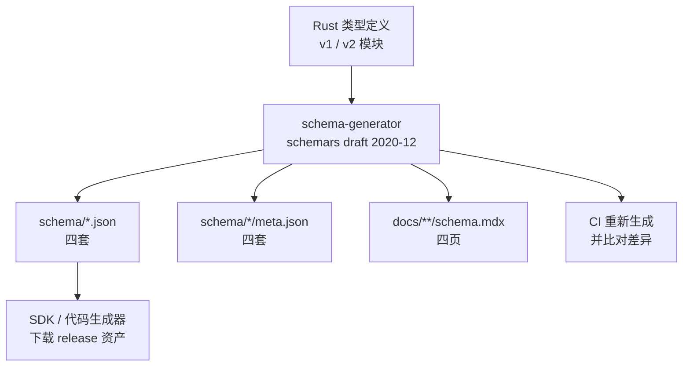

# Schema 生成管线

这份协议最值得学的工程决策，不是某个方法的设计，而是**协议规范以 Rust 类型的形式存在**。规范正文、JSON Schema、各语言 SDK 的类型，全都从同一份类型出发；改协议就是改类型，而不是「先改文档再改代码」。

## 一条从类型到产物的流水线

读这张图的重点是**没有回头路**：箭头只有从类型指向产物，没有从产物指回类型。生成器是一个独立 crate（`schema-generator`），它把类型的 schemars 投影写进 `schema/` 与 `docs/`；CI 再跑一遍生成并比对，有差异就判失败，从而保证仓库里提交的产物永远等于类型的投影。

## 四个编译组合，四套互不覆盖的产物

生成器用编译期特性区分要生成哪一套。每个组合独占自己的文件名，所以四次生成可以任意顺序执行，不会互相覆盖。

| 编译组合 | Schema 文件 | 元数据文件 | 文档页 | 文档链接前缀 |
|---------|------------|-----------|--------|-------------|
| 默认（稳定 v1） | `schema/v1/schema.json` | `schema/v1/meta.json` | `docs/protocol/v1/schema.mdx` | `/protocol/v1/` |
| v1 + unstable | `schema/v1/schema.unstable.json` | `schema/v1/meta.unstable.json` | `docs/protocol/v1/draft/schema.mdx` | `/protocol/v1/draft/` |
| v2（稳定面） | `schema/v2/schema.json` | `schema/v2/meta.json` | `docs/protocol/v2/schema.mdx` | `/protocol/v2/` |
| v2 + unstable | `schema/v2/schema.unstable.json` | `schema/v2/meta.unstable.json` | `docs/protocol/v2/draft/schema.mdx` | `/protocol/v2/draft/` |

一次 `npm run generate` 会依次跑完这四次，再统一格式化。

## 每类产物里装了什么

| 产物 | 内容 | 谁来消费 |
|------|------|---------|
| `schema.json` | draft 2020-12 的根 Schema。根是一个 `anyOf`，区分 Agent 侧消息、Client 侧消息与协议级通知；所有类型进 `$defs` | SDK 作者、代码生成器、编辑器做消息校验 |
| `meta.json` | 三个方法名映射：`agentMethods`、`clientMethods`、`protocolMethods`，外加该 Schema 描述的协议版本号 | SDK 作者：方法名不用手抄，从元数据读 |
| `schema.mdx` | 文档站的 Schema 参考页：按 Agent / Client / 协议级分区，按方法聚合类型并给出字段说明 | 读文档的人与站点检索 |
| `schema/*/CHANGELOG.md` | Schema 产物自己的版本历史，由约定式提交驱动 | 升级时判断产物变化 |

`meta.json` 的价值容易被低估：它是「协议里到底有哪些方法」的机器可读答案，因为方法名常量定义在 Rust 侧、经生成器落到 JSON，所以方法名不会在文档、SDK 与实现之间各写一份。

## 让产物与实现绑定：注解与反向测试

生成器本身只做投影，真正保证「类型怎么说、产物就怎么长」的是一组**反向测试**——它们不看产物，而是回到源码里找模式，再要求测试产生的 Schema 与之吻合。

| 测试关注点 | 做法 |
|-----------|------|
| 宽容反序列化必须可被生成器看见 | 扫描 `src/v1`、`src/v2` 里所有 `DefaultOnError` 字段，要求其下一行带 `x-deserialize-default-on-error` 注解；用到 `VecSkipError` 的还要求 `x-deserialize-skip-invalid-items`，让 SDK 生成器知道这个字段会「跳过坏元素」 |
| `_meta` 字段必须宽容 | 所有 `pub meta` 字段必须同时具备 `DefaultOnError` 与对应注解 |
| 产物里的注解确实生效 | 反向检查生成的 Schema 中，这些字段同样带上了扩展键 |
| 稳定面不夹带实验内容 | 断言某些已稳定的类型（如通知、压缩）在没有 unstable 特性时也存在且描述里不含「UNSTABLE」 |
| 版本文档链接正确 | 断言发布的 v2 Schema 里的协议文档链接指向 `/protocol/v2/...`，且没有出现重复路径 |

这些测试的取向是一致的：**它们锁定的是「源码标注」与「生成产物」之间的一致性**，而不是某个具体字段长什么样。字段可以随便改，只要忘了补注解、或注解与产物对不上，测试就会失败。

## 生成器里两个不显眼的机制

**侧别与方法归属靠 Schema 扩展传递。** 类型上通过 schemars 扩展标注 `x-side`（`agent` / `client` / `protocol`）与 `x-method`，生成器据此把 `$defs` 里的类型按「谁实现的方法」分组，产出文档页的分区结构；标了 `x-docs-ignore` 的类型则被排除在文档之外。

**方法文档来自 rustdoc JSON。** 为了让生成的 Schema 参考页能按方法给出说明，生成器会在运行时调用 `cargo +nightly rustdoc --output-format json`，读取类型与枚举变体上的文档注释，再与 `x-side` / `x-method` 分组对账。这也是为什么仓库的 CI 需要同时准备 stable 与 nightly 两套工具链——生成文档页这一步依赖 nightly 的 rustdoc JSON 输出。

## 代价与边界

- **生成产物入库**：`schema/*.json` 与四页 `schema.mdx` 都提交进仓库，好处是消费者可以直接下载、diff、审计，代价是每次改类型都必须重新生成并提交，忘掉就会被 CI 拦下。
- **需要 nightly**：因为文档页依赖 rustdoc JSON，完整跑一遍生成不能只用 stable 工具链。
- **格式权威在类型，语义权威在文档**：生成的 Schema 能保证结构一致，但不保证「这段说明写得对不对」；语义仍由 `docs/protocol/` 下的规范正文负责，协议规则要求改方法时同步更新文档。
- **实验特性会被带进 unstable 产物**：unstable Schema 是特性开关的并集，它比稳定 Schema 大不少（v1 稳定约 255 KB，unstable 约 393 KB），使用方需要自己判断该以哪一份为准。

> 依据：`schema-generator/src/main.rs:53-116`、`schema-generator/src/main.rs:117-160`、`schema-generator/src/main.rs:162-268`、`schema-generator/src/main.rs:272-297`、`schema-generator/src/main.rs:979-1055`、`schema-generator/src/main.rs:1142-1250`、`schema-generator/src/main.rs:2360-2478`、`package.json:18-23`、`.github/workflows/ci.yml`、`schema/v1/meta.json:1-34`、`docs/protocol/v1/schema.mdx:1-25`、`agent-client-protocol-schema/src/lib.rs:12-45`、`agent-client-protocol-schema/src/serde_util.rs:29-60`、`AGENTS.md:27-39`
