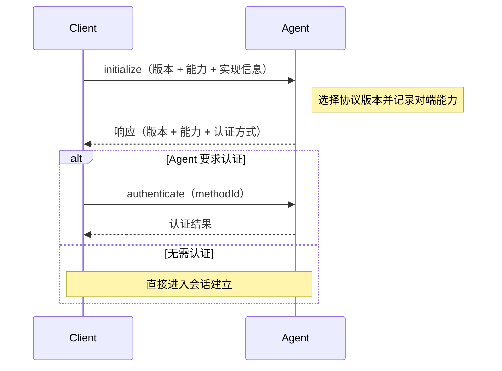
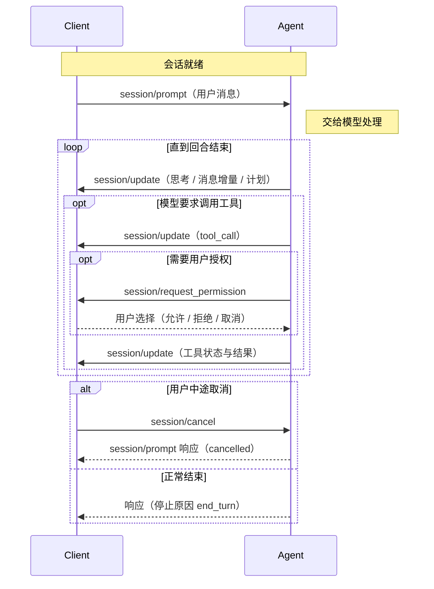
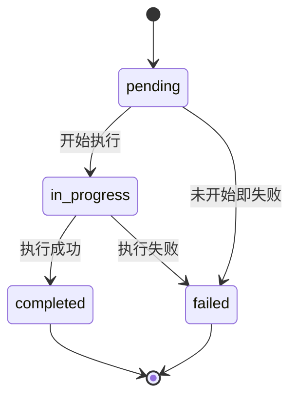

# 会话与回合生命周期

协议的方法很多，但真实使用只有一条主线：**连接 → 建立会话 → 一个回合接一个回合 → 关闭**。这页按这条主线走一遍，并说清每一步的确认语义——协议对「什么时候算完成」定义得很细，因为界面要靠它决定状态灯。

## 阶段一：初始化与认证

连接建立后，Client 必须先发 `initialize`，协商三件事：协议版本、双方能力、认证方式。

几点容易踩错的语义：

| 规则 | 内容 |
|------|------|
| 版本选择 | Client 发自己支持的最新版本；Agent 支持就回同一个版本，否则回自己支持的最新版本 |
| 版本不接受 | Client 若不支持 Agent 回的版本，应当关闭连接并告知用户，而不是硬着头皮继续 |
| 能力缺省 | 未出现的能力一律按不支持处理，实现方必须显式声明 |
| 认证方式 | Agent 在响应里给出 `authMethods`；Client 按其类型定义的流程执行 `authenticate` |

## 阶段二：进入一个会话

初始化完成后，Client 有三种方式进入会话，代价各不相同。

| 方式 | 前置能力 | 行为 | 适用 |
|------|---------|------|------|
| `session/new` | 无（基线） | 新建会话上下文，连接给定的 MCP 服务器，返回 `sessionId` | 开新话题 |
| `session/load` | Agent 的 `loadSession` | 恢复上下文，并**先回放完整历史**（以 `session/update` 通知形式），再返回响应 | 用户切回旧会话，界面要补齐历史 |
| `session/resume` | `sessionCapabilities.resume` | 恢复上下文，**不回放**，直接返回 | 界面自己已有历史，只要接回上下文 |

会话建立时可以带三样东西：工作目录（必填，绝对路径）、要连接的 MCP 服务器列表、以及可选的工作区附加根目录（需要 `sessionCapabilities.additionalDirectories`）。

除了进入会话，还有一组会话管理方法，它们**都是可选的**，Client 必须先看能力再调用：

| 方法 | 能力门槛 | 作用 |
|------|---------|------|
| `session/list` | `sessionCapabilities.list` | 分页列出 Agent 已知的会话，供界面展示历史 |
| `session/close` | `sessionCapabilities.close` | 取消该会话进行中的工作并释放资源；会话之后不再活跃 |
| `session/delete` | `sessionCapabilities.delete` | 从 `session/list` 结果中移除，属于历史清理 |
| `session/fork` | 实验特性 | 从现有会话分叉出新会话 |

## 阶段三：一个 prompt 回合

回合是协议里信息密度最高的一段：一次 `session/prompt` 请求可能触发多次模型调用与多轮工具执行，其间 Agent 用通知持续汇报，必要时反向向 Client 要授权。

这段流程里有三处「必须先确认」的硬性要求，界面状态直接依赖它们：

| 时刻 | 协议要求 |
|------|---------|
| 回合结束 | Agent **必须**对最初的 `session/prompt` 请求给出响应，并携带停止原因 |
| 取消 | Agent 收到 `session/cancel` 后应尽快停止模型请求与工具执行，并在所有待发更新发完之后，用 `cancelled` 停止原因回应原请求 |
| 取消副作用 | 底层库被中断时常抛异常；协议要求 Agent 捕获它们并翻译成 `cancelled`，因为对用户而言取消不是错误 |
| 权限悬空 | Client 在发出取消后，**必须**把所有待处理的权限请求以 `cancelled` 结果回应 |

停止原因共五种：`end_turn`（模型正常说完）、`max_tokens`（触到 token 上限）、`max_turn_requests`（单回合内模型请求次数超限）、`refusal`（Agent 拒绝继续）、`cancelled`（被 Client 取消）。

## 回合期间都在推什么

Agent 的过程汇报全部走 `session/update` 这一条通知通道，由其中的 `sessionUpdate` 字段决定这是哪一类更新。v1 的完整变体集合如下——它基本就是「界面上能看到的一切」。

| `sessionUpdate` 取值 | 含义 |
|---------------------|------|
| `user_message_chunk` | 用户消息的流式片段（回放历史时也会用到） |
| `agent_message_chunk` | Agent 回复的流式片段 |
| `agent_thought_chunk` | Agent 推理过程的流式片段 |
| `tool_call` | 新建一次工具调用 |
| `tool_call_update` | 工具调用的状态或结果变化 |
| `plan` | Agent 的执行计划 |
| `available_commands_update` | 可用的斜杠命令集合发生变化 |
| `current_mode_update` | 当前会话模式变化 |
| `config_option_update` | 会话配置项（模型、思考等级等）变化 |
| `session_info_update` | 会话元数据（标题、更新时间）变化 |
| `usage_update` | 上下文窗口用量与累计花费 |
| `notice` | 面向用户的即时提示，不进会话历史（需 Client 的 `session.notices` 能力） |
| `compaction_update` | 创建或更新一次上下文压缩（需 `session.compaction` 能力） |
| `compaction_summary_chunk` | 向压缩保留的摘要追加内容（同上） |

这些更新**不限于回合进行中**：Agent 可以在建立会话后立刻广告命令，也可以在 `session/load` 时回放历史，将来还可能推送非用户发起的后台工作进展——v2 正是把这一点明确下来（见下）。

## 工具调用的状态流转

工具调用是回合里唯一有明确状态机的实体，界面通常直接照搬这四个状态：

注意 v1 的正式状态只有这四个；取消发生时协议并不要求 Agent 补发一个新的「已取消」状态，而是由 Client 在发出 `session/cancel` 时**先行**把自己界面上未完成的工具调用标记为已取消，Agent 侧则以停止原因 `cancelled` 收尾。

## v2 把「回合」这一层拆开了

v1 把「消息被接受」和「回合结束」绑在同一个请求上：`session/prompt` 会一直挂起到模型干完活，响应里带停止原因。这在只有「用户说一句、Agent 答一段」时够用，但表达不了排队消息、后台工作、多个界面同时观察同一会话。

v2 因此改了语义：`session/prompt` 的响应只表示**用户消息已经插入会话**（返回该消息的 `messageId`），进程状态改由新的 `state_update` 通知承载。

| 想表达的事 | v1 的做法 | v2 的做法 |
|-----------|----------|----------|
| 提示词已被接受 | 隐式 | `session/prompt` 响应带 `messageId` |
| 用户消息进入历史 | 隐式（请求本身） | `user_message` 更新，使用同一个 `messageId` |
| 前台正在干活 | `session/prompt` 还挂着 | `state_update`，`state: "running"` |
| 前台在等用户 | 隐式（权限请求挂着） | `state_update`，`state: "requires_action"` |
| 前台结束 | 响应里的停止原因 | `state_update`，`state: "idle"` + 停止原因 |
| 失败 | 请求返回错误 | 空闲 `state_update` 带 `stopReason: "error"`（仅在消息已插入之后） |

一个关键推论：v2 里 `session/prompt` 返回错误**只代表消息没被插入**；一旦插入成功，之后无论成功、失败还是被取消，都通过通知汇报。这解决了 v1 时代「取消被包装成异常、界面弹出无意义报错」的经典问题，也让历史回放、多客户端观察、后台工作复用同一套消息流。

> 依据：`docs/protocol/v1/initialization.mdx:1-100`、`docs/protocol/v1/session-setup.mdx:45-330`、`docs/protocol/v1/prompt-turn.mdx:10-81`、`docs/protocol/v1/prompt-turn.mdx:452-586`、`docs/protocol/v1/session-list.mdx:35-225`、`docs/protocol/v1/session-delete.mdx:33-89`、`docs/protocol/v2/migration.mdx:257-359`、`docs/protocol/v2/migration.mdx:610-676`、`agent-client-protocol-schema/src/v1/tool_call.rs:514-532`、`agent-client-protocol-schema/src/v1/agent.rs:3192-3211`、`agent-client-protocol-schema/src/v2/agent.rs:3343-3373`
