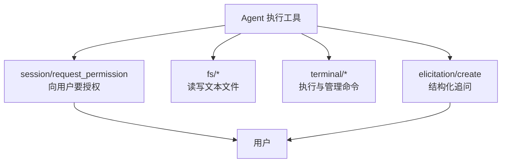
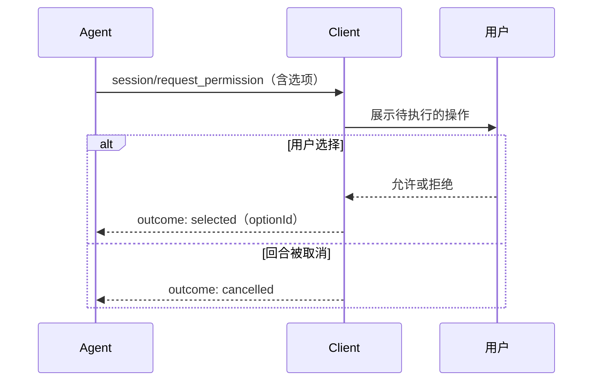

# 工具调用与权限

Agent 自己决定要不要调工具，但**工具能不能碰到用户的机器，由编辑器说了算**。协议把这条界线画在能力协商上：Client 在 `initialize` 里声明自己愿意提供哪些能力，Agent 只能用其中被声明的那部分；而每一次敏感操作之前，Agent 还可以再问用户一次。

## Client 提供的四个能力面

四个面各自独立协商，可以只开一部分。这也是为什么协议反复强调「声明—检查」：Agent 在使用任何一个面之前，必须先确认 Client 声明了对应能力，否则应当优雅退化而不是直接失败。

| 能力面 | 声明位置 | 提供的方法 |
|--------|---------|-----------|
| 文件读写 | `clientCapabilities.fs` | `fs/read_text_file`、`fs/write_text_file` |
| 终端执行 | `clientCapabilities.terminal` | `terminal/create`、`terminal/output`、`terminal/wait_for_exit`、`terminal/kill`、`terminal/release` |
| 用户授权 | 无门槛（基线方法） | `session/request_permission` |
| 结构化追问 | `clientCapabilities.elicitation`（按模式） | `elicitation/create`、`elicitation/complete` |

## 用户授权：一次请求，四种答案

授权请求是**反向调用**：Agent 发起 `session/request_permission`，Client 呈现界面并把用户的选择作为响应返回。

Agent 提供的是**选项列表**，每项有唯一 `optionId`、展示名与一个语义提示 `kind`：

| `kind` | 含义 |
|--------|------|
| `allow_once` | 只允许这一次 |
| `allow_always` | 允许并记住选择 |
| `reject_once` | 只拒绝这一次 |
| `reject_always` | 拒绝并记住选择 |

两条容易被忽略的约定：Client **可以**按用户设置自动允许或自动拒绝，而不弹窗；但一旦当前回合被取消，待处理的权限请求**必须**返回 `cancelled` 结果——否则 Agent 会一直等一个永远不会来的答案。

## 工具调用怎么被汇报

Agent 不对 Client 暴露「工具函数」，只汇报**调用**。一次工具调用通过 `session/update` 的 `tool_call` 变体创建，之后用 `tool_call_update` 增量更新。关键字段：

| 字段 | 作用 |
|------|------|
| `toolCallId` | 会话内唯一标识，后续所有更新靠它对齐 |
| `name` | 可选的程序化工具名（如 `read_file`），仅作展示与统计，不构成能力或授权语义 |
| `title` | 必填的人类可读标题，说明这次工具在做什么 |
| `kind` | 工具类别：读取、编辑、删除、移动、搜索、执行、获取、思考、其它 |
| `status` | 状态机取值：`pending`、`in_progress`、`completed`、`failed` |
| `content` | 结果内容，见下表 |
| `locations` | 受影响的文件位置，界面据此跟随 Agent 的视线 |

内容与结果支持的形态：

| 类型 | 用途 |
|------|------|
| 普通内容块 | 文本、图片、资源等，与消息共用同一套 `ContentBlock` 结构 |
| 文件 Diff | 以旧文本/新文本形式给出改动，供编辑器渲染差异视图 |
| 终端引用 | 把某次终端执行嵌入工具调用，界面可直接展示命令与输出 |

## 文件与终端方法族

文件系统只提供最基础的两个动作，够 Agent 读取编辑器里的未保存状态、并让编辑器感知 Agent 改了哪些文件：

| 方法 | 参数要点 | 说明 |
|------|---------|------|
| `fs/read_text_file` | 绝对路径、可选行区间与行数上限 | 读取 Client 环境中的文本文件 |
| `fs/write_text_file` | 绝对路径、内容 | 写入文本文件 |

终端方法族把「执行一个命令」拆成创建与轮询两步，好处是输出可以增量获取、进程可以单独被杀掉：

| 方法 | 说明 |
|------|------|
| `terminal/create` | 以命令、参数、环境变量、绝对工作目录创建终端，立即返回终端 ID 与是否已有输出 |
| `terminal/output` | 取回自上次读取以来的新增输出与退出状态，可在不阻塞的情况下轮询 |
| `terminal/wait_for_exit` | 等待命令退出（可带超时） |
| `terminal/kill` | 杀掉命令但保留终端，便于读取退出信息 |
| `terminal/release` | 释放终端及其资源 |

「带超时的执行」不是单独的方法，而是组合出来的：创建后用 `wait_for_exit` 带超时等待，超时则 `terminal/kill`，再用 `terminal/output` 读取结果。

## 结构化追问：两种模式

`elicitation/create` 让 Agent 向用户要结构化输入，并刻意分成两种模式——非敏感数据走表单，敏感流程走带外。

| 模式 | 形态 | 典型用途 | Client 的强制义务 |
|------|------|---------|------------------|
| form | 受限 JSON Schema 描述的表单 | 让用户补一段配置、选一个选项 | 必须让用户**先审阅、可修改**再提交 |
| url | 打开外部 URL 完成交互 | OAuth 授权等敏感流程 | 必须**展示目标主机**并在跳转前取得同意 |

能力的表达方式很严格：`elicitation` 字段缺省或为 `null` 表示完全不支持；某个模式只有在对应字段**显式存在且非空**时才算支持；`{}` 这样的空对象不代表任何模式——这一点与 MCP 的语义刻意不同，协议正文专门标注了差异。相应的，Agent 不得请求 Client 没有声明的模式，并应准备降级方案。

## 这套信任边界的代价

协议的设计哲学里写得很直白：ACP 成立的前提是**用户信任正在对话的模型**。编辑器会给 Agent 访问本地文件与 MCP 服务器的能力，用户仍能控制工具调用，但协议本身不提供沙箱或隔离。因此安全评估的落脚点不在协议，而在每个 Client 如何实现授权界面、默认策略与凭据管理。

v2 进一步做了减法：整个「Client 提供文件系统与终端执行」的面被移除（`fs/*`、`terminal/*` 及其能力声明全部删除）。理由写在迁移指南里——这套接口在少数 IDE 之外实现得并不一致，而 Agent 本来就得为不支持它的 Client 自备文件与执行能力，于是成了两套并行路径。v2 建议需要暴露文件或命令执行能力的 Client **改用 MCP 服务器**，把这些工具放到与其它工具同等的地位上。相应地，v2 新增的终端相关类型只用于 Agent 侧展示自己执行的命令输出，不再代表一份 Client 资源。

> 依据：`docs/protocol/v1/tool-calls.mdx:12-337`、`docs/protocol/v1/file-system.mdx:8-117`、`docs/protocol/v1/terminals.mdx:8-282`、`docs/protocol/v1/elicitation.mdx:15-194`、`docs/protocol/v1/initialization.mdx:114-215`、`docs/get-started/architecture.mdx:8-16`、`docs/protocol/v2/migration.mdx:666-703`
